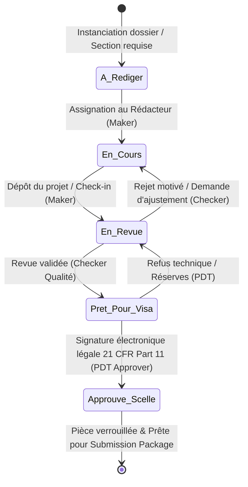
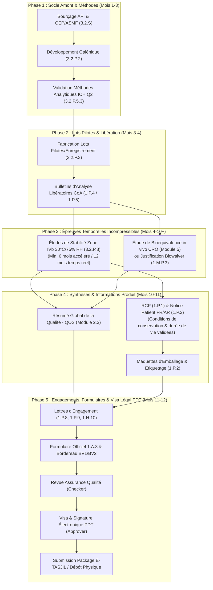

# Cahier des charges fonctionnel & technique détaillé
## Plateforme collaborative de gestion de l'enregistrement des médicaments, de l'homologation des dispositifs médicaux et GED pharmaceutique en Algérie

**Version :** 1.0 (Harmonisation Réglementaire ANPP & Lignes Directrices Officielles) — Novembre 2026.  
**Documents sources et référentiels officiels de l'ANPP intégrés :**
1. **Guide pour la soumission du Dossier Technique Commun (CTD)** destiné à l'enregistrement des produits pharmaceutiques à usage humain (DEPP/ANPP, Version 01, Date d'effet : 31/07/2025).
2. **Ligne directrice relative aux modifications des décisions d’enregistrement** des produits pharmaceutiques à usage de la médecine humaine (Code : `LD-DEPP07/V01`, Version 01, Date : 22/04/2026).
3. **Décret exécutif n° 20-325** du 22 novembre 2020 relatif aux modalités d'enregistrement des produits pharmaceutiques.
4. **Arrêté du 26 Safar 1443 (3 octobre 2021)** fixant les modalités de modification de la décision d'enregistrement des produits pharmaceutiques à usage humain.
5. **Arrêté du 07 novembre 2021** (Notamment article 09 régissant le regroupement des modifications - *Grouping*).
6. **Décret exécutif n° 20-324** et **Arrêté du 10 mai 2021** fixant les modalités d'homologation des dispositifs médicaux (DM).

---

## 1. Contexte, Cadre Juridique et Objectifs Stratégiques

### 1.1 Contexte Réglementaire Algérien
En Algérie, la mise sur le marché d'un médicament à usage de la médecine humaine est soumise à l'obtention d'une **Décision d'Enregistrement (DE)**, délivrée après évaluation technique, pharmaceutique, biologique, préclinique et clinique par la **Direction de l'Enregistrement des Produits Pharmaceutiques de l'Agence Nationale des Produits Pharmaceutiques (ANPP/DEPP)**. De même, les dispositifs médicaux (DM) et dispositifs médicaux de diagnostic in vitro (DMDIV) sont assujettis à une **Décision d'Homologation**.

Deux textes fondamentaux publiés par l'ANPP structurent l'ensemble du cycle de vie des médicaments :
1. **Le Guide CTD ANPP (Juillet 2025) :** Instaure l'exigence du format CTD (Common Technical Document - Modules 1 à 5) pour toute soumission d'enregistrement initial, de renouvellement quinquennal et de variation, en formalisant les exigences spécifiques pour les produits princeps (innovateurs), génériques importés et génériques fabriqués localement.
2. **La Ligne Directrice des Modifications LD-DEPP07/V01 (Avril 2026) :** Établit la nomenclature algérienne des modifications post-enregistrement en trois classes rigoureuses : **Modification Mineure (Mmin)**, **Modification Modérée (Mmod)** et **Modification Majeure (Mmaj)**, rompant définitivement avec les terminologies étrangères obsolètes (Types IA/IB/II européens). Elle formalise également le principe de reclassement automatique en cas de non-respect d'une condition et la possibilité de regroupement de modifications (*Grouping*, article 09 de l'arrêté du 07/11/2021).

### 1.2 Objectifs de la Plateforme "Homolog"
- **Centraliser et piloter le cycle de vie complet 360°** de tous les dossiers d'enregistrement de médicaments et d'homologation de DM au sein d'une instance unique.
- **Assurer la conformité native au format CTD ANPP 2025** : instancier automatiquement les checklists et arborescences selon le type de produit (Princeps, Générique importé, Générique local) et le type de procédure (**NI**, **RI**, **MI**, **NF**, **RF**, **MF**).
- **Intégrer un Coffre-Fort GED Pharmaceutique (Standard BPF / ALCOA+)** garantissant l'intégrité, la gestion des versions (mineures/majeures), les circuits d'approbation et la signature électronique légale du Directeur Technique.
- **Intégrer un Atelier d'Élaboration Documentaire et Workflow Multi-Rôles BPF (Maker-Checker-Approver)** : dépasser la simple collecte passive de fichiers existants en fournissant un environnement collaboratif de rédaction technique décentralisée (Affaires Réglementaires, Contrôle Qualité, R&D, Production, Assurance Qualité, Partenaires externes). Le Pharmacien Directeur Technique n'étant pas le rédacteur unique mais le garant légal et pénal exclusif (Approver - Décret exécutif 20-325), la plateforme orchestre la chaîne complète : Rédaction (*Maker*) ➔ Revue Qualité/Pair (*Checker*) ➔ Visa Légal Scellé (*Approver*), adossée à une bibliothèque de modèles maîtres conformes ICH/ANPP et à un générateur automatique de formulaires/engagements réglementaires en 1 clic.
- **Intégrer un Moteur Intelligent de Variations (LD-DEPP07/V01)** : détecter l'impact d'une modification documentaire, qualifier le type de modification (Mmin, Mmod, Mmaj) parmi les 34 rubriques réglementaires, vérifier les conditions, exécuter le reclassement dynamique et générer automatiquement le dossier complet de modification (avec tableau comparatif *État actuel vs Proposé* et attestation de non-modification des autres sections).
- **Anticiper les échéances critiques et péremptions** : renouvellements quinquennaux à J-180/J-90, réponses aux compléments ANPP avec compte à rebours légal, expiration des certificats BPF, CEP et licences d'exploitation.
- **Automatiser et sécuriser l'articulation avec les télé-procédures ANPP (Module ANPP Submission Assistant)** : génération automatique des bordereaux officiels (BV1/BV2, récépissés, formulaires d'homologation DM), export du Submission Package prêt pour le portail E-TASJIL (`etasjil.anpp.dz`), calendrier intelligent d'ouverture des créneaux de RDV (`rdvpp.anpp.dz` / `rdvdm.anpp.dz`), et architecture API-Ready pour future télétransmission directe.
- **Garantir la souveraineté numérique et la flexibilité hybride** : déployable en mode On-Premise 100 % hors-ligne (en intranet sécurisé de laboratoire) ou en mode Cloud SaaS souverain multi-tenant avec réversibilité absolue via l'archive chiffrée `.homolog`.
- **Offrir une ergonomie "Pharma Explorer" haute densité** : navigation 3 volets inspirée de Windows Explorer Pro, affichage compact (32px par ligne), volet de prévisualisation PDF instantané et bilinguisme intégral FR/AR avec support RTL natif.

---

## 2. Typologie des Procédures et Matrice CTD ANPP (Guide Juillet 2025)

### 2.1 Les 6 Parcours Officiels de Soumission
La plateforme distingue nativement les six codes de procédure définis par l'ANPP :

| Code ANPP | Intitulé officiel de la procédure | Portée | Périmètre documentaire principal |
|---|---|---|---|
| **NI** | **Enregistrement Initial d’un produit Importé** | Médicaments fabriqués à l'étranger importés en Algérie | Dossier CTD complet + CPP + Prix FOB Chambre Commerce + Benchmark |
| **RI** | **Renouvellement de la DE d'un produit Importé** | Renouvellement quinquennal d'un produit importé | Module 1 actualisé + Déclaration de non-modification + BPF/CPP à jour |
| **MI** | **Modification d’un produit Importé** | Variations administratives ou qualitatives | Dossier de modification ciblé + Approbation pays d'origine + Sections CTD modifiées |
| **NF** | **Enregistrement Initial d’un produit Fabriqué localement** | Médicaments produits sur un site industriel national | CTD complet + Structure de prix PCSU + Dossiers lots validation + Non-commercialisation |
| **RF** | **Renouvellement de la DE d’un produit Fabriqué localement** | Renouvellement quinquennal production locale | Module 1 + Déclaration de non-modification + BPF national + Revue qualité produit |
| **MF** | **Modification d’un produit Fabriqué localement** | Variations administratives ou techniques locales | Dossier de variation ciblé + Données comparatives de lots/stabilité + Sections CTD |

### 2.2 Structure des 5 Modules CTD selon le Type d'Origine
Conformément au tableau récapitulatif officiel de l'ANPP :

```
                                 ┌──────────────────────────────────────────────────────────┐
                                 │                STRUCTURE GLOBALE CTD ANPP                │
                                 └────────────────────────────┬─────────────────────────────┘
                                                              │
                     ┌────────────────────────────────────────┴────────────────────────────────────────┐
                     ▼                                                                                 ▼
     ┌───────────────────────────────┐                                                 ┌───────────────────────────────┐
     │       PRODUIT PRINCEPS        │                                                 │       PRODUIT GÉNÉRIQUE       │
     │      (Médicament Innovant)    │                                                 │    (Importé ou Localisé)      │
     ├───────────────────────────────┤                                                 ├───────────────────────────────┤
     │ Module 1 : Administratif [E]  │                                                 │ Module 1 : Administratif [E]  │
     │ Module 2 : Résumés [E]        │                                                 │ Module 2 : Incorporé (3, 4, 5)│
     │ Module 3 : Qualité [E]        │                                                 │ Module 3 : Qualité [E]        │
     │ Module 4 : Non Clinique [E]   │                                                 │ Module 4 : Facultatif [F]     │
     │ Module 5 : Clinique [E]       │                                                 │ Module 5 : Bioéquivalence [P] │
     └───────────────────────────────┘                                                 └───────────────────────────────┘
     [E] = Exigé obligatoirement      [F] = Facultatif (ANPP peut exiger à tout moment)   [P] = Partiellement requis (BE/BA)
```

- **Règle Princeps :** Modules 1, 2, 3, 4 et 5 obligatoirement exigés (`E`).
- **Règle Générique :**
  - **Module 1 :** Exigé (`E`) dans son intégralité selon les exigences algériennes.
  - **Module 2 :** Non requis sous forme de classeurs isolés 2.1 à 2.7 ; les résumés et synthèses sont directement incorporés dans les modules 3, 4 et 5.
  - **Module 3 :** Exigé (`E`) à l'identique d'un princeps (Substance Active 3.2.S, Produit Fini 3.2.P, Documentation régionale 3.2.R).
  - **Module 4 :** Facultatif (`F`) : non requis lors de la soumission initiale, mais l'ANPP se réserve formellement le droit d'exiger des données de toxicité ou pharmacologie si des impuretés nouvelles ou des excipients nouveaux apparaissent.
  - **Module 5 :** Partiellement requis (`P`) : focalisé impérativement sur la démonstration de la bioéquivalence (5.3.1.2) ou son exonération légitime (*Biowaiver* justifié en 1.M.P.3), les méthodes bioanalytiques humaines (5.3.1.4), et la tolérance clinique.

---

## 3. Spécification Exhaustive du Module 1 (Spécificités ANPP Algérie)

Le Module 1 est découpé en quatre sous-sections normalisées (`1.A`, `1.H`, `1.M`, `1.P`). Chaque pièce possède un identifiant strict, un titre légal et des conditions d'exigibilité selon le vecteur de soumission (NI, RI, MI, NF, RF, MF) :

### 3.1 Sous-Module 1.A : APPLICANT (Demandeur & Établissement)

| Réf. ANPP | Désignation de l'exigence documentaire | NI | RI | MI | NF | RF | MF | Règles métier de validation |
|---|---|:---:|:---:|:---:|:---:|:---:|:---:|---|
| **1.A.1** | Récépissé de dépôt du dossier | E | E | E | E | E | E | Document scanné avec numéro d'enregistrement ANPP et horodatage |
| **1.A.2** | Courrier de demande officiel | E | E | E | E | E | E | À en-tête du laboratoire, signé par le Pharmacien Directeur Technique |
| **1.A.3** | Formulaire de demande parafé, daté, signé et cacheté par le PDT | E | E | E | E | E | E | Formulaire officiel ANPP, paraphes sur chaque page, signature et cachet DT |
| **1.A.4** | Bordereau de versement + document bancaire / quittance ou autres + Attestation de taux de change si applicable | E | E | E | E | E | E | Preuve de paiement des redevances réglementaires, attestation de change Banque d'Algérie si devises |
| **1.A.5** | Copie de la réponse à la demande de pré-soumission (+ copie justificatif de paiement + BV) | E | NA | E | E | NA | E | Obligatoire pour NI, MI, NF, MF. Accord formel de pré-soumission de l'ANPP |
| **1.A.6** | Agrément d'exploitation / Fabrication / Sous-traitance | E | E | E | E | E | E | Agrément en cours de validité délivré par le Ministère de l'Industrie Pharmaceutique |
| **1.A.7** | Décision d'exercice du Pharmacien Directeur Technique (PDT) | E | E | E | E | E | E | Décision ministérielle nominative nommant le DT responsable |
| **1.A.8** | Copie des Contrats (exploitation, façonnage, sous-traitance et tout autre accord qualité) | E | E | E | E | E | E | Contrats liant le demandeur aux différents sites et détenteurs |
| **1.A.9** | Copie(s) de la DE, des approbations et des accusés des anciens dépôts (récépissés, notifications, paiements antérieurs) | NA | E | E | NA | E | E | Historique complet indispensable pour les renouvellements et variations |

### 3.2 Sous-Module 1.H : HOLDER (Détenteur de la Décision d'Enregistrement)

| Réf. ANPP | Désignation de l'exigence documentaire | NI | RI | MI | NF | RF | MF | Règles métier de validation |
|---|---|:---:|:---:|:---:|:---:|:---:|:---:|---|
| **1.H.1** | Courrier de demande du détenteur | E | E | E | E | E | E | Courrier officiel autorisant le demandeur local à déposer |
| **1.H.2** | Autorisation de Mise sur le Marché (original ou copie certifiée conforme) | E | E | E | E | E | E | AMM délivrée dans le pays d'origine par l'autorité compétente |
| **1.H.3** | Certificat de Produit Pharmaceutique (CPP - Modèle OMS) | E | E | E | E | E | E | CPP légalisé/apostillé conforme au modèle de certification OMS |
| **1.H.4** | Structure de prix (PCSU Fabrication) / Attestation de prix FOB Algérie visée Chambre de Commerce | E | E | E | E | E | E | Structure PCSU (Prix de Revient/Sortie Usine) pour le local (NF/RF/MF) ; Attestation FOB visée pour l'import (NI/RI/MI) |
| **1.H.5** | Dossier BENCHMARK de prix international | E | E | E | NA | NA | NA | Comparatif de prix dans les pays de référence (obligatoire pour importations) |
| **1.H.6** | Approbation de la variation par le pays d'origine | NA | NA | E | NA | NA | E | Preuve que la modification est approuvée dans le pays d'origine (ou justification) |
| **1.H.7** | Descriptif de la mise à jour signé | NA | NA | E | NA | NA | E | Document de synthèse expliquant le rationnel technico-réglementaire |
| **1.H.8** | Liste des sites intervenants dans la fabrication des substances actives et du produit fini (signée et visée) | E | E | E | E | E | E | Cartographie exhaustive des sites (SA, intermédiaires, PF, conditionnement, contrôle) |
| **1.H.9** | Déclaration de similarité | E | NA | NA | E | NA | NA | Attestation certifiant la similarité de composition et procédé |
| **1.H.10** | Déclaration de non-modification | NA | E | NA | NA | E | NA | Attestation formelle certifiant qu'aucune modification non autorisée n'a été opérée |
| **1.H.11** | Accord du détenteur actuel sur le transfert de la DE | NA | NA | E | NA | NA | E | Requis si la variation implique un transfert de titulaire de la DE |
| **1.H.12** | Attestation de déclaration de la date d’implémentation de la variation dans le pays d’origine | NA | NA | E | NA | NA | NA | Engagement sur la date de bascule industrielle dans le pays d'origine |

### 3.3 Sous-Module 1.M : MANUFACTURERS (Fabricants SA et Produit Fini)

| Réf. ANPP | Désignation de l'exigence documentaire | Cible | NI | RI | MI | NF | RF | MF | Exigences techniques clés |
|---|---|---|:---:|:---:|:---:|:---:|:---:|:---:|---|
| **1.M.S.1** | Agrément(s) du/des site(s) de fabrication SA (Manufacturing License) | API / SA | E | E | E | E | E | E | Licence de fabrication officielle de l'usine d'API |
| **1.M.S.2** | Certificat(s) BPF/GMP de conformité aux Bonnes Pratiques de Fabrication de la SA | API / SA | E | E | E | E | E | E | Certificat GMP valide émis par autorité compétente |
| **1.M.S.3** | Lettre d’accès / Certificate of Suitability (CEP) | API / SA | E | E | E | E | E | E | CEP EDQM valide avec déclaration d'accès nominative au nom du fabricant du FPP |
| **1.M.P.1** | Agrément d’ouverture d'établissement pharmaceutique (ML) | FPP (PF) | E | E | E | E | E | E | Licence d'établissement pour le fabricant du produit fini |
| **1.M.P.2** | Certificat(s) de conformité BPF/GMP du produit fini | FPP (PF) | E | E | E | E | E | E | Certificat BPF valide pour toutes les étapes de fabrication et conditionnement |
| **1.M.P.3** | Étude de bioéquivalence OU justificatif d’exonération de l'étude (Biowaiver) | FPP (PF) | E | NA | NA | E | NA | NA | Rapport clinique BE in vivo ou justification scientifique robuste (BCS classe I/III) |

### 3.4 Sous-Module 1.P : PRODUCT INFORMATION (Informations sur le Produit & Contrôle)

| Réf. ANPP | Désignation de l'exigence documentaire | NI | RI | MI | NF | RF | MF | Règles métier et contraintes |
|---|---|:---:|:---:|:---:|:---:|:---:|:---:|---|
| **1.P.1** | **Textes officiels pays d'origine :**<br>• 1.P.1.1 RCP d'origine<br>• 1.P.1.2 Notice d'origine<br>• 1.P.1.3 Étiquette d'origine | E | E | E | E | E | E | Documents approuvés dans le pays exportateur ou de référence |
| **1.P.2** | **Modèle Algérie (visé obligatoirement par le PDT) :**<br>• 1.P.2.1 RCP Modèle Algérie<br>• 1.P.2.2 Notice Modèle Algérie (Bilingue FR/AR)<br>• 1.P.2.3 Étiquette Modèle Algérie<br>• 1.P.2.4 Maquette Modèle Algérie (Conditionnement primaire & secondaire) | E | E | E | E | E | E | Textes conformes à la réglementation algérienne (notamment arabe obligatoire), maquettes en couleurs à échelle 100%, visées par le DT |
| **1.P.3** | Échantillons du produit fini | E | NA | E | E | NA | E | Enregistrement de la remise physique au laboratoire de contrôle de l'ANPP |
| **1.P.4** | Bulletin d'analyse de la substance active (avec granulométrie et polymorphisme) et son recontrôle | E | E | E | E | E | E | CoA du fabricant SA + bulletin de recontrôle complet par le fabricant du produit fini |
| **1.P.5** | Bulletin d’analyse du produit fini (et bulletin du prémix le cas échéant) | E | E | E | E | E | E | Certificat d'analyse libératoire complet conforme aux spécifications |
| **1.P.6** | Attestation de correspondance entre les lots | E | E | E | E | E | E | Traçabilité entre le lot soumis, le lot de bioéquivalence et les lots de stabilité |
| **1.P.7** | Certificat de libération de lot (précisant la libération pays d'origine / pays tiers) | E | E | E | E | E | E | Certificat officiel de libération par la personne qualifiée (QP/DT) |
| **1.P.8** | Lettre d’engagement de non-commercialisation des lots de validation | NA | NA | NA | E | NA | E | **Spécifique Fabrication Locale (NF/MF) :** Engagement formel signé du DT à ne pas commercialiser les lots industriels de validation avant l'obtention de la DE |
| **1.P.9** | Lettre d’engagement du demandeur à compléter les résultats des études de stabilité du PF | NA | NA | NA | E | NA | E | **Spécifique Fabrication Locale (NF/MF) :** Engagement à poursuivre les stabilités en temps réel (Zone IVa/IVb) et transmettre les résultats à l'ANPP |

---

## 4. Modules Techniques CTD 2, 3, 4 et 5 (Exigences et Spécificités Régionales)

### 4.1 Module 3 : Qualité Pharmaceutique, Chimique et Biologique
Le Module 3 est obligatoire (`E`) pour toutes les catégories (Princeps, Génériques importés, Génériques locaux). Le système intègre des contrôles stricts sur les éléments critiques imposés par l'ANPP :
1. **Partie 3.2.S (Substance Active) :**
   - Acceptabilité formelle du **CEP (Certificat de conformité à la Pharmacopée Européenne)** : la présence d'un CEP valide avec sa déclaration d'accès et ses annexes allège la documentation technique requise tout en garantissant la conformité analytique.
   - Contrôle obligatoire du **polymorphisme cristallin** et de la **granulométrie** (taille des particules) en 3.2.S.1.3 et 3.2.S.4.
2. **Partie 3.2.P (Produit Fini) :**
   - **Exigence spécifique fabrication locale (3.2.P.3.5) :** Dépôt obligatoire des dossiers complets de fabrication et de conditionnement des **lots industriels de validation** exécutés sur le site national.
   - Spécifications complètes à libération et à péremption (3.2.P.5.1).
3. **Partie 3.2.R (Informations Régionales Algériennes) :**
   - `3.2.R.1.1` : Exécution des documents de production (Master Batch Records exécutés).
   - `3.2.R.1.2` : Documents de production principaux (Formules cadres de fabrication et conditionnement).
   - `3.2.R.2` : Procédures analytiques et informations de validation sur site.

### 4.2 Module 5 : Données Cliniques et Bioéquivalence
Pour les médicaments génériques (importés et locaux), le moteur de checklist conditionne la recevabilité du dossier aux exigences suivantes :
- **5.3.1.2 Étude comparative de Biodisponibilité (BA) et Bioéquivalence (BE) :** Rapport complet de l'étude clinique in vivo démontrant la bioéquivalence du produit candidat vis-à-vis du produit princeps de référence (intervalle de confiance 90 % compris entre 80,00 % et 125,00 % sur $C_{max}$ et $AUC$).
- **5.3.1.4 Méthodes bioanalytiques et analytiques :** Validation complète selon les lignes directrices internationales (BPL/GCP).
- **Justification d'exonération (Biowaiver) :** En cas d'absence d'étude in vivo, rattachement obligatoire d'un dossier justificatif complet en 1.M.P.3 et 5.3.1.2 (profils de dissolution comparatifs multipoints à pH 1.2, 4.5, 6.8 et classification biopharmaceutique BCS).

---

## 5. Moteur Intelligent des Modifications (Ligne Directrice ANPP LD-DEPP07/V01)

### 5.1 Cadre Conceptuel et Règle d'Escalade Dynamique
L'ANPP classe toute modification post-approbation de la décision d'enregistrement en trois catégories exclusives :
1. **Modification Mineure (Mmin) :** Répercussions sur la qualité, la sécurité ou l'efficacité minimes ou nulles.
2. **Modification Modérée (Mmod) :** Impact potentiel sur la qualité, la sécurité ou l'efficacité.
3. **Modification Majeure (Mmaj) :** Répercussions significatives sur la qualité, la sécurité ou l'efficacité.

```
       ┌────────────────────────────────────────────────────────────────────────┐
       │             ALGORITHME DE QUALIFICATION & RECLASSEMENT ANPP            │
       └───────────────────────────────────┬────────────────────────────────────┘
                                           │
                                 Saisie de la variation
                             (Sélection parmi rubriques 1 à 34)
                                           │
                                           ▼
                       Évaluation des "Conditions à remplir"
                                           │
                      ┌────────────────────┴────────────────────┐
                      ▼                                         ▼
            Toutes conditions remplies             Au moins une condition non remplie
                      │                                         │
                      ▼                                         ▼
           Classification nominale               RECLASSEMENT AUTOMATIQUE OBLIGATOIRE
             (ex: Mmin ou Mmod)                                 │
                                                ┌───────────────┴───────────────┐
                                                ▼                               ▼
                                         Mmin  ──>  Mmod ou Mmaj         Mmod  ──>  Mmaj
```

> [!IMPORTANT]
> **Règle réglementaire de reclassement (Section 5.1 & 5.2 de la Ligne Directrice) :**
> Dès lors qu'une ou plusieurs conditions prédéfinies pour une modification mineure (`Mmin`) ou modérée (`Mmod`) ne sont pas strictement satisfaites, la plateforme réévalue et **reclasse automatiquement** la demande au niveau supérieur (`Mmin` reclassée en `Mmod` ou `Mmaj`, et `Mmod` reclassée en `Mmaj`), en ajustant instantanément la liste des documents justificatifs requis.

### 5.2 Regroupement de Modifications (*Grouping* - Arrêté du 07/11/2021)
En vertu de l'article 09 de l'arrêté du 07 novembre 2021, la plateforme permet de soumettre plusieurs modifications au sein d'une même procédure groupée (*Grouping*) lorsque :
- Elles concernent une même décision d'enregistrement et découlent d'un même changement technique (ex: changement de site de fabrication de l'API entraînant une modification de taille de lot et de méthode analytique).
- La plateforme calcule le niveau global de risque du groupe : si un groupe contient une modification `Mmaj`, l'ensemble du dossier groupé est instruit selon le niveau de sévérité maximal `Mmaj`.

### 5.3 Documentation Générale Requise pour TOUTE Demande de Modification
Selon la section 5.3 de la Ligne Directrice, toute soumission de variation (Mmin, Mmod, Mmaj) génère obligatoirement le bordereau de pièces maîtresses suivant :
1. **Lettre de demande officielle** de modification de la DE, visée par le PDT.
2. **Tableau comparatif standardisé :** État actuel approuvé vs Situation proposée, définissant clairement la portée du changement.
3. **Justificatif technico-réglementaire** motivant la modification.
4. **Bordereau de versement** de la redevance ANPP applicable (+ justificatif bancaire).
5. **Version modifiée des sections concernées du dossier CTD** (remplacement page à page).
6. **Liste actualisée et visée** de tous les intervenants (fabricants SA, PF, sites de conditionnement et de contrôle).
7. **Attestation formelle de non-modification des autres sections** en dehors de celles déclarées.
8. **Copie de la décision d’enregistrement (DE) en vigueur**.
9. **Accusés de dépôt** des demandes de modifications et/ou renouvellements actuellement en cours d'instruction par l'ANPP avec leurs bordereaux.
10. **Approbation de la modification par les autorités du pays d'origine** (pour les médicaments importés).
11. **Autorisations des sites et preuves BPF/BPL** valides pour les opérations concernées.
12. **Informations "produit" révisées** (RCP, notice bilingue, étiquetage, maquettes visées PDT).

### 5.4 Référentiel des 34 Rubriques de Modifications Réglementaires

#### I. Modifications Administratives (LD-DEPP07 Section 5.4.1)
- **1.** Changement dans la dénomination commerciale du produit fini.
- **2.** Changement dans la dénomination de la substance active, d'un excipient ou d'un article de conditionnement (avec maintien de l'entité chimique/spécification).
- **3.** Changement ou attribution du code ATC par l'OMS.
- **4.** Changement du nom et/ou de l'adresse du titulaire de l'AMM, du titulaire du dossier permanent de la substance active (DPSA/DMF), du site de stockage de la banque de cellules, du site de fabrication de l'API, du produit intermédiaire ou du produit fini, du conditionneur primaire/secondaire, ou du site de contrôle.
- **5.** Suppression d'un site de fabrication, de contrôle, de conditionnement ou de stockage (avec maintien d'au moins un site approuvé opérationnel).

#### II. Modifications relatives au CEP ou Préqualification API (LD-DEPP07 Section 5.4.1.2)
- **6.a.** Soumission d'un CEP nouveau ou mis à jour provenant d'un fabricant déjà approuvé (`6.a.1` $\to$ Mmin, `6.a.2` $\to$ Mmin, `6.a.3` $\to$ Mmod).
- **6.b.** Soumission d'un CEP provenant d'un nouveau fabricant (`6.b.1` $\to$ Mmin, `6.b.2` $\to$ Mmod).

#### III. Modifications Qualitatives Substance Active 3.2.S (LD-DEPP07 Section 5.4.2.1)
- **7.** Remplacement ou ajout d'un site de fabrication ou d'un nouveau fabricant d'API :
  - *7.a :* Uniquement le contrôle de la SA (`7.a.1` $\to$ Mmin, `7.a.2` $\to$ Mmod).
  - *7.b :* Production du matériau de départ (`7.b.1` $\to$ Mmin, `7.b.2` $\to$ Mmaj).
  - *7.c :* Production de l'intermédiaire (`7.c.1` $\to$ Mmod, `7.c.2` $\to$ Mmin).
  - *7.d :* Production complète de l'API (`7.d.1` $\to$ Mmod, `7.d.2` $\to$ Mmaj).
- **8.a.** Ajout ou changement d'un bloc de fabrication ou d'une unité de production sur un site API approuvé $\to$ Mmin.
- **9.** Changement dans le procédé de fabrication de l'API :
  - *9.a.1 :* Changement mineur sans altération du profil d'impuretés ni de la voie de synthèse $\to$ Mmod.
  - *9.a.2 :* Changement important susceptible d'avoir des répercussions significatives $\to$ Mmaj.
- **10.** Modification de la taille de lot de l'API ou d'un intermédiaire :
  - *10.a.1 :* Augmentation jusqu'à 10 fois la taille acceptée $\to$ Mmin.
  - *10.b :* Réduction de la taille de lot $\to$ Mmin.
  - *10.c.1 :* Augmentation supérieure à 10 fois la taille acceptée $\to$ Mmod.
- **11.** Essais en cours de fabrication ou limites durant la synthèse de l'API :
  - *11.a :* Resserrement des limites $\to$ Mmin.
  - *11.b :* Changement mineur d'une procédure analytique $\to$ Mmin.
  - *11.c :* Ajout d'un nouveau paramètre de spécification $\to$ Mmin.
  - *11.d :* Suppression d'un paramètre redondant $\to$ Mmin.
  - *11.e :* Ajout suite à un problème de qualité/sécurité $\to$ Mmod.
  - *11.f :* Élargissement des limites acceptées $\to$ Mmaj.
- **12.** Changement des spécifications et critères d'acceptation de l'API :
  - *12.a :* Mise à jour suite à révision de monographie de Pharmacopée officielle $\to$ Mmin.
  - *12.c :* Ajout de paramètre (`12.c.1` $\to$ Mmin, `12.c.2` $\to$ Mmod, `12.c.3` $\to$ Mmaj).
  - *12.b :* Suppression de paramètre (`12.b.1` $\to$ Mmin, `12.b.2` $\to$ Mmod, `12.b.3` $\to$ Mmaj).
  - *12.d :* Remplacement de paramètre (`12.d.1` $\to$ Mmin, `12.d.2` $\to$ Mmod, `12.d.3` $\to$ Mmaj).
  - *12.e :* Resserrement d'un critère d'acceptation $\to$ Mmin.
  - *12.f :* Élargissement d'un critère (`12.f.1` $\to$ Mmin, `12.f.2` $\to$ Mmod, `12.f.3` $\to$ Mmaj).
- **13.** Procédures d'essai de la SA ou de ses intermédiaires :
  - *13.a :* Mise à jour suite à révision pharmacopée officielle $\to$ Mmin.
  - *13.b :* Passage d'une méthode interne à une pharmacopée reconnue $\to$ Mmin.
  - *13.c :* Ajout d'une procédure (`13.c.1` $\to$ Mmin, `13.c.2` $\to$ Mmod, `13.c.3` $\to$ Mmaj).
  - *13.d :* Modification/remplacement de procédure (`13.d.1` $\to$ Mmin, `13.d.2` $\to$ Mmod, `13.d.3` $\to$ Mmaj).
  - *13.e :* Suppression d'une procédure alternative (`13.e.1/2` $\to$ Mmin, `13.e.3` $\to$ Mmaj).
- **14.** Changement de conditionnement primaire de la SA :
  - *14.a :* Composition qualitative/quantitative $\to$ Mmin.
  - *14.b :* SA liquides non stériles $\to$ Mmod.
- **15.** Période de recontrôle ou durée de vie de l'API :
  - *15.a :* Réduction $\to$ Mmin.
  - *15.b :* Extension $\to$ Mmod.
- **16.** Conditions de stockage de l'API sur l'étiquette :
  - *16.a :* Conditions plus restrictives $\to$ Mmin.
  - *16.b :* Tout autre changement $\to$ Mmod.

#### IV. Modifications Qualitatives Produit Fini 3.2.P (LD-DEPP07 Section 5.4.2.2)
- **17.** Système d'aromatisation ou de coloration du produit fini :
  - *17.a :* Augmentation ou réduction de teneur $\to$ Mmin.
  - *17.b :* Ajout, suppression ou remplacement d'arôme/colorant $\to$ Mmin.
- **18.a.** Masse de l'enrobage ou des capsules vides pour formes orales solides à libération immédiate $\to$ Mmin.
- **19.** Composition en excipients d'une forme orale solide à libération immédiate :
  - *19.a :* Remplacement d'un excipient par un excipient comparable à concentration similaire $\to$ Mmod (ou Mmaj si conditions non satisfaites).
  - *19.b :* Changement quantitatif des excipients $\to$ Mmaj.
- **20.** Site de fabrication du produit fini :
  - *20.a :* Site de conditionnement secondaire $\to$ Mmin.
  - *20.b :* Site de conditionnement primaire (solides, crèmes, sirops) $\to$ Mmin.
  - *20.c :* Site chargé de la fabrication (procédé conventionnel non complexe) $\to$ Mmod.
- **21.a.** Remplacement ou ajout d'un site de contrôle analytique $\to$ Mmin.
- **22.** Taille de lot du produit fini (formes orales solides ou solutions non stériles) :
  - *22.a :* Augmentation jusqu'à 10 fois la taille approuvée $\to$ Mmin.
  - *22.b :* Réduction jusqu'à 10 fois $\to$ Mmin.
  - *22.c :* Plus de 10 fois supérieure ou inférieure $\to$ Mmod.
- **23.** Changement dans le procédé de fabrication du produit fini (sans changement du principe fondamental) $\to$ Mmod.
- **24.** Contrôles en cours de fabrication du produit intermédiaire ou fini :
  - *24.a :* Resserrement des limites $\to$ Mmin.
  - *24.b :* Suppression d'un contrôle redondant $\to$ Mmin.
  - *24.c / 24.d :* Ajout, révision ou remplacement d'un contrôle $\to$ Mmin.
- **25.** Remplacement d'un excipient à risque EST par un excipient d'origine végétale ou synthétique $\to$ Mmin.
- **26.** Spécifications ou procédures analytiques d'un excipient :
  - *26.a :* Suppression d'un paramètre interne non critique $\to$ Mmin.
  - *26.b :* Ajout d'un nouveau paramètre $\to$ Mmin.
  - *26.c :* Resserrement des limites $\to$ Mmin.
  - *26.d :* Changement ou remplacement d'une méthode $\to$ Mmod.
- **27.** Mise à jour des spécifications du produit fini suite à révision d'une monographie de Pharmacopée officielle $\to$ Mmin.
- **28.** Spécifications et critères d'acceptation du produit fini :
  - *28.a :* Suppression d'un paramètre non critique redondant $\to$ Mmin.
  - *28.b :* Ajout d'un paramètre de contrôle $\to$ Mmin.
  - *28.c :* Resserrement d'un critère $\to$ Mmin.
  - *28.d :* Remplacement d'un paramètre $\to$ Mmin.
- **29.** Procédures analytiques du produit fini :
  - *29.a :* Suppression d'une procédure alternative $\to$ Mmin.
  - *29.b :* Ajout d'une procédure analytique $\to$ Mmin.
  - *29.c :* Modification ou remplacement d'une procédure $\to$ Mmod.
  - *29.d :* Mise à jour selon monographie pharmacopée $\to$ Mmin.
  - *29.e :* Transfert vers une pharmacopée reconnue $\to$ Mmin.
- **30.** Conditionnement primaire du produit fini (changement ou ajout de type de contenant) :
  - *30.a :* Formes pharmaceutiques non stériles $\to$ Mmod.
  - *30.b :* Médicaments stériles $\to$ Mmaj.
  - *30.c :* Suppression d'un contenant sans supprimer de dosage/forme $\to$ Mmod.
- **31.** Composition qualitative et quantitative du conditionnement primaire :
  - *31.a :* Formes solides (ex: blister vers autre blister équivalent) $\to$ Mmin.
  - *31.b :* Formes semi-solides et liquides non stériles $\to$ Mmod.
- **32.** Durée de conservation du produit fini pour la vente :
  - *32.a :* Réduction $\to$ Mmod.
  - *32.b :* Extension (sur base de données de stabilité temps réel) $\to$ Mmod.
- **33.** Durée de conservation après première ouverture, dilution ou reconstitution :
  - *33.a :* Réduction $\to$ Mmod.
  - *33.b :* Extension $\to$ Mmod.
- **34.** Changement des conditions de stockage du produit fini ou en cours d'utilisation $\to$ Mmod.

---

## 6. Architecture Technique et Ergonomie "Pharma Explorer"

### 6.1 Stack Technologique Native et Souveraine
- **Backend & Serveur Applicatif :** **Golang (Go 1.26+)**
  - Performance native sans runtime lourd, binaire unique auto-suffisant (`homolog.exe`).
  - Streaming de documents par morceaux (Chunked upload 5 Mo) résilient aux micro-coupures réseau.
  - Driver PostgreSQL natif `jackc/pgx/v5` avec pool de connexions optimisé.
- **Stockage Abstrait Sécurisé (`StorageProvider`) :**
  - Architecture CAS (Content-Addressed Storage) basée sur l'empreinte cryptographique **SHA-256**.
  - Déduplication physique des fichiers à la source et chiffrement AES-GCM sur disque.
- **Base de Données Relationnelle :** **PostgreSQL 16+**
  - Schémas configurables via colonnes `JSONB` indexées (checklists dynamiques, modèles de dossiers).
  - Recherche plein texte bilingue intégrée (`tsvector` / `tsquery`).
  - Table `audit_logs` strictement *append-only* (triggers SQL interdisant formellement `UPDATE` et `DELETE` selon 21 CFR Part 11).
- **Frontend Embarqué (`//go:embed`) :**
  - TypeScript strict, Tailwind CSS, Lucide Icons, PDF.js local sans appel à aucun CDN public externe.
  - Zéro dépendance Node.js requise sur le serveur en production.

### 6.2 Modèle Ergonomique "Pharma Explorer" à 3 Volets
Inspiré des outils d'exploration professionnelle haute densité, l'écran de travail optimise chaque pixel disponible :

```
┌────────────────────────────────────────────────────────────────────────────────────────────────────────┐
│ [📁 Navigation]  C:\Homolog > Dossiers > ENR-2026-0042 (Amoxicilline 500mg) > CTD_Module_1 > 1.P     │
├────────────────────┬─────────────────────────────────────────────────┬─────────────────────────────────┤
│ ARBRE DE NAVIGATION│ VUE TABLEAU COMPACT (Hauteur ligne : 32px)      │ VOLET DE PRÉVISUALISATION       │
│ (Volet Gauche)     │ (Zone Centrale)                                 │ (Volet Droit - Alt+P)           │
├────────────────────┼─────────────────────────────────────────────────┼─────────────────────────────────┤
│ ▼ ENR-2026-0042    │ Réf  | Statut | Document        | Ver | Validé  │ [Visionneuse PDF.js Intégrée]   │
│   ► Mod 1 : Admin  │ 1.P.1| Valide | RCP_Origine.pdf | 1.0 | ✅ DT    │                                 │
│     ▼ 1.P Info     │ 1.P.2| Valide | Notice_FR_AR.pdf| 2.0 | ✅ DT    │ Titre : Notice_FR_AR.pdf        │
│       • 1.P.1 (3/3)│ 1.P.3| Manque | Échantillons    | -   | ❌       │ Version : 2.0 (En vigueur)      │
│       • 1.P.2 (4/4)│ 1.P.4| Valide | CoA_API_Lot.pdf | 1.0 | ✅ DT    │ SHA-256 : e3b0c44298fc1c...     │
│       • 1.P.3 (0/1)│ 1.P.5| Valide | CoA_PF_Lot.pdf  | 1.0 | ✅ DT    │ Horodatage : 2026-11-10 14:32Z  │
│       • 1.P.8 (1/1)│ 1.P.8| Valide | Engag_NonCom.pdf| 1.0 | ✅ DT    │                                 │
│   ► Mod 2 : Résumé │ 1.P.9| Valide | Engag_Stab.pdf  | 1.0 | ✅ DT    │ [ Signer Électroniquement (DT) ]│
│   ► Mod 3 : Qualité│                                                 │ [ Télécharger avec Certificat ] │
│   ► Mod 5 : BE/BA  │                                                 │                                 │
├────────────────────┴─────────────────────────────────────────────────┴─────────────────────────────────┤
│ Éléments : 7 | Complétude : 85 % (1 obligatoire manquante) | Stockage : 1.42 Go / 50 Go                │
└────────────────────────────────────────────────────────────────────────────────────────────────────────┘
```

- **Adaptation RTL Arabe Intégrale :**
  - Bascule instantanée LTR $\leftrightarrow$ RTL via `dir="rtl"`.
  - Inversion symétrique naturelle de l'interface : arbre de navigation ancré à droite, tableau de données au centre, volet de prévisualisation à gauche.
  - Polices locales sans appel réseau : `Cairo` (typographie arabe fluide) et `Inter` (typographie latine).

### 6.3 Console Dédiée d'Administration du Laboratoire (Back-Office Autonome)
Conformément aux principes de séparation des fonctions BPF et du *Zero-Trust*, l'Administrateur de Laboratoire n'ayant aucun droit d'accès aux dossiers scientifiques, documents de santé et secrets de fabrication, il est **accueilli par défaut sur une interface dédiée d'administration et de gouvernance**, totalement découplée de l'explorateur scientifique "Pharma Explorer" :

```
┌────────────────────────────────────────────────────────────────────────────────────────────────────────┐
│ SANAD PHARMA — Console d'Administration & Sécurité du Laboratoire                [Admin: Dr. Amine] ⚙️ │
├─────────────────┬──────────────────────────────────────────────────────────────────────────────────────┤
│ NAVIGATION      │ ESPACE DE TRAVAIL CENTRAL                                                            │
├─────────────────┼──────────────────────────────────────────────────────────────────────────────────────┤
│ 👥 Utilisateurs │ 🛡️ MATRICE DYNAMIQUE DES HABILITATIONS (RBAC)                                        │
│ 🏢 Établissements│ [ Enregistrer ]  [ Réinitialiser ]  [ Exporter Certificat Qualification BPF ]        │
│ 🏭 Sites Fab.   ├──────────────────────────────────────────────────────────────────────────────────────┤
│ 🛡️ Habilitations│ Permission / Rôle      | Resp. Reg | PDT (DT) | CQ/Stab | R&D/Prod | Consultant | Audit │
│ 📜 Audit Trail  │ DOSSIER_VIEW           |    [x]    |   [x]    |   [x]   |   [x]    |    [~]     |  [x]  │
│ 💾 Quotas & CAS │ DOC_DRAFT_MAKER        |    [x]    |   [ ]*   |   [x]   |   [x]    |    [~]     |  [ ]  │
│ ⚙️ Paramètres   │ DOC_APPROVE_PDT        |    [ ]    |   [x]🔒  |   [ ]   |   [ ]    |    [ ]     |  [ ]  │
│                 │ EXPORT_PACKAGE         |    [x]    |   [x]    |   [ ]   |   [ ]    |    [ ]     |  [ ]  │
│                 ├──────────────────────────────────────────────────────────────────────────────────────┤
│                 │ 🔒 Garde-fous BPF : Le Visa PDT et la non auto-approbation SoD sont verrouillés.     │
└─────────────────┴──────────────────────────────────────────────────────────────────────────────────────┘
```

Cette console regroupe l'ensemble des modules d'administration :
1. **Annuaire Collaborateurs & Départements :** Création et désactivation des comptes, affectation aux pôles d'expertise (Affaires Réglementaires, CQ, R&D, Production, Assurance Qualité), et gestion des comptes *Consultants Externes* avec compte à rebours d'expiration contractuelle.
2. **Matrice Interactive des Rôles & Permissions (RBAC) :** Tableau interactif permettant d'ajuster les permissions par profil ou par utilisateur, avec mise en évidence des verrous réglementaires non désactivables.
3. **Référentiel Établissements & Décision d'Exercice PDT (1.A.7) :** Enregistrement de l'agrément ministériel MIPH et de la décision ministérielle nominative nommant le Pharmacien Directeur Technique responsable.
4. **Cartographie des Sites de Fabrication & Sous-traitants (1.H.8) :** Déclaration des sites avec rôles industriels, licences de fabrication et certificats BPF/GMP.
5. **Surveillance Audit Trail & Sécurité Système (`audit_logs`) :** Tableau de bord de traçabilité des connexions, échecs d'authentification 2FA, blocages de routes HTTP 403 et modifications de rôles.
6. **Supervision Quotas & Stockage CAS :** Suivi de l'espace disque dédupliqué SHA-256 et déclenchement des sauvegardes chiffrées `.homolog`.

*Pour les utilisateurs disposant d'un double rôle (ex: PDT ayant également un mandat d'administrateur du laboratoire), un commutateur d'espace permet de basculer instantanément en un clic entre la **Console Admin** et le **Pharma Explorer**.*

---

## 7. Sécurité, Rôles et Conformité 21 CFR Part 11 / BPF

### 7.1 Politique de Sécurité du Système d'Information Pharmaceutique (PSSI)
La plateforme SANAD PHARMA (Homolog) traite des données industrielles hautement sensibles, des secrets de fabrication (formules galéniques, procédés de synthèse chimique) et des données d'enregistrement engageant la responsabilité légale et pénale du Pharmacien Directeur Technique. La politique de sécurité s'articule autour de 5 principes directeurs incompressibles :

1. **Cloisonnement « Zero-Trust » des Administrateurs Techniques :**
   - L'Administrateur Système Local (On-Premise) et le Super-Administrateur Éditeur (Cloud SaaS) sont strictement cantonnés aux opérations d'infrastructure (sauvegardes, supervision système, certificats TLS, provisioning d'instances et quotas de stockage).
   - **Règle absolue d'étanchéité :** Les profils administrateurs techniques n'ont **aucun droit de consultation, de visualisation ou de téléchargement des pièces pharmaceutiques** (dossiers CTD, documents GED, formules de fabrication ou dossiers de lots). Les endpoints de téléchargement de documents leur renvoient un refus d'accès HTTP 403 Forbidden systématique.
2. **Séparation des Fonctions (*Segregation of Duties - SoD*) & Interdiction de l'Auto-Approbation :**
   - Conformément aux Bonnes Pratiques de Fabrication (BPF) et aux exigences d'intégrité 21 CFR Part 11, **l'auto-approbation est formellement interdite** par le moteur applicatif.
   - Un utilisateur ayant rédigé ou modifié une pièce (*Maker*) ne peut en aucun cas agir comme réviseur qualité (*Checker*) ni comme signataire (*Approver*) sur ce même document, même s'il possède par ailleurs un profil d'administrateur ou de responsable.
3. **Authentification Forte, Secrets & Sessions BPF :**
   - Hachage de mots de passe cryptographiquement robuste via **Argon2id** (mémoire 64 Mo, 3 itérations, sel 16 octets), longueur minimale de 12 caractères avec complexité obligatoire (majuscules, minuscules, chiffres, caractères spéciaux).
   - Second facteur **TOTP (RFC 6238)** 100 % hors-ligne obligatoire pour tout profil ayant des prérogatives d'édition, d'approbation ou de gestion des comptes.
   - Sessions sécurisées par Cookies HttpOnly, SameSite=Strict, transmission HTTPS exclusive.
   - **Verrouillage d'inactivité BPF :** Expiration automatique de session après 15 minutes d'inactivité (*Idle Timeout*).
   - **Protection anti-brute force :** Blocage automatique du compte pour une durée de 15 minutes après 5 tentatives infructueuses consécutives.
4. **Chiffrement, Intégrité ALCOA+ & Piste d'Audit Immuable :**
   - **Chiffrement au repos :** Données binaires stockées dans un volume chiffré (AES-256 / LUKS) avec déduplication physique gérée par le pilote CAS (Content-Addressable Storage) indexé par empreinte SHA-256.
   - **Chiffrement en transit :** TLS 1.3 exclusif avec suite cryptographique moderne et politique HSTS stricte.
   - **Immuabilité 21 CFR Part 11 :** Table `audit_logs` strictement *append-only* protégée par triggers SQL PostgreSQL interdisant toute modification (`UPDATE`) ou suppression (`DELETE`), journalisant nominativement chaque lecture, export, tentative d'accès, approbation et signature avec horodatage UTC et adresse IP.
5. **Souveraineté Numérique & Absence Totale d'Exfiltration :**
   - Architecture 100 % autonome sans dépendance vers des CDN publics ou des serveurs tiers (polices Inter/Cairo, icônes Lucide et visionneuse PDF.js compilées directement dans le binaire serveur Go via `//go:embed`).
   - Zéro télémétrie externe, zéro tracking.

#### Typologie des 9 Profils Utilisateurs Stricts :
1. **Super-Administrateur Éditeur (Mode Cloud SaaS) :** Provisioning d'instances laboratoires, isolation des schémas PostgreSQL, quotas de stockage. Aucun accès aux données métier.
2. **Administrateur Système Local (Mode On-Premise) :** Sauvegardes, certificats TLS, surveillance système. Aucun accès aux documents pharmaceutiques.
3. **Administrateur de Laboratoire :** Gestion des comptes utilisateurs internes, attribution des profils et structures du laboratoire.
4. **Responsable Affaires Réglementaires :** Création et pilotage des dossiers CTD/DM, coordination des pièces justificatives, suivi des échanges ANPP, télé-procédures.
5. **Directeur Technique (Pharmacien DT / PDT) :** Seul titulaire du pouvoir légal d'approbation et de scellement. Droit de signature électronique légale bloquante (21 CFR Part 11) pour validation finale des dossiers.
6. **Contributeur Qualité / BPF :** Gestion documentaire interne, téléversement de SOP, certificats BPF, rapports d'audit, révision qualité indépendante (*Checker*).
7. **Contributeur R&D / Production :** Dépôt des formules cadres, dossiers de lots de validation (3.2.P.3.5), données de stabilité et méthodes d'analyse (*Maker Technique*).
8. **Consultant Externe :** Accès invité (*Guest*) strictement restreint et cloisonné aux seuls dossiers auxquels il est affecté, avec date d'expiration contractuelle automatique.
9. **Auditeur / Inspecteur :** Consultation en lecture seule avec accès au journal d'audit immuable (`audit_logs`) pour inspections ANPP ou audits internes.

### 7.2 Matrice Exhaustive des Permissions Granulaires (RBAC)

Le contrôle d'accès est régi par 14 permissions unitaires combinées aux 9 profils :

| Permission Système | Description Fonctionnelle | Super Admin SaaS | Admin Sys Local | Admin Labo | Resp. Reg. (RA) | Directeur Tech. (PDT) | Contrib. Qualité | Contrib. R&D/Prod | Consultant Externe | Auditeur Inspecteur |
|---|---|:---:|:---:|:---:|:---:|:---:|:---:|:---:|:---:|:---:|
| `SYS_MAINT` | Maintenance système, backups, TLS, provisioning | ✅ | ✅ | ❌ | ❌ | ❌ | ❌ | ❌ | ❌ | ❌ |
| `USER_MANAGE` | Gestion des comptes utilisateurs & profils internes | ❌ | ❌ | ✅ | ❌ | ❌ | ❌ | ❌ | ❌ | ❌ |
| `REF_VIEW` | Consultation du référentiel produits & établissements | ❌ | ❌ | ✅ | ✅ | ✅ | ✅ | ✅ | ⚠️ *(1)* | ✅ |
| `REF_EDIT` | Création / modification produits, sites & établissements | ❌ | ❌ | ❌ | ✅ | ✅ | ❌ | ❌ | ❌ | ❌ |
| `DOSSIER_VIEW` | Consultation de l'arborescence des dossiers CTD / DM | ❌ | ❌ | ✅ | ✅ | ✅ | ✅ | ✅ | ⚠️ *(1)* | ✅ |
| `DOSSIER_CREATE` | Création / instanciation d'un nouveau dossier CTD / DM | ❌ | ❌ | ❌ | ✅ | ✅ | ❌ | ❌ | ❌ | ❌ |
| `DOC_READ` | Visualisation & téléchargement de documents GED/CTD | ❌ *(2)* | ❌ *(2)* | ❌ *(2)* | ✅ | ✅ | ✅ | ✅ | ⚠️ *(1)* | ✅ |
| `DOC_DRAFT_MAKER` | Création de brouillon, édition & import de révisions | ❌ | ❌ | ❌ | ✅ | ❌ *(3)* | ✅ | ✅ | ⚠️ *(1)* | ❌ |
| `DOC_CHECK_REVIEW` | Relecture qualité, formulation d'observations & validation | ❌ | ❌ | ❌ | ✅ | ❌ *(3)* | ✅ | ❌ | ❌ | ❌ |
| `DOC_LOCK_CHECKOUT` | Verrouillage exclusif temporaire d'un document en cours | ❌ | ❌ | ❌ | ✅ | ❌ | ✅ | ✅ | ⚠️ *(1)* | ❌ |
| `DOC_APPROVE_PDT` | Visa légal & Signature électronique 21 CFR Part 11 | ❌ | ❌ | ❌ | ❌ | ✅ | ❌ | ❌ | ❌ | ❌ |
| `DOC_ARCHIVE` | Déclaration d'obsolescence et archivage définitif | ❌ | ❌ | ❌ | ✅ | ✅ | ❌ | ❌ | ❌ | ❌ |
| `EXPORT_PACKAGE` | Génération Submission Package E-TASJIL / Export complet | ❌ | ❌ | ❌ | ✅ | ✅ | ❌ | ❌ | ❌ | ❌ |
| `AUDIT_VIEW` | Consultation du journal d'audit immuable `audit_logs` | ❌ | ❌ | ✅ | ❌ | ✅ | ❌ | ❌ | ❌ | ✅ |

*(1) **Cloisonnement Consultant Externe :** Accès restreint strictement limité aux seuls documents et sections CTD/DM explicitement assignés par le Responsable Réglementaire. Tout accès transverse à la GED générale, aux formules confidentielles ou aux autres dossiers est bloqué.*  
*(2) **Principe Zero-Trust Administrateurs :** Interdiction technique absolue de téléchargement et de consultation du contenu des pièces pharmaceutiques et données de santé pour les rôles d'administration technique.*  
*(3) **Séparation des Fonctions (SoD) :** Pour garantir la conformité BPF, le Pharmacien Directeur Technique exerce le rôle d'**Approver** (visa légal). Le système lui interdit de s'auto-désigner comme Maker et Approver d'un même document sans relecture indépendante par un Checker.*

#### 7.2.1 Blocage Hermétique des Routes API (Backend Defense-in-Depth)
Le masquage dans l'interface utilisateur ne constitue en aucun cas la barrière de sécurité principale. La plateforme applique le principe fondamental de **Défense en Profondeur** : chaque endpoint API HTTP/REST est strictement verrouillé côté serveur par le middleware `RequirePermission(perm)` ou `RequireRole(roles...)`. Toute requête non autorisée (y compris via tentative directe par script, curl ou manipulation de requêtes) est interceptée immédiatement avec les règles suivantes :

1. **Réponse d'Erreur Standardisée :** Renvoi systématique d'un code de statut `HTTP 403 Forbidden` accompagné d'un message d'erreur normalisé (ex: `{"error": "forbidden", "message": "Accès réglementaire refusé : permissions insuffisantes", "code": "ERR_RBAC_FORBIDDEN"}`).
2. **Journalisation d'Alerte dans l'Audit Trail :** Toute tentative d'accès à une route protégée sans les droits requis déclenche l'écriture instantanée d'un événement d'audit critique dans `audit_logs` consignant l'adresse IP cliente, l'identifiant de l'utilisateur, son rôle déclaré, l'URI sollicitée, la méthode HTTP et les headers, à des fins de traçabilité médico-légale et de conformité 21 CFR Part 11.
3. **Cartographie des Routes API Sensibles Strictement Verrouillées :**
   - **Téléchargement & Flux Binaires GED :** `/api/v1/ged/documents/{id}/file` et `/api/v1/ged/versions/{id}/download` bloquent formellement les requêtes émanant des rôles `admin_systeme_local` et `super_admin_editeur` (Principe Zero-Trust : restitution `HTTP 403`).
   - **Signature Électronique Légale PDT :** `/api/v1/dossiers/{id}/sign-pdt` et `/api/v1/ged/versions/{id}/sign-dt` exigent obligatoirement le rôle nominatif `directeur_technique`.
   - **Soumission & Export eCTD :** `/api/v1/dossiers/{id}/export-submission-package` et `/api/v1/dossiers/{id}/export-homolog` sont réservés exclusivement aux rôles `responsable_affaires_reglementaires` et `directeur_technique`.
   - **Données Économiques & Prix :** Les endpoints restituant les structures de prix PCSU (1.H.4), factures FOB (1.H.4), benchmark international (1.H.5) et bordereaux financiers BV1/BV2 (1.A.4) sont strictement filtrés au niveau SQL pour les profils `contributeur_rd_production`, `contributeur_qualite_bpf` et `consultant_externe` (champs masqués ou code 403).
   - **Administration Utilisateurs :** Les routes `/api/v1/users/*` sont inaccessibles en dehors de `admin_laboratoire`.
   - **Audit Logs :** L'endpoint `/api/v1/audit/logs` est inaccessible en dehors de `directeur_technique`, `admin_laboratoire` et `auditeur_inspecteur`.

#### 7.2.2 Gardes de Navigation & Matrice d'Adaptation Contextuelle de l'UI (Pharma Explorer)
Côté client, le routeur applicatif TypeScript et les composants de l'interface intègrent des gardes de navigation (*Navigation Route Guards*) et un moteur de rendu conditionnel :
- **Navigation Route Guards :** Toute tentative de saisie directe d'un fragment d'URL non autorisé (ex: `#/admin/users`, `#/audit`, `#/dossier/{unauthorized_id}`) est interceptée avant tout rendu : redirection immédiate vers l'accueil ou affichage d'un écran sécurisé institutionnel *« 403 - Accès Réglementaire Non Autorisé »*.
- **Règle d'or ergonomique :**
  - **Masquage total (*Display: None*) :** Utilisé pour la confidentialité et l'étanchéité métier (ex : l'Admin Système ne voit pas le visualiseur PDF ; le chimiste R&D ne voit pas les prix et marges ; le Consultant externe ne voit que son propre dossier).
  - **Désactivation avec infobulle contextuelle (*Disabled + Tooltip*) :** Utilisé pour guider le workflow sans frustration (ex : le bouton *"Signer (PDT)"* est visible par le DT mais grisé tant que le dossier n'atteint pas 100 % de complétude ; le bouton *"Soumettre pour Visa DT"* est grisé pour le Maker tant que le Checker n'a pas validé).

##### Matrice d'Adaptation et de Masquage Dynamique de l'Interface UI :

| Composant / Zone de l'interface | Éléments concernés | Rôles pour lesquels l'élément est **AFFICHÉ & ACTIF** | Rôles pour lesquels l'élément est **MASQUÉ OU DÉSACTIVÉ** |
|---|---|---|---|
| **Bouton Signature Électronique PDT** | Bouton officiel *"Signer électroniquement (DT)"* avec saisie TOTP et déclaration solennelle | **Pharmacien DT** *(actif si complétude 100%, sinon désactivé avec tooltip)* | **Masqué** pour tous les autres profils *(remplacé par badge d'état : « En attente visa DT » ou « Scellé »)*. |
| **Arbre de Navigation (Tree Explorer)** | Liste des dossiers d'enregistrement CTD / DM du laboratoire | DT, RA, CQ, R&D, AQ, Auditeur, Admin Labo | **Cloisonné pour le Consultant Externe :** L'arbre est filtré pour n'afficher **strictement que les dossiers qui lui sont affectés**. |
| **Données Financières & Prix** | Sections 1.H.4 (PCSU / FOB), 1.H.5 (Benchmark), 1.A.4 (Redevances bancaires) | Responsable Affaires Réglementaires, Pharmacien DT, Admin Labo | **Masqué** pour Contributeurs R&D, Production, CQ et Consultants Externes. |
| **Générateur E-TASJIL** | Bouton d'export du *Submission Package* ZIP et fiches de télé-saisie ANPP | Affaires Réglementaires, Pharmacien DT | **Masqué** pour les contributeurs techniques, consultants et auditeurs. |
| **Visionneuse PDF & Boutons Fichiers** | Aperçu PDF.js intégré et téléchargement des pièces originales | DT, RA, CQ, R&D, AQ, Auditeur, Consultant *(si assigné)* | **Masqué pour les Administrateurs Techniques** *(Badge Zero-Trust : « Données confidentielles inaccessibles »)*. |
| **Piste d'Audit Trail (`audit_logs`)** | Menu et écran de consultation des journaux immuables | Pharmacien DT, Admin Labo, Auditeur / Inspecteur ANPP | **Masqué** pour les contributeurs techniques et consultants. |
| **Gestion des Utilisateurs** | Écran d'administration des comptes internes et profils | **Administrateur de Laboratoire** | **Masqué** pour tous les profils opérationnels et techniques. |
| **Workflow Rédactionnel** | Boutons d'édition : *« Check-out »*, *« Soumettre Revue »*, *« Valider (Checker) »*, *« Rejeter »* | Affichés dynamiquement au **Maker** et au **Checker** désignés | **Désactivé avec tooltip explicatif** pour les tiers *(ex: « Document verrouillé en édition par Dr. X »)*. |

#### 7.2.3 Architecture Technique du Moteur RBAC Dynamique & Révocation Instantanée
L'attribution des droits s'appuie sur une infrastructure de données dynamique combinée à des sécurités cryptographiques et mémoires :
1. **Schéma Relationnel Dynamique (PostgreSQL) :**
   - Tables dédiées : `roles` (définition des profils système et personnalisés), `permissions` (catalogue des 14 permissions unitaires du CDC), `role_permissions` (matrice par défaut profil $\leftrightarrow$ permissions), et `user_permissions` (surcharges et dérogations nominatives autorisées).
   - Migration ascendante transparente `000004_rbac_dynamic_permissions.up.sql` garantissant l'absence de régression pour les comptes existants.
2. **Garde-fous Réglementaires Inviolables (Hard-coded Go Enforcement) :**
   - Même si un administrateur tente de modifier les droits en base de données, le code backend Go bloque formellement :
     - L'exercice du visa légal `DOC_APPROVE_PDT` par un utilisateur non titulaire de la décision ministérielle officielle de Pharmacien Directeur Technique (1.A.7).
     - L'accès `DOC_READ` (fichiers originaux et visionneuse PDF) pour les administrateurs techniques (*Zero-Trust*).
     - L'auto-approbation d'un document par son rédacteur (*Séparation des Fonctions SoD au niveau de la pièce*).
3. **Révocation Instantanée via Cache de Versioning de Permissions :**
   - Chaque utilisateur ou rôle possède un compteur de version de permissions (`permissions_version`).
   - Le middleware de session Go compare ce compteur en mémoire partagée ultra-rapide (`sync.Map` / atomique). Dès qu'un administrateur enregistre une modification en base, le compteur est incrémenté : la session active de l'utilisateur recharge immédiatement ses nouveaux droits dès la requête HTTP suivante, sans aucune latence ni besoin de déconnexion.
4. **Cloisonnement au Dossier pour Consultants Externes :**
   - L'accès d'un consultant est assujetti à la table `dossier_consultants` (`dossier_id`, `user_id`, `expires_at`).
   - Le middleware filtre les requêtes pour interdire l'accès à tout autre dossier ou à la GED transverse, et révoque automatiquement l'accès dès dépassement de la date `expires_at`.

### 7.3 Signature Électronique Légale et Intégrité ALCOA+
- **Double facteur (2FA) TOTP 100 % hors-ligne (RFC 6238) :** Compatible Google Authenticator, Microsoft Authenticator, FreeOTP, avec 10 codes de secours à usage unique chiffrés.
- **Re-authentification à la signature :** Toute signature de pièce critique ou validation de dossier impose la re-saisie du mot de passe ou validation TOTP accompagnée de la mention solennelle légale obligatoire :
  > *"En qualité de Pharmacien Directeur Technique, j'atteste sur l'honneur l'exactitude, la véracité et la complétude des données du présent dossier soumis à l'ANPP conformément aux lois et réglementations en vigueur."*
- **Scellement cryptographique :** Génération d'une empreinte SHA-256 scellant le binaire du document, l'identifiant nominatif du signataire, le rôle officiel, l'horodatage UTC et l'adresse IP.

### 7.4 Atelier d'Élaboration Collaborative & Workflow Multi-Acteurs BPF (Maker-Checker-Approver)

L'élaboration d'un dossier CTD d'enregistrement de médicament ou d'homologation de DM ne se résume pas au téléversement passif de fichiers scannés par un utilisateur unique. En pratique industrielle pharmaceutique, le **Pharmacien Directeur Technique (PDT)** assume la responsabilité légale et pénale exclusive devant l'ANPP et le Ministère de l'Industrie Pharmaceutique (Décret exécutif n° 20-325, Arrêté du 10 mai 2021), mais n'est **jamais** l'unique rédacteur de l'ensemble des centaines de pièces techniques constituant les dossiers.

La plateforme structure ainsi un atelier collaboratif d'élaboration documentaire fondé sur la séparation des responsabilités BPF, le paradigme réglementaire **Maker-Checker-Approver** et la gouvernance des données ALCOA+.

#### 7.4.1 Matrice d'Attribution et Cartographie des Rédacteurs par Département
Chaque section CTD et pièce GED est cartographiée et assignée nativement selon le pôle d'expertise métier compétent :

| Pôle / Département Métier | Rôle dans le Workflow | Périmètre Documentaire CTD & GED Dédié |
|---|---|---|
| **Affaires Réglementaires (RA)** | **Maker (Rédacteur Principal)**<br>Module 1 & Administratif | • **Module 1 complet :** Formulaire de demande (1.A.3), courriers officiels (1.A.2), fiches synoptiques (1.A.11), attestations de prix (1.H.4 / 1.H.5).<br>• **Informations produit :** Notices bilingues FR/AR (1.P.2), Résumés des Caractéristiques du Produit (RCP 1.P.1), maquettes d'étiquetage et emballages à l'échelle (1.P.2).<br>• **Engagements réglementaires :** Lettre de validation sur 3 lots (1.P.8), lettre de suivi de stabilité continue (1.P.9), attestation d'évaluation PDT (1.H.10).<br>• **Dossiers de variations ANPP :** Tableaux comparatifs *Approuvé vs Proposé*, lettres de motivation et attestations de non-modification des autres sections (LD-DEPP07/V01).<br>• **Bordereaux financiers :** Formulaires BV1 (initial/DM) et BV2 (variations/renouvellements). |
| **Contrôle Qualité (CQ) & Laboratoire de Stabilités** | **Maker (Rédacteur Technique)**<br>Modules 1.P & 3 (Qualité) | • **Spécifications analytiques :** Spécifications et méthodes de contrôle des Matières Premières / Principes Actifs (3.2.S.4) et du Produit Fini (3.2.P.5.1).<br>• **Validation analytique :** Protocoles et rapports de validation des méthodes analytiques selon ICH Q2(R1) (3.2.P.5.3 - spécificité, linéarité, répétabilité, fidélité intermédiaire, exactitude, limites de détection/quantification).<br>• **Bulletins de libération :** Certificats d'analyse (CoA) des lots pilotes et industriels de Substance Active (1.P.4) et Produit Fini (1.P.5).<br>• **Études de stabilité :** Protocoles et rapports de stabilité sous conditions climatiques Zone IVb (30°C ± 2°C / 75% RH ± 5% RH ou 30°C / 65% RH) et stabilités accélérées (40°C / 75% RH) (3.2.P.8.1, 3.2.P.8.2, 3.2.P.8.3). |
| **Recherche & Développement (R&D) / Galénique** | **Maker (Rédacteur Technique)**<br>Modules 2.3, 3.2.P & BE | • **Développement pharmaceutique (3.2.P.2) :** Justification de la formule, compatibilité principe actif/excipients, développement galénique, sélection du contenant-fermeture primaire.<br>• **Profils de dissolution comparatifs :** Cinétiques de dissolution in vitro multimilieux (pH 1.2, pH 4.5, pH 6.8) et calcul des facteurs de similitude ($f_1$, $f_2$) pour justification d'exonération de bioéquivalence (*Biowaiver* - 1.M.P.3).<br>• **Synthèse Qualité :** Résumé global de la qualité (QOS - Quality Overall Summary, Module 2.3). |
| **Production Industrielle & Ingénierie** | **Maker (Rédacteur Technique)**<br>Module 3 (Fabrication) | • **Formules de fabrication :** Formule unitaire et formule par taille de lot industrielle (3.2.P.3.2).<br>• **Procédé et contrôles en cours (IPC) :** Schéma synoptique des étapes de production, paramètres critiques de procédé (CPP) et contrôles en cours de fabrication (3.2.P.3.3 / 3.2.P.3.4).<br>• **Validation de procédé :** Protocoles et rapports de validation prospective sur 3 lots industriels consécutifs à l'échelle commerciale (3.2.P.3.5 / engagement 1.P.8 pour fabrication locale). |
| **Assurance Qualité (AQ) & Conformité BPF** | **Checker (Réviseur Qualité)**<br>& Maker (GED Qualité) | • **Rôle Checker :** Relecture qualité indépendante, vérification de la conformité aux BPF algériennes et aux pharmacopées (Ph. Eur., USP), contrôle des calculs et vérification de la complétude documentaire avant soumission au DT.<br>• **Rôle Maker (GED transverse) :** Manuel qualité, Procédures Opératoires Normalisées (SOP / POS), Revue Périodique de la Qualité Produit (PQR / RQP), rapports d'audit BPF des fournisseurs et sous-traitants, qualifications d'équipements (QI/QO/QP), dossiers de déviations et CAPA. |
| **Partenaires & Rédacteurs Externes (Tiers / CRO)** | **Maker Externe (Cloisonné)**<br>Modules 3.2.S & 5 | • **Fabricant de Substance Active (API) :** Dossier de la Substance Active (Drug Master File / Active Substance Master File - DMF/ASMF partie fermée/ouverte 3.2.S) et lettres d'accès nominatives (Letter of Access - 1.M.S.3).<br>• **Centre d'Essais Cliniques / CRO :** Protocoles, rapports d'études de bioéquivalence in vivo (Module 5.3.1.2), validation des méthodes bioanalytiques humaines (5.3.1.4) et rapports statistiques de pharmacocinétique. |
| **Pharmacien Directeur Technique (PDT)** | **Approver (Visa Légal Exclusif)**<br>Garant Réglementaire | • **Autorité légale et pénale exclusive :** Seul utilisateur habilité à apposer la signature électronique légale bloquante (21 CFR Part 11) et le visa d'approbation sur les formulaires, notices, engagements et l'ensemble du dossier CTD avant dépôt officiel à l'ANPP (E-TASJIL / guichet physique).<br>• **Supervision & Arbitrage :** Droit de refus motivé, renvoi en révision aux rédacteurs, et verrouillage final du dossier scellé. |

#### 7.4.2 Cycle de Vie Rédactionnel & Chaîne Maker-Checker-Approver
Chaque document ou section CTD suit un cycle de vie strict à 5 états, assorti d'un audit trail horodaté et inaltérable :



1. **`À Rédiger` (*Draft Pending*) :** La section CTD est instanciée selon la matrice de procédure (ex: NI, NF, MI, MF). Le système l'assigne automatiquement au département compétent (ou à un contributeur nominatif) avec une date limite de rédaction.
2. **`En Cours de Rédaction` (*Drafting*) :** Le rédacteur (*Maker*) initialise le document à partir d'un **Modèle Maître (*Master Template*)** ou d'un canevas vierge. Il dispose d'un mécanisme de verrouillage collaboratif (**Check-out / Check-in**) empêchant les éditions concurrentes. Les versions intermédiaires sont numérotées en révisions mineures (`0.1`, `0.2`, `0.3`...).
3. **`En Revue Qualité / Pair` (*Under Review - Checker*) :** Le rédacteur soumet son document pour relecture. Le vérificateur désigné (*Checker* - Assurance Qualité, Responsable Réglementaire ou Chef de Laboratoire) annote le document, formule ses observations ou valide la conformité scientifique et réglementaire. En cas de non-conformité, la pièce est renvoyée au statut *En Cours de Rédaction* avec l'historique des remarques.
4. **`Prêt pour Visa DT` (*Pending Approval*) :** La revue qualité est validée avec succès. Le document est converti en version figée (format PDF/A normalisé avec indexation plein texte) et soumis au parapheur électronique du Pharmacien Directeur Technique.
5. **`Approuvé & Scellé` (*Approved - PDT Visa*) :** Le Pharmacien Directeur Technique effectue la re-authentification forte (2FA TOTP), valide la mention solennelle légale et appose sa signature électronique conforme 21 CFR Part 11. Le document bascule en version majeure (`1.0`), est scellé par empreinte SHA-256 dans le stockage CAS immuable, et devient inaltérable.

#### 7.4.3 Ordonnancement Chronologique, Chemin Critique & Dépendances Conditionnelles (Gating)
L'élaboration des centaines de pièces composant un dossier CTD (Guide ANPP Juillet 2025) ou un dossier DM (Arrêté du 10 mai 2021) ne s'opère pas au hasard ni en vrac. Elle est gouvernée par un **Chemin Critique industriel et réglementaire** articulé en 5 phases successives, avec **déverrouillage conditionnel (*Gating*)** et **propagation descendante des données critiques** :



##### Règles de Déverrouillage Conditionnel (*Gating Rules*) dans la Plateforme :
1. **Verrouillage amont de la fabrication :** La section 3.2.P.3 (Fabrication) et les spécifications de contrôle 3.2.P.5 ne peuvent être figées tant que la validation des méthodes analytiques (ICH Q2 - 3.2.P.5.3) n'a pas été formellement validée par le CQ (*Checker*).
2. **Verrouillage des épreuves physiques :** Les études de stabilité (3.2.P.8) et les essais de bioéquivalence (Module 5) ne peuvent être déclarés initiés sans certificat d'analyse libératoire conforme (CoA 1.P.4 / 1.P.5). L'horloge de stabilité impose un compte à rebours réglementaire (M0, M3, M6, M9, M12) avec blocage de la soumission tant que le jalon M6 accéléré et temps réel n'est pas scellé.
3. **Verrouillage des synthèses et de l'information médicale :** 
   - Le Résumé Global de la Qualité (**QOS 2.3**) reste au statut *« Verrouillé - En attente données brutes Module 3 »* tant que 100 % des sous-sections de 3.2.S et 3.2.P ne sont pas au minimum en statut de revue validée.
   - La **Notice patient (1.P.2)**, le **RCP (1.P.1)** et les **Maquettes d'emballage** restent verrouillés en édition finale tant que les conclusions de stabilité (durée de vie en mois, température maximale de conservation, précautions particulières de conservation) ne sont pas validées par le Responsable Stabilités.
4. **Propagation descendante en cascade des données maîtresses :**
   - Dès validation du rapport 3.2.P.8, les données finales (ex: *« 36 mois »*, *« À conserver à une température ne dépassant pas 30°C »*) sont répercutées automatiquement dans les champs dynamiques de la Notice FR/AR, du RCP et des articles de conditionnement.
   - Dès validation de la formule de lot (3.2.P.3.2), la composition qualitative et quantitative exacte est injectée dans le RCP (rubrique 2), la Notice et le formulaire de demande 1.A.3.
5. **Verrou de complétude pré-dépôt :** L'export du Submission Package (E-TASJIL) et la signature légale finale du PDT sont techniquement bloqués tant que l'ensemble des branches du DAG (Directed Acyclic Graph) documentaire ne sont pas toutes à l'état *« Approuvé & Scellé »*.

#### 7.4.4 Bibliothèque de Modèles Maîtres Pharmaceutiques (*Master Templates*)
Pour garantir l'uniformité rédactionnelle et la stricte conformité aux exigences de l'ANPP et aux référentiels internationaux (ICH Q1, Q2, Q3, Q6, CTD), la plateforme intègre une bibliothèque native de modèles maîtres paramétrables :
- **Template Notice Patient Bilingue (FR/AR - 1.P.2) :** Modèle pré-structuré selon le canevas officiel de l'ANPP (Dénomination, composition, indications thérapeutiques, contre-indications, précautions d'emploi, posologie et mode d'administration, effets indésirables, conditions de conservation, date de révision). Support bilingue côte-à-côte ou séquencé avec mise en page RTL/LTR optimisée.
- **Template Résumé des Caractéristiques du Produit (RCP - 1.P.1) :** Structure conforme au standard ANPP et EMA (rubriques 1 à 10 : composition qualitative/quantitative, forme pharmaceutique, données cliniques, propriétés pharmacologiques, données pharmaceutiques).
- **Template Spécifications et Méthodes d'Essai Produit Fini (ICH Q6A - 3.2.P.5.1 & 3.2.P.5.2) :** Tableau standardisé des critères de libération et péremption (aspect, identification, dosage principe actif, substances apparentées/impuretés, dissolution, uniformité de masse/teneur, contamination microbiologique).
- **Template Protocole et Rapport de Stabilité Zone IVb (ICH Q1A(R2) - 3.2.P.8) :** Canevas d'essais en conditions climatiques algériennes Zone IVb (30°C ± 2°C / 75% RH ± 5% RH en longue durée, 40°C ± 2°C / 75% RH ± 5% RH en accéléré), tableau de suivi des points de contrôle (M0, M3, M6, M9, M12, M18, M24, M36), évaluation statistique des tendances et conclusion sur la durée de validité.
- **Template Résumé Global de la Qualité (Quality Overall Summary - QOS Module 2.3) :** Synthèse critique des données de qualité de la substance active (2.3.S) et du produit fini (2.3.P), justifiant les choix de développement galénique et la stratégie de contrôle.
- **Template Protocole et Rapport de Validation de Procédé (3.2.P.3.5) :** Définition des paramètres opératoires critiques (CPP), des attributs qualité critiques (CQA), plan d'échantillonnage intensif sur 3 lots consécutifs à échelle industrielle et critères d'acceptation statistiques (indices $C_p$ / $C_{pk}$).
- **Template Fiche Technique Dispositif Médical (Arrêté du 10 mai 2021) :** Structure réglementaire requise pour l'homologation des DM (classification selon annexe I, description, principes de fonctionnement, matières premières, stérilisation, performances et évaluation clinique).

#### 7.4.5 Générateur Automatisé de Formulaires & Lettres d'Engagement en 1 Clic
Afin d'éliminer les erreurs manuelles de saisie et les rejets administratifs de dossiers par l'ANPP, la plateforme intègre un générateur dynamique capable de composer instantanément les documents réglementaires obligatoires en fusionnant les métadonnées de l'établissement et du produit :
- **Lettre d'engagement de validation industrielle (1.P.8) :** Génération automatique de l'engagement officiel du PDT de réaliser la validation du procédé de fabrication sur les trois (03) premiers lots industriels consécutifs dès l'obtention de la DE et d'en transmettre les résultats à l'ANPP.
- **Lettre d'engagement de suivi de stabilité en Zone IVb (1.P.9) :** Génération de l'engagement de poursuivre le suivi de stabilité en temps réel sur les lots commerciaux en conditions Zone IVb jusqu'au terme de la durée de conservation autorisée.
- **Attestation d'évaluation et de conformité par le PDT (1.H.10) :** Génération de l'attestation formelle requise pour les produits fabriqués localement, par laquelle le Pharmacien Directeur Technique certifie l'exhaustivité et la véracité des contrôles effectués.
- **Bordereaux de versement officiels BV1 et BV2 :** Édition automatique des bordereaux normalisés de l'ANPP avec calcul précis des montants de redevance (selon la procédure NI, NF, MI, MF, RI, RF ou DM), ventilation par rubriques et références bancaires pré-remplies.
- **Attestation formelle de non-modification des autres sections (LD-DEPP07/V01) :** Pour les dossiers de variations, génération automatique de l'attestation légale jurant sur l'honneur qu'aucune autre modification qualitative ou quantitative n'a été introduite dans les sections non déclarées.

#### 7.4.6 Tableau de Bord de Supervision du Pharmacien Directeur Technique (Cockpit DT)
Pour lui permettre d'exercer pleinement sa responsabilité de garant légal sans être submergé par les micro-tâches rédactionnelles, le Pharmacien Directeur Technique dispose d'un tableau de bord de supervision dédié :
- **Vue d'avancement global en temps réel :** Matrice visuelle de complétude par module CTD (Modules 1 à 5) et par département responsable.
- **Parapheur électronique unifié :** Liste consolidée de tous les documents arrivés au statut *Prêt pour Visa DT*, avec accès direct au diff des révisions, au rapport de conformité du *Checker* et au volet d'aperçu instantané.
- **Signature par lot (*Batch Review & Signing*) :** Possibilité de signer électroniquement une liasse de documents validés en une seule opération sécurisée (une saisie TOTP validant l'ensemble de la liasse avec audit trail nominatif pour chaque pièce).
- **Détection proactive des retards & Goulots d'étranglement :** Indicateurs d'alerte sur les sections en retard par rapport au planning de soumission ciblé ou à l'échéance de réponse aux compléments ANPP.

---

## 8. Taxonomie du Coffre-Fort GED Pharmaceutique (Standard BPF)

Les documents de référence du laboratoire sont organisés en cinq branches maîtresses interconnectées avec les checklists des dossiers d'enregistrement :

1. **`01_Affaires_Reglementaires`**
   - `01_01_Agrements_Etablissement` (Agréments MIPH demandeur et fabricants)
   - `01_02_Decisions_Enregistrement` (DE initiales, renouvellements et avenants)
   - `01_03_Decisions_Homologation` (Décisions d'homologation DM/DMDIV)
   - `01_04_Dossiers_CTD_Reference` (Dossiers maîtres archivés et fiches de variations)
   - `01_05_Notices_Articles_Conditionnement` (Notices bilingues FR/AR, étiquettes, maquettes à l'échelle)
   - `01_06_Correspondances_ANPP` (Courriers de compléments, notifications, accusés de réception)
2. **`02_Assurance_Qualite_BPF`**
   - `02_01_Manuel_Qualite_Procedures` (Procédures opératoires normalisées - POS / SOP)
   - `02_02_Certificats_BPF_ISO` (Certificats GMP fabricants SA et PF, certificats ISO 13485)
   - `02_03_Rapports_Audit_Inspections` (Rapports d'inspection ANPP, audits fournisseurs)
   - `02_04_CAPA_Deviations` (Déviations qualité et actions correctives/préventives)
3. **`03_Developpement_Production`**
   - `03_01_Formules_Fabrication_DMF` (Dossiers de lot maîtres, Drug Master Files / DPSA)
   - `03_02_Methodes_Controle_Validation` (Méthodes d'analyse, transferts et validations analytiques)
   - `03_03_Etudes_Stabilite` (Protocoles et rapports de stabilité Zone IVa/IVb, temps réel et accéléré)
   - `03_04_Specifications_Matieres_PF` (Spécifications SA, excipients, articles de conditionnement, PF)
   - `03_05_Dossiers_Techniques_DM` (Fichiers techniques DM selon arrêté du 10 mai 2021)
4. **`04_Vigilance_Post_Market`**
   - `04_01_Pharmacovigilance` (Rapports périodiques de sécurité - PSUR, fiches de notification d'effets indésirables)
   - `04_02_Materiovigilance` (Incidents DM, fiches d'alerte)
   - `04_03_Rappels_Lots` (Procédures de retrait et dossiers d'investigation)
5. **`05_Contrats_Tiers`**
   - `05_01_Accords_Qualite_QTA` (Quality Technical Agreements avec façonniers et fournisseurs)
   - `05_02_Contrats_Faconnage_SousTraitance` (Contrats de fabrication, conditionnement, analyse)
   - `05_03_Certificats_Fournisseurs_APIs` (CEP EDQM, lettres d'accès APIMF, déclarations EST/OGM)

---

## 9. Module ANPP Submission Assistant & E-Services Gateway (Télé-Procédures ANPP)

### 9.1 Cartographie des E-Services Officiels de l'ANPP
L'ANPP met à disposition des opérateurs pharmaceutiques un ensemble de portails numériques spécialisés avec lesquels la plateforme **Homolog** s'articule :
1. **E-TASJIL (`https://etasjil.anpp.dz`) :** Portail officiel de gestion dématérialisée des procédures d'enregistrement des produits pharmaceutiques.
2. **RDV PP (`https://rdvpp.anpp.dz`) :** Plateforme de prise de rendez-vous en ligne obligatoire pour le dépôt physique et l'accueil des dossiers de produits pharmaceutiques (créneau d'ouverture hebdomadaire : du mercredi 10h00 au jeudi 10h00).
3. **RDV DM (`https://rdvdm.anpp.dz`) :** Plateforme de prise de rendez-vous en ligne obligatoire pour le dépôt des dossiers d'homologation des dispositifs médicaux (créneau d'ouverture : du mardi 10h00 au jeudi 10h00 ; jours de réception : dimanche, lundi, mercredi).
4. **État Déclaratif (`https://etatdeclaratif.anpp.dz`) :** Extranet réglementaire dédié aux déclarations périodiques d'approvisionnement et d'état des stocks.
5. **RCP (`https://rcp.anpp.dz`) :** Registre public de consultation des Résumés des Caractéristiques du Produit approuvés.

### 9.2 Cycle de Soumission Hybride et Positionnement d'Homolog
La réglementation pharmaceutique algérienne impose un **cycle de soumission hybride** (télé-procédure en amont + dépôt physique des classeurs et échantillons sur convocation). **Homolog** automatise l'intégralité de la chaîne préparatoire et assiste le Pharmacien Directeur Technique sans rupture d'intégrité :


### 9.3 Spécifications Fonctionnelles de l'Assistant de Soumission

#### 9.3.1 Génération Automatisée des Bordereaux et Formulaires Officiels ANPP
La plateforme génère directement, sans ressaisie manuelle, les documents réglementaires au format exact exigé par l'ANPP (Word `.docx`, Excel `.xlsx` et PDF scellé) :
- **Bordereau de Versement BV1 :** Dépôt d'un dossier d'enregistrement initial (NI/NF) ou d'homologation DM initiale avec calcul automatique des montants de redevance en DZD ou devises.
- **Bordereau de Versement BV2 :** Dépôt des demandes de modifications (Mmin, Mmod, Mmaj) et renouvellements quinquennaux (RI/RF).
- **Formulaire officiel de demande d'homologation DM :** Formulaire standardisé conforme au décret exécutif n° 20-324 et à l'arrêté du 10 mai 2021.
- **Récépissé officiel de dépôt :** Pré-rempli avec les métadonnées de l'établissement demandeur, du fabricant, du produit et du Pharmacien Directeur Technique.
- **Attestation formelle de non-modification des autres sections :** Générée selon le canevas officiel de la ligne directrice LD-DEPP07/V01.

#### 9.3.2 Générateur de Paquet de Télé-Soumission pour E-TASJIL (Export 1-Clic)
- **Arborescence eCTD / DM normalisée :** Export d'une archive structurée et validée respectant la nomenclature officielle des fichiers ANPP (Module 1 à 5).
- **Fiche récapitulative de saisie E-TASJIL :** Synthèse pré-formatée alignée champ par champ avec les masques de saisie d'E-TASJIL (DCI, dosage, forme galénique, code ATC, sites de synthèse SA, façonnage PF, conditionnement, contrôles), permettant un copier-coller instantané ou une injection assistée sans risque d'erreur humaine.
- **Index PDF d'intégrité :** Table des matières interactive avec liens hypertextes et empreintes cryptographiques SHA-256 de chaque document.

#### 9.3.3 Veille Calendaire & Assistant de Prise de RDV (RDV PP / RDV DM)
- **Moteur d'alertes calendaires proactives :**
  - Notification automatique au Responsable Réglementaire et au PDT chaque mardi matin à 09h50 pour les créneaux Dispositifs Médicaux (`rdvdm.anpp.dz`).
  - Notification chaque mercredi matin à 09h50 pour les créneaux Produits Pharmaceutiques (`rdvpp.anpp.dz`).
- **Assistant de saisie rapide (Fast-Fill Sécurisé) :** Préparation des données requises par le formulaire de rendez-vous (Raison sociale, n° d'agrément MIPH, nom du PDT, dénomination produit, objet de la demande, annexe choisie : Alger, Oran ou Constantine) pour réserver le créneau dès l'ouverture du guichet hebdomadaire.

#### 9.3.4 Contrôle de Complétude Pré-Dépôt Bloquant
L'assistant applique un audit automatisé bloquant avant d'autoriser l'export du Submission Package :
1. **Complétude documentaire :** 100 % des pièces obligatoires de la procédure (NI, RI, MI, NF, RF, MF ou DM) doivent être déposées et validées.
2. **Validité des titres réglementaires :** Vérification automatique des dates de péremption des agréments MIPH, certificats BPF/GMP, lettres d'accès CEP et licences.
3. **Signature solennelle du Pharmacien Directeur Technique :** Présence obligatoire de la signature électronique nominative avec horodatage UTC et scellement SHA-256 (21 CFR Part 11).

### 9.4 Architecture Technique du Connecteur (API-Ready)
Dans le backend Go de **Homolog**, le module d'interopérabilité est modélisé par des interfaces découplées au sein du package `internal/anpp` :
```go
// SubmissionPackage représente le paquet complet prêt pour le dépôt ANPP.
type SubmissionPackage struct {
    DossierID         string
    ProcedureCode     string // NI, RI, MI, NF, RF, MF, DM
    BordereauType     string // BV1, BV2
    GeneratedDocs     map[string][]byte // Formulaires Word/Excel/PDF pré-remplis
    ManifestSHA256    string
    PDTSignatureProof string
}

// Service d'exportation et d'assistance réglementaire ANPP.
type ANPPService interface {
    ValidatePreSubmission(ctx context.Context, dossierID string) (*ComplianceReport, error)
    GenerateSubmissionPackage(ctx context.Context, dossierID string) (*SubmissionPackage, error)
    GenerateFastFillData(ctx context.Context, dossierID string) (*RDVFastFillData, error)
    // Connecteur M2M : actif dès publication des spécifications techniques de télétransmission par l'ANPP
    SubmitDirectM2M(ctx context.Context, pkg *SubmissionPackage, creds *ANPPCredentials) (*SubmissionReceipt, error)
}
```
Cette architecture garantit que l'application est immédiatement opérationnelle en mode hybride aujourd'hui, et prête à être branchée sur une API B2B officielle de l'ANPP dès que celle-ci sera disponible.

---

## 10. Spécifications Exhaustives des États de Sortie & Reporting Réglementaire

Dans l'industrie pharmaceutique et face à l'autorité sanitaire nationale (**ANPP**), les états de sortie ne constituent pas de simples impressions bureautiques, mais des **actes réglementaires opposables**, des **pièces de dépôt officielles** et des **justificatifs d'audit BPF / 21 CFR Part 11**. La plateforme **Homolog** standardise et automatise l'intégralité des flux documentaires sortants à travers un moteur d'édition certifié garantissant l'intégrité, l'immuabilité et la valeur probante de chaque feuillet émis.

### 10.1 Principes Directeurs et Dispositifs de Sécurisation BPF

Chaque état de sortie produit par le système intègre nativement une triple barrière de sécurisation et d'authentification conforme au principe **ALCOA+** :
1. **Filigranes Dynamiques d'État de Cycle de Vie :**
   - `BROUILLON (DRAFT)` : Apposé en diagonale translucide sur tout document en cours d'élaboration ou non encore visé par le Pharmacien Directeur Technique (interdiction formelle de dépôt).
   - `OFFICIEL / APPROUVÉ` : Apposé avec cartouche vert BPF dès que le flux *Maker-Checker-Approver* est complété et scellé par la signature électronique qualifiée 2FA du Directeur Technique.
   - `ARCHIVÉ / PÉRIMÉ` : Apposé automatiquement avec timbre rouge dès qu'une révision ultérieure du dossier est approuvée ou qu'un renouvellement/avenant remplace l'état antérieur.
2. **Dispositif Anti-Falsification par QR-Code Cryptographique :**
   Chaque page imprimée comporte en cartouche inférieur un QR-code sécurisé contenant l'URL de vérification d'authenticité :  
   `https://homolog.labo.dz/verify/{SHA256_DOCUMENT_HASH}`  
   Le scan de ce QR-code par un inspecteur de l'ANPP, un douanier ou un auditeur qualité ouvre instantanément une page sécurisée attestant en temps réel de : l'authenticité de la pièce, l'identité et mandat du signataire légal, la date/heure de scellement et la conformité bit-à-bit du tirage papier avec l'original stocké dans le coffre-fort Homolog.
3. **Paginage Légal et Cartouche Standardisé BPF :**
   Conformément aux Bonnes Pratiques de Fabrication, chaque feuillet comporte la mention indélébile **« Page X sur Y »**, le numéro de version (ex: `v1.0`), le code interne du dossier (ex: `DOS-2026-PARAC-NF`), ainsi que l'identifiant système unique de l'opérateur ayant déclenché l'édition.

---

### 10.2 Matrice Exhaustive des 15 États de Sortie Homolog

| Code Réf. | Dénomination de l'État de Sortie | Format Cible | Déclencheur & Fréquence | Visa Légal Requis | Destinataire / Usage |
|---|---|---|---|---|---|
| **Famille 1 : Dossiers Réglementaires & Dépôts ANPP (Pièces Maîtresses)** | | | | | |
| **ES-REG-01** | **Bordereau de Dépôt / Transmission Officiel CTD** (Inventaire des 5 modules CTD et volumes) | PDF/A-1b | À chaque soumission physique ou dépôt de dossier | Directeur Technique | Bureau d'Ordre ANPP / Archives Labo |
| **ES-REG-02** | **Formulaire Officiel de Demande d'Enregistrement (1.A.3)** (Arrêté 16/12/2020 / Guide 2025) | PDF/A-1b | Constitution initiale d'un dossier NI, NF, RI ou RF | Directeur Technique & DG | Direction de l'Enregistrement ANPP |
| **ES-REG-03** | **Table des Matières Exhaustive & Index Paginé CTD** (Sommaire interactif M1-M5 avec SHA-256) | PDF/A-1b | Scellement final d'un Submission Package | Resp. Affaires Réglem. | Experts Évaluateurs ANPP |
| **ES-REG-04** | **Fiche Récapitulative de Modification (LD-DEPP07/V01)** (Comparatif Approuvé vs Proposé 1-34) | PDF/A-1b | Dépôt d'une variation Mmin, Mmod, Mmaj ou Grouping | Directeur Technique | Sous-Direction des Variations ANPP |
| **ES-REG-05** | **Bordereau d'Envoi des Échantillons & Réactifs (1.P)** (Quantités, lots, CoA et conservation) | PDF/A-1b | Convocation au dépôt des échantillons physiques | Responsable CQ / BPF | Laboratoire Contrôle LNCPP / ANPP |
| **Famille 2 : États Financiers & Redevances ANPP (Décret Exécutif 21-82)** | | | | | |
| **ES-FIN-01** | **Bordereau de Versement BV1 (Enregistrement Initial & DM)** (Calcul DZD/Devises, RIB Trésor) | PDF/A-1b + XLSX | Préalable obligatoire au dépôt NI, NF ou DM | Directeur Financier & PDT | Régie des Recettes ANPP & Trésor |
| **ES-FIN-02** | **Bordereau de Versement BV2 (Variations & Renouvellements)** (Liquidation avec Grouping) | PDF/A-1b + XLSX | Dépôt de modifications (MI/MF) ou renouvellement (RI/RF) | Directeur Financier & PDT | Régie des Recettes ANPP |
| **ES-FIN-03** | **Fiche d'Imputation & Rapprochement Bancaire des Redevances** (Concordance Avis/BV/Quittance) | XLSX / CSV | Mensuel ou à réconciliation de la quittance ANPP | Responsable Comptable | Contrôle de Gestion / Audit Interne |
| **Famille 3 : Vigilance Réglementaire, Compléments & Rendez-vous ANPP** | | | | | |
| **ES-VIG-01** | **Bordereau de Réponse aux Compléments (Deficiency Reply)** (Tableau croisé Question/Réponse/GED) | PDF/A-1b | Notification d'une lettre de carence (délai 60j / 90j) | Directeur Technique | Commission Technique d'Enregistrement |
| **ES-VIG-02** | **Fiche de Convocation & Préparation aux Rendez-vous ANPP** (Ordre du jour et historique) | PDF/A-1b | Confirmation de créneau RDV PP / RDV DM | Resp. Affaires Réglem. | Délégation Laboratoire / Accueil ANPP |
| **ES-VIG-03** | **Rapport Périodique de Veille & Échéancier Réglementaire** (AMM J-180/90/30, textes JO parus) | PDF/A-1b + XLSX | Mensuel / Trimestriel | Resp. Affaires Réglem. | Comité de Direction / Pharmacovigilance |
| **Famille 4 : Assurance Qualité, Intégrité BPF & 21 CFR Part 11** | | | | | |
| **ES-QUA-01** | **Registre d'Audit Trail BPF Scellé & Traçabilité ALCOA+** (Journal immuable append-only SHA-256) | PDF/A-1b + CSV | Sur demande d'inspection ANPP ou revue qualité | Responsable AQ / BPF | Inspecteurs BPF ANPP / Auditeurs Qualité |
| **ES-QUA-02** | **Manifeste de Signature Électronique BPF (Maker-Checker)** (Preuve de double visa qualifié) | PDF/A-1b | Scellement de toute version officielle de document CTD | Directeur Technique | Dossier de Lot / Dossier Maître AMM |
| **ES-QUA-03** | **Fiche de Contrôle Documentaire Pré-Dépôt (Checklist)** (PV d'audit d'exhaustivité M1-M5) | PDF/A-1b | Préalable à toute validation de soumission PDT | Responsable AQ & PDT | Dossier d'Enregistrement Interne |
| **Famille 5 : Pilotage Stratégique, Direction Générale & Réversibilité** | | | | | |
| **ES-DIR-01** | **Tableau de Bord Exécutif du Portefeuille Produits** (Statuts AMM/DM, taux et délais ANPP) | PDF/A-1b + XLSX | Trimestriel / Bilan Annuel | Directeur Technique & DG | Conseil d'Administration / DG |
| **ES-EXP-01** | **Procès-Verbal de Réversibilité & Manifeste d'Archive (.homolog)** (Inventaire 19 tables, CAS, SHA) | PDF/A-1b + JSON | À chaque sauvegarde d'exploitation ou réversibilité | Directeur Technique & DSI | Direction Générale / Huissier / Tiers Archiveur |

---

### 10.3 Architecture Technique du Moteur de Rendu et d'Exportation

L'implémentation logicielle du sous-système de reporting dans le backend Go d'Homolog repose sur une chaîne de traitement haute performance :

```go
// ReportingService gère la production, le scellement et la vérification des états de sortie BPF.
type ReportingService interface {
    // Génère un état de sortie officiel au format normé (PDF/A, XLSX, CSV).
    GenerateReport(ctx context.Context, req ReportRequest) (*GeneratedReport, error)

    // Applique le visa électronique du Pharmacien Directeur Technique et génère le QR-Code de vérification.
    SignAndSealReport(ctx context.Context, reportID string, pdtUser *User, totpToken string) (*SealedReport, error)

    // Vérifie l'authenticité d'un document scanné via son empreinte SHA-256.
    VerifyReportIntegrity(ctx context.Context, sha256Hash string) (*VerificationResult, error)
}
```

Les routes API associées au reporting sont protégées par les permissions granulaires du RBAC (`can_export_submission_package` et `can_sign_officially`) :
- `GET /api/v1/dossiers/{id}/reports/{report_code}?format=pdf|xlsx|csv` : Génération à la volée de l'état avec filigrane adapté.
- `POST /api/v1/dossiers/{id}/reports/{report_code}/seal` : Scellement officiel par le Pharmacien DT avec validation du code TOTP 2FA.
- `GET /api/v1/public/verify/{sha256}` : Endpoint public léger, accessible via le scan du QR-Code par l'ANPP ou les inspecteurs, restituant la fiche d'authenticité et le statut de validation du document.

---

## 11. Conclusion et Validation

Le présent cahier des charges constitue le socle fonctionnel et technique exhaustif de la plateforme **Homolog**. Il intègre l'état de l'art du droit pharmaceutique algérien, assure une traçabilité rigoureuse tout au long du cycle de vie du médicament (enregistrement, renouvellement, variations 1 à 34), et garantit l'alignement strict entre la gestion documentaire BPF et les impératifs réglementaires de l'ANPP.
