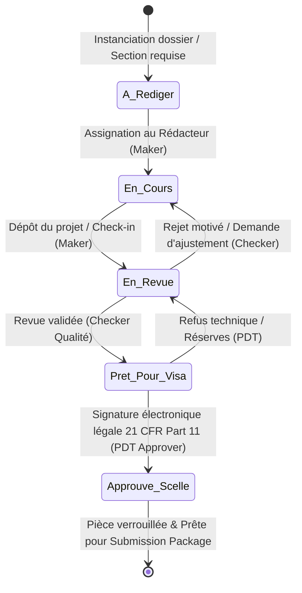
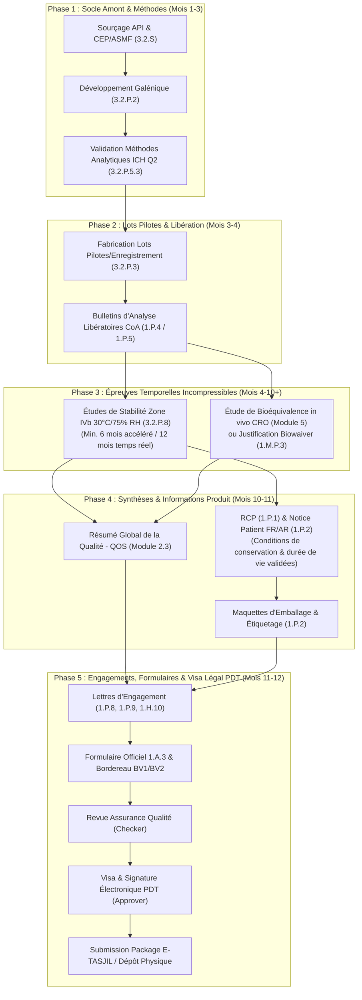
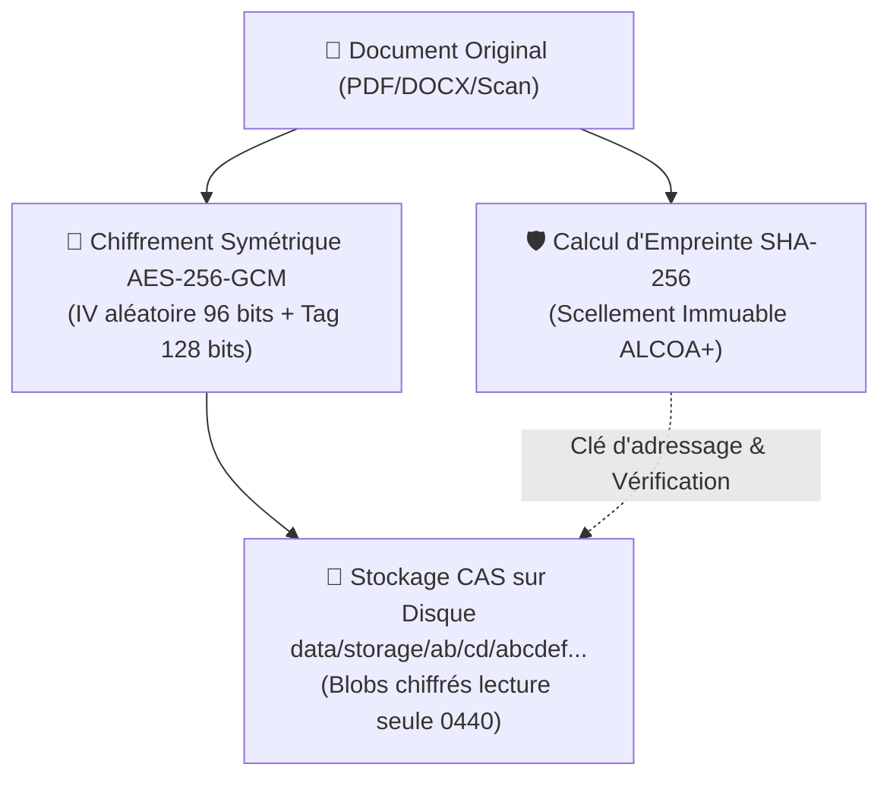
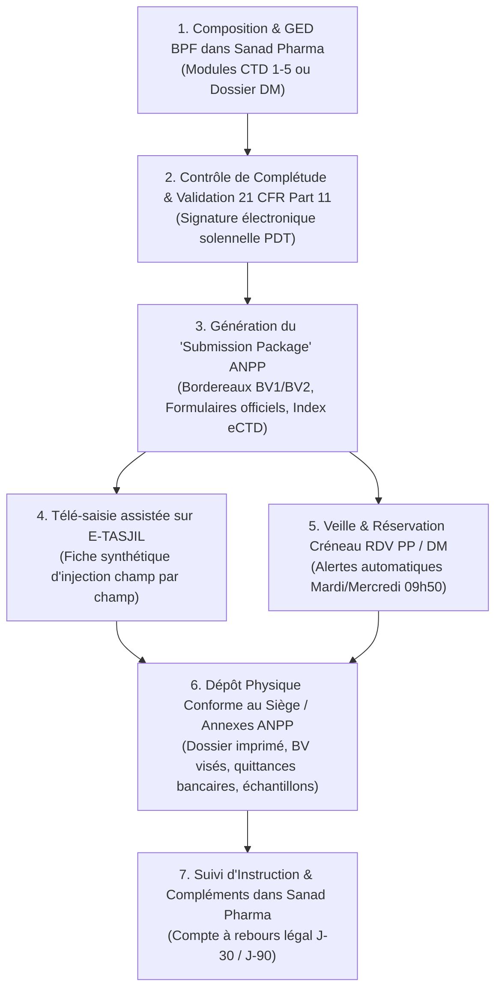
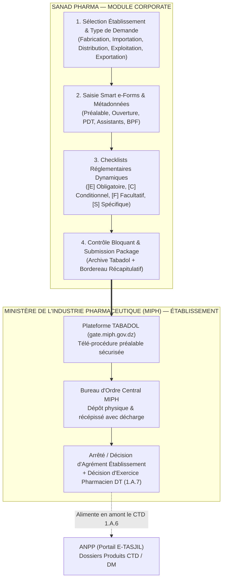
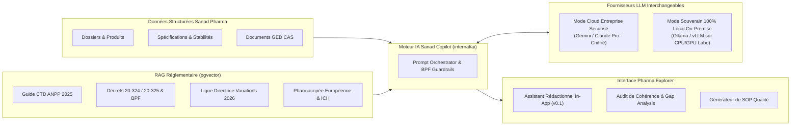

# Cahier des charges fonctionnel & technique détaillé
## Plateforme SANAD PHARMA — Gestion de l'Enregistrement des Médicaments, de l'Homologation des Dispositifs Médicaux et GED Pharmaceutique BPF en Algérie

**Version :** 1.0 (Harmonisation Réglementaire ANPP & Lignes Directrices Officielles) — Novembre 2026.  
**Documents sources et référentiels officiels de l'ANPP intégrés :**
1. **Guide pour la soumission du Dossier Technique Commun (CTD)** destiné à l'enregistrement des produits pharmaceutiques à usage humain (DEPP/ANPP, Version 01, Date d'effet : 31/07/2025).
2. **Ligne directrice relative aux modifications des décisions d’enregistrement** des produits pharmaceutiques à usage de la médecine humaine (Code : `LD-DEPP07/V01`, Version 01, Date : 22/04/2026).
3. **Décret exécutif n° 20-325** du 22 novembre 2020 relatif aux modalités d'enregistrement des produits pharmaceutiques.
4. **Arrêté du 26 Safar 1443 (3 octobre 2021)** fixant les modalités de modification de la décision d'enregistrement des produits pharmaceutiques à usage humain.
5. **Arrêté du 07 novembre 2021** (Notamment article 09 régissant le regroupement des modifications - *Grouping*).
6. **Décret exécutif n° 20-324** et **Arrêté du 10 mai 2021** fixant les modalités d'homologation des dispositifs médicaux (DM).

---

## 1. Contexte, Cadre Juridique et Objectifs Stratégiques

### 1.1 Contexte Réglementaire Algérien
En Algérie, la mise sur le marché d'un médicament à usage de la médecine humaine est soumise à l'obtention d'une **Décision d'Enregistrement (DE)**, délivrée après évaluation technique, pharmaceutique, biologique, préclinique et clinique par la **Direction de l'Enregistrement des Produits Pharmaceutiques de l'Agence Nationale des Produits Pharmaceutiques (ANPP/DEPP)**. De même, les dispositifs médicaux (DM) et dispositifs médicaux de diagnostic in vitro (DMDIV) sont assujettis à une **Décision d'Homologation**.

Deux textes fondamentaux publiés par l'ANPP structurent l'ensemble du cycle de vie des médicaments :
1. **Le Guide CTD ANPP (Juillet 2025) :** Instaure l'exigence du format CTD (Common Technical Document - Modules 1 à 5) pour toute soumission d'enregistrement initial, de renouvellement quinquennal et de variation, en formalisant les exigences spécifiques pour les produits princeps (innovateurs), génériques importés et génériques fabriqués localement.
2. **La Ligne Directrice des Modifications LD-DEPP07/V01 (Avril 2026) :** Établit la nomenclature algérienne des modifications post-enregistrement en trois classes rigoureuses : **Modification Mineure (Mmin)**, **Modification Modérée (Mmod)** et **Modification Majeure (Mmaj)**, rompant définitivement avec les terminologies étrangères obsolètes (Types IA/IB/II européens). Elle formalise également le principe de reclassement automatique en cas de non-respect d'une condition et la possibilité de regroupement de modifications (*Grouping*, article 09 de l'arrêté du 07/11/2021).

### 1.2 Identité de Marque « Sanad Pharma », Architecture Modulaire et Objectifs Stratégiques

#### 1.2.1 Identité de Marque & Rôles Ergonomiques
- **Marque Produit Officielle :** **Sanad Pharma** (« سَنَد فارما »).  
  En terminologie scientifique et juridique arabe, le terme *Sanad* désigne l'appui, le fondement documentaire authentifié, la chaîne de transmission inaltérable et la pièce probante. Il traduit fidèlement la vocation du produit : conférer aux laboratoires pharmaceutiques un garant absolu de conformité réglementaire, d'intégrité des données (**ALCOA+**) et de traçabilité opposable devant le Ministère de l'Industrie Pharmaceutique (**MIPH**) et l'Agence Nationale des Produits Pharmaceutiques (**ANPP**). L'ancienne appellation de travail « Homolog » désignait le nom de code de développement initial et s'efface au profit de **Sanad Pharma**.
- **Espace Opérationnel "Pharma Explorer" :**  
  Le terme *Pharma Explorer* désigne exclusivement le **modèle ergonomique et l'environnement de travail haute densité à 3 volets** (arborescence réglementaire, liste compacte 32px, visionneuse PDF instantanée) utilisé par les équipes métiers (Affaires Réglementaires, Contrôle Qualité, Pharmacien DT).
- **Console d'Administration & Sécurité :**  
  Espace back-office autonome réservé à l'Administrateur Système et de Laboratoire, physiquement et logiquement découplé des données scientifiques conformément aux règles BPF et au principe de défense en profondeur *Zero-Trust*.

#### 1.2.2 Nomenclature de la Suite Modulaire Sanad Pharma
La plateforme s'articule autour de neuf (9) modules cœur étroitement intégrés, complétés par un dixième module optionnel activable par établissement :
1. **Sanad Registry (Référentiel Établissements & Produits) :** Répertoire centralisé des établissements agréés MIPH (Décret 20-325), cartographie des sites de fabrication et de contrôle 1.H.8 (substance active, formulateur PF, conditionneurs, contrôle analytique) et catalogue unifié Médicaments & Dispositifs Médicaux (Décret 20-324).
2. **Sanad Corporate & MIPH Gateway (Agréments d'Établissements & Télé-Procédures Tabadol) :** Espace dédié à la préparation, constitution, qualification et suivi des dossiers d'agrément ministériel auprès du Ministère de l'Industrie Pharmaceutique (MIPH), couvrant les **5 catégories d'établissements** (Fabrication, Exploitation, Importation, Distribution en gros, Exportation) selon le Décret exécutif n° 21-82, les arrêtés d'application 2021-2022 et la refonte de septembre/octobre 2025, la numérisation des formulaires officiels en Smart e-Forms, la gestion des décisions d'exercice des pharmaciens (PDT et assistants), le suivi des échéances de renouvellement/caducité et l'exportation du Submission Package pour la plateforme ministérielle Tabadol (`Tabadol-J` & `Tabadol Intaj`).
3. **Sanad CTD Studio (Dossiers d'Enregistrement & Homologation DM) :** Atelier de composition, de structuration et de calcul de complétude des dossiers CTD (Modules 1 à 5) et dossiers techniques DM en 6 sections.
4. **Sanad Variations (Moteur de Modifications Post-AMM LD-DEPP07/V01) :** Moteur expert de qualification des 34 rubriques de modifications (Mmin, Mmod, Mmaj), détection des escalades dynamiques et production des dossiers comparatifs *État actuel vs Proposé*.
5. **Sanad Vault (Coffre-Fort GED Pharmaceutique BPF) :** Système d'archivage documentaire GxP à 5 branches maîtresses avec stockage CAS dédupliqué SHA-256 et chiffrement symétrique AES-256-GCM.
6. **Sanad Gateway (ANPP Submission Assistant & E-Services) :** Passerelle d'interfaçage avec les télé-procédures ANPP (portail E-TASJIL, calendrier RDV PP/DM, liquidation automatique des redevances et bordereaux officiels BV1/BV2).
7. **Sanad Audit & Compliance :** Moteur d'audit trail inviolable conforme 21 CFR Part 11 / Annexe 11 BPF, scellement cryptographique et signature électronique légale à double facteur (2FA).
8. **Sanad Admin Console :** Console d'administration du laboratoire, gestion des 10 profils pharmaceutiques stricts, gouvernance multi-tenant, supervision des quotas et politique de réversibilité.
9. **Sanad Copilot (Phase 3) :** Copilote d'intelligence réglementaire et d'assistance à la rédaction scientifique (RAG souverain avec `pgvector`, gouvernance stricte *Human-in-the-Loop*).
10. **Sanad eQMS (Optionnel / Add-on Qualité BPF) :** Extension modulaire activable par établissement (*feature flag* multi-tenant) couvrant la gestion des **Déviations**, **CAPA**, **Change Control BPF** (connecté au moteur de variations ANPP), **Audits internes & fournisseurs**, **Réclamations qualité** et **Formations sur SOP** sur le même socle ALCOA+ / 21 CFR Part 11.

#### 1.2.3 Objectifs Stratégiques de Sanad Pharma
- **Centraliser et piloter le cycle de vie complet 360°** de tous les dossiers d'enregistrement de médicaments et d'homologation de DM au sein d'une instance unique.
- **Structurer et piloter les dossiers d'Agréments d'Établissements MIPH (Module Sanad Corporate)** : gérer l'obtention, la modification et le renouvellement quinquennal des agréments des **5 types d'établissements pharmaceutiques** (Fabrication, Exploitation, Importation, Distribution en gros, Exportation) conformément au Décret exécutif n° 21-82 et aux arrêtés d'application (2021-2022 et refonte septembre/octobre 2025). Transformer les formulaires officiels en formulaires numériques interactifs (*Smart e-Forms*), gérer les décisions d'exercice nominatives des Pharmaciens Directeurs Techniques et assistants, piloter les checklists dynamiques à 4 niveaux d'exigibilité (`[E]`, `[C]`, `[F]`, `[S]`), et générer les paquets de télé-soumission pour la plateforme ministérielle **Tabadol** (`gate.miph.gov.dz`).
- **Assurer la conformité native au format CTD ANPP 2025** : instancier automatiquement les checklists et arborescences selon le type de produit (Princeps, Générique importé, Générique local) et le type de procédure (**NI**, **RI**, **MI**, **NF**, **RF**, **MF**).
- **Intégrer un Coffre-Fort GED Pharmaceutique (Standard BPF / ALCOA+)** garantissant l'intégrité, la gestion des versions (mineures/majeures), les circuits d'approbation et la signature électronique légale du Directeur Technique.
- **Intégrer un Atelier d'Élaboration Documentaire et Workflow Multi-Rôles BPF (Maker-Checker-Approver)** : dépasser la simple collecte passive de fichiers existants en fournissant un environnement collaboratif de rédaction technique décentralisée (Affaires Réglementaires, Contrôle Qualité, R&D, Production, Assurance Qualité, Partenaires externes). Le Pharmacien Directeur Technique n'étant pas le rédacteur unique mais le garant légal et pénal exclusif (Approver - Décret exécutif 20-325), la plateforme orchestre la chaîne complète : Rédaction (*Maker*) ➔ Revue Qualité/Pair (*Checker*) ➔ Visa Légal Scellé (*Approver*), adossée à une bibliothèque de modèles maîtres conformes ICH/ANPP et à un générateur automatique de formulaires/engagements réglementaires en 1 clic.
- **Intégrer un Moteur Intelligent de Variations (LD-DEPP07/V01)** : détecter l'impact d'une modification documentaire, qualifier le type de modification (Mmin, Mmod, Mmaj) parmi les 34 rubriques réglementaires, vérifier les conditions, exécuter le reclassement dynamique et générer automatiquement le dossier complet de modification (avec tableau comparatif *État actuel vs Proposé* et attestation de non-modification des autres sections).
- **Anticiper les échéances critiques et péremptions** : renouvellements quinquennaux à J-180/J-90, réponses aux compléments ANPP avec compte à rebours légal, expiration des certificats BPF, CEP et licences d'exploitation.
- **Automatiser et sécuriser l'articulation avec les télé-procédures ANPP (Module Sanad Gateway / Submission Assistant)** : génération automatique des bordereaux officiels (BV1/BV2, récépissés, formulaires d'homologation DM), export du Submission Package prêt pour le portail E-TASJIL (`etasjil.anpp.dz`), calendrier intelligent d'ouverture des créneaux de RDV (`rdvpp.anpp.dz` / `rdvdm.anpp.dz`), et architecture API-Ready pour future télétransmission directe.
- **Garantir la souveraineté numérique et la flexibilité hybride** : déployable en mode On-Premise 100 % hors-ligne (en intranet sécurisé de laboratoire) ou en mode Cloud SaaS souverain multi-tenant avec réversibilité absolue via l'archive chiffrée universelle `.sanad`.
- **Offrir une ergonomie "Pharma Explorer" haute densité** : navigation 3 volets inspirée de Windows Explorer Pro, affichage compact (32px par ligne), volet de prévisualisation PDF instantané et bilinguisme intégral FR/AR avec support RTL natif.

### 1.3 Main Courante Réglementaire : Corpus Exhaustif des Textes Applicables (9 Piliers)
Conformément aux exigences de traçabilité descendante **GAMP 5 (V-Model / RTM)** et à l'auditabilité réglementaire auprès de l'ANPP et du MIPH, le présent Cahier des charges consolide l'ensemble des textes juridiques algériens (avec leurs intitulés officiels complets) et référentiels GxP internationaux couverts par la plateforme et alimentant directement le module de **Veille Juridique** :

1. **Pilier 1 — Législation-Cadre & Gouvernance :**
   - **Loi n° 18-11 du 18 Chaoual 1439 correspondant au 2 juillet 2018** relative à la santé *(JORADP n° 46)*, modifiée et complétée par l'**Ordonnance n° 20-02 du 11 Moharram 1442 correspondant au 30 août 2020** *(JORADP n° 51)*.
   - **Décret exécutif n° 19-190 du 30 Chaoual 1440 correspondant au 3 juillet 2019** fixant les missions, l'organisation et le fonctionnement de l'Agence nationale des produits pharmaceutiques *(JORADP n° 43)*.
   - **Décret exécutif n° 20-271 du 11 Safar 1442 correspondant au 29 septembre 2020** fixant les attributions du ministre de l'industrie pharmaceutique *(JORADP n° 58)*.
2. **Pilier 2 — Établissements Pharmaceutiques & Agréments (MIPH) :**
   - **Décret exécutif n° 21-82 du 11 Rajab 1442 correspondant au 23 février 2021** relatif aux établissements pharmaceutiques et aux conditions de leur agrément *(JORADP n° 14 — 5 catégories, exclusivité PDT, intérim max 3 mois / 92 jours Art. 24, caducité à 2 ans Art. 16)*.
   - **Arrêté du 11 Dhou El Kaâda 1442 correspondant au 22 juin 2021** fixant les missions, les responsabilités et les qualifications du pharmacien directeur technique et des pharmaciens assistants de l'établissement pharmaceutique de fabrication *(JORADP n° 62)*.
   - **Arrêté du 27 Safar 1443 correspondant au 5 octobre 2021** fixant les éléments du dossier de demande d'agrément de l'établissement pharmaceutique de distribution en gros, les modalités de son traitement, la liste des modifications à caractère substantiel ainsi que le cahier des charges y afférent *(JORADP n° 08/2022)*.
   - **Arrêté du 9 Rabie Ethani 1443 correspondant au 14 novembre 2021** fixant les éléments du dossier de demande d'agrément de l'établissement pharmaceutique d'exploitation, les modalités de son traitement ainsi que la liste des modifications à caractère substantiel *(JORADP n° 92)*.
   - **Arrêté du 24 Rabie Ethani 1443 correspondant au 30 novembre 2021** fixant les missions et qualifications du pharmacien directeur technique de l'établissement pharmaceutique d'exploitation *(JORADP n° 95)*.
   - **Arrêté du 15 Joumada El Oula 1443 correspondant au 20 décembre 2021** fixant les éléments du dossier de demande d'agrément de l'établissement pharmaceutique d'importation, les modalités de son traitement ainsi que la liste des modifications à caractère substantiel *(JORADP n° 04/2022 — superficies minimales 300 m²/90 m²/390 m²)*, modifié et complété par l'**Arrêté du 20 Safar 1444 correspondant au 17 septembre 2022** *(JORADP n° 68)*.
   - **Refonte MIPH 2025/2026 :** **Arrêté du 22 septembre 2025** fixant les éléments du dossier de demande d'agrément de l'établissement pharmaceutique de fabrication, les modalités de traitement ainsi que la liste limitative des modifications à caractère substantiel (procédure en 2 étapes) ; **Arrêté du 30 septembre 2025** relatif à l'agrément de l'établissement pharmaceutique de distribution en gros ; **Arrêté du 9 Rabie Ethani 1447 correspondant au 1er octobre 2025** fixant les éléments du dossier de demande d'agrément d'un établissement pharmaceutique d'exploitation des décisions d'enregistrement des produits pharmaceutiques et des décisions d'homologation des dispositifs médicaux ; **Arrêté du 1er octobre 2025** relatif à l'agrément d'importation ; **Ligne Directrice MIPH de février 2026** et télé-procédures **Tabadol-J / Tabadol Intaj**.
3. **Pilier 3 — Enregistrement des Médicaments :**
   - **Décret exécutif n° 20-325 du 6 Rabie Ethani 1442 correspondant au 22 novembre 2020** relatif aux modalités d'enregistrement des produits pharmaceutiques *(JORADP n° 71)*.
   - **Arrêté du 12 Joumada El Oula 1442 correspondant au 27 décembre 2020** fixant la composition du dossier d'enregistrement des médicaments à usage de la médecine humaine *(format CTD Modules 1 à 5)*.
   - **Arrêté du 26 Safar 1443 correspondant au 3 octobre 2021** fixant les modalités de modification de la décision d'enregistrement des produits pharmaceutiques à usage de la médecine humaine.
   - **Arrêté du 2 Rabie Ethani 1443 correspondant au 7 novembre 2021** relatif au regroupement des modifications (*Grouping*, Art. 09).
   - **Guide pour la soumission du Dossier Technique Commun (CTD)** (DEPP/ANPP, juillet 2025) et **Ligne directrice relative aux modifications des décisions d'enregistrement (`LD-DEPP07/V01`)** (avril 2026).
4. **Pilier 4 — Homologation des Dispositifs Médicaux (DM & DMDIV) :**
   - **Décret exécutif n° 20-324 du 6 Rabie Ethani 1442 correspondant au 22 novembre 2020** relatif aux modalités d'homologation des dispositifs médicaux à usage de la médecine humaine *(JORADP n° 71)*.
   - **Arrêté du 28 Ramadhan 1442 correspondant au 10 mai 2021** fixant la composition du dossier technique d'homologation des dispositifs médicaux à usage de la médecine humaine *(JORADP n° 48 — Classes I, IIa, IIb, III et DMDIV)*.
   - **Arrêté du 12 Dhou El Kaâda 1442 correspondant au 23 juin 2021** fixant les modalités de modification de la décision d'homologation des dispositifs médicaux à usage de la médecine humaine *(JORADP n° 62)*.
   - Normes harmonisées : **ISO 13485** (SMQ Dispositifs Médicaux), **ISO 14971** (Gestion des risques), **ISO 10993** (Biocompatibilité).
5. **Pilier 5 — Bonnes Pratiques Pharmaceutiques (GxP) :**
   - **Décret exécutif n° 22-247 du 26 Dhou El Kaâda 1443 correspondant au 26 juin 2022** fixant les règles de bonnes pratiques de fabrication des produits pharmaceutiques à usage de la médecine humaine *(JORADP n° 44 — Guide algérien des BPF aligné PIC/S & OMS)*.
   - Cahier des charges des **Bonnes Pratiques de Distribution en Gros (BPDG)** annexé à l'arrêté du 5 octobre 2021 ; Guides des **Bonnes Pratiques de Laboratoire (BPL)** du LNCPP ; **Bonnes Pratiques Cliniques (BPC)** et études de bioéquivalence.
6. **Pilier 6 — Fixation des Prix & Régulation Économique :**
   - **Décret exécutif n° 20-326 du 6 Rabie Ethani 1442 correspondant au 22 novembre 2020** fixant les missions, la composition, l'organisation et le fonctionnement du comité économique intersectoriel des médicaments *(JORADP n° 78)*, modifié et complété par le **Décret exécutif n° 23-105 du 14 Chaâbane 1444 correspondant au 7 mars 2023** *(JORADP n° 16)*.
   - **Décret exécutif n° 98-44 du 4 Chaoual 1418 correspondant au 1er février 1998** fixant les marges plafonds applicables à la production, au conditionnement et à la distribution des médicaments *(JORADP n° 07 — production 20 %, conditionnement 10 %, gros 10-20 %, détail 20-50 %)*.
7. **Pilier 7 — Vigilance Sanitaire, Stocks Stratégiques & Substances Réglementées :**
   - **Décret exécutif n° 98-43 du 4 Chaoual 1418 correspondant au 1er février 1998** portant création du centre national de pharmacovigilance et de matériovigilance *(JORADP n° 07)*.
   - **Loi n° 04-18 du 13 Dhou El Kaâda 1425 correspondant au 25 décembre 2004** relative à la prévention et à la répression de l'usage et du trafic illicites de stupéfiants et de substances psychotropes *(modifiée par les Lois n° 23-05 et n° 25-03)* ; **Décret exécutif n° 19-379 du 31 décembre 2019** fixant les modalités de contrôle administratif, technique et de sécurité des substances et médicaments ayant des propriétés psychotropes ; **Décret exécutif n° 24-112 du 13 mars 2024** fixant les conditions et les modalités de classification des stupéfiants, des substances psychotropes et des précurseurs ; Arrêtés ministériels relatifs aux **stocks stratégiques de sécurité** (3 à 6 mois).
8. **Pilier 8 — Redevances Administratives ANPP :**
   - **Décret exécutif n° 21-551 du 25 Joumada El Oula 1443 correspondant au 30 décembre 2021** fixant les modalités de recouvrement et d'affectation du produit de la redevance des produits pharmaceutiques et des dispositifs médicaux *(JORADP n° 02/2022)* et **Arrêté interministériel Finances / MIPH** fixant le barème des redevances d'expertise, d'enregistrement, d'homologation et d'agrément.
9. **Pilier 9 — Intégrité des Données, Signature Électronique & CSV :**
   - **Loi n° 15-04 du 11 Rabie Ethani 1436 correspondant au 1er février 2015** fixant les règles générales relatives à la signature et à la certification électroniques *(JORADP n° 06)*.
   - **Loi n° 18-07 du 25 Ramadhan 1439 correspondant au 10 juin 2018** relative à la protection des personnes physiques dans le traitement des données à caractère personnel *(JORADP n° 38)*.
   - Référentiels internationaux : **FDA 21 CFR Part 11**, **EU GMP Annexe 11**, **GAMP 5 (2e édition)** et principes **ALCOA+**.

---

## 2. Typologie des Procédures et Matrice CTD ANPP (Guide Juillet 2025)

### 2.1 Les 6 Parcours Officiels de Soumission
La plateforme distingue nativement les six codes de procédure définis par l'ANPP :

| Code ANPP | Intitulé officiel de la procédure | Portée | Périmètre documentaire principal |
|---|---|---|---|
| **NI** | **Enregistrement Initial d’un produit Importé** | Médicaments fabriqués à l'étranger importés en Algérie | Dossier CTD complet + CPP + Prix FOB Chambre Commerce + Benchmark |
| **RI** | **Renouvellement de la DE d'un produit Importé** | Renouvellement quinquennal d'un produit importé | Module 1 actualisé + Déclaration de non-modification + BPF/CPP à jour |
| **MI** | **Modification d’un produit Importé** | Variations administratives ou qualitatives | Dossier de modification ciblé + Approbation pays d'origine + Sections CTD modifiées |
| **NF** | **Enregistrement Initial d’un produit Fabriqué localement** | Médicaments produits sur un site industriel national | CTD complet + Structure de prix PCSU + Dossiers lots validation + Non-commercialisation |
| **RF** | **Renouvellement de la DE d’un produit Fabriqué localement** | Renouvellement quinquennal production locale | Module 1 + Déclaration de non-modification + BPF national + Revue qualité produit |
| **MF** | **Modification d’un produit Fabriqué localement** | Variations administratives ou techniques locales | Dossier de variation ciblé + Données comparatives de lots/stabilité + Sections CTD |

### 2.2 Structure des 5 Modules CTD selon le Type d'Origine
Conformément au tableau récapitulatif officiel de l'ANPP :

```
                                 ┌──────────────────────────────────────────────────────────┐
                                 │                STRUCTURE GLOBALE CTD ANPP                │
                                 └────────────────────────────┬─────────────────────────────┘
                                                              │
                     ┌────────────────────────────────────────┴────────────────────────────────────────┐
                     ▼                                                                                 ▼
     ┌───────────────────────────────┐                                                 ┌───────────────────────────────┐
     │       PRODUIT PRINCEPS        │                                                 │       PRODUIT GÉNÉRIQUE       │
     │      (Médicament Innovant)    │                                                 │    (Importé ou Localisé)      │
     ├───────────────────────────────┤                                                 ├───────────────────────────────┤
     │ Module 1 : Administratif [E]  │                                                 │ Module 1 : Administratif [E]  │
     │ Module 2 : Résumés [E]        │                                                 │ Module 2 : Incorporé (3, 4, 5)│
     │ Module 3 : Qualité [E]        │                                                 │ Module 3 : Qualité [E]        │
     │ Module 4 : Non Clinique [E]   │                                                 │ Module 4 : Facultatif [F]     │
     │ Module 5 : Clinique [E]       │                                                 │ Module 5 : Bioéquivalence [P] │
     └───────────────────────────────┘                                                 └───────────────────────────────┘
     [E] = Exigé obligatoirement      [F] = Facultatif (ANPP peut exiger à tout moment)   [P] = Partiellement requis (BE/BA)
```

- **Règle Princeps :** Modules 1, 2, 3, 4 et 5 obligatoirement exigés (`E`).
- **Règle Générique :**
  - **Module 1 :** Exigé (`E`) dans son intégralité selon les exigences algériennes.
  - **Module 2 :** Non requis sous forme de classeurs isolés 2.1 à 2.7 ; les résumés et synthèses sont directement incorporés dans les modules 3, 4 et 5.
  - **Module 3 :** Exigé (`E`) à l'identique d'un princeps (Substance Active 3.2.S, Produit Fini 3.2.P, Documentation régionale 3.2.R).
  - **Module 4 :** Facultatif (`F`) : non requis lors de la soumission initiale, mais l'ANPP se réserve formellement le droit d'exiger des données de toxicité ou pharmacologie si des impuretés nouvelles ou des excipients nouveaux apparaissent.
  - **Module 5 :** Partiellement requis (`P`) : focalisé impérativement sur la démonstration de la bioéquivalence (5.3.1.2) ou son exonération légitime (*Biowaiver* justifié en 1.M.P.3), les méthodes bioanalytiques humaines (5.3.1.4), et la tolérance clinique.

---

## 3. Spécification Exhaustive du Module 1 (Spécificités ANPP Algérie)

Le Module 1 est découpé en quatre sous-sections normalisées (`1.A`, `1.H`, `1.M`, `1.P`). Chaque pièce possède un identifiant strict, un titre légal et des conditions d'exigibilité selon le vecteur de soumission (NI, RI, MI, NF, RF, MF) :

### 3.1 Sous-Module 1.A : APPLICANT (Demandeur & Établissement)

| Réf. ANPP | Désignation de l'exigence documentaire | NI | RI | MI | NF | RF | MF | Règles métier de validation |
|---|---|:---:|:---:|:---:|:---:|:---:|:---:|---|
| **1.A.1** | Récépissé de dépôt du dossier | E | E | E | E | E | E | Document scanné avec numéro d'enregistrement ANPP et horodatage |
| **1.A.2** | Courrier de demande officiel | E | E | E | E | E | E | À en-tête du laboratoire, signé par le Pharmacien Directeur Technique |
| **1.A.3** | Formulaire de demande parafé, daté, signé et cacheté par le PDT | E | E | E | E | E | E | Formulaire officiel ANPP, paraphes sur chaque page, signature et cachet DT |
| **1.A.4** | Bordereau de versement + document bancaire / quittance ou autres + Attestation de taux de change si applicable | E | E | E | E | E | E | Preuve de paiement des redevances réglementaires, attestation de change Banque d'Algérie si devises |
| **1.A.5** | Copie de la réponse à la demande de pré-soumission (+ copie justificatif de paiement + BV) | E | NA | E | E | NA | E | Obligatoire pour NI, MI, NF, MF. Accord formel de pré-soumission de l'ANPP |
| **1.A.6** | Agrément d'exploitation / Fabrication / Sous-traitance | E | E | E | E | E | E | Agrément en cours de validité délivré par le Ministère de l'Industrie Pharmaceutique |
| **1.A.7** | Décision d'exercice du Pharmacien Directeur Technique (PDT) | E | E | E | E | E | E | Décision ministérielle nominative nommant le DT responsable |
| **1.A.8** | Copie des Contrats (exploitation, façonnage, sous-traitance et tout autre accord qualité) | E | E | E | E | E | E | Contrats liant le demandeur aux différents sites et détenteurs |
| **1.A.9** | Copie(s) de la DE, des approbations et des accusés des anciens dépôts (récépissés, notifications, paiements antérieurs) | NA | E | E | NA | E | E | Historique complet indispensable pour les renouvellements et variations |

### 3.2 Sous-Module 1.H : HOLDER (Détenteur de la Décision d'Enregistrement)

| Réf. ANPP | Désignation de l'exigence documentaire | NI | RI | MI | NF | RF | MF | Règles métier de validation |
|---|---|:---:|:---:|:---:|:---:|:---:|:---:|---|
| **1.H.1** | Courrier de demande du détenteur | E | E | E | E | E | E | Courrier officiel autorisant le demandeur local à déposer |
| **1.H.2** | Autorisation de Mise sur le Marché (original ou copie certifiée conforme) | E | E | E | E | E | E | AMM délivrée dans le pays d'origine par l'autorité compétente |
| **1.H.3** | Certificat de Produit Pharmaceutique (CPP - Modèle OMS) | E | E | E | E | E | E | CPP légalisé/apostillé conforme au modèle de certification OMS |
| **1.H.4** | Structure de prix (PCSU Fabrication) / Attestation de prix FOB Algérie visée Chambre de Commerce | E | E | E | E | E | E | Structure PCSU (Prix de Revient/Sortie Usine) pour le local (NF/RF/MF) ; Attestation FOB visée pour l'import (NI/RI/MI) |
| **1.H.5** | Dossier BENCHMARK de prix international | E | E | E | NA | NA | NA | Comparatif de prix dans les pays de référence (obligatoire pour importations) |
| **1.H.6** | Approbation de la variation par le pays d'origine | NA | NA | E | NA | NA | E | Preuve que la modification est approuvée dans le pays d'origine (ou justification) |
| **1.H.7** | Descriptif de la mise à jour signé | NA | NA | E | NA | NA | E | Document de synthèse expliquant le rationnel technico-réglementaire |
| **1.H.8** | Liste des sites intervenants dans la fabrication des substances actives et du produit fini (signée et visée) | E | E | E | E | E | E | Cartographie exhaustive des sites (SA, intermédiaires, PF, conditionnement, contrôle) |
| **1.H.9** | Déclaration de similarité | E | NA | NA | E | NA | NA | Attestation certifiant la similarité de composition et procédé |
| **1.H.10** | Déclaration de non-modification | NA | E | NA | NA | E | NA | Attestation formelle certifiant qu'aucune modification non autorisée n'a été opérée |
| **1.H.11** | Accord du détenteur actuel sur le transfert de la DE | NA | NA | E | NA | NA | E | Requis si la variation implique un transfert de titulaire de la DE |
| **1.H.12** | Attestation de déclaration de la date d’implémentation de la variation dans le pays d’origine | NA | NA | E | NA | NA | NA | Engagement sur la date de bascule industrielle dans le pays d'origine |

### 3.3 Sous-Module 1.M : MANUFACTURERS (Fabricants SA et Produit Fini)

| Réf. ANPP | Désignation de l'exigence documentaire | Cible | NI | RI | MI | NF | RF | MF | Exigences techniques clés |
|---|---|---|:---:|:---:|:---:|:---:|:---:|:---:|---|
| **1.M.S.1** | Agrément(s) du/des site(s) de fabrication SA (Manufacturing License) | API / SA | E | E | E | E | E | E | Licence de fabrication officielle de l'usine d'API |
| **1.M.S.2** | Certificat(s) BPF/GMP de conformité aux Bonnes Pratiques de Fabrication de la SA | API / SA | E | E | E | E | E | E | Certificat GMP valide émis par autorité compétente |
| **1.M.S.3** | Lettre d’accès / Certificate of Suitability (CEP) | API / SA | E | E | E | E | E | E | CEP EDQM valide avec déclaration d'accès nominative au nom du fabricant du FPP |
| **1.M.P.1** | Agrément d’ouverture d'établissement pharmaceutique (ML) | FPP (PF) | E | E | E | E | E | E | Licence d'établissement pour le fabricant du produit fini |
| **1.M.P.2** | Certificat(s) de conformité BPF/GMP du produit fini | FPP (PF) | E | E | E | E | E | E | Certificat BPF valide pour toutes les étapes de fabrication et conditionnement |
| **1.M.P.3** | Étude de bioéquivalence OU justificatif d’exonération de l'étude (Biowaiver) | FPP (PF) | E | NA | NA | E | NA | NA | Rapport clinique BE in vivo ou justification scientifique robuste (BCS classe I/III) |

### 3.4 Sous-Module 1.P : PRODUCT INFORMATION (Informations sur le Produit & Contrôle)

| Réf. ANPP | Désignation de l'exigence documentaire | NI | RI | MI | NF | RF | MF | Règles métier et contraintes |
|---|---|:---:|:---:|:---:|:---:|:---:|:---:|---|
| **1.P.1** | **Textes officiels pays d'origine :**<br>• 1.P.1.1 RCP d'origine<br>• 1.P.1.2 Notice d'origine<br>• 1.P.1.3 Étiquette d'origine | E | E | E | E | E | E | Documents approuvés dans le pays exportateur ou de référence |
| **1.P.2** | **Modèle Algérie (visé obligatoirement par le PDT) :**<br>• 1.P.2.1 RCP Modèle Algérie<br>• 1.P.2.2 Notice Modèle Algérie (Bilingue FR/AR)<br>• 1.P.2.3 Étiquette Modèle Algérie<br>• 1.P.2.4 Maquette Modèle Algérie (Conditionnement primaire & secondaire) | E | E | E | E | E | E | Textes conformes à la réglementation algérienne (notamment arabe obligatoire), maquettes en couleurs à échelle 100%, visées par le DT. **Contrôle de Parité Linguistique Synchrone :** Gating bloquant interdisant le visa DT si la notice arabe n'est pas strictement synchronisée à l'indice de révision du texte français. |
| **1.P.3** | Échantillons du produit fini | E | NA | E | E | NA | E | Enregistrement de la remise physique au laboratoire de contrôle de l'ANPP |
| **1.P.4** | Bulletin d'analyse de la substance active (avec granulométrie et polymorphisme) et son recontrôle | E | E | E | E | E | E | CoA du fabricant SA + bulletin de recontrôle complet par le fabricant du produit fini |
| **1.P.5** | Bulletin d’analyse du produit fini (et bulletin du prémix le cas échéant) | E | E | E | E | E | E | Certificat d'analyse libératoire complet conforme aux spécifications |
| **1.P.6** | Attestation de correspondance entre les lots | E | E | E | E | E | E | Traçabilité entre le lot soumis, le lot de bioéquivalence et les lots de stabilité |
| **1.P.7** | Certificat de libération de lot (précisant la libération pays d'origine / pays tiers) | E | E | E | E | E | E | Certificat officiel de libération par la personne qualifiée (QP/DT) |
| **1.P.8** | Lettre d’engagement de non-commercialisation des lots de validation | NA | NA | NA | E | NA | E | **Spécifique Fabrication Locale (NF/MF) :** Engagement formel signé du DT à ne pas commercialiser les lots industriels de validation avant l'obtention de la DE |
| **1.P.9** | Lettre d’engagement du demandeur à compléter les résultats des études de stabilité du PF | NA | NA | NA | E | NA | E | **Spécifique Fabrication Locale (NF/MF) :** Engagement à poursuivre les stabilités en temps réel (Zone IVa/IVb) et transmettre les résultats à l'ANPP |

---

## 4. Modules Techniques CTD 2, 3, 4 et 5 (Exigences et Spécificités Régionales)

### 4.1 Module 3 : Qualité Pharmaceutique, Chimique et Biologique
Le Module 3 est obligatoire (`E`) pour toutes les catégories (Princeps, Génériques importés, Génériques locaux). Le système intègre des contrôles stricts sur les éléments critiques imposés par l'ANPP :
1. **Partie 3.2.S (Substance Active) :**
   - Acceptabilité formelle du **CEP (Certificat de conformité à la Pharmacopée Européenne)** : la présence d'un CEP valide avec sa déclaration d'accès et ses annexes allège la documentation technique requise tout en garantissant la conformité analytique.
   - Contrôle obligatoire du **polymorphisme cristallin** et de la **granulométrie** (taille des particules) en 3.2.S.1.3 et 3.2.S.4.
2. **Partie 3.2.P (Produit Fini) :**
   - **Exigence spécifique fabrication locale (3.2.P.3.5) :** Dépôt obligatoire des dossiers complets de fabrication et de conditionnement des **lots industriels de validation** exécutés sur le site national.
   - Spécifications complètes à libération et à péremption (3.2.P.5.1).
3. **Partie 3.2.R (Informations Régionales Algériennes) :**
   - `3.2.R.1.1` : Exécution des documents de production (Master Batch Records exécutés).
   - `3.2.R.1.2` : Documents de production principaux (Formules cadres de fabrication et conditionnement).
   - `3.2.R.2` : Procédures analytiques et informations de validation sur site.

### 4.2 Module 5 : Données Cliniques et Bioéquivalence
Pour les médicaments génériques (importés et locaux), le moteur de checklist conditionne la recevabilité du dossier aux exigences suivantes :
- **5.3.1.2 Étude comparative de Biodisponibilité (BA) et Bioéquivalence (BE) :** Rapport complet de l'étude clinique in vivo démontrant la bioéquivalence du produit candidat vis-à-vis du produit princeps de référence (intervalle de confiance 90 % compris entre 80,00 % et 125,00 % sur *C*<sub>max</sub> et *AUC*).
- **5.3.1.4 Méthodes bioanalytiques et analytiques :** Validation complète selon les lignes directrices internationales (BPL/GCP).
- **Justification d'exonération (Biowaiver) :** En cas d'absence d'étude in vivo, rattachement obligatoire d'un dossier justificatif complet en 1.M.P.3 et 5.3.1.2 (profils de dissolution comparatifs multipoints à pH 1.2, 4.5, 6.8 et classification biopharmaceutique BCS).

---

## 5. Moteur Intelligent des Modifications (Ligne Directrice ANPP LD-DEPP07/V01)

### 5.1 Cadre Conceptuel et Règle d'Escalade Dynamique
L'ANPP classe toute modification post-approbation de la décision d'enregistrement en trois catégories exclusives :
1. **Modification Mineure (Mmin) :** Répercussions sur la qualité, la sécurité ou l'efficacité minimes ou nulles.
2. **Modification Modérée (Mmod) :** Impact potentiel sur la qualité, la sécurité ou l'efficacité.
3. **Modification Majeure (Mmaj) :** Répercussions significatives sur la qualité, la sécurité ou l'efficacité.

```
       ┌────────────────────────────────────────────────────────────────────────┐
       │             ALGORITHME DE QUALIFICATION & RECLASSEMENT ANPP            │
       └───────────────────────────────────┬────────────────────────────────────┘
                                           │
                                 Saisie de la variation
                             (Sélection parmi rubriques 1 à 34)
                                           │
                                           ▼
                       Évaluation des "Conditions à remplir"
                                           │
                      ┌────────────────────┴────────────────────┐
                      ▼                                         ▼
            Toutes conditions remplies             Au moins une condition non remplie
                      │                                         │
                      ▼                                         ▼
           Classification nominale               RECLASSEMENT AUTOMATIQUE OBLIGATOIRE
             (ex: Mmin ou Mmod)                                 │
                                                ┌───────────────┴───────────────┐
                                                ▼                               ▼
                                         Mmin  ──>  Mmod ou Mmaj         Mmod  ──>  Mmaj
```

> [!IMPORTANT]
> **Règle réglementaire de reclassement (Section 5.1 & 5.2 de la Ligne Directrice) :**
> Dès lors qu'une ou plusieurs conditions prédéfinies pour une modification mineure (`Mmin`) ou modérée (`Mmod`) ne sont pas strictement satisfaites, la plateforme réévalue et **reclasse automatiquement** la demande au niveau supérieur (`Mmin` reclassée en `Mmod` ou `Mmaj`, et `Mmod` reclassée en `Mmaj`), en ajustant instantanément la liste des documents justificatifs requis.

### 5.2 Regroupement de Modifications (*Grouping* - Arrêté du 07/11/2021)
En vertu de l'article 09 de l'arrêté du 07 novembre 2021, la plateforme permet de soumettre plusieurs modifications au sein d'une même procédure groupée (*Grouping*) lorsque :
- Elles concernent une même décision d'enregistrement et découlent d'un même changement technique (ex: changement de site de fabrication de l'API entraînant une modification de taille de lot et de méthode analytique).
- La plateforme calcule le niveau global de risque du groupe : si un groupe contient une modification `Mmaj`, l'ensemble du dossier groupé est instruit selon le niveau de sévérité maximal `Mmaj`.

### 5.3 Documentation Générale Requise pour TOUTE Demande de Modification
Selon la section 5.3 de la Ligne Directrice, toute soumission de variation (Mmin, Mmod, Mmaj) génère obligatoirement le bordereau de pièces maîtresses suivant :
1. **Lettre de demande officielle** de modification de la DE, visée par le PDT.
2. **Tableau comparatif standardisé :** État actuel approuvé vs Situation proposée, définissant clairement la portée du changement.
3. **Justificatif technico-réglementaire** motivant la modification.
4. **Bordereau de versement** de la redevance ANPP applicable (+ justificatif bancaire).
5. **Version modifiée des sections concernées du dossier CTD** (remplacement page à page).
6. **Liste actualisée et visée** de tous les intervenants (fabricants SA, PF, sites de conditionnement et de contrôle).
7. **Attestation formelle de non-modification des autres sections** en dehors de celles déclarées.
8. **Copie de la décision d’enregistrement (DE) en vigueur**.
9. **Accusés de dépôt** des demandes de modifications et/ou renouvellements actuellement en cours d'instruction par l'ANPP avec leurs bordereaux.
10. **Approbation de la modification par les autorités du pays d'origine** (pour les médicaments importés).
11. **Autorisations des sites et preuves BPF/BPL** valides pour les opérations concernées.
12. **Informations "produit" révisées** (RCP, notice bilingue, étiquetage, maquettes visées PDT).

### 5.4 Référentiel des 34 Rubriques de Modifications Réglementaires

#### I. Modifications Administratives (LD-DEPP07 Section 5.4.1)
- **1.** Changement dans la dénomination commerciale du produit fini.
- **2.** Changement dans la dénomination de la substance active, d'un excipient ou d'un article de conditionnement (avec maintien de l'entité chimique/spécification).
- **3.** Changement ou attribution du code ATC par l'OMS.
- **4.** Changement du nom et/ou de l'adresse du titulaire de l'AMM, du titulaire du dossier permanent de la substance active (DPSA/DMF), du site de stockage de la banque de cellules, du site de fabrication de l'API, du produit intermédiaire ou du produit fini, du conditionneur primaire/secondaire, ou du site de contrôle.
- **5.** Suppression d'un site de fabrication, de contrôle, de conditionnement ou de stockage (avec maintien d'au moins un site approuvé opérationnel).

#### II. Modifications relatives au CEP ou Préqualification API (LD-DEPP07 Section 5.4.1.2)
- **6.a.** Soumission d'un CEP nouveau ou mis à jour provenant d'un fabricant déjà approuvé (`6.a.1` → Mmin, `6.a.2` → Mmin, `6.a.3` → Mmod).
- **6.b.** Soumission d'un CEP provenant d'un nouveau fabricant (`6.b.1` → Mmin, `6.b.2` → Mmod).

#### III. Modifications Qualitatives Substance Active 3.2.S (LD-DEPP07 Section 5.4.2.1)
- **7.** Remplacement ou ajout d'un site de fabrication ou d'un nouveau fabricant d'API :
  - *7.a :* Uniquement le contrôle de la SA (`7.a.1` → Mmin, `7.a.2` → Mmod).
  - *7.b :* Production du matériau de départ (`7.b.1` → Mmin, `7.b.2` → Mmaj).
  - *7.c :* Production de l'intermédiaire (`7.c.1` → Mmod, `7.c.2` → Mmin).
  - *7.d :* Production complète de l'API (`7.d.1` → Mmod, `7.d.2` → Mmaj).
- **8.a.** Ajout ou changement d'un bloc de fabrication ou d'une unité de production sur un site API approuvé → Mmin.
- **9.** Changement dans le procédé de fabrication de l'API :
  - *9.a.1 :* Changement mineur sans altération du profil d'impuretés ni de la voie de synthèse → Mmod.
  - *9.a.2 :* Changement important susceptible d'avoir des répercussions significatives → Mmaj.
- **10.** Modification de la taille de lot de l'API ou d'un intermédiaire :
  - *10.a.1 :* Augmentation jusqu'à 10 fois la taille acceptée → Mmin.
  - *10.b :* Réduction de la taille de lot → Mmin.
  - *10.c.1 :* Augmentation supérieure à 10 fois la taille acceptée → Mmod.
- **11.** Essais en cours de fabrication ou limites durant la synthèse de l'API :
  - *11.a :* Resserrement des limites → Mmin.
  - *11.b :* Changement mineur d'une procédure analytique → Mmin.
  - *11.c :* Ajout d'un nouveau paramètre de spécification → Mmin.
  - *11.d :* Suppression d'un paramètre redondant → Mmin.
  - *11.e :* Ajout suite à un problème de qualité/sécurité → Mmod.
  - *11.f :* Élargissement des limites acceptées → Mmaj.
- **12.** Changement des spécifications et critères d'acceptation de l'API :
  - *12.a :* Mise à jour suite à révision de monographie de Pharmacopée officielle → Mmin.
  - *12.c :* Ajout de paramètre (`12.c.1` → Mmin, `12.c.2` → Mmod, `12.c.3` → Mmaj).
  - *12.b :* Suppression de paramètre (`12.b.1` → Mmin, `12.b.2` → Mmod, `12.b.3` → Mmaj).
  - *12.d :* Remplacement de paramètre (`12.d.1` → Mmin, `12.d.2` → Mmod, `12.d.3` → Mmaj).
  - *12.e :* Resserrement d'un critère d'acceptation → Mmin.
  - *12.f :* Élargissement d'un critère (`12.f.1` → Mmin, `12.f.2` → Mmod, `12.f.3` → Mmaj).
- **13.** Procédures d'essai de la SA ou de ses intermédiaires :
  - *13.a :* Mise à jour suite à révision pharmacopée officielle → Mmin.
  - *13.b :* Passage d'une méthode interne à une pharmacopée reconnue → Mmin.
  - *13.c :* Ajout d'une procédure (`13.c.1` → Mmin, `13.c.2` → Mmod, `13.c.3` → Mmaj).
  - *13.d :* Modification/remplacement de procédure (`13.d.1` → Mmin, `13.d.2` → Mmod, `13.d.3` → Mmaj).
  - *13.e :* Suppression d'une procédure alternative (`13.e.1/2` → Mmin, `13.e.3` → Mmaj).
- **14.** Changement de conditionnement primaire de la SA :
  - *14.a :* Composition qualitative/quantitative → Mmin.
  - *14.b :* SA liquides non stériles → Mmod.
- **15.** Période de recontrôle ou durée de vie de l'API :
  - *15.a :* Réduction → Mmin.
  - *15.b :* Extension → Mmod.
- **16.** Conditions de stockage de l'API sur l'étiquette :
  - *16.a :* Conditions plus restrictives → Mmin.
  - *16.b :* Tout autre changement → Mmod.

#### IV. Modifications Qualitatives Produit Fini 3.2.P (LD-DEPP07 Section 5.4.2.2)
- **17.** Système d'aromatisation ou de coloration du produit fini :
  - *17.a :* Augmentation ou réduction de teneur → Mmin.
  - *17.b :* Ajout, suppression ou remplacement d'arôme/colorant → Mmin.
- **18.a.** Masse de l'enrobage ou des capsules vides pour formes orales solides à libération immédiate → Mmin.
- **19.** Composition en excipients d'une forme orale solide à libération immédiate :
  - *19.a :* Remplacement d'un excipient par un excipient comparable à concentration similaire → Mmod (ou Mmaj si conditions non satisfaites).
  - *19.b :* Changement quantitatif des excipients → Mmaj.
- **20.** Site de fabrication du produit fini :
  - *20.a :* Site de conditionnement secondaire → Mmin.
  - *20.b :* Site de conditionnement primaire (solides, crèmes, sirops) → Mmin.
  - *20.c :* Site chargé de la fabrication (procédé conventionnel non complexe) → Mmod.
- **21.a.** Remplacement ou ajout d'un site de contrôle analytique → Mmin.
- **22.** Taille de lot du produit fini (formes orales solides ou solutions non stériles) :
  - *22.a :* Augmentation jusqu'à 10 fois la taille approuvée → Mmin.
  - *22.b :* Réduction jusqu'à 10 fois → Mmin.
  - *22.c :* Plus de 10 fois supérieure ou inférieure → Mmod.
- **23.** Changement dans le procédé de fabrication du produit fini (sans changement du principe fondamental) → Mmod.
- **24.** Contrôles en cours de fabrication du produit intermédiaire ou fini :
  - *24.a :* Resserrement des limites → Mmin.
  - *24.b :* Suppression d'un contrôle redondant → Mmin.
  - *24.c / 24.d :* Ajout, révision ou remplacement d'un contrôle → Mmin.
- **25.** Remplacement d'un excipient à risque EST par un excipient d'origine végétale ou synthétique → Mmin.
- **26.** Spécifications ou procédures analytiques d'un excipient :
  - *26.a :* Suppression d'un paramètre interne non critique → Mmin.
  - *26.b :* Ajout d'un nouveau paramètre → Mmin.
  - *26.c :* Resserrement des limites → Mmin.
  - *26.d :* Changement ou remplacement d'une méthode → Mmod.
- **27.** Mise à jour des spécifications du produit fini suite à révision d'une monographie de Pharmacopée officielle → Mmin.
- **28.** Spécifications et critères d'acceptation du produit fini :
  - *28.a :* Suppression d'un paramètre non critique redondant → Mmin.
  - *28.b :* Ajout d'un paramètre de contrôle → Mmin.
  - *28.c :* Resserrement d'un critère → Mmin.
  - *28.d :* Remplacement d'un paramètre → Mmin.
- **29.** Procédures analytiques du produit fini :
  - *29.a :* Suppression d'une procédure alternative → Mmin.
  - *29.b :* Ajout d'une procédure analytique → Mmin.
  - *29.c :* Modification ou remplacement d'une procédure → Mmod.
  - *29.d :* Mise à jour selon monographie pharmacopée → Mmin.
  - *29.e :* Transfert vers une pharmacopée reconnue → Mmin.
- **30.** Conditionnement primaire du produit fini (changement ou ajout de type de contenant) :
  - *30.a :* Formes pharmaceutiques non stériles → Mmod.
  - *30.b :* Médicaments stériles → Mmaj.
  - *30.c :* Suppression d'un contenant sans supprimer de dosage/forme → Mmod.
- **31.** Composition qualitative et quantitative du conditionnement primaire :
  - *31.a :* Formes solides (ex: blister vers autre blister équivalent) → Mmin.
  - *31.b :* Formes semi-solides et liquides non stériles → Mmod.
- **32.** Durée de conservation du produit fini pour la vente :
  - *32.a :* Réduction → Mmod.
  - *32.b :* Extension (sur base de données de stabilité temps réel) → Mmod.
- **33.** Durée de conservation après première ouverture, dilution ou reconstitution :
  - *33.a :* Réduction → Mmod.
  - *33.b :* Extension → Mmod.
- **34.** Changement des conditions de stockage du produit fini ou en cours d'utilisation → Mmod.

### 5.5 Assistant Graphique d'Arborescence d'Impact Réglementaire (Change Impact Tree)
Afin de guider le Pharmacien Réglementaire et d'éliminer le risque d'omission de sections CTD corollaires, le module **Sanad Variations** intègre un composant visuel d'analyse d'impact en graphe dirigé :
- **Propagation Automatique des Dépendances :** Dès la sélection de l'une des 34 rubriques de modification (ex: Rubrique 7.d — Nouveau site de fabrication d'API), l'arbre d'impact projette instantanément l'arborescence complète des sections CTD impactées :
  - *Module 1 :* 1.A.3 (Formulaire officiel), 1.H.8 (Attestation du fabricant), 1.P.8 / 1.P.9 (Engagements de validation et stabilités).
  - *Module 2 :* 2.3.S (Quality Overall Summary - Substance Active).
  - *Module 3 :* 3.2.S.1 à 3.2.S.7 (Dossier complet de la SA), 3.2.P.2 (Développement galénique / compatibilité excipients), 3.2.P.8 (Données de stabilités Zone IVb sur 3 lots).
  - *Module Information Produit :* Détection automatique de l'obligation de réviser la Notice (1.P.2) et le RCP (1.P.1) en cas d'impact sur les conditions de conservation ou précautions d'emploi.
- **Code Visuel Tri-Couleur d'Alerte :**
  - 🔴 **Rouge (Impact Direct) :** Section CTD au cœur de la modification déclarée (remplacement page à page obligatoire).
  - 🟠 **Orange (Impact Corollaire) :** Section indirectement affectée par la modification (*Ripple Effect* devant faire l'objet d'une revue ou d'une attestation de non-altération).
  - 🟢 **Vert (Section Préservée) :** Section non affectée, candidate automatique pour l'Attestation formelle de non-modification des autres sections.
- **Alimentation Directe de la Fiche EI-CHG-01 :** L'arborescence d'impact exporte automatiquement l'évaluation technique et financière pour le Comité de Contrôle des Changements (*Change Control Board*).

---

## 6. Architecture Technique et Ergonomie "Pharma Explorer"

### 6.1 Stack Technologique Native et Souveraine
- **Backend & Serveur Applicatif :** **Golang (Go 1.26+)**
  - Performance native sans runtime lourd, binaire unique auto-suffisant (`sanad.exe` / `sanad-pharma`).
  - Streaming de documents par morceaux (Chunked upload 5 Mo) résilient aux micro-coupures réseau.
  - Driver PostgreSQL natif `jackc/pgx/v5` avec pool de connexions optimisé.
- **Stockage Abstrait Sécurisé (`StorageProvider`) :**
  - Architecture CAS (Content-Addressed Storage) basée sur l'empreinte cryptographique **SHA-256**.
  - Déduplication physique des fichiers à la source et chiffrement AES-GCM sur disque.
- **Base de Données Relationnelle :** **PostgreSQL 16+**
  - Schémas configurables via colonnes `JSONB` indexées (checklists dynamiques, modèles de dossiers).
  - Recherche plein texte bilingue intégrée (`tsvector` / `tsquery`).
  - Table `audit_logs` strictement *append-only* (triggers SQL interdisant formellement `UPDATE` et `DELETE` selon 21 CFR Part 11).
- **Gestion de la Concurrence & Verrouillage d'Édition (*Lease Lock* GxP) :**
  - Prévention des conflits de co-édition simultanée entre Maker et Checker sur une même section CTD ou pièce GED via un verrouillage transactionnel pessimiste (`SELECT ... FOR UPDATE` sous PostgreSQL).
  - Implémentation d'un mécanisme de **Bail Temporaire Renouvelable (*TTL Lease Lock* de 30 minutes)** adossé à la permission `DOC_LOCK_CHECKOUT`.
  - Attributs de verrouillage dans `dossier_sections` et `ged_documents` : `locked_by_user_id`, `locked_at`, `lock_expires_at`, `lock_reason`.
  - Notification visuelle en temps réel : bandeau d'avertissement en lecture seule pour les autres utilisateurs indiquant l'identité du rédacteur actif et le décompte avant libération automatique. Libération anticipée sur enregistrement (*Check-in*) ou annulation (*Rollback*).
- **Frontend Embarqué (`//go:embed`) :**
  - TypeScript strict, Tailwind CSS, Lucide Icons, PDF.js local sans appel à aucun CDN public externe.
  - Zéro dépendance Node.js requise sur le serveur en production.

### 6.2 Modèle Ergonomique "Pharma Explorer" à 3 Volets
Inspiré des outils d'exploration professionnelle haute densité, l'écran de travail optimise chaque pixel disponible :

```
┌────────────────────────────────────────────────────────────────────────────────────────────────────────┐
│ [📁 Navigation]  C:\SanadPharma > Dossiers > ENR-2026-0042 (Amoxicilline 500mg) > CTD_Module_1 > 1.P   │
├────────────────────┬─────────────────────────────────────────────────┬─────────────────────────────────┤
│ ARBRE DE NAVIGATION│ VUE TABLEAU COMPACT (Hauteur ligne : 32px)      │ VOLET DE PRÉVISUALISATION       │
│ (Volet Gauche)     │ (Zone Centrale)                                 │ (Volet Droit - Alt+P)           │
├────────────────────┼─────────────────────────────────────────────────┼─────────────────────────────────┤
│ ▼ ENR-2026-0042    │ Réf  | Statut | Document        | Ver | Validé  │ [Visionneuse PDF.js Intégrée]   │
│   ► Mod 1 : Admin  │ 1.P.1| Valide | RCP_Origine.pdf | 1.0 | ✅ DT    │                                 │
│     ▼ 1.P Info     │ 1.P.2| Valide | Notice_FR_AR.pdf| 2.0 | ✅ DT    │ Titre : Notice_FR_AR.pdf        │
│       • 1.P.1 (3/3)│ 1.P.3| Manque | Échantillons    | -   | ❌       │ Version : 2.0 (En vigueur)      │
│       • 1.P.2 (4/4)│ 1.P.4| Valide | CoA_API_Lot.pdf | 1.0 | ✅ DT    │ SHA-256 : e3b0c44298fc1c...     │
│       • 1.P.3 (0/1)│ 1.P.5| Valide | CoA_PF_Lot.pdf  | 1.0 | ✅ DT    │ Horodatage : 2026-11-10 14:32Z  │
│       • 1.P.8 (1/1)│ 1.P.8| Valide | Engag_NonCom.pdf| 1.0 | ✅ DT    │                                 │
│   ► Mod 2 : Résumé │ 1.P.9| Valide | Engag_Stab.pdf  | 1.0 | ✅ DT    │ [ Signer Électroniquement (DT) ]│
│   ► Mod 3 : Qualité│                                                 │ [ Télécharger avec Certificat ] │
│   ► Mod 5 : BE/BA  │                                                 │                                 │
├────────────────────┴─────────────────────────────────────────────────┴─────────────────────────────────┤
│ Éléments : 7 | Complétude : 85 % (1 obligatoire manquante) | Stockage : 1.42 Go / 50 Go                │
└────────────────────────────────────────────────────────────────────────────────────────────────────────┘
```

- **Adaptation RTL Arabe Intégrale :**
  - Bascule instantanée LTR ↔ RTL via `dir="rtl"`.
  - Inversion symétrique naturelle de l'interface : arbre de navigation ancré à droite, tableau de données au centre, volet de prévisualisation à gauche.
  - Polices locales sans appel réseau : `Cairo` (typographie arabe fluide) et `Inter` (typographie latine).

### 6.3 Console Dédiée d'Administration du Laboratoire (Back-Office Autonome)
Conformément aux principes de séparation des fonctions BPF et du *Zero-Trust*, l'Administrateur de Laboratoire n'ayant aucun droit d'accès aux dossiers scientifiques, documents de santé et secrets de fabrication, il est **accueilli par défaut sur une interface dédiée d'administration et de gouvernance**, totalement découplée de l'explorateur scientifique "Pharma Explorer" :

```
┌────────────────────────────────────────────────────────────────────────────────────────────────────────┐
│ SANAD PHARMA — Console d'Administration & Sécurité du Laboratoire                [Admin: Dr. Amine] ⚙️ │
├─────────────────┬──────────────────────────────────────────────────────────────────────────────────────┤
│ NAVIGATION      │ ESPACE DE TRAVAIL CENTRAL                                                            │
├─────────────────┼──────────────────────────────────────────────────────────────────────────────────────┤
│ 👥 Utilisateurs │ 🛡️ MATRICE DYNAMIQUE DES HABILITATIONS (RBAC)                                        │
│ 🏢 Établissements│ [ Enregistrer ]  [ Réinitialiser ]  [ Exporter Certificat Qualification BPF ]        │
│ 🏭 Sites Fab.   ├──────────────────────────────────────────────────────────────────────────────────────┤
│ 🛡️ Habilitations│ Permission / Rôle      | Resp. Reg | PDT (DT) | CQ/Stab | R&D/Prod | Consultant | Audit │
│ 📜 Audit Trail  │ DOSSIER_VIEW           |    [x]    |   [x]    |   [x]   |   [x]    |    [~]     |  [x]  │
│ 💾 Quotas & CAS │ DOC_DRAFT_MAKER        |    [x]    |   [ ]*   |   [x]   |   [x]    |    [~]     |  [ ]  │
│ ⚙️ Paramètres   │ DOC_APPROVE_PDT        |    [ ]    |   [x]🔒  |   [ ]   |   [ ]    |    [ ]     |  [ ]  │
│                 │ EXPORT_PACKAGE         |    [x]    |   [x]    |   [ ]   |   [ ]    |    [ ]     |  [ ]  │
│                 ├──────────────────────────────────────────────────────────────────────────────────────┤
│                 │ 🔒 Garde-fous BPF : Le Visa PDT et la non auto-approbation SoD sont verrouillés.     │
└─────────────────┴──────────────────────────────────────────────────────────────────────────────────────┘
```

Cette console regroupe l'ensemble des modules d'administration :
1. **Annuaire Collaborateurs & Départements :** Création et désactivation des comptes, affectation aux pôles d'expertise (Affaires Réglementaires, CQ, R&D, Production, Assurance Qualité), et gestion des comptes *Consultants Externes* avec compte à rebours d'expiration contractuelle.
2. **Matrice Interactive des Rôles & Permissions (RBAC) :** Tableau interactif permettant d'ajuster les permissions par profil ou par utilisateur, avec mise en évidence des verrous réglementaires non désactivables.
3. **Référentiel Établissements & Décision d'Exercice PDT (1.A.7) :** Enregistrement de l'agrément ministériel MIPH et de la décision ministérielle nominative nommant le Pharmacien Directeur Technique responsable.
4. **Cartographie des Sites de Fabrication & Sous-traitants (1.H.8) :** Déclaration des sites avec rôles industriels, licences de fabrication et certificats BPF/GMP.
5. **Surveillance Audit Trail & Sécurité Système (`audit_logs`) :** Tableau de bord de traçabilité des connexions, échecs d'authentification 2FA, blocages de routes HTTP 403 et modifications de rôles.
6. **Supervision Quotas & Stockage CAS :** Suivi de l'espace disque dédupliqué SHA-256 et déclenchement des sauvegardes chiffrées `.sanad` (archive universelle Sanad Pharma).
7. **Module de Paramétrage Réglementaire & Variables Institutionnelles Configurables (`regulatory_parameters`) :** Console d'administration permettant de configurer et d'actualiser sans modification de code source ni redémarrage du serveur l'ensemble des constantes institutionnelles, financières, bancaires et temporelles régissant la conformité ANPP.

*Pour les utilisateurs disposant d'un double rôle (ex: PDT ayant également un mandat d'administrateur du laboratoire), un commutateur d'espace permet de basculer instantanément en un clic entre la **Console Admin** et le **Pharma Explorer**.*

---

### 6.4 Spécifications du Module de Paramétrage Institutionnel & Variables Réglementaires

Afin d'éviter tout codage en dur de variables institutionnelles sujettes à modifications législatives, ministérielles ou bancaires (ex: changement de domiciliation bancaire de l'ANPP, mise à jour des barèmes de redevances par décret exécutif, ajustement des délais de réponse aux notifications d'insuffisance), la plateforme intègre un **Moteur de Paramétrage Réglementaire Découplé** doté d'une gouvernance BPF stricte.

> [!IMPORTANT]
> **Architecture Découplée & Paramétrage par Tenant (`organization_id`) :**
> L'ensemble des coordonnées bancaires, comptes de trésorerie et barèmes de redevances est **strictement partitionné par laboratoire/tenant**. Aucun compte bancaire ni barème n'est codé en dur dans l'application. Chaque établissement configure et ajuste ses propres paramètres dans l'espace **« Settings du Tenant »** de *Sanad Admin Console*. Le tableau ci-dessous détaille la nomenclature des paramètres système ainsi que le **jeu de valeurs initiales par défaut** injecté lors du provisionnement (*seed*) du laboratoire.

#### 6.4.1 Typologie des Variables Réglementaires Configurables (Settings du Tenant)

Le tableau ci-dessous détaille les familles de paramètres administrables dynamiquement au niveau de chaque tenant :

| Famille de Paramètres | Code Clé Système | Type & Valeur Initiale par Défaut | Impact Métier / États de Sortie | Rôle Habilité à Modifier | Approbation Requise |
| :--- | :--- | :--- | :--- | :--- | :--- |
| **Médicaments : Mode de Règlement** | `FIN_PAYMENT_MODE_MEDICINE` | Chaine : `TRESOR_PUBLIC_OU_CHEQUE` | Modalité de liquidation des dossiers DEPP | Admin Labo | **Pharmacien DT (2FA)** |
| **Médicaments : Compte Trésor** | `FIN_TREASURY_ACCOUNT_MEDICINE` | Chaine : `CAS N° 302.145 (Fonds Spécial ANPP)` | Mentions légales Trésor Public (Décret 21-82) | Admin Labo | **Pharmacien DT (2FA)** |
| **Médicaments : Ordre Bénéficiaire** | `FIN_BENEFICIARY_ORDER_MEDICINE` | Chaine : `Régisseur des recettes de l'ANPP` | Libellé des chèques certifiés et bordereaux BV1/BV2 | Admin Labo | **Pharmacien DT (2FA)** |
| **Dispositifs Méd. : Banque** | `FIN_BANK_NAME_DM` | Chaine : `BNA Agence Al Qods — Chéraga (Guichet 00622)` | Bordereaux de versement DDM (Ordonnance 21-07) | Admin Labo | **Pharmacien DT (2FA)** |
| **Dispositifs Méd. : RIB ANPP** | `FIN_BANK_RIB_DM` | Chaine : `00100622030000064395` | Bordereaux ES-FIN-01 (DM), Formulaire ES-REG-02-DM | Admin Labo | **Pharmacien DT (2FA)** |
| **Barème PP : Enregistrement NI** | `FEE_MEDICINE_NI_DZD` | Numérique : `355000.00` | Liquidation automatique ES-FIN-01 Médicaments | Admin Labo / Dir. Fin. | **Pharmacien DT (2FA)** |
| **Barème PP : Renouvellement RI** | `FEE_MEDICINE_RI_DZD` | Numérique : `205000.00` | Renouvellement quinquennal Médicaments | Admin Labo / Dir. Fin. | **Pharmacien DT (2FA)** |
| **Barème PP : Variation Majeure (Mmaj)**| `FEE_MEDICINE_MI_DZD` | Numérique : `115000.00` | Variations Mmaj Décret 21-82 / Grouping PP | Admin Labo / Dir. Fin. | **Pharmacien DT (2FA)** |
| **Barème DM : Homologation Initiale** | `FEE_DM_HOMOLOGATION_DZD` | Numérique : `300000.00` | Liquidation automatique ES-FIN-01 DM | Admin Labo / Dir. Fin. | **Pharmacien DT (2FA)** |
| **Barème DM : Renouvellement DM** | `FEE_DM_RENEWAL_DZD` | Numérique : `300000.00` | Renouvellement quinquennal DM (BNA Chéraga) | Admin Labo / Dir. Fin. | **Pharmacien DT (2FA)** |
| **Barème DM : Modification DM** | `FEE_DM_MODIFICATION_DZD` | Numérique : `150000.00` | Modification technique DM (BNA Chéraga) | Admin Labo / Dir. Fin. | **Pharmacien DT (2FA)** |
| **Barème DM : Transfert DM** | `FEE_DM_TRANSFER_DZD` | Numérique : `100000.00` | Cession / transfert d'homologation DM | Admin Labo / Dir. Fin. | **Pharmacien DT (2FA)** |
| **Délai Carence Réglementaire (Standard)**| `REG_DEFICIENCY_DEADLINE_STANDARD_DAYS`| Entier : `90` | Compte à rebours légal initial (J-90 / J-60 / J-30) | Admin Labo / Resp. Reg. | **Pharmacien DT (2FA)** |
| **Délai Carence Réglementaire (Relance)** | `REG_DEFICIENCY_DEADLINE_URGENT_DAYS`  | Entier : `45` (ou `60`) | Délai sur mise en demeure ou relance formelle ANPP | Admin Labo / Resp. Reg. | **Pharmacien DT (2FA)** |
| **Guichet Dépôt DEPP** | `INST_ANPP_DEPP_ADDRESS` | Texte : `Direction de l'Enregistrement, Rue Didouche Mourad, Alger` | En-têtes ES-REG-01, ES-REG-02 | Admin Labo | **Pharmacien DT (2FA)** |
| **Guichet Dépôt DDM** | `INST_ANPP_DDM_ADDRESS` | Texte : `Direction des Dispositifs Médicaux, Alger` | ES-REG-02-DM, ES-REG-03-DM | Admin Labo | **Pharmacien DT (2FA)** |
| **Laboratoire Contrôle DCE** | `INST_ANPP_DCE_ADDRESS` | Texte : `Laboratoire National de Contrôle des Produits Pharmaceutiques (LNCPP)` | Module DCE & Demande d'expertise | Admin Labo | **Pharmacien DT (2FA)** |

#### 6.4.2 Temporalité & Règle d'Immuabilité Rétroactive (GAMP 5 / ALCOA+)

1. **Versioning Temporel (`valid_from` / `valid_to`) :**
   - Lorsqu'une variable financière ou bancaire est modifiée (ex: nouveau décret modifiant les tarifs d'enregistrement ou nouveau RIB ANPP), l'ancienne valeur n'est **jamais écrasée ou supprimée**.
   - La ligne existante est clôturée avec un horodatage `valid_to = NOW()`. Une nouvelle ligne est créée avec `valid_from = NOW()` et `valid_to = NULL`.
2. **Reproductibilité des États de Sortie Déjà Émis :**
   - Tout état de sortie officiel (ex: ES-FIN-01 émis en 2025) conserve lors de sa réédition la valeur historique du RIB et des barèmes en vigueur à sa date de scellement SHA-256.
   - Les nouvelles valeurs configurées ne s'appliquent qu'aux dossiers créés ou liquidés postérieurement à leur date d'approbation effective.

#### 6.4.3 Workflow de Mise à Jour Sécurisée (Maker-Checker & Visa DT)

Conformément à la politique PSSI et au principe de non auto-approbation (*SoD*) :
1. **Étape 1 (Maker - Proposition) :** L'Administrateur du Laboratoire ou le Responsable Financier saisit la modification d'un paramètre (ex: mise à jour d'un code RIB) avec mention obligatoire du **motif réglementaire** (référence du nouveau texte officiel, arrêté ou notification ANPP) et téléversement de la pièce justificative au format PDF/A.
2. **Étape 2 (Vérification & Contrôle) :** Le système bascule le paramètre en statut `EN_ATTENTE_APPROBATION_DT`. L'ancienne valeur reste active pour les opérations courantes.
3. **Étape 3 (Approver - Visa DT avec 2FA) :** Le Pharmacien Directeur Technique examine le projet dans son parapheur électronique dédié. Il valide la modification par signature électronique avancée traçable (conforme 21 CFR Part 11 / GAMP 5) avec contrôle TOTP.
4. **Étape 4 (Audit Trail Automatique) :** L'action est scellée dans la table `audit_logs` avec l'empreinte SHA-256 de la modification, l'identité du signataire, l'adresse IP et la date UTC+1.

---

## 7. Sécurité, Rôles et Conformité 21 CFR Part 11 / BPF

### 7.1 Politique de Sécurité du Système d'Information Pharmaceutique (PSSI)
La plateforme SANAD PHARMA traite des données industrielles hautement sensibles, des secrets de fabrication (formules galéniques, procédés de synthèse chimique) et des données d'enregistrement engageant la responsabilité légale et pénale du Pharmacien Directeur Technique. La politique de sécurité s'articule autour de 5 principes directeurs incompressibles :

1. **Cloisonnement « Zero-Trust » des Administrateurs Techniques :**
   - L'Administrateur Système Local (On-Premise) et le Super-Administrateur Éditeur (Cloud SaaS) sont strictement cantonnés aux opérations d'infrastructure (sauvegardes, supervision système, certificats TLS, provisioning d'instances et quotas de stockage).
   - **Règle absolue d'étanchéité :** Les profils administrateurs techniques n'ont **aucun droit de consultation, de visualisation ou de téléchargement des pièces pharmaceutiques** (dossiers CTD, documents GED, formules de fabrication ou dossiers de lots). Les endpoints de téléchargement de documents leur renvoient un refus d'accès HTTP 403 Forbidden systématique.
2. **Séparation des Fonctions (*Segregation of Duties - SoD*) & Interdiction de l'Auto-Approbation :**
   - Conformément aux Bonnes Pratiques de Fabrication (BPF) et aux exigences d'intégrité 21 CFR Part 11, **l'auto-approbation est formellement interdite** par le moteur applicatif.
   - Un utilisateur ayant rédigé ou modifié une pièce (*Maker*) ne peut en aucun cas agir comme réviseur qualité (*Checker*) ni comme signataire (*Approver*) sur ce même document, même s'il possède par ailleurs un profil d'administrateur ou de responsable.
3. **Authentification Forte, Secrets & Sessions BPF :**
   - Hachage de mots de passe cryptographiquement robuste via **Argon2id** (mémoire 64 Mo, 3 itérations, sel 16 octets), longueur minimale de 12 caractères avec complexité obligatoire (majuscules, minuscules, chiffres, caractères spéciaux).
   - Second facteur **TOTP (RFC 6238)** 100 % hors-ligne obligatoire pour tout profil ayant des prérogatives d'édition, d'approbation ou de gestion des comptes.
   - Sessions sécurisées par Cookies HttpOnly, SameSite=Strict, transmission HTTPS exclusive.
   - **Verrouillage d'inactivité BPF :** Expiration automatique de session après 15 minutes d'inactivité (*Idle Timeout*).
   - **Protection anti-brute force :** Blocage automatique du compte pour une durée de 15 minutes après 5 tentatives infructueuses consécutives.
4. **Chiffrement, Intégrité ALCOA+ & Piste d'Audit Immuable :**
   - **Chiffrement au repos (At-Rest) Applicatif AES-256-GCM :** Données binaires stockées par le pilote CAS (*Content-Addressable Storage*) avec double garantie cryptographique : scellement d'intégrité et déduplication par empreinte SHA-256 du document en clair, couplé à un chiffrement symétrique systématique à la volée en **AES-256-GCM** (vecteur d'initialisation aléatoire 96 bits et tag d'authentification 128 bits) assurant l'opacité binaire absolue sur le disque physique.
   - **Gestion des Clés selon le Mode de Déploiement :**
     - *Mode Cloud SaaS Souverain :* Hiérarchie de clés enveloppées (Master Key d'instance chiffrant les clés de données spécifiques à chaque laboratoire/tenant), garantissant un cloisonnement mathématique étanche entre établissements concurrents sur la même infrastructure mutualisée.
     - *Mode On-Premise (Zero-Trust Local) :* Clé maîtresse générée lors du déploiement initial (*Setup Wizard 1.A.7*) et remise exclusivement au Pharmacien Directeur Technique et au RSSI du laboratoire. Ni les techniciens informatiques internes (DSI), ni l'éditeur du progiciel en télémaintenance ne peuvent déchiffrer les documents sans cette clé.
   - **Chiffrement en transit :** TLS 1.3 exclusif avec suite cryptographique moderne et politique HSTS stricte.
   - **Immuabilité 21 CFR Part 11 :** Table `audit_logs` strictement *append-only* protégée par triggers SQL PostgreSQL interdisant toute modification (`UPDATE`) ou suppression (`DELETE`), journalisant nominativement chaque lecture, export, tentative d'accès, approbation et signature avec horodatage UTC et adresse IP.
5. **Souveraineté Numérique & Absence Totale d'Exfiltration :**
   - Architecture 100 % autonome sans dépendance vers des CDN publics ou des serveurs tiers (polices Inter/Cairo, icônes Lucide et visionneuse PDF.js compilées directement dans le binaire serveur Go via `//go:embed`).
   - Zéro télémétrie externe, zéro tracking.
6. **Cloisonnement Hermétique des Environnements & Neutralisation des Outils Commerciaux en Production :**
   - En environnement de production (`APP_ENV=production` ou `ENVIRONMENT=production`), tous les composants de démonstration, de pitch et de test rapide sont **strictement neutralisés et inaccessibles** par conception (*Security by Design*).
   - **Neutralisation du Pitch Commercial (*Pitch Deck Executive*) :** Les routes `/presentation` et `/pitch` sont désactivées et renvoient une erreur `HTTP 404 Not Found`. Le bouton d'accès au Pitch Commercial dans le bandeau de l'interface est éliminé dès le service HTTP du document (`index.html`) par substitution côté serveur et verrouillé par l'API de session (`pitch_deck_enabled: false`).
   - **Neutralisation du Switcher de Rôles Dev :** Le sélecteur rapide de rôles sans mot de passe est prohibé (endpoint `/api/v1/auth/dev-switch` neutralisé en 404 et sélecteur masqué).

#### Typologie des 10 Profils Utilisateurs Stricts :
1. **Super-Administrateur Éditeur (Mode Cloud SaaS) :** Provisioning d'instances laboratoires, isolation des schémas PostgreSQL, quotas de stockage. Aucun accès aux données métier.
2. **Administrateur Système Local (Mode On-Premise) :** Sauvegardes, certificats TLS, surveillance système. Aucun accès aux documents pharmaceutiques.
3. **Administrateur de Laboratoire :** Gestion des comptes utilisateurs internes, attribution des profils et structures du laboratoire.
4. **Responsable Affaires Réglementaires :** Création et pilotage des dossiers CTD/DM, coordination des pièces justificatives, suivi des échanges ANPP, télé-procédures.
5. **Directeur Technique (Pharmacien DT / PDT) :** Seul titulaire du pouvoir légal d'approbation et de scellement. Droit de signature électronique légale bloquante (21 CFR Part 11) pour validation finale des dossiers.
6. **Contributeur Qualité / BPF :** Gestion documentaire interne, téléversement de SOP, certificats BPF, rapports d'audit, révision qualité indépendante (*Checker*).
7. **Contributeur R&D / Production :** Dépôt des formules cadres, dossiers de lots de validation (3.2.P.3.5), données de stabilité et méthodes d'analyse (*Maker Technique*).
8. **Consultant Externe :** Accès invité (*Guest*) strictement restreint et cloisonné aux seuls dossiers auxquels il est affecté, avec date d'expiration contractuelle automatique.
9. **Auditeur / Inspecteur :** Consultation en lecture seule avec accès au journal d'audit immuable (`audit_logs`) pour inspections ANPP ou audits internes.
10. **Partenaire Fournisseur / API Holder (Extranet B2B GxP) :** Profil d'accès tiers restreint et chiffré permettant au fabricant de principe actif de déposer directement la partie fermée du dossier de substance active (*ASMF / DMF Restricted Part* 3.2.S) et ses certificats BPF, sans divulgation du secret de synthèse au titulaire local mais avec scellement SHA-256 certifié pour transmission à l'ANPP.

### 7.2 Matrice Exhaustive des Permissions Granulaires (RBAC)

Le contrôle d'accès est régi par 14 permissions unitaires combinées aux 10 profils :

| Permission Système | Description Fonctionnelle | Super Admin SaaS | Admin Sys Local | Admin Labo | Resp. Reg. (RA) | Directeur Tech. (PDT) | Contrib. Qualité | Contrib. R&D/Prod | Consultant Externe | Auditeur Inspecteur | Partenaire API (ASMF) |
|---|---|:---:|:---:|:---:|:---:|:---:|:---:|:---:|:---:|:---:|:---:|
| `SYS_MAINT` | Maintenance système, backups, TLS, provisioning | ✅ | ✅ | ❌ | ❌ | ❌ | ❌ | ❌ | ❌ | ❌ | ❌ |
| `USER_MANAGE` | Gestion des comptes utilisateurs & profils internes | ❌ | ❌ | ✅ | ❌ | ❌ | ❌ | ❌ | ❌ | ❌ | ❌ |
| `REF_VIEW` | Consultation du référentiel produits & établissements | ❌ | ❌ | ✅ | ✅ | ✅ | ✅ | ✅ | ⚠️ *(1)* | ✅ | ❌ |
| `REF_EDIT` | Création / modification produits, sites & établissements | ❌ | ❌ | ❌ | ✅ | ✅ | ❌ | ❌ | ❌ | ❌ | ❌ |
| `DOSSIER_VIEW` | Consultation de l'arborescence des dossiers CTD / DM | ❌ | ❌ | ✅ | ✅ | ✅ | ✅ | ✅ | ⚠️ *(1)* | ✅ | ⚠️ *(4)* |
| `DOSSIER_CREATE` | Création / instanciation d'un nouveau dossier CTD / DM | ❌ | ❌ | ❌ | ✅ | ✅ | ❌ | ❌ | ❌ | ❌ | ❌ |
| `DOC_READ` | Visualisation & téléchargement de documents GED/CTD | ❌ *(2)* | ❌ *(2)* | ❌ *(2)* | ✅ | ✅ | ✅ | ✅ | ⚠️ *(1)* | ✅ | ⚠️ *(4)* |
| `DOC_DRAFT_MAKER` | Création de brouillon, édition & import de révisions | ❌ | ❌ | ❌ | ✅ | ❌ *(3)* | ✅ | ✅ | ⚠️ *(1)* | ❌ | ⚠️ *(4)* |
| `DOC_CHECK_REVIEW` | Relecture qualité, formulation d'observations & validation | ❌ | ❌ | ❌ | ✅ | ❌ *(3)* | ✅ | ❌ | ❌ | ❌ | ❌ |
| `DOC_LOCK_CHECKOUT` | Verrouillage exclusif temporaire d'un document en cours | ❌ | ❌ | ❌ | ✅ | ❌ | ✅ | ✅ | ⚠️ *(1)* | ❌ | ⚠️ *(4)* |
| `DOC_APPROVE_PDT` | Visa légal & Signature électronique 21 CFR Part 11 | ❌ | ❌ | ❌ | ❌ | ✅ | ❌ | ❌ | ❌ | ❌ | ❌ |
| `DOC_ARCHIVE` | Déclaration d'obsolescence et archivage définitif | ❌ | ❌ | ❌ | ✅ | ✅ | ❌ | ❌ | ❌ | ❌ | ❌ |
| `EXPORT_PACKAGE` | Génération Submission Package E-TASJIL / Export complet | ❌ | ❌ | ❌ | ✅ | ✅ | ❌ | ❌ | ❌ | ❌ | ❌ |
| `AUDIT_VIEW` | Consultation du journal d'audit immuable `audit_logs` | ❌ | ❌ | ✅ | ❌ | ✅ | ❌ | ❌ | ❌ | ✅ | ❌ |

*(1) **Cloisonnement Consultant Externe :** Accès restreint strictement limité aux seuls documents et sections CTD/DM explicitement assignés par le Responsable Réglementaire. Tout accès transverse à la GED générale, aux formules confidentielles ou aux autres dossiers est bloqué.*  
*(2) **Principe Zero-Trust Administrateurs :** Interdiction technique absolue de téléchargement et de consultation du contenu des pièces pharmaceutiques et données de santé pour les rôles d'administration technique.*  
*(3) **Séparation des Fonctions (SoD) & Non Auto-Approbation :** Pour garantir la conformité BPF et l'intégrité ALCOA+, la règle stricte Maker ≠ Approver s'applique de façon absolue sans exception. Le Pharmacien Directeur Technique exerce le rôle légal d'**Approver** (visa opposable). Le moteur applicatif lui interdit formellement d'être à la fois Maker et Approver d'un même document (l'auto-approbation est techniquement bloquée au niveau de l'API et de la base de données).*  
*(4) **Cloisonnement Partenaire API / ASMF (Extranet B2B GxP) :** Accès strictement borné au téléversement de la sous-section 3.2.S désignée. Les pièces déposées sont chiffrées par une clé transmise sous pli scellé à l'ANPP, rendant le document opaque pour les collaborateurs du laboratoire mais certifié complet pour le Submission Package.*

#### 7.2.1 Blocage Hermétique des Routes API (Backend Defense-in-Depth)
Le masquage dans l'interface utilisateur ne constitue en aucun cas la barrière de sécurité principale. La plateforme applique le principe fondamental de **Défense en Profondeur** : chaque endpoint API HTTP/REST est strictement verrouillé côté serveur par le middleware `RequirePermission(perm)` ou `RequireRole(roles...)`. Toute requête non autorisée (y compris via tentative directe par script, curl ou manipulation de requêtes) est interceptée immédiatement avec les règles suivantes :

1. **Réponse d'Erreur Standardisée :** Renvoi systématique d'un code de statut `HTTP 403 Forbidden` accompagné d'un message d'erreur normalisé (ex: `{"error": "forbidden", "message": "Accès réglementaire refusé : permissions insuffisantes", "code": "ERR_RBAC_FORBIDDEN"}`).
2. **Journalisation d'Alerte dans l'Audit Trail :** Toute tentative d'accès à une route protégée sans les droits requis déclenche l'écriture instantanée d'un événement d'audit critique dans `audit_logs` consignant l'adresse IP cliente, l'identifiant de l'utilisateur, son rôle déclaré, l'URI sollicitée, la méthode HTTP et les headers, à des fins de traçabilité médico-légale et de conformité 21 CFR Part 11.
3. **Cartographie des Routes API Sensibles Strictement Verrouillées :**
   - **Téléchargement & Flux Binaires GED :** `/api/v1/ged/documents/{id}/file` et `/api/v1/ged/versions/{id}/download` bloquent formellement les requêtes émanant des rôles `admin_systeme_local` et `super_admin_editeur` (Principe Zero-Trust : restitution `HTTP 403`).
   - **Signature Électronique Légale PDT :** `/api/v1/dossiers/{id}/sign-pdt` et `/api/v1/ged/versions/{id}/sign-dt` exigent obligatoirement le rôle nominatif `directeur_technique`.
   - **Soumission & Export eCTD :** `/api/v1/dossiers/{id}/export-submission-package` et `/api/v1/dossiers/{id}/export-sanad` sont réservés exclusivement aux rôles `responsable_affaires_reglementaires` et `directeur_technique`.
   - **Données Économiques & Prix :** Les endpoints restituant les structures de prix PCSU (1.H.4), factures FOB (1.H.4), benchmark international (1.H.5) et bordereaux financiers BV1/BV2 (1.A.4) sont strictement filtrés au niveau SQL pour les profils `contributeur_rd_production`, `contributeur_qualite_bpf` et `consultant_externe` (champs masqués ou code 403).
   - **Administration Utilisateurs :** Les routes `/api/v1/users/*` sont inaccessibles en dehors de `admin_laboratoire`.
   - **Audit Logs :** L'endpoint `/api/v1/audit/logs` est inaccessible en dehors de `directeur_technique`, `admin_laboratoire` et `auditeur_inspecteur`.

#### 7.2.2 Gardes de Navigation & Matrice d'Adaptation Contextuelle de l'UI (Pharma Explorer)
Côté client, le routeur applicatif TypeScript et les composants de l'interface intègrent des gardes de navigation (*Navigation Route Guards*) et un moteur de rendu conditionnel :
- **Navigation Route Guards :** Toute tentative de saisie directe d'un fragment d'URL non autorisé (ex: `#/admin/users`, `#/audit`, `#/dossier/{unauthorized_id}`) est interceptée avant tout rendu : redirection immédiate vers l'accueil ou affichage d'un écran sécurisé institutionnel *« 403 - Accès Réglementaire Non Autorisé »*.
- **Règle d'or ergonomique :**
  - **Masquage total (*Display: None*) :** Utilisé pour la confidentialité et l'étanchéité métier (ex : l'Admin Système ne voit pas le visualiseur PDF ; le chimiste R&D ne voit pas les prix et marges ; le Consultant externe ne voit que son propre dossier).
  - **Désactivation avec infobulle contextuelle (*Disabled + Tooltip*) :** Utilisé pour guider le workflow sans frustration (ex : le bouton *"Signer (PDT)"* est visible par le DT mais grisé tant que le dossier n'atteint pas 100 % de complétude ; le bouton *"Soumettre pour Visa DT"* est grisé pour le Maker tant que le Checker n'a pas validé).

##### Matrice d'Adaptation et de Masquage Dynamique de l'Interface UI :

| Composant / Zone de l'interface | Éléments concernés | Rôles pour lesquels l'élément est **AFFICHÉ & ACTIF** | Rôles pour lesquels l'élément est **MASQUÉ OU DÉSACTIVÉ** |
|---|---|---|---|
| **Bouton Signature Électronique PDT** | Bouton officiel *"Signer électroniquement (DT)"* avec saisie TOTP et déclaration solennelle | **Pharmacien DT** *(actif si complétude 100%, sinon désactivé avec tooltip)* | **Masqué** pour tous les autres profils *(remplacé par badge d'état : « En attente visa DT » ou « Scellé »)*. |
| **Arbre de Navigation (Tree Explorer)** | Liste des dossiers d'enregistrement CTD / DM du laboratoire | DT, RA, CQ, R&D, AQ, Auditeur, Admin Labo | **Cloisonné pour le Consultant Externe :** L'arbre est filtré pour n'afficher **strictement que les dossiers qui lui sont affectés**. |
| **Données Financières & Prix** | Sections 1.H.4 (PCSU / FOB), 1.H.5 (Benchmark), 1.A.4 (Redevances bancaires) | Responsable Affaires Réglementaires, Pharmacien DT, Admin Labo | **Masqué** pour Contributeurs R&D, Production, CQ et Consultants Externes. |
| **Générateur E-TASJIL** | Bouton d'export du *Submission Package* ZIP et fiches de télé-saisie ANPP | Affaires Réglementaires, Pharmacien DT | **Masqué** pour les contributeurs techniques, consultants et auditeurs. |
| **Visionneuse PDF & Boutons Fichiers** | Aperçu PDF.js intégré et téléchargement des pièces originales | DT, RA, CQ, R&D, AQ, Auditeur, Consultant *(si assigné)* | **Masqué pour les Administrateurs Techniques** *(Badge Zero-Trust : « Données confidentielles inaccessibles »)*. |
| **Piste d'Audit Trail (`audit_logs`)** | Menu et écran de consultation des journaux immuables | Pharmacien DT, Admin Labo, Auditeur / Inspecteur ANPP | **Masqué** pour les contributeurs techniques et consultants. |
| **Gestion des Utilisateurs** | Écran d'administration des comptes internes et profils | **Administrateur de Laboratoire** | **Masqué** pour tous les profils opérationnels et techniques. |
| **Workflow Rédactionnel** | Boutons d'édition : *« Check-out »*, *« Soumettre Revue »*, *« Valider (Checker) »*, *« Rejeter »* | Affichés dynamiquement au **Maker** et au **Checker** désignés | **Désactivé avec tooltip explicatif** pour les tiers *(ex: « Document verrouillé en édition par Dr. X »)*. |

#### 7.2.3 Architecture Technique du Moteur RBAC Dynamique & Révocation Instantanée
L'attribution des droits s'appuie sur une infrastructure de données dynamique combinée à des sécurités cryptographiques et mémoires :
1. **Schéma Relationnel Dynamique (PostgreSQL) :**
   - Tables dédiées : `roles` (définition des profils système et personnalisés), `permissions` (catalogue des 14 permissions unitaires du CDC), `role_permissions` (matrice par défaut profil ↔ permissions), et `user_permissions` (surcharges et dérogations nominatives autorisées).
   - Migration ascendante transparente `000004_rbac_dynamic_permissions.up.sql` garantissant l'absence de régression pour les comptes existants.
2. **Garde-fous Réglementaires Inviolables (Hard-coded Go Enforcement) :**
   - Même si un administrateur tente de modifier les droits en base de données, le code backend Go bloque formellement :
     - L'exercice du visa légal `DOC_APPROVE_PDT` par un utilisateur non titulaire de la décision ministérielle officielle de Pharmacien Directeur Technique (1.A.7).
     - L'accès `DOC_READ` (fichiers originaux et visionneuse PDF) pour les administrateurs techniques (*Zero-Trust*).
     - L'auto-approbation d'un document par son rédacteur (*Séparation des Fonctions SoD au niveau de la pièce*).
3. **Révocation Instantanée via Cache de Versioning de Permissions :**
   - Chaque utilisateur ou rôle possède un compteur de version de permissions (`permissions_version`).
   - Le middleware de session Go compare ce compteur en mémoire partagée ultra-rapide (`sync.Map` / atomique). Dès qu'un administrateur enregistre une modification en base, le compteur est incrémenté : la session active de l'utilisateur recharge immédiatement ses nouveaux droits dès la requête HTTP suivante, sans aucune latence ni besoin de déconnexion.
4. **Cloisonnement au Dossier pour Consultants Externes :**
   - L'accès d'un consultant est assujetti à la table `dossier_consultants` (`dossier_id`, `user_id`, `expires_at`).
   - Le middleware filtre les requêtes pour interdire l'accès à tout autre dossier ou à la GED transverse, et révoque automatiquement l'accès dès dépassement de la date `expires_at`.

### 7.3 Signature Électronique Légale et Intégrité ALCOA+
- **Double facteur (2FA) TOTP 100 % hors-ligne (RFC 6238) :** Compatible Google Authenticator, Microsoft Authenticator, FreeOTP, avec 10 codes de secours à usage unique chiffrés.
- **Re-authentification à la signature :** Toute signature de pièce critique ou validation de dossier impose la re-saisie du mot de passe ou validation TOTP accompagnée de la mention solennelle légale obligatoire :
  > *"En qualité de Pharmacien Directeur Technique, j'atteste sur l'honneur l'exactitude, la véracité et la complétude des données du présent dossier soumis à l'ANPP conformément aux lois et réglementations en vigueur."*
- **Scellement cryptographique :** Génération d'une empreinte SHA-256 scellant le binaire du document, l'identifiant nominatif du signataire, le rôle officiel, l'horodatage UTC et l'adresse IP.

### 7.4 Atelier d'Élaboration Collaborative & Workflow Multi-Acteurs BPF (Maker-Checker-Approver)

L'élaboration d'un dossier CTD d'enregistrement de médicament ou d'homologation de DM ne se résume pas au téléversement passif de fichiers scannés par un utilisateur unique. En pratique industrielle pharmaceutique, le **Pharmacien Directeur Technique (PDT)** assume la responsabilité légale et pénale exclusive devant l'ANPP et le Ministère de l'Industrie Pharmaceutique (Décret exécutif n° 20-325, Arrêté du 10 mai 2021), mais n'est **jamais** l'unique rédacteur de l'ensemble des centaines de pièces techniques constituant les dossiers.

La plateforme structure ainsi un atelier collaboratif d'élaboration documentaire fondé sur la séparation des responsabilités BPF, le paradigme réglementaire **Maker-Checker-Approver** et la gouvernance des données ALCOA+.

#### 7.4.1 Matrice d'Attribution et Cartographie des Rédacteurs par Département
Chaque section CTD et pièce GED est cartographiée et assignée nativement selon le pôle d'expertise métier compétent :

| Pôle / Département Métier | Rôle dans le Workflow | Périmètre Documentaire CTD & GED Dédié |
|---|---|---|
| **Affaires Réglementaires (RA)** | **Maker (Rédacteur Principal)**<br>Module 1 & Administratif | • **Module 1 complet :** Formulaire de demande (1.A.3), courriers officiels (1.A.2), fiches synoptiques (1.A.11), attestations de prix (1.H.4 / 1.H.5).<br>• **Informations produit :** Notices bilingues FR/AR (1.P.2), Résumés des Caractéristiques du Produit (RCP 1.P.1), maquettes d'étiquetage et emballages à l'échelle (1.P.2).<br>• **Engagements réglementaires :** Lettre de validation sur 3 lots (1.P.8), lettre de suivi de stabilité continue (1.P.9), attestation d'évaluation PDT (1.H.10).<br>• **Dossiers de variations ANPP :** Tableaux comparatifs *Approuvé vs Proposé*, lettres de motivation et attestations de non-modification des autres sections (LD-DEPP07/V01).<br>• **Bordereaux financiers :** Formulaires BV1 (initial/DM) et BV2 (variations/renouvellements). |
| **Contrôle Qualité (CQ) & Laboratoire de Stabilités** | **Maker (Rédacteur Technique)**<br>Modules 1.P & 3 (Qualité) | • **Spécifications analytiques :** Spécifications et méthodes de contrôle des Matières Premières / Principes Actifs (3.2.S.4) et du Produit Fini (3.2.P.5.1).<br>• **Validation analytique :** Protocoles et rapports de validation des méthodes analytiques selon ICH Q2(R1) (3.2.P.5.3 - spécificité, linéarité, répétabilité, fidélité intermédiaire, exactitude, limites de détection/quantification).<br>• **Bulletins de libération :** Certificats d'analyse (CoA) des lots pilotes et industriels de Substance Active (1.P.4) et Produit Fini (1.P.5).<br>• **Études de stabilité :** Protocoles et rapports de stabilité sous conditions climatiques Zone IVb (30°C ± 2°C / 75% RH ± 5% RH ou 30°C / 65% RH) et stabilités accélérées (40°C / 75% RH) (3.2.P.8.1, 3.2.P.8.2, 3.2.P.8.3). |
| **Recherche & Développement (R&D) / Galénique** | **Maker (Rédacteur Technique)**<br>Modules 2.3, 3.2.P & BE | • **Développement pharmaceutique (3.2.P.2) :** Justification de la formule, compatibilité principe actif/excipients, développement galénique, sélection du contenant-fermeture primaire.<br>• **Profils de dissolution comparatifs :** Cinétiques de dissolution in vitro multimilieux (pH 1.2, pH 4.5, pH 6.8) et calcul des facteurs de similitude (*f*<sub>1</sub>, *f*<sub>2</sub>) pour justification d'exonération de bioéquivalence (*Biowaiver* - 1.M.P.3).<br>• **Synthèse Qualité :** Résumé global de la qualité (QOS - Quality Overall Summary, Module 2.3). |
| **Production Industrielle & Ingénierie** | **Maker (Rédacteur Technique)**<br>Module 3 (Fabrication) | • **Formules de fabrication :** Formule unitaire et formule par taille de lot industrielle (3.2.P.3.2).<br>• **Procédé et contrôles en cours (IPC) :** Schéma synoptique des étapes de production, paramètres critiques de procédé (CPP) et contrôles en cours de fabrication (3.2.P.3.3 / 3.2.P.3.4).<br>• **Validation de procédé :** Protocoles et rapports de validation prospective sur 3 lots industriels consécutifs à l'échelle commerciale (3.2.P.3.5 / engagement 1.P.8 pour fabrication locale). |
| **Assurance Qualité (AQ) & Conformité BPF** | **Checker (Réviseur Qualité)**<br>& Maker (GED Qualité) | • **Rôle Checker :** Relecture qualité indépendante, vérification de la conformité aux BPF algériennes et aux pharmacopées (Ph. Eur., USP), contrôle des calculs et vérification de la complétude documentaire avant soumission au DT.<br>• **Rôle Maker (GED transverse) :** Manuel qualité, Procédures Opératoires Normalisées (SOP / POS), Revue Périodique de la Qualité Produit (PQR / RQP), rapports d'audit BPF des fournisseurs et sous-traitants, qualifications d'équipements (QI/QO/QP), dossiers de déviations et CAPA. |
| **Partenaires & Rédacteurs Externes (Tiers / CRO)** | **Maker Externe (Cloisonné)**<br>Modules 3.2.S & 5 | • **Fabricant de Substance Active (API) :** Dossier de la Substance Active (Drug Master File / Active Substance Master File - DMF/ASMF partie fermée/ouverte 3.2.S) et lettres d'accès nominatives (Letter of Access - 1.M.S.3).<br>• **Centre d'Essais Cliniques / CRO :** Protocoles, rapports d'études de bioéquivalence in vivo (Module 5.3.1.2), validation des méthodes bioanalytiques humaines (5.3.1.4) et rapports statistiques de pharmacocinétique. |
| **Pharmacien Directeur Technique (PDT)** | **Approver (Visa Légal Exclusif)**<br>Garant Réglementaire | • **Autorité légale et pénale exclusive :** Seul utilisateur habilité à apposer la signature électronique légale bloquante (21 CFR Part 11) et le visa d'approbation sur les formulaires, notices, engagements et l'ensemble du dossier CTD avant dépôt officiel à l'ANPP (E-TASJIL / guichet physique).<br>• **Supervision & Arbitrage :** Droit de refus motivé, renvoi en révision aux rédacteurs, et verrouillage final du dossier scellé. |

#### 7.4.2 Cycle de Vie Rédactionnel & Chaîne Maker-Checker-Approver
Chaque document ou section CTD suit un cycle de vie strict à 5 états, assorti d'un audit trail horodaté et inaltérable :



1. **`À Rédiger` (*Draft Pending*) :** La section CTD est instanciée selon la matrice de procédure (ex: NI, NF, MI, MF). Le système l'assigne automatiquement au département compétent (ou à un contributeur nominatif) avec une date limite de rédaction.
2. **`En Cours de Rédaction` (*Drafting*) :** Le rédacteur (*Maker*) initialise le document à partir d'un **Modèle Maître (*Master Template*)** ou d'un canevas vierge. Il dispose d'un mécanisme de verrouillage collaboratif (**Check-out / Check-in**) empêchant les éditions concurrentes. Les versions intermédiaires sont numérotées en révisions mineures (`0.1`, `0.2`, `0.3`...).
3. **`En Revue Qualité / Pair` (*Under Review - Checker*) :** Le rédacteur soumet son document pour relecture. Le vérificateur désigné (*Checker* - Assurance Qualité, Responsable Réglementaire ou Chef de Laboratoire) annote le document, formule ses observations ou valide la conformité scientifique et réglementaire. En cas de non-conformité, la pièce est renvoyée au statut *En Cours de Rédaction* avec l'historique des remarques.
4. **`Prêt pour Visa DT` (*Pending Approval*) :** La revue qualité est validée avec succès. Le document est converti en version figée (format PDF/A normalisé avec indexation plein texte) et soumis au parapheur électronique du Pharmacien Directeur Technique.
5. **`Approuvé & Scellé` (*Approved - PDT Visa*) :** Le Pharmacien Directeur Technique effectue la re-authentification forte (2FA TOTP), valide la mention solennelle légale et appose sa signature électronique conforme 21 CFR Part 11. Le document bascule en version majeure (`1.0`), est scellé par empreinte SHA-256 dans le stockage CAS immuable, et devient inaltérable.

#### 7.4.3 Ordonnancement Chronologique, Chemin Critique & Dépendances Conditionnelles (Gating)
L'élaboration des centaines de pièces composant un dossier CTD (Guide ANPP Juillet 2025) ou un dossier DM (Arrêté du 10 mai 2021) ne s'opère pas au hasard ni en vrac. Elle est gouvernée par un **Chemin Critique industriel et réglementaire** articulé en 5 phases successives, avec **déverrouillage conditionnel (*Gating*)** et **propagation descendante des données critiques** :



##### Règles de Déverrouillage Conditionnel (*Gating Rules*) dans la Plateforme :
1. **Verrouillage amont de la fabrication :** La section 3.2.P.3 (Fabrication) et les spécifications de contrôle 3.2.P.5 ne peuvent être figées tant que la validation des méthodes analytiques (ICH Q2 - 3.2.P.5.3) n'a pas été formellement validée par le CQ (*Checker*).
2. **Verrouillage des épreuves physiques :** Les études de stabilité (3.2.P.8) et les essais de bioéquivalence (Module 5) ne peuvent être déclarés initiés sans certificat d'analyse libératoire conforme (CoA 1.P.4 / 1.P.5). L'horloge de stabilité impose un compte à rebours réglementaire (M0, M3, M6, M9, M12) avec blocage de la soumission tant que le jalon M6 accéléré et temps réel n'est pas scellé.
3. **Verrouillage des synthèses et de l'information médicale :** 
   - Le Résumé Global de la Qualité (**QOS 2.3**) reste au statut *« Verrouillé - En attente données brutes Module 3 »* tant que 100 % des sous-sections de 3.2.S et 3.2.P ne sont pas au minimum en statut de revue validée.
   - La **Notice patient (1.P.2)**, le **RCP (1.P.1)** et les **Maquettes d'emballage** restent verrouillés en édition finale tant que les conclusions de stabilité (durée de vie en mois, température maximale de conservation, précautions particulières de conservation) ne sont pas validées par le Responsable Stabilités.
   - **Verrou de Parité Linguistique Synchrone (Notice 1.P.2.2 FR ↔ AR) :** La notice en langue arabe étant juridiquement opposable au même titre que la version française (Décret exécutif 20-325), le système intègre un contrôleur de parité synchrone. Tout passage de la section 1.P.2 au statut *« Prêt pour Visa DT »* est techniquement bloqué tant que le volet arabe n'est pas révisé et synchronisé au même indice de version que le volet français, avec comparateur d'écarts bilingue intégré.
4. **Propagation descendante en cascade des données maîtresses :**
   - Dès validation du rapport 3.2.P.8, les données finales (ex: *« 36 mois »*, *« À conserver à une température ne dépassant pas 30°C »*) sont répercutées automatiquement dans les champs dynamiques de la Notice FR/AR, du RCP et des articles de conditionnement.
   - Dès validation de la formule de lot (3.2.P.3.2), la composition qualitative et quantitative exacte est injectée dans le RCP (rubrique 2), la Notice et le formulaire de demande 1.A.3.
5. **Verrou de complétude pré-dépôt :** L'export du Submission Package (E-TASJIL) et la signature légale finale du PDT sont techniquement bloqués tant que l'ensemble des branches du DAG (Directed Acyclic Graph) documentaire ne sont pas toutes à l'état *« Approuvé & Scellé »*.
6. **Moteur de Rétroplanning Dynamique Inversé (*Smart Planning* ANPP) :**
   - À partir d'une date cible de dépôt fixée (ex: renouvellement quinquennal impératif à **J-180** avant échéance de la Décision d'Enregistrement, ou date visée de mise sur le marché), le moteur calcule automatiquement par chemin critique inversé l'ensemble des dates butoirs intermédiaires :
     - *J-240 :* Lancement obligatoire des études de stabilité Zone IVb en enceinte climatique (seuil légal M6).
     - *J-150 :* Clôture des synthèses qualité (QOS Module 2.3) et soumission au Checker.
     - *J-60 :* Réservation du créneau sur `rdvpp.anpp.dz` ou `rdvdm.anpp.dz`.
     - *J-30 :* Finalisation du double visa bilingue Notice 1.P.2 et génération des bordereaux BV1/BV2.
     - *J-15 :* Visa légal 2FA du Pharmacien DT et scellement du Submission Package.
   - En cas de dérive calendaire sur un jalon amont, le système recalcule instantanément les marges libres et émet des alertes visuelles graduées (Jaune / Orange / Rouge) dans le cockpit du Pharmacien DT.

#### 7.4.4 Bibliothèque de Modèles Maîtres Pharmaceutiques (*Master Templates*)
Pour garantir l'uniformité rédactionnelle et la stricte conformité aux exigences de l'ANPP et aux référentiels internationaux (ICH Q1, Q2, Q3, Q6, CTD), la plateforme intègre une bibliothèque native de modèles maîtres paramétrables :
- **Template Notice Patient Bilingue (FR/AR - 1.P.2) :** Modèle pré-structuré selon le canevas officiel de l'ANPP (Dénomination, composition, indications thérapeutiques, contre-indications, précautions d'emploi, posologie et mode d'administration, effets indésirables, conditions de conservation, date de révision). Support bilingue côte-à-côte ou séquencé avec mise en page RTL/LTR optimisée.
- **Template Résumé des Caractéristiques du Produit (RCP - 1.P.1) :** Structure conforme au standard ANPP et EMA (rubriques 1 à 10 : composition qualitative/quantitative, forme pharmaceutique, données cliniques, propriétés pharmacologiques, données pharmaceutiques).
- **Template Spécifications et Méthodes d'Essai Produit Fini (ICH Q6A - 3.2.P.5.1 & 3.2.P.5.2) :** Tableau standardisé des critères de libération et péremption (aspect, identification, dosage principe actif, substances apparentées/impuretés, dissolution, uniformité de masse/teneur, contamination microbiologique).
- **Template Protocole et Rapport de Stabilité Zone IVb (ICH Q1A(R2) - 3.2.P.8) :** Canevas d'essais en conditions climatiques algériennes Zone IVb (30°C ± 2°C / 75% RH ± 5% RH en longue durée, 40°C ± 2°C / 75% RH ± 5% RH en accéléré), tableau de suivi des points de contrôle (M0, M3, M6, M9, M12, M18, M24, M36), évaluation statistique des tendances et conclusion sur la durée de validité.
- **Template Résumé Global de la Qualité (Quality Overall Summary - QOS Module 2.3) :** Synthèse critique des données de qualité de la substance active (2.3.S) et du produit fini (2.3.P), justifiant les choix de développement galénique et la stratégie de contrôle.
- **Template Protocole et Rapport de Validation de Procédé (3.2.P.3.5) :** Définition des paramètres opératoires critiques (CPP), des attributs qualité critiques (CQA), plan d'échantillonnage intensif sur 3 lots consécutifs à échelle industrielle et critères d'acceptation statistiques (indices *C*<sub>p</sub> / *C*<sub>pk</sub>).
- **Template Fiche Technique Dispositif Médical (Arrêté du 10 mai 2021) :** Structure réglementaire requise pour l'homologation des DM (classification selon annexe I, description, principes de fonctionnement, matières premières, stérilisation, performances et évaluation clinique).

#### 7.4.5 Générateur Automatisé de Formulaires & Lettres d'Engagement en 1 Clic
Afin d'éliminer les erreurs manuelles de saisie et les rejets administratifs de dossiers par l'ANPP, la plateforme intègre un générateur dynamique capable de composer instantanément les documents réglementaires obligatoires en fusionnant les métadonnées de l'établissement et du produit :
- **Lettre d'engagement de validation industrielle (1.P.8) :** Génération automatique de l'engagement officiel du PDT de réaliser la validation du procédé de fabrication sur les trois (03) premiers lots industriels consécutifs dès l'obtention de la DE et d'en transmettre les résultats à l'ANPP.
- **Lettre d'engagement de suivi de stabilité en Zone IVb (1.P.9) :** Génération de l'engagement de poursuivre le suivi de stabilité en temps réel sur les lots commerciaux en conditions Zone IVb jusqu'au terme de la durée de conservation autorisée.
- **Attestation d'évaluation et de conformité par le PDT (1.H.10) :** Génération de l'attestation formelle requise pour les produits fabriqués localement, par laquelle le Pharmacien Directeur Technique certifie l'exhaustivité et la véracité des contrôles effectués.
- **Bordereaux de versement officiels BV1 et BV2 :** Édition automatique des bordereaux normalisés de l'ANPP avec calcul précis des montants de redevance (selon la procédure NI, NF, MI, MF, RI, RF ou DM), ventilation par rubriques et références bancaires pré-remplies.
- **Attestation formelle de non-modification des autres sections (LD-DEPP07/V01) :** Pour les dossiers de variations, génération automatique de l'attestation légale jurant sur l'honneur qu'aucune autre modification qualitative ou quantitative n'a été introduite dans les sections non déclarées.

#### 7.4.6 Tableau de Bord de Supervision du Pharmacien Directeur Technique (Cockpit DT)
Pour lui permettre d'exercer pleinement sa responsabilité de garant légal sans être submergé par les micro-tâches rédactionnelles, le Pharmacien Directeur Technique dispose d'un tableau de bord de supervision dédié :
- **Vue d'avancement global en temps réel :** Matrice visuelle de complétude par module CTD (Modules 1 à 5) et par département responsable.
- **Parapheur électronique unifié :** Liste consolidée de tous les documents arrivés au statut *Prêt pour Visa DT*, avec accès direct au diff des révisions, au rapport de conformité du *Checker* et au volet d'aperçu instantané.
- **Signature par lot (*Batch Review & Signing*) :** Possibilité de signer électroniquement une liasse de documents validés en une seule opération sécurisée (une saisie TOTP validant l'ensemble de la liasse avec audit trail nominatif pour chaque pièce).
- **Détection proactive des retards & Goulots d'étranglement :** Indicateurs d'alerte sur les sections en retard par rapport au planning de soumission ciblé ou à l'échéance de réponse aux compléments ANPP.

### 7.5 Salle d'Inspection Virtuelle & Mode "Inspection ANPP" (Inspection Readiness)

Afin de permettre au laboratoire d'aborder sereinement les audits réglementaires et inspections sur site de l'ANPP ou du Ministère de l'Industrie Pharmaceutique (**MIPH**), la plateforme intègre un environnement dédié et étanche :

1. **Activation Contrôlée d'une Session d'Inspection :**
   - Le Pharmacien Directeur Technique ou le Responsable Assurance Qualité active une session d'inspection horodatée (avec durée de validité limitée, ex. 48 heures).
   - Définition stricte du **périmètre d'audit** : sélection exclusive des produits, dossiers CTD ou numéros de lots concernés par l'ordre de mission officiel des inspecteurs.
2. **Interface Épurée "Vue Inspecteur" :**
   - L'inspecteur se connecte avec le profil temporaire `auditeur_inspecteur` et accède à un espace de travail focalisé en **lecture seule absolue**.
   - Accès direct aux pièces maîtresses officielles scellées, aux formules de fabrication, aux données de contrôles analytiques et au journal d'audit immuable (`audit_logs`) circonscrit au périmètre audité.
   - **Protection contre les fuites d'informations transverses :** Masquage total des autres dossiers du portefeuille, des coûts de revient/prix (PCSU, FOB), des projets R&D en cours et des données d'autres établissements.
3. **Générateur du Pack d'Inspection en 1 Clic :**
   - Production instantanée d'une archive officielle chiffrée scellée SHA-256 regroupant :
     - Agréments d'ouverture de l'établissement (MIPH).
     - Décisions d'enregistrement et d'homologation (DE/DH) en vigueur.
     - Procédures opératoires normalisées (SOP) applicables.
     - Certificats de libération des lots audités et traçabilité des matières premières.
     - Extrait certifié de l'Audit Trail médico-légal 21 CFR Part 11.

---

## 8. Taxonomie du Coffre-Fort GED Pharmaceutique BPF (Sanad Vault)

### 8.1 Structure de l'Arborescence & Cinq Branches Maîtresses BPF
Les documents de référence du laboratoire sont organisés en cinq (5) branches maîtresses interconnectées avec les checklists des dossiers d'enregistrement CTD et d'homologation DM :

1. **`01_Affaires_Reglementaires`**
   - `01_01_Agrements_Etablissement` (Agréments MIPH demandeur et fabricants)
   - `01_02_Decisions_Enregistrement` (DE initiales, renouvellements et avenants)
   - `01_03_Decisions_Homologation` (Décisions d'homologation DM/DMDIV)
   - `01_04_Dossiers_CTD_Reference` (Dossiers maîtres archivés et fiches de variations)
   - `01_05_Notices_Articles_Conditionnement` (Notices bilingues FR/AR, étiquettes, maquettes à l'échelle)
   - `01_06_Correspondances_ANPP` (Courriers de compléments, notifications, accusés de réception)
2. **`02_Assurance_Qualite_BPF`**
   - `02_01_Manuel_Qualite_Procedures` (Procédures opératoires normalisées - POS / SOP)
   - `02_02_Certificats_BPF_ISO` (Certificats GMP fabricants SA et PF, certificats ISO 13485)
   - `02_03_Rapports_Audit_Inspections` (Rapports d'inspection ANPP, audits fournisseurs)
   - `02_04_CAPA_Deviations` (Déviations qualité et actions correctives/préventives)
3. **`03_Developpement_Production`**
   - `03_01_Formules_Fabrication_DMF` (Dossiers de lot maîtres, Drug Master Files / DPSA)
   - `03_02_Methodes_Controle_Validation` (Méthodes d'analyse, transferts et validations analytiques)
   - `03_03_Etudes_Stabilite` (Protocoles et rapports de stabilité Zone IVa/IVb, temps réel et accéléré)
   - `03_04_Specifications_Matieres_PF` (Spécifications SA, excipients, articles de conditionnement, PF)
   - `03_05_Dossiers_Techniques_DM` (Fichiers techniques DM selon arrêté du 10 mai 2021)
4. **`04_Vigilance_Post_Market`**
   - `04_01_Pharmacovigilance` (Rapports périodiques de sécurité - PSUR, fiches de notification d'effets indésirables)
   - `04_02_Materiovigilance` (Incidents DM, fiches d'alerte)
   - `04_03_Rappels_Lots` (Procédures de retrait et dossiers d'investigation)
5. **`05_Contrats_Tiers`**
   - `05_01_Accords_Qualite_QTA` (Quality Technical Agreements avec façonniers et fournisseurs)
   - `05_02_Contrats_Faconnage_SousTraitance` (Contrats de fabrication, conditionnement, analyse)
   - `05_03_Certificats_Fournisseurs_APIs` (CEP EDQM, lettres d'accès APIMF, déclarations EST/OGM)

### 8.2 Métadonnées Réglementaires et Cycle de Vie GxP des Documents
Chaque pièce archivée dans **Sanad Vault** est enrichie d'un jeu de métadonnées obligatoires garantissant son opposabilité légale et son indexation instantanée :
- **Identification & Codification :** Code document unique normalisé (ex: `SOP-AQ-014`, `DMF-SA-AMOX-01`), titre bilingue (français/arabe) et type MIME.
- **Rattachement Référentiel (*Sanad Registry*) :** Liaison obligatoire avec l'établissement titulaire, le site de fabrication 1.H.8 concerné ou la spécialité pharmaceutique / DM.
- **Classification de Confidentialité BPF :**
  - *Interne Laboratoire* : Accessible à l'ensemble des collaborateurs habilités.
  - *Confidentiel Qualité* : Restreint aux Affaires Réglementaires et à l'Assurance Qualité.
  - *Secret Industriel de Fabrication* : Formules galéniques et synthèses chimiques protégées par chiffrement dédié.
- **Cycle de Vie Documentaire GxP (Machine à États Finis) :**
  1. `brouillon` (*Draft*) : Document en cours de rédaction par le collaborateur technique (*Maker*). Non opposable.
  2. `en_revue` (*Under Review*) : Document soumis à vérification par un pair ou le Responsable Qualité (*Checker*).
  3. `en_approbation_dt` (*Under DT Approval*) : Document finalisé en attente du visa réglementaire du Pharmacien DT.
  4. `en_vigueur` (*Effective*) : Document validé par signature 2FA du Pharmacien DT (*Approver*), officiellement opposable lors des dépôts ANPP.
  5. `obsolete` (*Superseded*) : Document remplacé par une version ultérieure ou rendu caduc par une variation post-AMM.
  6. `archive` (*Archived*) : Pièce conservée pour la durée légale obligatoire avec scellement immuable.

### 8.3 Gestion du Versioning, Audit Trail Documentaire et Intégrité ALCOA+
- **Règle Stricte d'Incrémentation des Versions :**
  - *Versions mineures* (`v0.1`, `v0.2`, `v1.1`) : Évolutions de travail, annotations et corrections intermédiaires au stade brouillon.
  - *Versions majeures* (`v1.0`, `v2.0`) : Versions formellement approuvées et promulguées par le Pharmacien Directeur Technique.
- **Justification Obligatoire de Révision (*Reason for Change*) :** Conformément au **21 CFR Part 11**, aucun versement d'une nouvelle version ne peut être opéré sans la saisie obligatoire du motif réglementaire ou technique de la modification.
- **Audit Trail Documentaire Inaltérable :** Chaque action (téléversement, consultation, téléchargement, modification de métadonnée, approbation ou rejet) est consignée dans la table `audit_trail` avec l'identité nominative, le rôle BPF, l'horodatage certifié UTC+1 et l'adresse IP.
- **Préservation Immuable des Pièces Obsolètes :** Aucune pièce entrée en vigueur ne peut faire l'objet d'une suppression physique (*Soft Delete* / Archivage scellé uniquement). Les versions antérieures demeurent consultables à tout moment pour reconstituer l'état exact du dossier CTD à une date d'audit antérieure.

### 8.4 Sécurité du Stockage Physique & Chiffrement Applicatif AES-256-GCM (Dual-Mode Cloud / On-Premise)

Pour répondre aux exigences strictes de confidentialité du secret de fabrication pharmaceutique et aux audits BPF / ALCOA+ / 21 CFR Part 11, le moteur de stockage physique CAS (*Content-Addressable Storage*) intègre une double protection cryptographique native (scellement d'intégrité + chiffrement réversible at-rest) :



#### 1. Mécanisme Cryptographique Unifié (Enveloppe AES-256-GCM + CAS SHA-256) :
- **Scellement d'Intégrité ALCOA+ :** L'empreinte SHA-256 est calculée sur le document brut en clair pour garantir l'indexation, la déduplication BPF et la vérification de conformité dans la table `ged_versions`.
- **Chiffrement au Repos (*At-Rest*) :** Le flux physique écrit sur disque est chiffré à la volée avec l'algorithme **AES-256-GCM** (Galois/Counter Mode). Chaque fichier possède un vecteur d'initialisation unique (*nonce/IV* de 12 octets) et un tag d'authentification cryptographique de 16 octets (128 bits) empêchant toute altération silencieuse.
- **Accès Physique Illisible :** Même avec un accès `root` direct au système de fichiers du serveur ou sur une copie brute de sauvegarde, les fichiers stockés dans `data/storage/` sont d'une opacité totale (bruit binaire indéchiffrable sans la clé).

#### 2. Spécifications du Mode Cloud SaaS Souverain (Multi-Tenant Enveloppé) :
- **Clé par Établissement (*Tenant Encryption Key*) :** Chaque laboratoire client dispose de sa propre clé de chiffrement déduite ou enveloppée (*Key Encryption Key - KEK*).
- **Isolation Hermétique Inter-Laboratoires :** Mathématiquement, un laboratoire A ne peut en aucun cas déchiffrer les documents déposés par un laboratoire B, même s'ils partagent la même instance de stockage physique.
- **Hébergement Souverain :** Déploiement exclusif en datacenter certifié sur le territoire national algérien (conformité Loi 18-07 sur la protection des données et directives MIPH).

#### 3. Spécifications du Mode On-Premise (Sur Site - Architecture Zero-Trust) :
- **Souveraineté Totale du Laboratoire Client :** La clé maîtresse AES-256 est générée localement lors du premier démarrage (*Setup Wizard 1.A.7*) et remise exclusivement au Pharmacien Directeur Technique et au RSSI du laboratoire.
- **Étanchéité Vis-à-Vis de l'Éditeur et des Équipes Informatiques :** Ni l'éditeur du logiciel en télémaintenance, ni les techniciens informatiques internes (DSI/infogérance) ne peuvent lire le contenu des dossiers CTD ou des prix de revient sans la clé détenue par la Direction Technique.
- **Fonctionnement Air-Gapped :** Prise en charge des environnements industriels 100% isolés d'Internet (aucun appel externe de validation de clé).
- **Gestion du Cycle de Vie des Clés :** Procédure documentée de rotation de clé (*Key Rotation*) et export sécurisé de la clé maîtresse sous scellé pour le Plan de Reprise d'Activité (PRA).

#### 4. Stratégie de Sauvegarde, PRA & Séquestre de Clé Maîtresse (Anti "Bus Factor") :
- **Séquestre à Double Contrôle de la Clé Maîtresse (*Four-Eyes Principle*) :**
  Afin de parer à toute incapacité temporaire, force majeure ou départ inopiné du Pharmacien Directeur Technique (risque critique de perte irréversible des données chiffrées), la clé maîtresse On-Premise fait l'objet d'une procédure de séquestre réglementaire :
  - *Option Cryptographique (Split-Key / Partage de Secret de Shamir 2 sur 3) :* La clé maîtresse est divisée mathématiquement en 3 fragments indépendants : Fragment 1 détenu par le Pharmacien Directeur Technique, Fragment 2 détenu par la Direction Générale / Mandataire Social, Fragment 3 sous séquestre notarié ou coffre-fort bancaire. La reconstruction exige obligatoirement 2 fragments sur 3.
  - *Option Physique Sous Scellé Cire/Inviolable :* Clé de secours inscrite sur support matériel chiffré, scellée avec signature manuscrite conjointe du PDT et du DG, conservée dans le coffre-fort ignifugé de la Direction Générale du laboratoire.
- **Sauvegardes Automatisées Cohérentes (*Consistent Snapshots*) :**
  - Moteur de sauvegarde planifié couplant le dump transactionnel PostgreSQL (`pg_dump` chiffré) et le miroir physique du stockage CAS `data/storage/`.
  - Objectifs de service PRA : RPO (Perte de données maximale admissible) ≤ 1 heure, RTO (Durée maximale d'interruption admissible) ≤ 4 heures.
  - Test de restauration semestriel obligatoire consigné dans le registre de maintenance BPF / 21 CFR Part 11.

---

## 9. Module ANPP Submission Assistant & E-Services Gateway (Télé-Procédures ANPP)

### 9.1 Cartographie des E-Services Officiels de l'ANPP
L'ANPP met à disposition des opérateurs pharmaceutiques un ensemble de portails numériques spécialisés avec lesquels la plateforme **Sanad Pharma** (via son module **Sanad Gateway**) s'articule :
1. **E-TASJIL (`https://etasjil.anpp.dz`) :** Portail officiel de gestion dématérialisée des procédures d'enregistrement des produits pharmaceutiques.
2. **RDV PP (`https://rdvpp.anpp.dz`) :** Plateforme de prise de rendez-vous en ligne obligatoire pour le dépôt physique et l'accueil des dossiers de produits pharmaceutiques (créneau d'ouverture hebdomadaire : du mercredi 10h00 au jeudi 10h00).
3. **RDV DM (`https://rdvdm.anpp.dz`) :** Plateforme de prise de rendez-vous en ligne obligatoire pour le dépôt des dossiers d'homologation des dispositifs médicaux (créneau d'ouverture : du mardi 10h00 au jeudi 10h00 ; jours de réception : dimanche, lundi, mercredi).
4. **État Déclaratif (`https://etatdeclaratif.anpp.dz`) :** Extranet réglementaire dédié aux déclarations périodiques d'approvisionnement et d'état des stocks.
5. **RCP (`https://rcp.anpp.dz`) :** Registre public de consultation des Résumés des Caractéristiques du Produit approuvés.

### 9.2 Cycle de Soumission Hybride et Positionnement de Sanad Pharma
La réglementation pharmaceutique algérienne impose un **cycle de soumission hybride** (télé-procédure en amont + dépôt physique des classeurs et échantillons sur convocation). **Sanad Pharma** automatise l'intégralité de la chaîne préparatoire et assiste le Pharmacien Directeur Technique sans rupture d'intégrité :



### 9.3 Spécifications Fonctionnelles de l'Assistant de Soumission

#### 9.3.1 Génération Automatisée des Bordereaux et Formulaires Officiels ANPP
La plateforme génère directement, sans ressaisie manuelle, les documents réglementaires au format exact exigé par l'ANPP (Word `.docx`, Excel `.xlsx` et PDF scellé) :
- **Bordereau de Versement BV1 :** Dépôt d'un dossier d'enregistrement initial (NI/NF) ou d'homologation DM initiale avec calcul automatique des montants de redevance en DZD ou devises.
- **Bordereau de Versement BV2 :** Dépôt des demandes de modifications (Mmin, Mmod, Mmaj) et renouvellements quinquennaux (RI/RF).
- **Formulaire officiel de demande d'homologation DM :** Formulaire standardisé conforme au décret exécutif n° 20-324 et à l'arrêté du 10 mai 2021.
- **Récépissé officiel de dépôt :** Pré-rempli avec les métadonnées de l'établissement demandeur, du fabricant, du produit et du Pharmacien Directeur Technique.
- **Attestation formelle de non-modification des autres sections :** Générée selon le canevas officiel de la ligne directrice LD-DEPP07/V01.

#### 9.3.2 Générateur de Paquet de Télé-Soumission pour E-TASJIL (Export 1-Clic)
- **Arborescence eCTD / DM normalisée :** Export d'une archive structurée et validée respectant la nomenclature officielle des fichiers ANPP (Module 1 à 5).
- **Fiche récapitulative de saisie E-TASJIL :** Synthèse pré-formatée alignée champ par champ avec les masques de saisie d'E-TASJIL (DCI, dosage, forme galénique, code ATC, sites de synthèse SA, façonnage PF, conditionnement, contrôles), permettant un copier-coller instantané ou une injection assistée sans risque d'erreur humaine.
- **Index PDF d'intégrité :** Table des matières interactive avec liens hypertextes et empreintes cryptographiques SHA-256 de chaque document.

#### 9.3.3 Veille Calendaire & Assistant de Prise de RDV (RDV PP / RDV DM)
- **Moteur d'alertes calendaires proactives :**
  - Notification automatique au Responsable Réglementaire et au PDT chaque mardi matin à 09h50 pour les créneaux Dispositifs Médicaux (`rdvdm.anpp.dz`).
  - Notification chaque mercredi matin à 09h50 pour les créneaux Produits Pharmaceutiques (`rdvpp.anpp.dz`).
- **Assistant de saisie rapide (Fast-Fill Sécurisé) :** Préparation des données requises par le formulaire de rendez-vous (Raison sociale, n° d'agrément MIPH, nom du PDT, dénomination produit, objet de la demande, annexe choisie : Alger, Oran ou Constantine) pour réserver le créneau dès l'ouverture du guichet hebdomadaire.

#### 9.3.4 Contrôle de Complétude Pré-Dépôt Bloquant
L'assistant applique un audit automatisé bloquant avant d'autoriser l'export du Submission Package :
1. **Complétude documentaire :** 100 % des pièces obligatoires de la procédure (NI, RI, MI, NF, RF, MF ou DM) doivent être déposées et validées.
2. **Validité des titres réglementaires :** Vérification automatique des dates de péremption des agréments MIPH, certificats BPF/GMP, lettres d'accès CEP et licences.
3. **Signature solennelle du Pharmacien Directeur Technique :** Présence obligatoire de la signature électronique nominative avec horodatage UTC et scellement SHA-256 (21 CFR Part 11).

### 9.4 Architecture Technique du Connecteur (API-Ready)
Dans le backend Go de **Sanad Pharma**, le module d'interopérabilité est modélisé par des interfaces découplées au sein du package `internal/anpp` :
```go
// SubmissionPackage représente le paquet complet prêt pour le dépôt ANPP.
type SubmissionPackage struct {
    DossierID         string
    ProcedureCode     string // NI, RI, MI, NF, RF, MF, DM
    BordereauType     string // BV1, BV2
    GeneratedDocs     map[string][]byte // Formulaires Word/Excel/PDF pré-remplis
    ManifestSHA256    string
    PDTSignatureProof string
}

// Service d'exportation et d'assistance réglementaire ANPP.
type ANPPService interface {
    ValidatePreSubmission(ctx context.Context, dossierID string) (*ComplianceReport, error)
    GenerateSubmissionPackage(ctx context.Context, dossierID string) (*SubmissionPackage, error)
    GenerateFastFillData(ctx context.Context, dossierID string) (*RDVFastFillData, error)
    // Connecteur M2M : actif dès publication des spécifications techniques de télétransmission par l'ANPP
    SubmitDirectM2M(ctx context.Context, pkg *SubmissionPackage, creds *ANPPCredentials) (*SubmissionReceipt, error)
}
```
Cette architecture garantit que l'application est immédiatement opérationnelle en mode hybride aujourd'hui, et prête à être branchée sur une API B2B officielle de l'ANPP dès que celle-ci sera disponible.

---

## 10. Module Sanad Corporate : Agréments des Établissements Pharmaceutiques & Télé-Procédures MIPH (Plateforme Tabadol)

### 10.1 Cadre Juridique et Dualité Institutionnelle MIPH vs ANPP
L'exercice de toute activité pharmaceutique en Algérie repose sur une stricte dualité réglementaire et administrative :
1. **L'Établissement (Tutelle MIPH) :** Régit par la Direction Générale des Activités Pharmaceutiques et des Équipements de Santé (DGAPES) du Ministère de l'Industrie Pharmaceutique. Nul établissement ne peut exercer sans l'obtention préalable de son arrêté d'agrément ministériel et des décisions d'exercice nominatives de son Pharmacien Directeur Technique et de ses pharmaciens assistants.
2. **Le Produit (Tutelle ANPP) :** Régit par l'Agence Nationale des Produits Pharmaceutiques (dossiers CTD, enregistrements AMM, homologations DM, variations LD-DEPP07/V01 et libération de lots DCE).

Le module **Sanad Corporate & MIPH Gateway** assure la gestion complète du cycle de vie des établissements pharmaceutiques et l'interfaçage avec les télé-procédures ministérielles de la plateforme **Tabadol** (`https://gate.miph.gov.dz` : **Tabadol-J** pour Importation/Distribution/Exploitation/Exportation et **Tabadol Intaj** pour la Fabrication), conformément aux textes fondamentaux :
- **Décret exécutif n° 21-82 du 23 février 2021** (JORADP n° 14) relatif aux établissements pharmaceutiques et aux conditions de leur agrément (5 catégories, exclusivité PDT, intérim max 3 mois / 92 jours Art. 24, caducité à 2 ans Art. 16).
- **Vague initiale d'arrêtés d'application (2021-2022) :** Arrêté du 22 juin 2021 (PDT Fabrication, JORADP n° 62), Arrêté du 5 octobre 2021 (Distribution en gros BPDG, JORADP n° 08/2022), Arrêtés des 14 et 30 novembre 2021 (Exploitation & PDT), Arrêté du 20 décembre 2021 complété par l'Arrêté du 17 septembre 2022 (Importation & superficies minimales).
- **Refonte réglementaire (2025-2026) :** Arrêté du 22 septembre 2025 (Fabrication en 2 étapes : Agrément préalable de réalisation puis Agrément d'ouverture), Arrêté du 30 septembre 2025 (Distribution en gros), Arrêtés du 1er octobre 2025 (Exploitation & Importation), et Ligne Directrice MIPH de février 2026 sur les modifications des établissements de fabrication.
- **Recueil général des textes réglementaires du Ministère de l'Industrie Pharmaceutique**.



### 10.2 Les 5 Catégories d'Établissements et leurs Parcours Réglementaires Dédiés

La plateforme instancie un espace de travail cloisonné et hautement spécialisé pour chacune des cinq (5) catégories d'établissements définies à l'article 2 du Décret exécutif n° 21-82 :

#### 10.2.1 Établissements Pharmaceutiques de Fabrication (Arrêté du 22 septembre 2025)
Le logiciel prend en charge les six (6) parcours distincts de soumission :
1. **Parcours A : Demande d'agrément préalable de réalisation :**
   - *Formulaire officiel numérisé :* `eForm-MIPH-FAB-PREALABLE` (identification du promoteur, nature des investissements, calendrier prévisionnel des travaux, capacité prévisionnelle de production par forme galénique).
   - *Checklist des pièces exigées :*
     - Statuts de la société et registre du commerce avec code d'activité fabrication pharmaceutique (`[E]`).
     - Acte de propriété du terrain ou contrat de bail notarié d'une durée minimale de 10 ans enregistré (`[E]`).
     - Certificat d'urbanisme et permis de construire (`[E]`).
     - Étude d'impact sur l'environnement approuvée par les services compétents (`[E]`).
     - Descriptif technique détaillé du projet : plans de masse, plans de zonage (niveaux de propreté ISO 5 à ISO 8), schémas des flux matières, personnels et déchets (élimination des flux croisés) (`[E]`).
     - Liste des formes galéniques envisagées et procédés de fabrication prévisionnels (`[E]`).
     - Étude technico-économique et plan de financement validé (`[E]`).
2. **Parcours B : Demande d'agrément d'ouverture :**
   - *Formulaire officiel numérisé :* `eForm-MIPH-FAB-OUVERTURE`.
   - *Dossier administratif :* Référentiel société, procès-verbaux, assurances professionnelles et responsabilité civile (`[E]`).
   - *Dossier technique locaux & installations :* Plans finaux as-built certifiés, qualification des systèmes de traitement d'air CVC/HVAC (débits, cascades de surpression, filtration HEPA), qualification des boucles d'eau purifiée et d'eau pour préparations injectables (PPI selon Ph. Eur.), rapports de Qualification d'Installation (IQ) et Opérationnelle (OQ) des équipements de production et de contrôle (`[E]`).
   - *Dossier organisationnel :* Organigramme nominatif BPF, plan de formation du personnel, système documentaire de gestion de la qualité (PQS), procédures opératoires normalisées (SOP de libération, d'hygiène, d'habillage, de métrologie et de maintenance) (`[E]`).
   - *Rapport d'inspection préalable :* Préparation de la visite conjointe des inspecteurs du MIPH et de l'ANPP (`[E]`).
3. **Parcours C : Demande d'agrément d'ouverture dans le cadre de la sous-traitance :**
   - *Formulaire officiel numérisé :* `eForm-MIPH-FAB-SOUS-TRAITANCE`.
   - *Contrat de sous-traitance BPF opposable :* Définition claire des obligations du donneur d'ordre et du receveur, clauses de libération exclusive par le PDT, modalités d'audits qualité contradictoires (`[E]`).
   - *Dossier technique de sous-traitance :* Justification des capacités techniques, validation du transfert de technologie galénique et analytique, certificats BPF en vigueur des installations du façonnier (`[E]`).
4. **Parcours D : Demande de décision d'exercice du Pharmacien Directeur Technique (PDT) :**
   - *Formulaire officiel numérisé :* `eForm-MIPH-PDT` (conformité Décret 21-82, article 16 et suivants).
   - Diplôme d'État de Docteur en Pharmacie ou diplôme équivalent reconnu (`[E]`).
   - Attestation d'inscription au Conseil National de l'Ordre des Pharmaciens (Section B - Industrie) datant de moins de 3 mois (`[E]`).
   - Justificatif d'expérience professionnelle pratique d'au moins trois (3) ou cinq (5) années dans le domaine de la fabrication ou du contrôle de la qualité selon le cursus (attestations de travail détaillées visées par la CNAS) (`[E]`).
   - Contrat de travail à durée indéterminée (CDI) stipulant l'exercice exclusif à temps plein des fonctions de Directeur Technique (`[E]`).
   - Extrait de casier judiciaire (Bulletin n° 3) datant de moins de 3 mois (`[E]`).
   - Certificat médical d'aptitude physique et mentale (`[E]`).
   - Déclaration sur l'honneur de non-cumul d'activité et engagement de respecter les règles de déontologie pharmaceutique et les BPF (`[E]`).
5. **Parcours E : Demande de décision d'exercice du Pharmacien Assistant :**
   - *Formulaire officiel numérisé :* `eForm-MIPH-ASSISTANT`.
   - Diplôme de pharmacien, inscription à l'Ordre, contrat de travail, désignation précise du champ d'activité (production, contrôle qualité, assurance qualité, matériovigilance) sous l'autorité du PDT (`[E]`).
6. **Parcours F : Gestion des Modifications (Substantielles vs Non Substantielles) :**
   - *Modifications à caractère substantiel (Arrêté du 22/09/2025 & Ligne Directrice Février 2026) :*
     - Liste limitative légale : adjonction d'une nouvelle forme galénique, modification ou extension majeure des locaux de production/stockage, création d'une nouvelle ligne de fabrication, modification structurelle des réseaux CVC/eau PPI, transfert ou déplacement de site géographique, changement dans la détention du capital entraînant modification du contrôle de la société.
     - *Procédure :* Dépôt préalable obligatoire d'un dossier complet, enquête ministérielle, visite d'inspection des lieux et délivrance obligatoire d'un arrêté modificatif ministériel avant tout démarrage d'exploitation.
   - *Modifications non substantielles :*
     - Modifications d'aménagements secondaires, renouvellement d'équipements à l'identique (sans impact BPF critique), mises à jour administratives de forme.
     - *Procédure :* Déclaration annuelle d'information transmise au Ministère avec état récapitulatif sans suspension d'activité.

#### 10.2.2 Établissements Pharmaceutiques d'Importation (Arrêtés du 20/12/2021, 17/09/2022 & 01/10/2025)
Le module structure les trois parcours réglementaires (Première demande, Renouvellement quinquennal, Modification) :
- *Formulaire officiel numérisé :* `eForm-MIPH-IMPORTATION`.
- *Checklist des pièces administratives et financières :* Registre du commerce (code importation produits pharmaceutiques/DM), statuts notariés, **titre de propriété notarié ou contrat de bail notarié enregistré des locaux de stockage (`[E]`)**, attestation d'assujettissement fiscal et parafiscal, programme prévisionnel d'importation annuel.
- *Dossier Pharmacien Directeur Technique :* Décision d'exercice nominative (Section B de l'Ordre, contrat exclusif).
- *Cahier des conditions techniques à l'importation (Arrêtés 20/12/2021 & 01/10/2025) :*
  - Descriptif des magasins de stockage et respect des **superficies minimales obligatoires** : **300 m²** minimum pour les médicaments (dont **200 m² au sol d'un seul tenant**), **90 m²** minimum pour les dispositifs médicaux, et **390 m²** minimum pour une activité mixte, avec séparation stricte des zones (quarantaine physique ou informatique validée, zone de stockage libéré, zone de rejet/retrait sécurisée sous clé).
  - Installations thermorégulées : chambres froides qualifiées (+2°C à +8°C), zones de température dirigée (+15°C à +25°C), cartographie thermique été/hiver, système de monitoring continu avec alarmes 24/7 et secours électrogène.
  - Procédure de contrôle et de libération des lots importés par le PDT (contrôle de conformité documentaire, bulletins d'analyse certifiés, certificats de libération du fabricant princeps/générique).
  - Conventions d'assurance qualité avec les transitaires et transporteurs sous température dirigée.

#### 10.2.3 Établissements Pharmaceutiques de Distribution en Gros (Arrêtés du 05/10/2021 & 30/09/2025)
- *Formulaire officiel numérisé :* `eForm-MIPH-DISTRIBUTION`.
- *Checklist des pièces spécifiques :*
  - **Titre de propriété notarié ou contrat de bail notarié enregistré des locaux et entrepôts de distribution (`[E]`)**, justificatifs de localisation et d'aménagement selon les Bonnes Pratiques de Distribution en Gros (BPDG).
  - Plans des locaux au 1/100e distinguant les quais de réception abrités, les aires de préparation des commandes, les zones de quarantaine et de stockage.
  - Flotte logistique : inventaire des véhicules utilitaires affectés à la distribution, certificats de conformité isotherme/frigorifique, enregistreurs de température embarqués étalonnés.
  - Système informatique de gestion des stocks garantissant la traçabilité complète des lots (filiation stricte Fabricant/Importateur ➔ Grossiste-Répartiteur ➔ Officines/Hôpitaux) et permettant l'exécution immédiate des retraits de lots ordonnés par les autorités.
  - Cahier des charges opposable dûment paraphé et signé avec engagement de service public (approvisionnement continu du marché national et respect du stock de sécurité réglementaire).

#### 10.2.4 Établissements Pharmaceutiques d'Exploitation (Arrêtés des 14 & 30/11/2021 & 01/10/2025)
- *Formulaire officiel numérisé :* `eForm-MIPH-EXPLOITATION`.
- *Checklist des exigences opposables :*
  - Statuts, registre du commerce et **titre de propriété notarié ou contrat de bail notarié enregistré du siège et des installations de l'exploitant (`[E]`)**.
  - Couverture réglementaire des décisions d'enregistrement des produits pharmaceutiques et des décisions d'homologation des dispositifs médicaux.
  - Système de Pharmacovigilance et de Matériovigilance : désignation de la personne responsable de la pharmacovigilance (QPPV) avec astreinte 24/7, SOP de recueil, d'évaluation et de transmission des effets indésirables aux centres nationaux (CNPM).
  - Gestion de l'information médicale et scientifique : validation préalable de toute documentation promotionnelle ou scientifique par le Pharmacien Directeur Technique, conformément aux dispositions du Ministère et de l'ANPP.
  - Système de suivi de la traçabilité des lots et plan formel de rappel d'urgence sous 24 heures (exercice de rappel à blanc annuel consigné dans l'audit trail).
  - Cahier des conditions techniques à l'exploitation paraphé avec engagement de conformité déontologique.

#### 10.2.5 Établissements Pharmaceutiques d'Exportation (Décret 21-82 Art. 12)
- *Formulaire officiel numérisé :* `eForm-MIPH-EXPORTATION`.
- *Checklist des pièces spécifiques :*
  - Statuts notariés et Registre du Commerce électronique CNRC (codes d'activité **702103** exportation de produits pharmaceutiques et/ou **702106** exportation de dispositifs médicaux) (`[E]`).
  - **Titre de propriété notarié ou contrat de bail notarié enregistré des locaux et aires d'entreposage sous douane/export (`[E]`)**.
  - Dossier nominatif du Pharmacien Directeur Technique (diplôme d'État, inscription Ordre CNOP, contrat de travail exclusif à temps plein) (`[E]`).
  - Descriptif des installations de stockage sous température contrôlée et conventions de sourcing auprès des fabricants locaux ou importateurs agréés (`[E]`).
  - Système informatisé de traçabilité des lots destinés à l'exportation et procédures de délivrance des certificats d'exportation (`[E]`).

---

### 10.3 Architecture des « Smart e-Forms » : Du Formulaire Numérique au Rendu Officiel
Contrairement à une simple GED passive de fichiers PDF scannés, **Sanad Corporate** transforme chaque formulaire ministériel en un composant numérique intelligent réactif :
1. **Saisie Structurée et Guidée :** Les champs de formulaire sont validés en temps réel (numéro d'agrément, NIF, NIS, codes d'activité, matricules ordinaux des pharmaciens, coordonnées GPS des sites).
2. **Héritage et Propagation des Données :** Les données immuables de l'établissement (raison sociale, siège, PDT) sont automatiquement injectées depuis le référentiel central sans ressaisie.
3. **Double Rendu Opposable :**
   - *Génération PDF/A Officiel :* Injection des données saisies dans les gabarits graphiques exacts du MIPH, avec mise en page institutionnelle, QR-Code d'intégrité et cartouche de signature PDT.
   - *Sérialisation JSON pour Tabadol :* Production automatique du payload de données structurées conforme aux masques d'ingestion de la plateforme `gate.miph.gov.dz`.

---

### 10.4 Moteur de Checklists Dynamiques à 4 Niveaux d'Exigibilité
Chaque pièce constitutive du dossier d'agrément est régie par une typologie d'exigibilité stricte :

| Niveau d'Exigibilité | Libellé Réglementaire | Comportement Applicatif & Verrou BPF |
|:---:|---|---|
| **`[E]`** | **Exigé / Obligatoire** | **Bloquant absolu :** Aucun dossier ne peut être soumis au visa du PDT ni exporté pour Tabadol si une pièce `[E]` est manquante ou périmée. |
| **`[C]`** | **Conditionnel** | Activé automatiquement par l'arbre de décision selon les options saisies (ex. si *Locataire* → Bail notarié 10 ans obligatoire ; si *Sous-traitance* → Contrat BPF et audit exigés ; si *Formes Stériles* → Qualification HVAC ISO 5 requise). |
| **`[F]`** | **Facultatif / Complémentaire** | Documents de valorisation technique, notes explicatives complémentaires, certifications ISO volontaires (non bloquant). |
| **`[S]`** | **Spécifique à la Procédure** | Pièces imposées exclusivement par la nature de la démarche (ex. relevé comparatif des plans pour une *Modification Substantielle* d'usine). |

Un tableau de bord interactif de **Gap Analysis Établissement** synthétise en permanence l'état de complétude (pourcentage global, alertes rouges sur pièces `[E]` manquantes, alertes oranges sur pièces conditionnelles en attente d'arbitrage).

---

### 10.5 Suivi des Validités et Rétroplanning des Échéances Corporate
Le système intègre un moteur de compte à rebours juridique protégeant l'établissement contre toute rupture d'exploitation :
- **Registre des Titres Réglementaires :** Suivi centralisé des arrêtés d'agrément (validité quinquennale), des décisions d'exercice nominatives (PDT, assistants), des baux notariés, des attestations d'assurances et des certificats de conformité CVC/métrologie.
- **Contrôles de Caducité & Intérim (Décret 21-82 Art. 16 & 24) :**
  - **Caducité à 2 ans (Art. 16) :** Alerte proactive de mise en exploitation effective avant l'expiration du délai légal de 24 mois suivant l'octroi de l'agrément (avec suivi de l'éventuelle prorogation unique d'un an).
  - **Plafond d'intérim du PDT (Art. 24) :** Contrôle strict et alerte bloquante lorsque la suppléance du Pharmacien Directeur Technique par un pharmacien assistant approche du plafond légal de **3 mois (92 jours maximum)**.
- **Rétroplanning Dynamique Inversé Corporate :**
  - **J-180 :** Alerte automatique d'anticipation et création assistée du dossier de renouvellement quinquennal.
  - **J-90 :** Notification urgente au Directeur Général et au PDT pour finalisation des bilans d'activité et audit des pièces.
  - **J-30 :** Seuil critique d'alerte rouge si la demande n'est pas encore déposée sur Tabadol avec récépissé de dépôt bureau d'ordre.

---

### 10.6 Assistant de Soumission Numérique pour la Plateforme Tabadol
Bien que la soumission finale relève de la plateforme ministérielle officielle (`gate.miph.gov.dz`) et du dépôt physique au bureau d'ordre central du MIPH, **Sanad Corporate** fournit un assistant de pré-soumission complet :
1. **Audit de Pré-Soumission Bloquant :** Vérification du poids des fichiers (respect des quotas d'upload de Tabadol), du format PDF/A, de la résolution des scans (300 DPI BPF) et du nommage normalisé imposé par la nomenclature ministérielle.
2. **Submission Package Tabadol (Export 1-Clic) :** Génération d'une archive universelle (.zip) ordonnancée selon les rubriques officielles de Tabadol, accompagnée du manifeste d'intégrité cryptographique SHA-256.
3. **Bordereau Récapitulatif de Dépôt Papier :** Impression du bordereau officiel d'accompagnement destiné à l'émargement et à l'apposition du cachet de décharge au bureau d'ordre central du Ministère de l'Industrie Pharmaceutique.

---

### 10.7 Modélisation de Données Backend Go & Schéma PostgreSQL
Dans l'architecture technique de **Sanad Pharma**, le domaine Corporate s'articule autour des structures dédiées du package `internal/corporate` :
```go
// Category d'établissement selon le Décret 21-82
type EstablishmentCategory string
const (
    CategoryFabrication  EstablishmentCategory = "FABRICATION"
    CategoryImportation  EstablishmentCategory = "IMPORTATION"
    CategoryDistribution EstablishmentCategory = "DISTRIBUTION"
    CategoryExploitation EstablishmentCategory = "EXPLOITATION"
)

// Nature de la demande ministérielle
type ApplicationNature string
const (
    NaturePrealableRealisation ApplicationNature = "PREALABLE_REALISATION"
    NatureOuvertureInitiale    ApplicationNature = "OUVERTURE_INITIALE"
    NatureSousTraitance        ApplicationNature = "SOUS_TRAITANCE"
    NatureExercicePDT          ApplicationNature = "EXERCICE_PDT"
    NatureExerciceAssistant    ApplicationNature = "EXERCICE_ASSISTANT"
    NatureRenouvellement       ApplicationNature = "RENOUVELLEMENT"
    NatureModifSubstantielle   ApplicationNature = "MODIF_SUBSTANTIELLE"
    NatureModifNonSubst        ApplicationNature = "MODIF_NON_SUBSTANTIELLE"
)

// Dossier de demande d'agrément MIPH
type CorporateApplication struct {
    ID                uuid.UUID             `json:"id"`
    OrganizationID    uuid.UUID             `json:"organization_id"`
    Category          EstablishmentCategory `json:"category"`
    Nature            ApplicationNature     `json:"nature"`
    ReferenceNumber   string                `json:"reference_number"`
    Status            string                `json:"status"` // DRAFT, CHECKER_REVIEW, PDT_SIGNED, TABADOL_SUBMITTED, GRANTED
    FormData          map[string]any        `json:"form_data"` // Données e-Form structurées
    CompletenessRatio float64               `json:"completeness_ratio"`
    TabadolPackageURL string                `json:"tabadol_package_url,omitempty"`
    CreatedAt         time.Time             `json:"created_at"`
    UpdatedAt         time.Time             `json:"updated_at"`
}
```
Les tables PostgreSQL associées (`corporate_applications`, `corporate_checklists`, `corporate_form_data`, `corporate_licenses`) garantissent l'isolation multi-tenant stricte (`organization_id`), l'immuabilité de l'audit trail et l'ancrage cryptographique CAS SHA-256 de chaque pièce justificative déposée.

---

## 11. Spécifications Exhaustives des États de Sortie & Reporting Réglementaire

Dans l'industrie pharmaceutique et face à l'autorité sanitaire nationale (**ANPP**), les états de sortie ne constituent pas de simples impressions bureautiques, mais des **actes réglementaires opposables**, des **pièces de dépôt officielles** et des **justificatifs d'audit BPF / 21 CFR Part 11**. La plateforme **Sanad Pharma** standardise et automatise l'intégralité des flux documentaires sortants à travers un moteur d'édition certifié garantissant l'intégrité, l'immuabilité et la valeur probante de chaque feuillet émis.

### 11.1 Principes Directeurs et Dispositifs de Sécurisation BPF

Chaque état de sortie produit par le système intègre nativement une triple barrière de sécurisation et d'authentification conforme au principe **ALCOA+** :
1. **Filigranes Dynamiques d'État de Cycle de Vie :**
   - `BROUILLON (DRAFT)` : Apposé en diagonale translucide sur tout document en cours d'élaboration ou non encore visé par le Pharmacien Directeur Technique (interdiction formelle de dépôt).
   - `OFFICIEL / APPROUVÉ` : Apposé avec cartouche vert BPF dès que le flux *Maker-Checker-Approver* est complété et scellé par la signature électronique certifiée 2FA (conforme 21 CFR Part 11) du Directeur Technique.
   - `ARCHIVÉ / PÉRIMÉ` : Apposé automatiquement avec timbre rouge dès qu'une révision ultérieure du dossier est approuvée ou qu'un renouvellement/avenant remplace l'état antérieur.
2. **Dispositif Anti-Falsification par QR-Code Cryptographique :**
   Chaque page imprimée comporte en cartouche inférieur un QR-code sécurisé contenant l'URL de vérification d'authenticité :  
   `https://sanad.labo.dz/verify/{SHA256_DOCUMENT_HASH}`  
   Le scan de ce QR-code par un inspecteur de l'ANPP, un douanier ou un auditeur qualité ouvre instantanément une page sécurisée attestant en temps réel de : l'authenticité de la pièce, l'identité et mandat du signataire légal, la date/heure de scellement et la conformité bit-à-bit du tirage papier avec l'original stocké dans le coffre-fort Sanad Vault.
3. **Paginage Légal et Cartouche Standardisé BPF :**
   Conformément aux Bonnes Pratiques de Fabrication, chaque feuillet comporte la mention indélébile **« Page X sur Y »**, le numéro de version (ex: `v1.0`), le code interne du dossier (ex: `DOS-2026-PARAC-NF`), ainsi que l'identifiant système unique de l'opérateur ayant déclenché l'édition.

---

### 11.2 Matrice Exhaustive des 20 États de Sortie Réglementaires (ES)

| Code Réf. | Dénomination de l'État de Sortie | Format Cible | Déclencheur & Fréquence | Visa Légal Requis | Destinataire / Usage |
|---|---|---|---|---|---|
| **Famille 1 : Dossiers Réglementaires & Dépôts ANPP (Pièces Maîtresses)** | | | | | |
| **ES-REG-01** | **Bordereau de Dépôt / Transmission Officiel CTD** (Inventaire des 5 modules CTD et volumes) | PDF/A-1b | À chaque soumission physique ou dépôt de dossier | Directeur Technique | Bureau d'Ordre ANPP / Archives Labo |
| **ES-REG-02** | **Formulaire Officiel de Demande d'Enregistrement (1.A.3) & Demande d'Homologation DM** (Arrêté 16/12/2020 pour PP & Décret 20-324 / Arrêté 10 mai 2021 pour DM en 6 sections) | PDF/A-1b | Constitution initiale d'un dossier NI, NF, RI, RF ou Homologation DM | Directeur Technique & DG | Direction de l'Enregistrement (DEPP) / Direction DM ANPP |
| **ES-REG-03** | **Table des Matières Exhaustive & Index Paginé CTD** (Sommaire interactif M1-M5 avec SHA-256) | PDF/A-1b | Scellement final d'un Submission Package | Resp. Affaires Réglem. | Experts Évaluateurs ANPP |
| **ES-REG-03-DM** | **Récépissé Officiel de Dépôt des Dossiers soumis à Homologation DM** (Grille de recevabilité en 13 points, 4 exemplaires électroniques, double visa ANPP/PDT) | PDF/A-1b | Dépôt physique et enregistrement guichet Direction DM | Directeur Technique & Agent ANPP | Direction des Dispositifs Médicaux ANPP |
| **ES-REG-04** | **Fiche Récapitulative de Modification (LD-DEPP07/V01)** (Comparatif Approuvé vs Proposé 1-34) | PDF/A-1b | Dépôt d'une variation Mmin, Mmod, Mmaj ou Grouping | Directeur Technique | Sous-Direction des Variations ANPP |
| **ES-REG-05** | **Bordereau d'Envoi des Échantillons & Réactifs (1.P)** (Quantités calculées selon la Table Officielle d'Échantillonnage ANPP `Fr-DCE02-F/V01`, lots, CoA, N° de scellés inviolables, relevé datalogger chaîne du froid +2°C/+8°C et émargement LNCPP) | PDF/A-1b | Convocation au dépôt des échantillons physiques | Responsable CQ / BPF | Laboratoire Contrôle LNCPP / ANPP (DCE) |
| **Famille 2 : États Financiers & Redevances ANPP (Décret 21-82 & Ordonnance 21-07)** | | | | | |
| **ES-FIN-01** | **Bordereau de Versement BV1 (Enregistrement Initial & DM)** (Calcul DZD/Devises ; Trésor Public CAS 302.145 pour PP ; BNA Al Qods Chéraga RIB `00100622030000064395` - 300 000 DA pour DM) | PDF/A-1b + XLSX | Préalable obligatoire au dépôt NI, NF ou DM | Directeur Financier & PDT | Régie des Recettes ANPP / BNA Chéraga |
| **ES-FIN-02** | **Bordereaux de Versement BV Variations, Renouvellements & Transferts** (Grouping PP Décret 21-82 ; BV Renouvellement DM 300k DA, BV Modification DM 150k DA, BV Transfert DM 100k DA BNA) | PDF/A-1b + XLSX | Dépôt de modifications (MI/MF), renouvellements (RI/RF/DM) ou cessions | Directeur Financier & PDT | Régie des Recettes ANPP / Trésor / BNA |
| **ES-FIN-03** | **Fiche d'Imputation & Rapprochement Bancaire des Redevances** (Concordance Avis/BV/Quittance) | XLSX / CSV | Mensuel ou à réconciliation de la quittance ANPP | Responsable Comptable | Contrôle de Gestion / Audit Interne |
| **Famille 3 : Vigilance Réglementaire, Compléments & Rendez-vous ANPP** | | | | | |
| **ES-VIG-01** | **Bordereau de Réponse aux Compléments (Deficiency Reply)** (Tableau croisé Question/Réponse/GED) | PDF/A-1b | Notification d'une lettre de carence (délai 60j / 90j) | Directeur Technique | Commission Technique d'Enregistrement |
| **ES-VIG-02** | **Fiche de Convocation & Préparation aux Rendez-vous ANPP** (Ordre du jour et historique) | PDF/A-1b | Confirmation de créneau RDV PP / RDV DM (`rdvdm.anpp.dz`) | Resp. Affaires Réglem. | Délégation Laboratoire / Accueil ANPP |
| **ES-VIG-03** | **Rapport Périodique de Veille & Échéancier Réglementaire** (AMM J-180/90/30, textes JO parus) | PDF/A-1b + XLSX | Mensuel / Trimestriel | Resp. Affaires Réglem. | Comité de Direction / Pharmacovigilance |
| **Famille 4 : Assurance Qualité, Intégrité BPF & 21 CFR Part 11** | | | | | |
| **ES-QUA-01** | **Registre d'Audit Trail BPF Scellé & Traçabilité ALCOA+** (Journal immuable append-only SHA-256) | PDF/A-1b + CSV | Sur demande d'inspection ANPP ou revue qualité | Responsable AQ / BPF | Inspecteurs BPF ANPP / Auditeurs Qualité |
| **ES-QUA-02** | **Manifeste de Signature Électronique BPF (Maker-Checker)** (Preuve de double visa conforme 21 CFR Part 11 / GAMP 5) | PDF/A-1b | Scellement de toute version officielle de document CTD | Directeur Technique | Dossier de Lot / Dossier Maître AMM |
| **ES-QUA-03** | **Fiche de Contrôle Documentaire Pré-Dépôt (Checklist)** (PV d'audit d'exhaustivité M1-M5) | PDF/A-1b | Préalable à toute validation de soumission PDT | Responsable AQ & PDT | Dossier d'Enregistrement Interne |
| **Famille 5 : Pilotage Stratégique, Direction Générale & Réversibilité** | | | | | |
| **ES-DIR-01** | **Tableau de Bord Exécutif du Portefeuille Produits** (Statuts AMM/DM, taux et délais ANPP) | PDF/A-1b + XLSX | Trimestriel / Bilan Annuel | Directeur Technique & DG | Conseil d'Administration / DG |
| **ES-EXP-01** | **Procès-Verbal de Réversibilité & Manifeste d'Archive (.sanad)** (Inventaire 19 tables, CAS, SHA) | PDF/A-1b + JSON | À chaque sauvegarde d'exploitation ou réversibilité | Directeur Technique & DSI | Direction Générale / Huissier / Tiers Archiveur |
| **Famille 6 : Contrôle de Conformité, Métrologie & Libération de Lot DCE (Direction du Contrôle et de l'Expertise)** | | | | | |
| **ES-DCE-01** | **Certificat Officiel de Libération de Lot du Pharmacien Directeur Technique** (Filiation stricte Lot PF ↔ Lot SA ↔ Lot Semi-fini, agréments, validation LCQ par l'ANPP, Arrêté du 10 mai 2021) | PDF/A-1b | À chaque lot de produit pharmaceutique ou DM libéré | Directeur Technique Libérateur | Direction du Contrôle et de l'Expertise (DCE) |
| **ES-DCE-02** | **Formulaires Officiels de Réception des Produits Importés soumis à Libération** (PP selon Arrêté 14/02/2021 ; DM selon Arrêtés 14/02/2021 & 20/02/2025, N° DE/DH, dédouanement, plans d'échantillonnage) | PDF/A-1b | À chaque arrivage de marchandise importée sous douane | Pharmacien DT Importateur | Bureau de Libération de Lot DCE / Douanes |
| **ES-DCE-03** | **Exportateur Automatisé des Canevas Journaliers de Libération ANPP (.xlsx)** (Génération native des classeurs unifiés `PP-DM-Revision`, `PP-Routine` et `DM-Non-Homologues`) | XLSX Normé ANPP | Quotidien / Hebdomadaire (Obligation légale) | Resp. Libération de Lot / PDT | Service Déclarations Journalières DCE |
| **ES-DCE-04** | **Bordereau de Composition du Dossier de Libération de Lot** (Checklist de contrôle des 8 pièces PDF indispensables + mention du 1er lot commercialisé) | PDF/A-1b | Constitution de chaque dossier de libération physique | Responsable Assurance Qualité | Direction du Contrôle et de l'Expertise (DCE) |
| **MT-LCQ-01** | **Template Maître BPF de Certificat d'Analyse pour Standard de Référence Secondaire** (Conforme `TEMPLATE-CA-SR-secondaire.docx` : traçabilité ISO 17034, FTIR, HPLC/UV 3 essais ± U, teneur en eau) | PDF/A-1b + DOCX | Qualification et re-test de tout étalon secondaire de travail | Responsable Contrôle Qualité | Laboratoire Contrôle Qualité (LCQ) & ANPP |

---

### 11.3 Matrice des 8 États Intermédiaires de Suivi d'Avancement & Pilotage Opérationnel

La constitution d'un dossier CTD s'étalant sur plusieurs mois et mobilisant des équipes pluridisciplinaires (Affaires Réglementaires, Contrôle Qualité, R&D, Production, Assurance Qualité, Façonniers et CROs), la plateforme **Sanad Pharma** fournit **huit états intermédiaires de liaison et de suivi opérationnel**.

Contrairement aux états réglementaires finaux destinés aux autorités sanitaires, ces états constituent des **instruments internes de pilotage de projet, de coordination transversale et d'arbitrage qualité** :

| Code Réf. | Dénomination de l'État Intermédiaire | Format Cible | Déclencheur & Fréquence | Responsable Émetteur | Destinataire / Usage |
|---|---|---|---|---|---|
| **Volet 1 : Suivi de Montage CTD & Contrôle d'Étape (Maker-Checker)** | | | | | |
| **EI-AVT-01** | **Fiche Navette d'Avancement CTD / DM (Dossier Progress Sheet)** (Vue 360° du montage : % par module M1-M5, statuts Maker-Checker et verrous actifs) | PDF + Écran interactif | Hebdomadaire / Revue de projet | Chef de Projet Affaires Réglem. | Pharmacien DT & CoDir Labo |
| **EI-AVT-02** | **Relevé des Écarts & Pièces Manquantes (Gap Analysis Matrix)** (Inventaire des pièces [E] manquantes/rejetées, ventilé par service responsable et dates butoirs) | PDF + XLSX | À chaque sprint de montage / Revue mensuelle | Responsable Affaires Réglem. | Rédacteurs (Makers) & Chefs de Départements |
| **EI-AVT-03** | **Fiche de Revue & d'Annotation Checker (Quality Review Card)** (Relevé d'arbitrage émis lors d'un rejet : écarts constatés vs BPF/ICH et actions correctives) | PDF généré in-app | À chaque rejet ou demande d'ajustement | Relecteur Qualité (*Checker*) | Rédacteur (*Maker*) & Assurance Qualité |
| **Volet 2 : Suivi Chronologique des Épreuves Incompressibles** | | | | | |
| **EI-CHR-01** | **Fiche de Suivi des Stabilités Zone IVb (Stability Milestone Card)** (Suivi des échéances de prélèvement en enceinte climatique M0, M3, M6 seuil légal dépôt, M9, M12, M24 et conformité CoA) | PDF + XLSX | Mensuel / À chaque échéance de prélèvement | Responsable Stabilités / CQ | Directeur Technique & R&D |
| **EI-CHR-02** | **Rapport d'Étape de l'Étude de Bioéquivalence (BE Study Tracker)** (Suivi des jalons CRO : éthique, phase clinique, dosage bioanalytique BPL et calculs IC 90%) | PDF | Mensuel / À réception d'un livrable CRO | Chef de Projet Galénique / R&D | Directeur Technique |
| **Volet 3 : Instruction Opérationnelle des Compléments & Pilotage Pipeline** | | | | | |
| **EI-VIG-01** | **Fiche d'Instruction des Compléments & Plan d'Action Interne** (Découpage des questions de la lettre de carence, jalons internes J-15/J-5 et chronomètre 60j/90j) | PDF + Fiche active | Dès notification d'une lettre ANPP | Coordinateur Réglementaire | Équipe Projet Compléments ANPP |
| **EI-CHG-01** | **Fiche d'Évaluation d'Impact Réglementaire (Change Control Assessment)** (Évaluation préalable avant changement usine : rubrique 1-34 LD-DEPP07/V01, conditions, coût/délai) | PDF | À l'initiation d'un Change Control interne | Assurance Qualité & Affaires Réglem. | Comité de Contrôle des Changements (CCB) |
| **EI-PIP-01** | **Point de Situation Hebdomadaire du Pipeline (Weekly Pipeline Digest)** (Synthèse CoDir : dossiers en attente ANPP, délais écoulés vs cibles 120j/180j, relances) | PDF + XLSX | Hebdomadaire (Comité de Direction) | Responsable Affaires Réglem. | Directeur Technique & Direction Générale |

> **Distinction de Statut Réglementaire :**  
> Les **États Réglementaires (ES)** sont des actes scellés, visés obligatoirement par le Pharmacien DT sous signature électronique 2FA (conforme 21 CFR Part 11), munis du QR-Code de vérification publique et du filigrane légal `OFFICIEL / APPROUVÉ`. À l'inverse, les **États Intermédiaires (EI)** portent le filigrane `DOCUMENT DE TRAVAIL / INTERNE / EN COURS` et servent exclusivement au pilotage opérationnel sans engager la responsabilité légale externe de l'établissement.

---

### 11.4 Référentiels Officiels des Directions Spécialisées ANPP (DDM & DCE)

L'intégration des trames réglementaires certifiées de l'ANPP (issues des répertoires de référence `C:\dev\document homolog\DM\` et `C:\dev\document homolog\DCE\`) enrichit la plateforme d'une conformité institutionnelle exacte :

#### 11.4.1 Direction des Dispositifs Médicaux (DDM) : Homologation & Redevances BNA
1. **Formulaire Officiel de Demande d'Homologation (6 sections intégrales) :**
   Conforme au **Décret exécutif n° 20-324 du 22 novembre 2020** et à l'**Arrêté du 10 mai 2021 (28 Ramadhan 1442)** :
   - *Section 1 (Renseignements Administratifs) :* Dénomination commerciale, désignation, caractéristiques, conditionnement, règle et classe de risque (I, IIa, IIb, III), durées et conditions de conservation, demandeur, détenteur, Pharmacien DT titulaire.
   - *Certifications & Engagements :* Attestation solennelle sur l'honneur du Pharmacien DT sur la qualité, l'efficacité, la sécurité, la performance et le règlement intégral des droits.
   - *Section 2 (Nature de la Demande) :*
     - *Fabrication locale :* N° et date d'agrément d'exploitation MIPH, marché cible (local / exportation / les deux).
     - *Importation :* Titulaire étranger, pays d'origine, autorisations, Certificat de Libre Vente (CLV), CPP OMS, Marquage CE ou équivalent, certification **ISO 13485** (numéro, date d'attribution et autorité émettrice).
   - *Section 3 (Renseignements Techniques sur le DM) :* Composition, conditionnement, nomenclature/codification, dimensions, volume, classification, procédé et norme de stérilisation (OUI/NON), nature (kit, système, accessoires), durées et conditions de conservation (proposée, après ouverture, après reconstitution/dilution, stockage), échantillonnage (lots MP et PF, DDF, DDP, photos et maquettes graphiques).
   - *Section 4 (Renseignements sur le Fabricant & Sites Industriels) :* Cartographie complète des sites (Production, Conditionnement primaire & secondaire, Stérilisation, Contrôle Qualité, Libération) avec certifications associées (BPF/GMP, ISO 13485, ISO 9001) et agrément d'exploitation.
   - *Section 5 (Partie Technique & Performance) :*
     - Composition détaillée par sous-composant et pourcentage pondéral (%).
     - Dépistage formel des composants critiques : Latex (O/N), Phtalates (O/N), Principe actif médicamenteux incorporé (O/N), Origine animale ou biologique (O/N), Substances CMR / toxiques pour la reproduction (O/N).
     - Études de stabilité accélérée (T0, T3, T6) et en temps réel (T0, T3, T6, T9, T12, T18, T24, T36).
     - Gestion des risques selon **ISO 14971** et évaluation biologique/préclinique selon **ISO 10993**.
   - *Section 6 (Études Cliniques) :* Normes appliquées (**ISO 14155**, **ISO 20916**), centres investigateurs et dates.
2. **Récépissé Officiel de Dépôt des Dossiers soumis à Homologation :**
   - Formalisation de la grille de recevabilité de la Direction DM en **13 points de contrôle**, attestant du dépôt physique et de l'enregistrement administratif (exigeant **04 exemplaires électroniques**).
3. **Bordereaux de Versement Spécifiques DM (Compte BNA Chéraga) :**
   En application stricte de l'**Article 31 de l'Ordonnance n° 21-07 du 08-06-2021**, les redevances d'homologation des DM sont perçues au profit du compte bancaire officiel de l'ANPP :
   - **Établissement bancaire :** Banque Nationale d'Algérie (BNA), Agence Al Qods Chéraga.
   - **RIB Bancaire Officiel :** `00100622030000064395`
   - **Grille tarifaire officielle DM :**
     - *Nouvelle Demande d'Homologation DM importé :* **300 000 DA** (`Demande-Homologation.docx`)
     - *Renouvellement d'Homologation DM (fabriqué ou importé) :* **300 000 DA** (`BV-Renouvellement-DM.docx`)
     - *Modification de Décision d'Homologation DM :* **150 000 DA** (`BV-Modification-DM.docx`)
     - *Transfert de Décision d'Homologation DM :* **100 000 DA** (`BV-Tranfert-DM.docx`)

#### 11.4.2 Direction du Contrôle et de l'Expertise (DCE) : Contrôle Analytique & Libération de Lot
1. **Table Officielle d'Échantillonnage des Produits Pharmaceutiques (Norme Fr-DCE02-F/V01) :**
   Grille statistique nationale opposable édictée par le Laboratoire de Contrôle de l'ANPP (version officielle du 01/06/2025, 10 pages) fixant les prélèvements minimaux et les contrôles exigibles selon les voies galéniques :
   - *Voie Ophtalmique :* Stérilité, uniformité des unidoses, pH, osmolarité, taille des particules (≥ 10 récipients doseurs si lot > 200 unités ; ≥ 20 unidoses si lot ≥ 500 ; ≥ 30 doses physico-chimie).
   - *Voie Locale (Pommades, crèmes, gels, emplâtres) :* Propreté microbienne (≥ 10g), stérilité si déclarée stérile, uniformité de teneur (≥ 10 doseurs ou ≥ 30 unidoses).
   - *Voie Rectale :* Propreté microbienne (≥ 10g), uniformité si SA < 2% de la masse, désagrégation, temps de ramollissement (≥ 3 suppo), dureté (≥ 10 comprimés), friabilité.
   - *Voie Nasale :* Propreté microbienne, uniformité de masse et de dose, stérilité (≥ 10 bâtons / ≥ 30 bâtons), granulométrie.
   - *Voie Parentérale & Irrigation :* Stérilité (≥ 10 doseurs / ≥ 20 unidoses), volume extractible, contamination particulaire subvisible (100 récipients si < 25 ml ; 10 si > 25 ml), endotoxines bactériennes / pyrogènes (03 échantillons), toxicité anormale (05 récipients).
   - *Voie Orale Liquide (Sirops, suspensions) :* Propreté microbienne (≥ 10g), uniformité des unidoses (≥ 30 doses).
   - *Voie Orale Solide (Comprimés, gélules, lyophilisats) :* Propreté microbienne (≥ 10g), uniformité (≥ 30 doses), Dissolution Ph. Eur. 2.9.3 (≥ 24 doses), Désagrégation 2.9.1 (≥ 18 doses), Dureté 2.9.8 (≥ 10 doses), Friabilité 2.9.7, teneur en eau. Prélèvement total ≥ 0,650 g si comprimé ≤ 0,650 g.
   - *Voie Inhalation :* Aérodynamique des particules fines, dose délivrée, efficacité des conservateurs antimicrobiens (≥ 30g, ≥ 20 doses).
   - *Traçabilité Logistique & Chaîne du Froid des Échantillons (Bordereau ES-REG-05) :*
     Pour les produits thermosensibles (vaccins, insulines, collyres, biotechnologies soumis à conservation entre +2°C et +8°C ou température dirigée), le système intègre la traçabilité logistique opposable de transport :
     - Enregistrement du numéro unique de scellé inviolable apposé sur chaque colis d'échantillons.
     - Importation et scellement du relevé de température issu du datalogger thermique de transport (vérification de l'absence d'excursion thermique).
     - Rapprochement avec le récépissé émargé par le bureau d'ordre du Laboratoire National de Contrôle des Produits Pharmaceutiques (LNCPP / DCE) attestant de l'intégrité des scellés à l'arrivée.
2. **Certificat Officiel de Libération de Lot du Pharmacien Directeur Technique :**
   Attestation formelle engageant la responsabilité légale du Pharmacien DT :
   - *Filiation intégrale des lots :* N° lot Produit Fini (PF) ↔ N° lot Substance Active (SA) ↔ N° lot semi-fini.
   - *Traçabilité des sites agréés :* N° agrément d'ouverture MIPH (production, conditionnement, libération) et **N° et date de décision de validation du Laboratoire de Contrôle Qualité (LCQ) octroyée par l'ANPP**.
   - *Déclaration de conformité :* Respect des BPF et des prescriptions de l'**Arrêté du 10 mai 2021** (composition du dossier d'enregistrement).
3. **Dossier de Libération de Lot (8 pièces obligatoires en PDF) :**
   1. Certificat officiel de libération de lot visé par le PDT.
   2. Bulletin d'analyse du produit fini libéré.
   3. Bulletins d'analyse du fabricant de la substance active + bulletin de recontrôle interne.
   4. Bulletins d'analyse du semi-fini (le cas échéant).
   5. Tableau de correspondance exacte des lots (PF ↔ SA ↔ Semi-fini).
   6. Copie de la décision d'enregistrement (DE) ou d'homologation (DH) en vigueur.
   7. Agrément d'ouverture de l'établissement délivré par le MIPH.
   8. Décision de validation du LCQ délivrée par l'ANPP.
   *Mention spéciale obligatoire : déclaration formelle du **premier lot commercialisé** après octroi de la DE.*
4. **Formulaires d'Importation sous Contrôle de Libération :**
   - *Produits Pharmaceutiques (Arrêté du 14 février 2021) :* DCI, dosage, N° DE/ATU, programme prévisionnel d'importation, N° dédouanement et facture, bulletins d'analyse, document harmonisé, plan d'échantillonnage, vignette.
   - *Dispositifs Médicaux (Arrêté du 14 février 2021 & Arrêté du 20 février 2025) :* Classe, N° DH ou accusé de dépôt ANPP (pour les DM en cours d'homologation), facture douanière, certification d'origine.
5. **Canevas Officiels de Déclaration Journalière de Libération (.xlsx) :**
   - `CANEVAS-Declaration-journaliere-PP-DM-Revision.xlsx` : Matrice unifiée à double onglet (`PRODUITS PHARMACEUTIQUES` et `DM CANEVAS`) ventilant les flux par destination (**Hôpital ou Officine**) et signalant le 1er lot commercialisé.
   - `CANEVAS-Declaration-journaliere-PP.xlsx` : Suivi quotidien des lots de routine PP et traçabilité de la substance active (site de fabrication SA, lot SA, DDF/DDP).
   - `CANEVAS-DECLARATION-DM-NON-HOMOLOGUES.xlsx` : Suivi quotidien des DM importés dérogatoires non encore homologués.
6. **Prototype de Certificat d'Analyse pour Standard de Référence Secondaire (MT-LCQ-01) :**
   Conforme à `TEMPLATE-CA-SR-secondaire.docx` pour les laboratoires de contrôle qualité :
   - Traçabilité prouvée au Standard de Référence primaire de la Pharmacopée ou organisme accrédité **ISO 17034**.
   - Identification par spectrométrie **FTIR** ou deux techniques séparatives alternatives.
   - Dosage et taux d'impuretés établis sur **au moins trois (03) essais comparatifs** (HPLC, UV) avec calcul des incertitudes de mesure associées (± U).
   - Teneur en eau sur 3 essais avec feuilles de calculs brutes et chromatogrammes rattachés.
   - *Suivi Automatisé du Cycle de Vie des Étalons Secondaires :* Durée maximale de validité fixée à douze (12) mois à compter de la date de caractérisation initiale, avec alertes BPF automatisées de re-qualification / re-test analytique à J-60 et J-30 avant péremption du standard de travail.

---

### 11.5 Standards Graphiques, Typographiques & Exigences d'Édition Haute Fidélité (Charte Print BPF 300 DPI)

Pour conférer à chaque état de sortie une autorité indiscutable face à l'autorité sanitaire nationale (**ANPP**) et aux auditeurs internationaux, **Sanad Pharma** applique une charte graphique et typographique de niveau institutionnel :

1. **Rendu Vectoriel Pur 300+ DPI & Zéro Flou :**
   - Tous les éléments graphiques (armoiries, logos du laboratoire, cartouches, pictogrammes et QR-codes) sont intégrés et générés exclusivement en **SVG vectoriel pur**.
   - Palette chromatique institutionnelle : Bleu nuit régalien (`#091e36` / `#0f3b60`), Vert pharmacie scellé BPF (`#047857`), Gris ardoise (`#1e293b` / `#475569`) et fond blanc pur.
2. **Mise en Page A4 Millimétrée & Règle Absolue « Anti-Coupure » :**
   - Format standard **ISO A4 (210 x 297 mm)** avec marges sécurisées (`12mm 14mm 14mm 14mm`) adaptées aux classeurs de dépôt CTD.
   - Directive CSS Paged Media `page-break-inside: avoid;` appliquée systématiquement : un tableau de synthèse, un cartouche de données ou une section de signatures **ne sont jamais coupés au milieu d'une page**.
   - Paginage légal indélébile **« Page X sur Y »** répété sur chaque feuillet.
3. **Dispositif Anti-Falsification par QR-Code Cryptographique :**
   - QR-Code SVG vectoriel en pied de page scannable instantanément (< 500 ms) renvoyant vers l'URL `/verify/{sha256}`.
   - Empreinte SHA-256 tronquée et horodatage certifié UTC+1 imprimés en clair.
4. **Filigranes Dynamiques Calibrés :**
   - `BROUILLON (DRAFT)` ou `DOCUMENT DE TRAVAIL` en diagonale fine translucide à **8-10% d'opacité** sans masquer la lecture du texte.
   - `OFFICIEL / APPROUVÉ` matérialisé par un sceau vert BPF horodaté avec visa PDT.
5. **Parapheurs & Blocs de Signatures Réglementaires Nobles :**
   - Cadres de signature structurés pour le Pharmacien DT titulaire (1.A.7), le Responsable Assurance Qualité et la Direction Générale, avec rappel de la décision ministérielle nominative et mention solennelle légale.
6. **Excellence des Classeurs Tableurs (Excel / CSV) :**
   - Fichiers `.xlsx` avec volets figés (*Freeze Panes*), colonnes ajustées, typage monétaire strict (`### ###,00 DZD`) et dates ISO/européennes.
   - Encodage universel UTF-8 avec BOM pour les fichiers CSV garantissant l'intégrité des accents français et des caractères arabes.

---

### 11.6 Architecture Technique du Moteur de Rendu et d'Exportation

L'implémentation logicielle du sous-système de reporting dans le backend Go de Sanad Pharma repose sur une chaîne de traitement haute performance :

```go
// ReportingService gère la production, le scellement et la vérification des états de sortie BPF.
type ReportingService interface {
    // Génère un état de sortie officiel au format normé (PDF/A, XLSX, CSV).
    GenerateReport(ctx context.Context, req ReportRequest) (*GeneratedReport, error)

    // Applique le visa électronique du Pharmacien Directeur Technique et génère le QR-Code de vérification.
    SignAndSealReport(ctx context.Context, reportID string, pdtUser *User, totpToken string) (*SealedReport, error)

    // Vérifie l'authenticité d'un document scanné via son empreinte SHA-256.
    VerifyReportIntegrity(ctx context.Context, sha256Hash string) (*VerificationResult, error)
}
```

Les routes API associées au reporting sont protégées par les permissions granulaires du RBAC (`can_export_submission_package` et `can_sign_officially`) :
- `GET /api/v1/dossiers/{id}/reports/{report_code}?format=pdf|xlsx|csv` : Génération à la volée de l'état avec filigrane adapté.
- `POST /api/v1/dossiers/{id}/reports/{report_code}/seal` : Scellement officiel par le Pharmacien DT avec validation du code TOTP 2FA.
- `GET /api/v1/public/verify/{sha256}` : Endpoint public léger, accessible via le scan du QR-Code par l'ANPP ou les inspecteurs, restituant la fiche d'authenticité et le statut de validation du document.

---

## 12. Spécifications du Copilote IA & Intelligence Réglementaire Pharmaceutique (Phase 3 — Sanad Copilot)

Dans l'industrie pharmaceutique et face à l'autorité sanitaire nationale (**ANPP**), la constitution d'un dossier d'enregistrement CTD ou d'homologation de dispositif médical ne se résume pas à l'archivage passif de pièces administratives. Elle exige une intense activité de **rédaction scientifique**, de **justification technico-réglementaire** et de **croisement critique des données** (200 à plus de 1 000 pages).

La plateforme **Sanad Pharma** (via son module **Sanad Copilot**) intègre un sous-système d'intelligence artificielle spécialisée dans le domaine pharmaceutique et réglementaire, conçu pour agir comme un véritable copilote métier au service exclusif du Pharmacien et des équipes pluridisciplinaires (Affaires Réglementaires, Contrôle Qualité, R&D, Production, Assurance Qualité).

---

### 12.1 Principes Directeurs, Secret Industriel et Responsabilité Légale (Human-in-the-Loop)

L'implémentation de l'IA dans Sanad Pharma est encadrée par trois piliers stricts garantissant la conformité aux Bonnes Pratiques de Fabrication (BPF), au 21 CFR Part 11 et au principe d'intégrité **ALCOA+** :

1. **Responsabilité Pénale Exclusive & Gouvernance « Human-in-the-Loop » :**
   - L'IA n'est jamais autonome et ne prend aucune décision réglementaire. Elle agit exclusivement comme un **assistant de proposition et de rédaction préliminaire**.
   - Tout contenu produit par l'IA est initialisé au statut **`Brouillon v0.1 — Suggestion IA`**.
   - Le pharmacien rédacteur (*Maker*), le relecteur qualité (*Checker*) et le Pharmacien Directeur Technique titulaire (*Approver*) conservent la maîtrise totale : chaque paragraphe doit être relu, modifiable au clavier et formellement validé avant toute intégration définitive au dossier scellé.
2. **Secret Industriel, Souveraineté & Protection des Formulations R&D :**
   - Les formules galéniques, les procédés de synthèse de principes actifs, les profils de dissolution et les méthodes analytiques constituent des actifs industriels confidentiels majeurs.
   - L'architecture garantit l'étanchéité absolue des données :
     - Cloisonnement strict multi-tenant (`tenant_id`) au niveau de la base de données et des contextes de requêtes.
     - Prise en charge du déploiement **100% On-Premise / Hors-ligne** (moteur local sans aucune connexion internet) pour les laboratoires soumis au secret défense ou à des impératifs stricts de souveraineté.
     - En mode connecté, recours exclusif à des passerelles d'entreprise sécurisées garantissant par contrat qu'aucune donnée client n'est conservée, journalisée à des fins tierces ou utilisée pour réentraîner des modèles publics.
3. **Traçabilité ALCOA+ & Marquage dans l'Audit Trail :**
   - Chaque appel aux fonctions d'intelligence artificielle est consigné dans la table immuable `audit_logs` avec les métadonnées suivantes : identifiant de l'opérateur, horodatage UTC+1 certifié, rubrique concernée, modèle LLM sollicité, empreinte SHA-256 du prompt et du texte généré.
   - L'historique des modifications conserve l'état initial proposé par l'IA et les retouches manuelles apportées par le pharmacien.

---

### 12.2 Assistant Intelligent de Rédaction Scientifique & Réglementaire par Rubrique

L'assistant de rédaction est accessible au niveau de chaque section du dossier CTD (Modules 1 à 5) et du dossier technique de dispositif médical :

1. **Génération Contextualisée de Projets Textuels (*Draft v0.1*) :**
   À partir des données de référence renseignées dans le dossier (DCI, formule centésimale, dosage, forme galénique, spécifications de contrôle, données de stabilité Zone IVb, coordonnées des sites de fabrication), l'IA élabore des propositions textuelles hautement structurées :
   - **Introductions & Fiches synthétiques :** Présentation globale du produit, historique et justification du statut (princeps, générique local, générique importé, DM).
   - **Développement pharmaceutique (Module 3.2.P.2) :** Justification du choix de la forme galénique, compatibilité principe actif / excipients, sélection de l'emballage primaire et démonstration du rationnel scientifique.
   - **Procédés de fabrication (Module 3.2.P.3) :** Description narrative chronologique des étapes de fabrication, paramètres critiques de procédé (CPP) et contrôles en cours (IPC).
   - **Contrôle Qualité & Validation analytique (Module 3.2.P.5) :** Explications relatives aux méthodes de dosage, justification des limites de spécification selon les monographies de la Pharmacopée Européenne ou USP, et synthèse des paramètres de validation ICH Q2(R1).
   - **Profils de dissolution & Justification de Biowaiver (Modules 1.M.P.3 / 5.3.1.2) :** Argumentation scientifique pour l'exonération des études de bioéquivalence in vivo basée sur la solubilité et la perméabilité (BCS).
   - **Notices et résumés des caractéristiques du produit (RCP 1.P.1 / 1.P.2) :** Structuration des textes réglementaires bilingues conformes aux recommandations de l'ANPP.
2. **Actions Rédactionnelles Unitaires In-App :**
   Pour chaque bloc de texte, le rédacteur dispose d'actions rapides en un clic :
   - *🪄 Rédiger cette rubrique* : Premier jet complet à partir des paramètres du dossier.
   - *🔄 Reformuler en style réglementaire* : Élévation du niveau de langage vers le standard institutionnel ANPP.
   - *📝 Développer l'argumentation* : Approfondissement d'un point technique ou d'une justification scientifique.
   - *✂️ Synthétiser / Condenser* : Résumé exécutif pour les synthèses de dossiers (Module 2).

---

### 12.3 Générateur Automatique de Procédures Opératoires Normalisées (SOP BPF)

Le module qualité permet de générer des procédures pharmaceutiques et qualité conformes aux exigences des Bonnes Pratiques de Fabrication (BPF algériennes, PIC/S et GAMP 5) :

1. **Structure Standardisée des Procédures Générées :**
   Toute procédure produite respecte un canevas normé articulé en 7 chapitres obligatoires :
   - **1. Objet :** Finalité précise et objectifs qualité de la procédure.
   - **2. Domaine d'application :** Périmètre d'application (départements, sites, lignes de production, formes pharmaceutiques).
   - **3. Définitions & Abréviations :** Terminologie BPF, acronymes techniques et références scientifiques.
   - **4. Responsabilités & Ségrégation des Fonctions :** Rôles opérationnels détaillés (Rédacteur, Vérificateur AQ, Approbateur Pharmacien DT, Opérateurs d'exécution).
   - **5. Mode Opératoire Détaillé :** Description chronologique et exhaustive des étapes d'exécution, précautions de sécurité, conditions opératoires et critères d'acceptation.
   - **6. Documents Associés & Références :** Normes, textes légaux ANPP, fiches techniques et pharmacopées applicables.
   - **7. Enregistrements & Traçabilité ALCOA+ :** Modèles de formulaires, feuilles de travail, fiches d'émargement et règles d'archivage pérenne.
2. **Bibliothèque de Modèles Pré-Paramétrés :**
   L'IA s'appuie sur une matrice de canevas types couvrant les processus clés du laboratoire :
   - Gestion des déviations et traitement des CAPA.
   - Contrôle analytique et libération de lots de médicaments.
   - Conduite des études de stabilité sous conditions climatiques Zone IVb.
   - Revue Annuelle de la Qualité Produit (PQR / RQP).
   - Qualification des équipements de production (QI / QO / QP) et nettoyage industriel.
   - Gestion des réclamations clients et procédures de retrait / rappel de lots.

---

### 12.4 Assistant de Vérification Réglementaire & Audit de Cohérence Inter-Rubriques

L'IA agit comme un auditeur qualité virtuel permanent, capable d'examiner le dossier dans son ensemble et de croiser les informations entre les différentes rubriques et pièces jointes :

1. **Détection des Incohérences Croisées :**
   - Contrôle de cohérence entre la formule de fabrication (3.2.P.3), les spécifications du produit fini (3.2.P.5.1) et les certificats d'analyse de lots (CoA 1.P.5).
   - Vérification de concordance entre les excipients mentionnés dans la formule et les excipients à effet notoire déclarés dans la notice patient (1.P.2) et le RCP (1.P.1).
   - Détection des écarts de taille de lot entre les lots pilotes de stabilité et la taille de lot industrielle commerciale déclarée en 1.P.8.
2. **Identification des Pièces Manquantes & Analyse des Écarts (*Gap Analysis*) :**
   - Comparaison automatique du dossier en cours avec la matrice des exigences du **Guide CTD ANPP Juillet 2025** ou de l'**Arrêté du 10 mai 2021 (DM)** selon la procédure concernée (NI, NF, RI, RF, MI, MF).
   - Signalement immédiat des pièces obligatoires [E] non encore rattachées ou dont la date de validité est expirée (ex: certificat BPF de fabricant de principe actif 1.M.S.2).
3. **Recommandations d'Amélioration & Prévention des Carences ANPP :**
   - Formulation d'avis consultatifs avant soumission officielle : propositions de compléments, alertes sur les formulations ambiguës susceptibles de déclencher une lettre de demande de renseignements de l'ANPP (délais de 60j ou 90j).

---

### 12.5 Assistant de Traduction Médicale & Glossaire Terminologique Bilingue (FR / AR / EN)

Pour répondre à l'obligation réglementaire stricte de bilinguisme des notices (1.P.2), résumés des caractéristiques (1.P.1) et étiquetages imposée par le Décret exécutif 20-325, l'assistant intègre une mémoire de traduction pharmaceutique spécialisée :
1. **Base Terminologique & Glossaire Officiel ANPP / Pharmacopée :**
   - Référentiel unifié des formes galéniques, voies d'administration et termes médicaux en langue arabe institutionnelle (ex: terminologie normalisée pour contre-indications, précautions d'emploi, effets indésirables, interactions médicamenteuses).
   - Élimination des traductions littérales fautives issues de traducteurs automatiques généralistes.
2. **Contrôle de Conformité Sémantique Synchrone :**
   - Analyse comparative automatisée vérifiant que chaque mention obligatoire du texte français possède sa transcription fidèle, exacte et complète dans le texte arabe avant validation.

---

### 12.6 Architecture Technique Hybride, Base Vectorielle `pgvector` & RAG Souverain

L'intégration de l'intelligence artificielle au cœur de Sanad Pharma repose sur une conception modulaire, évolutive et agnostique du fournisseur d'IA :



1. **Base de Connaissances Vectorielle Intégrée (`pgvector`) :**
   - Exploitation de l'extension native **`pgvector`** de PostgreSQL, sans composant serveur externe supplémentaire.
   - Indexation vectorielle du corpus juridique et technique actualisé (ANPP, Ministère de l'Industrie Pharmaceutique, ICH, Pharmacopée).
   - Recherche sémantique ultra-rapide (< 10 ms sur CPU standard) permettant de sourcer chaque proposition de l'IA avec la référence réglementaire exacte.
2. **Abstraction Technique du Fournisseur LLM (`LLMProvider`) :**
   - Le moteur backend Go expose une interface unique découplée de toute dépendance propriétaire :
     ```go
     // LLMProvider définit le contrat d'intégration de l'IA pharmaceutique.
     type LLMProvider interface {
         GenerateSectionDraft(ctx context.Context, req SectionPromptRequest) (*SectionDraftResponse, error)
         AuditDossierConsistency(ctx context.Context, req ConsistencyAuditRequest) (*ConsistencyAuditReport, error)
         GenerateSOPDraft(ctx context.Context, req SOPPromptRequest) (*SOPDraftResponse, error)
     }
     ```
   - **Mode 1 (Cloud Entreprise Sécurisé) :** Exécution par API chiffrée avec temps de réponse de 1 à 2 secondes, zéro investissement en matériel GPU pour le laboratoire, et garantie stricte de non-conservation des données.
   - **Mode 2 (Souverain 100% Local On-Premise) :** Exécution hors-ligne via connecteur local (*Ollama / vLLM*) sur serveur d'entreprise existant (CPU multi-cœurs ou GPU dédié), garantissant qu'aucun octet ne transite sur internet.

---

## 13. Module Optionnel « Sanad eQMS » (Système de Management de la Qualité Électronique BPF)

### 13.1 Positionnement Modulaire, Offre Optionnelle & Activation Multi-Tenant
Afin de permettre aux laboratoires de déployer **Sanad Pharma** soit uniquement sur son socle réglementaire ANPP/MIPH & GED (*Sanad Pharma Core*), soit en tant que suite unifiée **RIM + eQMS** (couvrant l'ensemble des processus Assurance Qualité exigés par le Décret exécutif n° 22-247 et les inspections BPF/BPDG), le module **Sanad eQMS** est conçu comme une **option activable à la carte par établissement** :

- **Pilotage par drapeau de fonctionnalité (*Feature Flag* par tenant) :** Activation via le paramètre `eqms_enabled` dans `organizations` / `tenant_regulatory_settings`, gouverné par la Console Super-Admin / Admin Lab.
- **Cloisonnement API & UI :** Lorsque l'option est désactivée, l'onglet **eQMS** est masqué dans l'interface *Pharma Explorer* et les routes `/api/v1/eqms/*` retournent `403 Forbidden` (avec journalisation Audit Trail).
- **Réutilisation intégrale du socle GxP :** Les enregistrements eQMS s'appuient nativement sur le coffre-fort **Sanad Vault (CAS SHA-256)**, la piste d'audit **ALCOA+**, l'authentification **2FA TOTP**, la séparation des tâches (**SoD Maker-Checker-DT**) et le mécanisme de **délégation ciblée Qualité/Production** du Pharmacien Assistant.

### 13.2 Gestion des Déviations & Non-Conformités
- **Déclaration & Triage :** Enregistrement structuré de tout écart (production, contrôle qualité, stockage/chaîne du froid, distribution BPDG, utilités CVC/eau PPI), avec classification par criticité (**Mineure**, **Majeure**, **Critique**).
- **Confinement immédiat :** Liaison au lot, au produit (`medicines` / `medical_devices`) ou au site concerné (`manufacturing_sites`) avec décision documentée de mise en quarantaine / blocage préventif.
- **Investigation des causes racines :** Atelier guidé intégrant les méthodologies **5 Pourquoi (*5 Whys*)** et **Diagramme d'Ishikawa (6M)**, avec attachement de preuves analytiques ou photographiques dans le coffre-fort GED (`02_Assurance_Qualite`).
- **Évaluation d'impact & Clôture :** Analyse d'impact sur la qualité des lots, les dossiers d'enregistrement en cours et la sécurité patient ; approbation finale scellée par l'Assurance Qualité et le Pharmacien Directeur Technique (ou son assistant habilité en délégation Qualité).

### 13.3 CAPA (Actions Correctives et Préventives)
- **Origine unifiée :** Création de CAPA directement depuis une **Déviation**, un **Constat d'Audit**, une **Réclamation Qualité** ou une **Lettre d'Observation ANPP** (`deficiencies`).
- **Planification & Suivi :** Décomposition en actions élémentaires assignées par département (AQ, CQ, Production, Maintenance, Affaires Réglementaires) avec échéances calculées en jours ouvrés algériens (*Smart Planning*) et relances automatiques à J-15 / J-3.
- **Vérification d'Efficacité (*Verification of Effectiveness — VOE*) :** Étape bloquante obligatoire après mise en œuvre des actions, démontrant l'absence de récurrence sur une période définie avant toute clôture définitive 21 CFR Part 11.

### 13.4 Change Control Interne (Maîtrise des Changements BPF) & Passerelle Variations ANPP
- **Périmètre :** Encadrement de toute modification planifiée touchant les **SOP**, **équipements**, **procédés de fabrication**, **méthodes analytiques**, **matières premières / excipients**, **fournisseurs** ou **locaux/utilités**.
- **Évaluation de risque (ICH Q9) & Revue multi-pôles :** Circuit de revue parallèle par les responsables CQ, Production, AQ et Affaires Réglementaires.
- **Passerelle native vers `Sanad Variations` (`LD-DEPP07/V01`) & DM (`Décret 20-324`) :**
  - C'est l'avantage différenciant majeur face à un eQMS isolé : dès que les Affaires Réglementaires qualifient un *Change Control* comme ayant un **impact réglementaire**, Sanad Pharma génère en 1 clic le dossier de variation ANPP (`Mmin` / `Mmod` / `Mmaj`, rubriques 1 à 34) ou de modification post-homologation DM, en y rattachant automatiquement les justifications techniques et preuves GED issues du Change Control.
  - La clôture définitive du Change Control peut être conditionnée à l'obtention de l'approbation ANPP lorsque la variation est de type `Mmod` ou `Mmaj`.

### 13.5 Gestion des Audits (Internes, Fournisseurs & Sous-Traitants)
- **Programme annuel d'audits :** Planification des audits internes BPF/BPDG et des audits de qualification des fabricants de substances actives (API), façonniers et laboratoires de contrôle sous-traitants.
- **Grilles & Constats (*Findings*) :** Checklists structurées selon le Décret 22-247 (BPF) et ISO 13485 (DM) ; enregistrement des observations classées (**Critique**, **Majeure**, **Autre / Remarque**) avec génération automatique des CAPA associées.
- **Alimentation automatique du Référentiel & CTD (`1.H.8`) :** Les rapports d'audit validés et certificats BPF/QTA actualisés mettent à jour la fiche du site intervenant dans `Sanad Registry` et alertent en cas d'expiration prochaine.

### 13.6 Gestion des Réclamations Qualité & Simulations de Rappel de Lots
- **Enregistrement & Triage :** Réception des réclamations (officines, hôpitaux/PCH, patients, distributeurs) avec horodatage et évaluation de criticité médicale/qualité.
- **Escalades :** Conversion directe en **Déviation / CAPA** ou signalement de **Pharmacovigilance / Matériovigilance** (Décret 98-43) si un effet indésirable ou défaut qualité grave est suspecté.

### 13.7 Habilitations & Formations sur SOP (Training Management)
- **Déclenchement automatique depuis `Sanad Vault` :** Lorsqu'une SOP (`02_Assurance_Qualite`) passe au statut `en_vigueur` après signature DT, le système génère automatiquement les tâches de lecture et d'évaluation pour les collaborateurs des pôles concernés.
- **Matrice d'habilitation :** Suivi en temps réel du taux de conformité de formation par utilisateur et par département, opposable lors des inspections ANPP.

---

## 14. Conclusion et Validation

Le présent cahier des charges constitue le socle fonctionnel et technique exhaustif de la plateforme **Sanad Pharma**. Il intègre l'état de l'art du droit pharmaceutique algérien, assure une traçabilité rigoureuse tout au long du cycle de vie du médicament (enregistrement, renouvellement, variations 1 à 34), et garantit l'alignement strict entre la gestion documentaire BPF, l'option **Sanad eQMS** et les impératifs réglementaires de l'ANPP.
