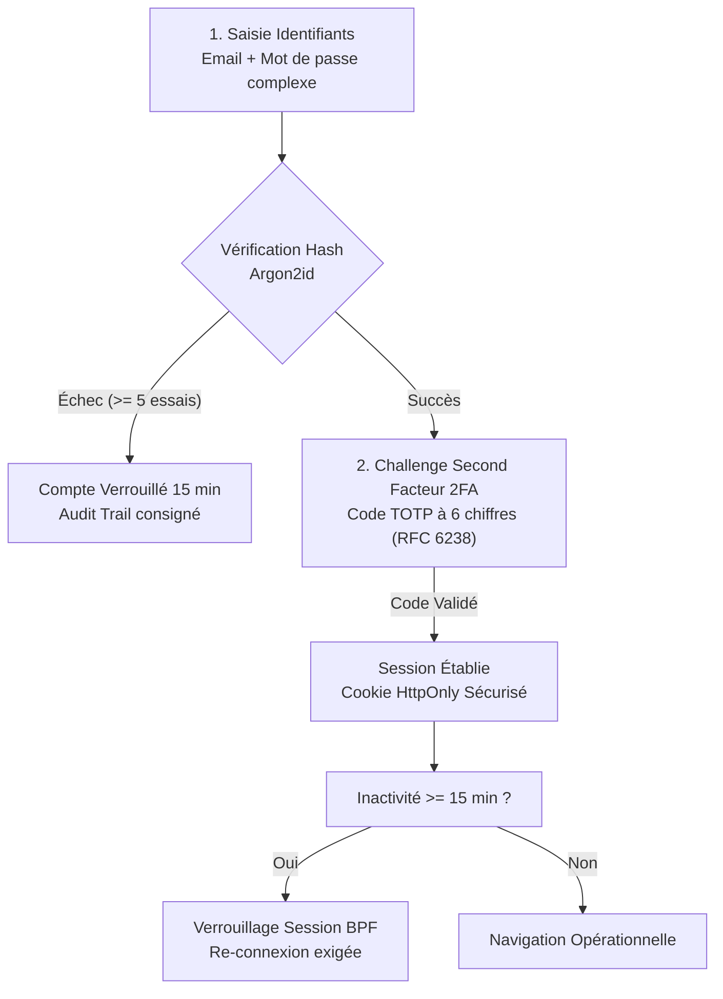
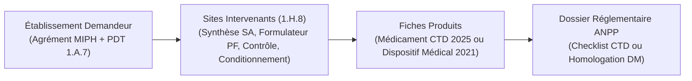

# Manuel d'Utilisation & Guide Opérationnel des Usagers
## Plateforme SANAD PHARMA — Gestion Réglementaire ANPP & GED Pharmaceutique

**Code Document :** `MAN-SANAD-001`  
**Version en vigueur :** `1.0-DRAFT`  
**Date d'effet :** Novembre 2026  
**Statut :** Document vivant (Living Documentation), révisé au fur et à mesure du déploiement des jalons et des évolutions des textes officiels de l'ANPP.  
**Public cible :** Pharmaciens Directeurs Techniques (PDT), Responsables Affaires Réglementaires (RAR), Responsables Assurance Qualité (AQ/BPF), Chefs de Projets R&D / Production, Consultants Réglementaires Externes, Administrateurs de Laboratoire.

---

## Registre des Révisions et Historique des Amendements

Ce tableau consigne formellement chaque révision de la notice d'utilisation, garantissant la traçabilité documentaire conforme aux Bonnes Pratiques de Fabrication (BPF).

| Version | Date | Auteur / Rôle | Nature des modifications & Amendements apportés | Statut d'approbation |
|:---:|:---:|---|---|:---:|
| **1.0** | 11/11/2026 | Antigravity / R&D | **Création initiale du manuel opérationnel :**<br>• Cadrage réglementaire ANPP (Guide CTD 2025, LD-DEPP07 2026).<br>• Protocoles de connexion, 2FA hors-ligne et matrice des 10 profils.<br>• Gestion du référentiel Établissements, Sites 1.H.8 et Produits (Médicaments & DM).<br>• Règles de constitution des dossiers CTD (NI, RI, MI, NF, RF, MF).<br>• Guide de signature électronique légale du Directeur Technique.<br>• Préfiguration du moteur de modifications (34 rubriques) et studio de compléments. | **Validé pour exploitation Phase 1** |
| *1.1 (Prévue)* | Déc. 2026 | Cellule Réglementaire | Intégration pas-à-pas du Coffre-fort GED (Jalon 1.4) et de la navigation Pharma Explorer 3 volets (Jalon 1.6). | *En préparation* |
| *2.0 (Prévue)* | T1 2027 | Affaires Réglementaires | Intégration du catalogue complet des 34 variations, assistant de reclassement automatique et module de regroupement (*Grouping*). | *Planifiée* |

---

## Sommaire Général

```
1. Introduction, Philosophie & Cadre Réglementaire ANPP
2. Sécurité, Connexion & Authentification Forte 2FA
3. Matrice des Rôles & Habilitations Utilisateurs (10 Profils)
4. Gestion du Référentiel Établissements, Sites & Produits
   4.1 Fiche Établissement Demandeur & Pharmacien Directeur Technique
   4.2 Cartographie des Sites de Fabrication & Contrôle (1.H.8)
   4.3 Fiche Médicament (Guide CTD 2025) & Données Économiques (PCSU vs FOB)
   4.4 Fiche Dispositif Médical (Décret 20-324 & Arrêté du 10/05/2021)
5. Constitution et Pilotage des Dossiers CTD & Homologation DM
   5.1 Les 6 Parcours Officiels de Soumission (NI, RI, MI, NF, RF, MF)
   5.2 Nomenclature Complète du Module 1 Algérie
   5.3 Modules Techniques 2 à 5 (Princeps vs Génériques)
   5.4 Indicateur Dynamique de Complétude & Contrôle Bloquant
6. Le Coffre-Fort GED Pharmaceutique (Standard BPF & ALCOA+)
   6.1 Arborescence Standardisée en 5 Branches
   6.2 Cycle de Vie Documentaire & Gestion des Versions
   6.3 Téléversement Sécurisé & Déduplication CAS SHA-256
7. Protocole de Signature Électronique Légale du Directeur Technique
8. Préfiguration : Moteur des Variations Post-Enregistrement (LD-DEPP07/V01)
9. Studio de Compléments ANPP & Compte à Rebours Légal
10. Assistance, Maintenance & Signalement d'Anomalies
```

---

## 1. Introduction, Philosophie & Cadre Réglementaire ANPP

### 1.1 Objet de la Plateforme
La plateforme logicielle **Sanad Pharma** est conçue pour piloter à 360° le cycle de vie réglementaire des médicaments et des dispositifs médicaux en Algérie. Elle permet aux laboratoires pharmaceutiques, façonniers et importateurs de :
- Structurer, centraliser et instruire leurs dossiers d'enregistrement initial, de renouvellement quinquennal et de modifications selon les référentiels officiels de l'**Agence Nationale des Produits Pharmaceutiques (ANPP)**.
- Gérer leurs documents opposables au sein d'un coffre-fort numérique conforme aux exigences de traçabilité des **Bonnes Pratiques de Fabrication (BPF)** et du standard international **ALCOA+** (*Attributable, Legible, Contemporaneous, Original, Accurate*).
- Sécuriser juridiquement les approbations grâce à la signature électronique bloquante du **Pharmacien Directeur Technique (PDT)**.

### 1.2 Référentiels Officiels Intégrés
La plateforme applique de façon native et rigoureuse les dispositions des textes algériens en vigueur :
1. **Guide pour la soumission du Dossier Technique Commun (CTD)** de l'ANPP (Version 01, Date d'effet : 31/07/2025).
2. **Ligne directrice relative aux modifications des décisions d’enregistrement** `LD-DEPP07/V01` (Version 01, Date d'effet : 22/04/2026).
3. **Décret exécutif n° 20-325** du 22 novembre 2020 fixant les modalités d'enregistrement des produits pharmaceutiques.
4. **Arrêtés du 3 octobre 2021 et du 7 novembre 2021** (Modifications de la DE et Regroupement / *Grouping*).
5. **Décret exécutif n° 20-324** et **Arrêté du 10 mai 2021** fixant les modalités d'homologation des dispositifs médicaux.

---

## 2. Sécurité, Connexion & Authentification Forte 2FA

Pour répondre aux normes BPF et 21 CFR Part 11, l'accès à Sanad Pharma repose sur une authentification nominative stricte. **Le partage d'identifiants entre collaborateurs est formellement interdit et détecté par l'audit trail.**



### 2.1 Politique de Mots de Passe
Tout mot de passe défini sur la plateforme doit obligatoirement respecter les règles suivantes :
- Longueur minimale de **12 caractères**.
- Au moins une lettre majuscule (`A-Z`).
- Au moins une lettre minuscule (`a-z`).
- Au moins un chiffre (`0-9`).
- Au moins un caractère spécial (`!@#$%^&*()_+-=[]{}|;:,.<>?`).
- Le système rejette automatiquement les mots de passe triviaux ou contenant le nom d'utilisateur.

### 2.2 Activation et Utilisation du Double Facteur (TOTP 100% Hors-Ligne)
Sanad Pharma intègre un moteur de second facteur totalement autonome ne dépendant d'aucun réseau téléphonique ni passerelle SMS externe :
1. À la première connexion, rendez-vous dans votre **Profil Utilisateur** > **Sécurité**.
2. Cliquez sur **Activer l'authentification 2FA**.
3. Scannez le QR Code affiché à l'écran avec une application d'authentification standard installée sur votre smartphone (ex: *Google Authenticator*, *Microsoft Authenticator*, *FreeOTP*).
4. Saisissez le code temporaire à 6 chiffres généré par l'application pour valider l'association.
5. **Téléchargez et conservez en lieu sûr vos 10 codes de secours à usage unique.** En cas de perte de votre téléphone, ces codes sont l'unique moyen de débloquer votre accès sans intervention de l'administrateur.

### 2.3 Verrouillage Automatique d'Inactivité (Timeout BPF)
Conformément aux exigences d'intégrité en milieu de laboratoire, **toute session inactive pendant 15 minutes consécutives est automatiquement verrouillée**. Pour reprendre votre travail sans perdre votre saisie en cours, vous devez renseigner à nouveau votre mot de passe.

---

## 3. Matrice des Rôles & Habilitations Utilisateurs (10 Profils)

L'accès aux fonctionnalités et aux données est strictement cloisonné selon 10 profils nominatifs (CDC Section 7.1) :

| Profil Utilisateur | Droits d'Accès Principaux | Droits de Validation & Signature | Périmètre Documentaire |
|---|---|---|---|
| **Pharmacien Directeur Technique (PDT)** | Contrôle global de l'établissement, consultation 360°, gestion des litiges ANPP. | **Seul habilité à la signature électronique solennelle** et à l'approbation finale bloquante des dossiers avant soumission. | Accès exhaustif à tous les dossiers et à la GED du laboratoire. |
| **Responsable Affaires Réglementaires** | Création, montage et coordination des dossiers CTD (NI/RI/MI/NF/RF/MF) et DM. | Dépôt de pièces, soumission des dossiers au visa interne du PDT. | Ensemble des dossiers réglementaires et correspondances ANPP. |
| **Contributeur Qualité / BPF** | Gestion des référentiels qualité, téléversement de SOP, certificats BPF/GMP, audits fournisseurs. | Mise en révision documentaire interne (v0.1, v1.0). | Branche `02_Assurance_Qualite_BPF` et Module 1/3 CTD. |
| **Contributeur R&D / Production** | Dépôt des formules cadres, dossiers de validation industrielle de lots (3.2.P.3.5), rapports de stabilité. | Téléversement des données de lot de validation. | Branche `03_Developpement_Production` et Modules 3 & 5 CTD. |
| **Consultant Externe** | Consultation et dépôt de pièces justificatives exclusivement sur les dossiers confiés. | Dépôt de brouillons de pièces. Aucune signature possible. | **Cloisonnement hermétique :** Accès limité aux seuls dossiers autorisés avec date d'expiration automatique. |
| **Auditeur / Inspecteur** | Contrôle de conformité et inspection réglementaire (Mode Inspection ANPP). | **Lecture seule intégrale**, exportation des rapports d'audit trail certifiés. | Accès en lecture seule à l'historique complet et à la table `audit_logs` sur périmètre audité. |
| **Partenaire Fournisseur / API Holder** | Dépôt chiffré de la partie fermée du dossier de substance active (3.2.S ASMF/DMF) et certificats BPF/CEP. | Aucun droit de signature réglementaire ni de relecture. | **Cloisonnement cryptographique :** Accès borné à la sous-section 3.2.S désignée, documents opaques pour le titulaire local mais certifiés pour l'ANPP. |
| **Administrateur Laboratoire** | Gestion des comptes utilisateurs, affectation des rôles, gestion des accès. | Aucun droit de signature réglementaire. | Données d'administration des utilisateurs et licences. |
| **Administrateur Système Local** | Exploitation système (sauvegardes, certificats TLS, Docker). | Aucun droit sur les documents pharmaceutiques. | Logs système et maintenance infra (Mode On-Premise). |
| **Super-Admin Éditeur** | Provisioning des instances laboratoires, quotas disques. | Aucun accès aux secrets de formules ni documents labos. | Console d'infrastructure (Mode Cloud SaaS Souverain). |

---

## 4. Gestion du Référentiel Établissements, Sites & Produits

Avant d'initier un dossier d'enregistrement, l'utilisateur doit renseigner le socle référentiel du laboratoire.



### 4.1 Fiche Établissement Demandeur & Pharmacien Directeur Technique
Accessible depuis le menu **Référentiel > Établissement** :
1. Renseignez la raison sociale bilingue (Français et Arabe officiel), le statut juridique (SPA, SARL, etc.) et l'adresse du siège.
2. Saisissez le **Numéro d'Agrément ministériel MIPH** ainsi que sa date d'octroi et sa date de validité.
3. **Pharmacien Directeur Technique (Exigence 1.A.7) :** Indiquez le nom complet du PDT ainsi que les références précises de la décision ministérielle nominative nommant le PDT dans ses fonctions. *Ce nom sera automatiquement apposé sur toutes les déclarations de conformité générées.*

### 4.2 Cartographie des Sites de Fabrication & Contrôle (Exigence 1.H.8)
Tout intervenant dans le cycle de production doit faire l'objet d'un enregistrement précis dans l'onglet **Sites de Fabrication** :
- **Nom du site & Pays :** Code ISO-2 officiel (ex: `DZ` pour Algérie, `FR` pour France, `IN` pour Inde).
- **Rôle réglementaire ANPP :** Sélectionnez la fonction exacte :
  - *Synthèse de la Substance Active (API/SA)* (1.M.S)
  - *Fabrication de l'Intermédiaire*
  - *Formulateur du Produit Fini (PF)* (1.M.P)
  - *Conditionneur Primaire*
  - *Conditionneur Secondaire*
  - *Laboratoire de Contrôle Analytique Libératoire*
  - *Site de Stockage agréé*
- **Licences & Certificats BPF :** Saisissez le numéro de la licence d'exploitation (1.M.S.1 / 1.M.P.1) et le numéro de certificat BPF/GMP avec date d'échéance et autorité émettrice.

> [!WARNING]
> La plateforme alerte automatiquement à **J-90** et **J-30** avant la date d'expiration d'un certificat BPF ou d'une licence de site. Un certificat expiré bloque la validation finale d'un dossier CTD rattaché à ce site.

### 4.3 Fiche Médicament (Classification Guide ANPP 2025)
La création d'une fiche médicament (**Référentiel > Médicaments > Nouveau Médicament**) structure les exigences futures de la checklist :
- **Classification d'origine ANPP :**
  - `princeps` : Médicament innovateur de référence.
  - `generique_importe` : Médicament générique fabriqué à l'étranger.
  - `generique_local` : Médicament générique fabriqué sur un site industriel algérien.
- **Dénomination et Galénique :** Saisissez la Dénomination Commerciale, la DCI (Dénomination Commune Internationale), le dosage, la forme galénique et la voie d'administration. Tous ces champs supportent une saisie bilingue FR / AR.
- **Substance Active (Module 3.2.S) :**
  - Présence d'un CEP EDQM (1.M.S.3) : Renseignez le numéro et indiquez si le demandeur détient la lettre d'accès officielle.
  - Spécifications critiques : Indiquez la forme polymorphique et si la taille particulaire (granulométrie) est un paramètre critique de dissolution.
- **Produit Fini (Module 3.2.P) :**
  - Durée de conservation (ex: 36 mois) et conditions de conservation (température, humidité).
  - *Spécifique Fabrication Locale (3.2.P.3.5) :* Cochez la détention obligatoire des dossiers de lots industriels de validation.
- **Données Économiques (1.H.4 / 1.H.5) :**
  - *Pour la fabrication locale :* Sélection obligatoire du format **PCSU** (Prix de Revient / Sortie Usine).
  - *Pour l'importation :* Format **FOB & Benchmark**, saisie du prix FOB en devises avec visa Chambre de Commerce et rattachement du dossier comparatif international.

### 4.4 Fiche Dispositif Médical (Décret 20-324 & Arrêté du 10/05/2021)
Accessible depuis **Référentiel > Dispositifs Médicaux** :
- **Classe de risque :** Sélectionnez la classe réglementaire : `I`, `IIa`, `IIb`, `III` ou `DMDIV` (Diagnostic In Vitro).
- **Caractéristiques techniques :** Précisez le statut stérile (Oui/Non), l'usage unique (Oui/Non) et la destination clinique revendiquée (Notice bilingue FR/AR).

---

## 5. Constitution et Pilotage des Dossiers CTD & Homologation DM

### 5.1 Les 6 Parcours Officiels de Soumission ANPP
Lors de la création d'un dossier d'enregistrement, vous devez sélectionner le code de procédure applicable :

| Code ANPP | Intitulé officiel | Checklist générée automatiquement |
|:---:|---|---|
| **NI** | Enregistrement Initial d'un produit Importé | CTD complet (M1 à M5) + Attestation FOB Chambre de Commerce + Benchmark de prix international. |
| **RI** | Renouvellement de la DE d'un produit Importé | Module 1 allégé + Déclaration de non-modification 1.H.10 + Certificats BPF et CPP en cours de validité. |
| **MI** | Modification d'un produit Importé | Dossier de variation ciblé + Approbation pays d'origine 1.H.6 + Sections CTD modifiées page à page. |
| **NF** | Enregistrement Initial d'un produit Fabriqué localement | CTD complet + Structure de prix PCSU + Dossiers de lots de validation 3.2.P.3.5 + Lettres d'engagement 1.P.8 et 1.P.9. |
| **RF** | Renouvellement de la DE d'un produit Fabriqué localement | Module 1 + Déclaration 1.H.10 + BPF national actualisé + Revue annuelle de qualité produit (PQR). |
| **MF** | Modification d'un produit Fabriqué localement | Dossier de variation ciblé + Données comparatives de lots/stabilités locales + Sections CTD modifiées. |

### 5.2 Nomenclature Officielle du Module 1 Algérie
Le système déploie automatiquement l'arborescence des pièces exigibles selon le guide ANPP :

```
📁 Module 1 (Exigences Spécifiques Algérie)
├── 📁 1.A : APPLICANT (Demandeur)
│   ├── 📄 1.A.1 - Récépissé de dépôt du dossier
│   ├── 📄 1.A.2 - Courrier officiel de demande signé PDT
│   ├── 📄 1.A.3 - Formulaire officiel ANPP paraphé sur chaque page et cacheté PDT
│   ├── 📄 1.A.4 - Bordereau de versement + Quittance bancaire + Attestation de change Banque d'Algérie
│   ├── 📄 1.A.5 - Accord de pré-soumission ANPP + Quittance de paiement
│   ├── 📄 1.A.6 - Agrément d'exploitation MIPH en cours de validité
│   ├── 📄 1.A.7 - Décision ministérielle nominative d'exercice du PDT
│   ├── 📄 1.A.8 - Contrats d'exploitation, de façonnage et accords qualité
│   └── 📄 1.A.9 - Historique des décisions d'enregistrement antérieures
├── 📁 1.H : HOLDER (Détenteur de la DE)
│   ├── 📄 1.H.1 - Courrier de demande du détenteur
│   ├── 📄 1.H.2 - Autorisation de Mise sur le Marché (AMM pays d'origine)
│   ├── 📄 1.H.3 - Certificat de Produit Pharmaceutique (CPP Modèle OMS)
│   ├── 📄 1.H.4 - Structure de prix PCSU (Local) ou Attestation prix FOB visée (Import)
│   ├── 📄 1.H.5 - Dossier de Benchmark international des prix (Obligatoire Import NI/RI/MI)
│   ├── 📄 1.H.6 - Preuve d'approbation de la modification dans le pays d'origine
│   ├── 📄 1.H.8 - Cartographie des sites de synthèse, formulation, conditionnement et contrôle
│   ├── 📄 1.H.10 - Déclaration formelle de non-modification (Renouvellements RI/RF)
│   └── 📄 1.H.12 - Attestation de date de bascule industrielle dans le pays d'origine
├── 📁 1.M : MANUFACTURERS (Fabricants SA & PF)
│   ├── 📄 1.M.S.1 / 1.M.S.2 - Agrément et Certificat BPF du site de synthèse API
│   ├── 📄 1.M.S.3 - Lettre d'accès nominative au CEP EDQM ou APIMF/DMF
│   ├── 📄 1.M.P.1 / 1.M.P.2 - Agrément d'ouverture et Certificat BPF du fabricant Produit Fini
│   └── 📄 1.M.P.3 - Étude clinique de Bioéquivalence OU Justification d'exonération (Biowaiver BCS)
└── 📁 1.P : PRODUCT INFORMATION (Informations Produit & Contrôle)
    ├── 📄 1.P.1 - Textes officiels pays d'origine (RCP, Notice, Étiquette)
    ├── 📄 1.P.2 - Modèle Algérie visé PDT : RCP, Notice bilingue FR/AR, Maquettes couleurs 100%
    ├── 📄 1.P.3 - Justificatif de dépôt des échantillons physiques au labo de contrôle ANPP
    ├── 📄 1.P.4 - Bulletin d'analyse SA (granulométrie, polymorphisme) et bulletin de recontrôle
    ├── 📄 1.P.5 - Bulletin d'analyse libératoire du Produit Fini
    ├── 📄 1.P.6 - Attestation formelle de correspondance des lots
    ├── 📄 1.P.7 - Certificat officiel de libération de lot par la personne qualifiée (PDT/QP)
    ├── 📄 1.P.8 - Lettre d'engagement de non-commercialisation des lots de validation (Local NF/MF)
    └── 📄 1.P.9 - Lettre d'engagement suivi des stabilités en temps réel Zone IVb (Local NF/MF)
```

### 5.3 Modules Techniques 2 à 5 (Règles d'Exigibilité)
- **Produit Princeps :** L'ensemble des Modules 1, 2, 3, 4 et 5 est obligatoirement exigé (`E`).
- **Produit Générique :**
  - **Module 2 :** Non requis sous forme de classeurs isolés (les synthèses sont intégrées dans les modules correspondants).
  - **Module 3 (Qualité) :** Obligatoire (`E`) à l'identique d'un princeps, avec contrôle obligatoire des dossiers de lots de validation en 3.2.P.3.5 pour la fabrication locale.
  - **Module 4 (Non clinique) :** Facultatif (`F`) lors du dépôt initial (l'ANPP se réservant le droit de le réclamer).
  - **Module 5 (Clinique) :** Focalisé impérativement sur la **Bioéquivalence (5.3.1.2)** avec intervalle de confiance 90 % [80,00 % - 125,00 %] ou sur le dossier de **Biowaiver** justifié scientifiquement.

### 5.4 Indicateur Dynamique de Complétude & Contrôle Bloquant
Sur chaque dossier, une barre d'état calcule en temps réel le pourcentage d'avancement :
$$\text{Complétude (\%)} = \frac{\text{Nombre de pièces obligatoires validées}}{\text{Nombre total de pièces exigibles selon le parcours}} \times 100$$

> [!CAUTION] Règle Bloquante de Soumission
> La plateforme **interdit formellement** le passage d'un dossier au statut *« Validé interne / Prêt pour dépôt ANPP »* si :
> 1. Le taux de complétude est inférieur à **100 %** (au moins une pièce obligatoire manquante ou rejetée).
> 2. Une des licences ou un certificat BPF des sites rattachés est expiré.
> 3. La signature électronique solennelle du Pharmacien Directeur Technique n'a pas été apposée.

---

## 6. Le Coffre-Fort GED Pharmaceutique (Standard BPF & ALCOA+)

### 6.1 Arborescence Standardisée en 5 Branches Maîtresses
La GED est structurée pour séparer rigoureusement les départements tout en permettant la réutilisation des documents maîtres dans les dossiers CTD :
1. **`01_Affaires_Reglementaires` :** Agréments MIPH, Décisions d'Enregistrement, Homologations DM, correspondances et récépissés ANPP.
2. **`02_Assurance_Qualite_BPF` :** Procédures opératoires normalisées (SOP), Certificats GMP/ISO, rapports d'audits fournisseurs, dossiers CAPA.
3. **`03_Developpement_Production` :** Formules cadres, dossiers de lots de validation industrielle (3.2.P.3.5), protocoles et rapports de stabilité Zone IVb, méthodes de contrôle analytique validées.
4. **`04_Vigilance_Post_Market` :** Rapports périodiques de sécurité (PSUR), notifications de matériovigilance, dossiers d'investigation et retraits de lots.
5. **`05_Contrats_Tiers` :** Quality Technical Agreements (QTA), contrats de façonnage, certificats CEP des fabricants de principes actifs.

### 6.2 Cycle de Vie Documentaire & Gestion des Versions
Chaque document déposé suit un cycle de vie strict :
$$\text{Brouillon} \longrightarrow \text{En revue} \longrightarrow \text{En approbation DT} \longrightarrow \text{En vigueur} \longrightarrow \text{Obsolète}$$

- **Versions mineures (`v0.1`, `v0.2`) :** Utilisées durant la phase de rédaction et de relecture interne.
- **Versions majeures (`v1.0`, `v2.0`) :** Entrent en vigueur uniquement après approbation formelle du Pharmacien Directeur Technique.
- **Motif de modification obligatoire :** Toute révision d'un document exige la saisie explicite de la justification de changement (consignée dans l'audit trail).

### 6.3 Téléversement Résilient (Chunked Upload) & Déduplication CAS
- **Résilience réseau :** Les fichiers volumineux (dossiers de lots, rapports de stabilités jusqu'à 500 Mo) sont transmis par morceaux de 5 Mo avec reprise automatique en cas de micro-coupure réseau.
- **Stockage CAS (Content-Addressed Storage) :** Le système calcule l'empreinte cryptographique **SHA-256** de chaque fichier. Si un même certificat BPF est utilisé sur 10 médicaments différents, il n'est stocké qu'une seule fois physiquement sur le disque chiffré, évitant tout gaspillage d'espace de stockage.

---

## 7. Protocole de Signature Électronique Légale du Directeur Technique

Conformément à l'article 7 du décret exécutif 20-325, le Pharmacien Directeur Technique assume l'entière responsabilité technique, pharmaceutique et juridique des dossiers soumis à l'ANPP.

### Déroulement Pas-à-Pas de la Cérémonie de Signature :
1. Le Responsable Affaires Réglementaires passe le dossier au statut **« Soumis pour approbation DT »**.
2. Le Pharmacien Directeur Technique se connecte sur son espace personnel et ouvre le dossier.
3. Après revue des pièces sur le volet de visualisation instantané (Alt+P), il clique sur **[ Signer et Sceller le Dossier ]**.
4. **Fenêtre de Re-authentification Solennelle :**
   - Le système affiche la déclaration réglementaire obligatoire :
     > *« En qualité de Pharmacien Directeur Technique, j'atteste sur l'honneur l'exactitude, la véracité et la complétude des données du présent dossier soumis à l'ANPP conformément aux lois et réglementations en vigueur. »*
   - Le PDT saisit son mot de passe personnel ainsi que le code dynamique **TOTP à 6 chiffres** de son smartphone.
5. **Scellement Cryptographique :**  
   Le système génère un sceau numérique infalsifiable liant :
   - L'empreinte SHA-256 du document ou de l'archive du dossier.
   - L'identifiant nominatif et le numéro de décision d'exercice du PDT.
   - L'horodatage UTC certifié et l'adresse IP de signature.
6. Le dossier passe au statut **« Validé interne / Prêt pour dépôt ANPP »** et un bordereau de dépôt certifié avec certificat d'intégrité est généré pour remise à l'ANPP.

---

## 8. Préfiguration : Moteur des Variations Post-Enregistrement (LD-DEPP07/V01)

*(Ce module sera déployé lors de la Phase 2 de la Roadmap - Jalon 2.2)*

### 8.1 Les 3 Classes Algériennes
L'ANPP a aboli les nomenclatures européennes (Types IA/IB/II). Sanad Pharma gère nativement :
- **Modification Mineure (Mmin) :** Impact négligeable sur la qualité, la sécurité ou l'efficacité.
- **Modification Modérée (Mmod) :** Impact potentiel nécessitant une revue formelle.
- **Modification Majeure (Mmaj) :** Impact substantiel sur le profil du produit.

### 8.2 Règle du Reclassement Automatique (Escalade)
Lorsque vous déclarez un changement parmi les **34 rubriques officielles** (changement de site de synthèse API, modification de procédé, taille de lot, contenant primaire) :
1. Le système vous soumet le questionnaire réglementaire des conditions à remplir.
2. **Si l'ensemble des conditions est respecté :** La modification conserve sa classe nominale (`Mmin` ou `Mmod`).
3. **Dès lors qu'une seule condition n'est pas remplie :** Le moteur d'escalade **reclasse automatiquement la demande au niveau supérieur** (`Mmin` $\to$ `Mmod` ou `Mmaj`, et `Mmod` $\to$ `Mmaj`) et actualise instantanément la liste des 12 pièces justificatives requises (CDC Section 5.3).

### 8.3 Regroupement de Modifications (*Grouping*)
En application de l'article 09 de l'arrêté du 07/11/2021, plusieurs variations interdépendantes pour une même DE peuvent être soumises ensemble. Sanad Pharma calcule automatiquement le niveau de risque global du groupe : **si une modification du groupe est classée `Mmaj`, l'ensemble de la soumission groupée est traitée selon les exigences `Mmaj`.**

---

## 9. Studio de Compléments ANPP & Compte à Rebours Légal

À réception d'un courrier de demande de compléments émis par la Commission d'Enregistrement de l'ANPP :
1. Cliquez sur **Dossiers > [Votre Dossier] > Enregistrer un Complément ANPP**.
2. Renseignez la date de réception du courrier, le numéro de référence officiel et le délai légal imparti (ex: 60 jours).
3. Découpez le courrier en questions élémentaires et assignez chaque question à un contributeur interne (ex: Question 1 pour la Qualité, Question 2 pour la R&D).
4. **Moteur d'Alertes Dynamiques :**
   - Un bandeau visuel décompte les jours restants dans l'interface.
   - Des alertes e-mails sont programmées à **J-30, J-15, J-7 et J-3**.
   - **Escalade automatique :** À J-7 d'une échéance sans réponse finalisée, une alerte d'urgence est notifiée directement au Pharmacien Directeur Technique pour éviter la caducité du dossier.

---

## 10. Assistance, Maintenance & Signalement d'Anomalies

### 10.1 Journal d'Audit et Recherche d'Incident
En cas de doute sur une action opérée sur un dossier, l'Auditeur ou l'Administrateur peut consulter le menu **Sécurité > Audit Trail** :
- Chaque lecture, téléchargement, modification ou tentative d'accès est consignée avec horodatage UTC, identifiant utilisateur, rôle et empreinte SHA-256.
- Aucun utilisateur (y compris l'administrateur système) ne peut altérer ou purger ce journal.

### 10.2 Support Utilisateur & Mises à Jour Réglementaires
- **Support Réglementaire & Technique :** Disponible par ticket interne ou à l'adresse support du laboratoire.
- **Amendements Réglementaires :** En cas de publication par l'ANPP d'une nouvelle décision ou d'un avenant au Guide CTD, l'éditeur met à disposition un paquet de mise à jour signé cryptographiquement (`.pkg`), applicable à chaud sans coupure de service.

---

### Clause de Maintien en Condition Documentaire
*La présente notice d'utilisation est un document vivant. Toute modification de l'interface logicielle, ajout d'un jalon technique ou parution d'un nouveau texte juridique de l'ANPP entraînera la publication d'un avenant documenté au sein du Registre des Révisions ci-dessus.*
