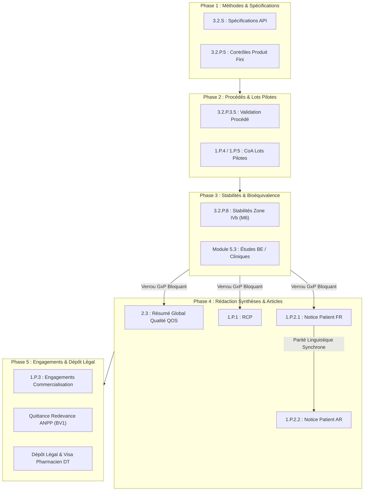

# Bilan de Recette & Qualification — Moteur de Dépendances Chronologiques & Gating CTD (Jalon 2.1b)

**Projet :** Sanad Pharma (*Homolog*) — Plateforme Réglementaire & BPF Algérienne (ANPP / MIPH)  
**Branche Git :** `feat/jalon-2.1b-moteur-gating-dependances-ctd`  
**Commit :** `45af3a4`  
**Date :** 18 Novembre 2026  
**Statut :** ✅ **CONFORME & QUALIFIÉ (Tests Unitaires, Intégration API & Robot Navigateur)**

---

## 1. Synthèse des Réalisations Techniques

Le **Moteur de Dépendances Chronologiques, Chemin Critique & Déverrouillage Conditionnel (*Gating*)** a été conçu, implémenté et qualifié conformément aux exigences du Guide CTD ANPP Juillet 2025, du Décret exécutif n° 20-325 (Art. 12) et des règles ALCOA+ / 21 CFR Part 11.

---

## 2. Règles Métier & Garde-fous Réglementaires Implémentés

| N° | Règle Métier BPF / ANPP | Cible Contrôlée | Prérequis Exigé | Gravité & Code | Fondement Légal |
|:---|:---|:---|:---|:---|:---|
| **1** | **Stabilités Zone IVb ➔ Notice & RCP** | `1.P.1` (RCP) & `1.P.2` / `1.P.2.1` (Notice) | `3.2.P.8` en statut `approved_sealed` | `BLOCKING` (HTTP 422 `GATING_BLOCKED`) | Guide CTD ANPP Juillet 2025 Module 1.P & 3.2.P.8 (Seuil légal M6) |
| **2** | **Parité Linguistique Synchrone FR ➔ AR** | `1.P.2.2` (Notice Arabe) | `1.P.2.1` au moins `under_review` (revue) et `approved_sealed` (approbation) | `BLOCKING` (HTTP 422 `GATING_BLOCKED`) | Décret exécutif n° 20-325 Art. 12 & Guide ANPP |
| **3** | **Module 3 Qualité ➔ QOS Module 2.3** | `2.3` (Résumé Global de la Qualité) | 100% des rubriques `[E]` du Module 3 scellées en `v1.0` | `BLOCKING` (HTTP 422 `GATING_BLOCKED`) | ICH M4Q & Guide CTD ANPP Module 2.3 |
| **4** | **Validation Procédé ➔ Stabilités Zone IVb** | `3.2.P.8` (Stabilités) | `3.2.P.3.5` (Validation procédé sur lots pilotes) | `WARNING` | BPF Algériennes & Guide CTD 3.2.P.3.5 |
| **5** | **Calculateur DAG 5 Phases** | Dossier global | Détermination automatique de la phase active (1 à 5) | `ANALYTICS` | Chemin critique du montage CTD |

---

## 3. Résultats de Qualification & Tests Automatisés

### Tests Unitaires du Domaine (`internal/domain/gating_test.go`)
- `TestGating_NoticeBlockedByStabilities` : **PASS** (vérifie le blocage de 1.P.2 tant que 3.2.P.8 n'est pas scellée, puis déverrouillage immédiat).
- `TestGating_PariteLinguistiqueNoticeFRandAR` : **PASS** (vérifie le blocage de la soumission de 1.P.2.2 tant que 1.P.2.1 n'est pas en revue, et le blocage de l'approbation tant que 1.P.2.1 n'est pas scellée).
- `TestGating_QOSBlockedByModule3` : **PASS** (vérifie le blocage du QOS 2.3 tant qu'une pièce exigée du Module 3 reste non scellée).
- `TestGating_DAGPhaseProgression` : **PASS** (vérifie la transition automatique du dossier de la Phase 1 à la Phase 5 au fur et à mesure du scellement des étapes).

### Tests d'Intégration API & Workflow (`internal/api/workflow_gating_test.go`)
- Refus HTTP 422 avec JSON structuré `GATING_BLOCKED` lors de la tentative d'approbation sans prérequis : **PASS**
- Inspection par endpoint dédié `GET /api/v1/dossiers/{id}/items/{itemId}/gating` : **PASS**
- Synthèse globale par endpoint `GET /api/v1/dossiers/{id}/gating-summary` : **PASS**
- Levée instantanée du verrou dès scellement de la pièce prérequise : **PASS**
