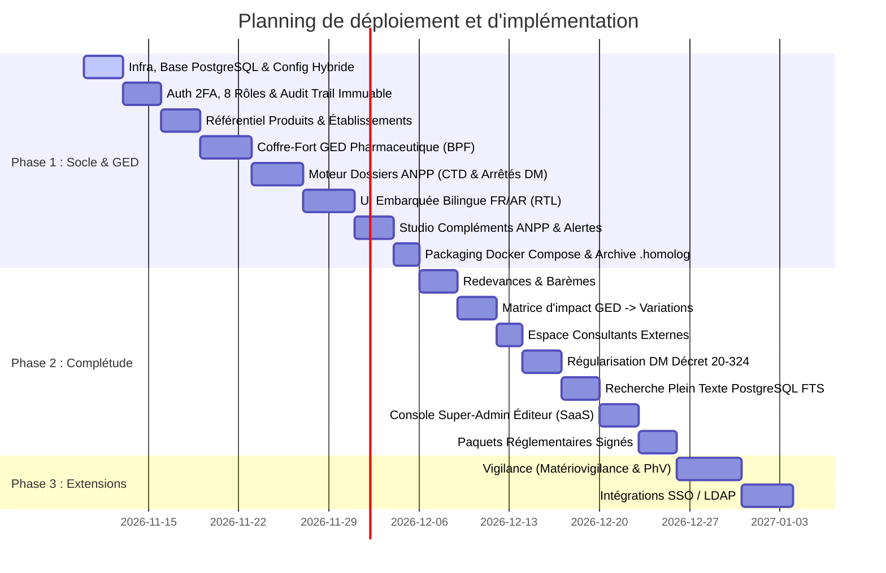

# Feuille de route du projet (Roadmap)
## Plateforme collaborative de gestion de l'enregistrement des médicaments, de l'homologation des DM et GED pharmaceutique en Algérie

**Dernière mise à jour :** 10 novembre 2026  
**Document de référence :** [`docs/cahier_des_charges.md`](file:///c:/dev/homolog/docs/cahier_des_charges.md) (v0.5)  
**Architecture cible :** Go 1.26+ | PostgreSQL 16+ (`pgx`) | Frontend embarqué TypeScript/Tailwind (RTL FR/AR) | Mode Hybride (On-Premise & SaaS)

---

## Vue d'ensemble des jalons

---

## Phase 1 : Socle Fondateur, GED Pharmaceutique & Parcours 360° (Priorité M)
> **Objectif :** Disposer d'une plateforme fonctionnelle de bout en bout permettant de créer un produit, monter un dossier d'enregistrement CTD ou d'homologation DM, déposer et signer électroniquement des pièces en GED, et exporter l'archive de réversibilité.

### Jalon 1.1 : Infrastructure, Base de données & Configuration Hybride
- [x] Initialiser l'arborescence Go (`cmd/server`, `internal/{api,domain,ged,regulatory,storage,database,audit}`)
- [x] Configurer la connexion PostgreSQL via `jackc/pgx/v5` avec pool de connexions asynchrone
- [x] Écrire les migrations initiales SQL (Schémas, tables de base, contraintes d'intégrité)
- [x] Gérer la configuration hybride par variables d'environnement (`DEPLOYMENT_MODE=on-premise` ou `saas`)
- [x] Mettre en place le `StorageProvider` (Driver CAS local sur disque chiffré avec hachage SHA-256 et déduplication)

### Jalon 1.2 : Authentification Forte, 2FA Hors-Ligne, Rôles & Audit Trail (21 CFR Part 11)
- [x] Implémenter le hachage sécurisé des mots de passe avec **Argon2id** et politique de complexité (min. 12 car.)
- [x] Développer la gestion des sessions par **Cookies HttpOnly sécurisés** avec table de sessions PostgreSQL pour révocation instantanée
- [x] Développer le second facteur **TOTP (RFC 6238)** 100% hors-ligne (QR code local, Google/Microsoft Authenticator, 10 codes de secours chiffrés)
- [x] Mettre en place le verrouillage automatique de session sur inactivité (Idle timeout 15 min BPF) et protection anti-brute force (5 essais = 15 min de blocage)
- [x] Implémenter la matrice des 8 rôles stricts (Admin Sys, Admin Labo, Affaires Réglementaires, DT, Qualité/Prod, Consultant, Lecteur, Auditeur)
- [x] Créer le flux de **re-authentification pour signature électronique légale** (mot de passe/2FA + déclaration de rôle BPF)
- [x] Créer la table `audit_logs` strictement *append-only* (triggers SQL PostgreSQL interdisant UPDATE et DELETE)
- [x] Logger automatiquement toutes les actions sensibles (connexion, échec, consultation, téléchargement, approbation, signature, modification de rôle)

### Jalon 1.3 : Référentiel Établissements & Produits (Bilingue FR/AR)
- [ ] Modèle et API **Établissement** (Raison sociale, agrément MIPH, Directeur Technique, sites de fabrication)
- [ ] Modèle et API **Produit Médicament** (Dénomination, DCI, forme galénique, dosage, voie, statut réglementaire)
- [ ] Modèle et API **Produit Dispositif Médical** (Dénomination, classe I/IIa/IIb/III/DMDIV, stérilité, règle de classification)
- [ ] Support des champs bilingues FR/AR dans les tables PostgreSQL

### Jalon 1.4 : Coffre-Fort GED Pharmaceutique (Standard BPF / ALCOA+)
- [ ] Arborescence préconfigurée en 5 branches :
  - `01_Affaires_Reglementaires`
  - `02_Assurance_Qualite_BPF`
  - `03_Developpement_Production`
  - `04_Vigilance_Post_Market`
  - `05_Contrats_Tiers`
- [ ] Gestion du cycle de vie documentaire (*Brouillon* $\to$ *En revue* $\to$ *En approbation* $\to$ *En vigueur* $\to$ *Obsolète*)
- [ ] Gestion des versions mineures/majeures (`v0.1`, `v1.0`, `v2.0`) avec saisie obligatoire du motif de révision
- [ ] Circuit d'approbation et **Signature électronique légale du Directeur Technique** (avec mot de passe/2FA, horodatage UTC et mention légale)
- [ ] Téléversement par morceaux (Chunked Upload résilient aux coupures) et déduplication physique par hash SHA-256

### Jalon 1.5 : Moteur de Dossiers ANPP & Checklists Interactives
- [ ] Arborescence **CTD Médicaments** (Modules 1 à 5, avec Module 1 spécifique Algérie)
- [ ] Questionnaire de qualification dynamique **Dispositifs Médicaux** (génération automatique de la liste de pièces selon l'arrêté du 10 mai 2021)
- [ ] Liaison dynamique GED $\leftrightarrow$ Checklist du dossier ANPP
- [ ] Calculateur de complétude en temps réel (pourcentage, pièces manquantes obligatoires vs conditionnelles)
- [ ] Verrouillage strict du statut *« Validé interne / Prêt pour dépôt »* (soumis à 100% de complétude + signature DT)

### Jalon 1.6 : Interface Web Haute Densité 'Pharma Explorer' (3 Volets & RTL FR/AR)
- [ ] Architecture frontend TypeScript / Tailwind CSS / Lucide Icons embarquée via `//go:embed`
- [ ] Implémenter le layout 'Pharma Explorer' à 3 volets (inspiré de Windows Explorer Pro) :
  - Volet gauche : Navigation par arbre dépliable avec chevrons et compteurs compacts de complétude
  - Zone centrale : Tableau dense (lignes compactes de 32px, 25-30 documents visibles sans scroll, colonnes triables)
  - Volet droit : Volet de prévisualisation immédiate (Preview Pane, Alt+P) avec PDF.js local et modale de signature DT
- [ ] Barre d'adresse en fil d'Ariane cliquable (Breadcrumb) avec champ de filtrage instantané en temps réel
- [ ] Barre d'état inférieure (Status bar : compteurs de pièces manquantes, espace disque labo)
- [ ] Intégration des polices locales `Cairo` (Arabe) et `Inter` (Français) sans aucun appel CDN externe
- [ ] Support complet de la bascule dynamique LTR $\leftrightarrow$ RTL (`dir="rtl"`) avec inversion naturelle des 3 volets
- [ ] Écrans principaux :
  - Cockpit de pilotage (vue portefeuille, frise chronologique des alertes J-180/J-90)
  - Explorateur de dossier CTD / DM avec checklist interactive haute densité
  - Explorateur du coffre-fort GED Pharmaceutique
  - Visionneuse PDF intégrée avec bouton de signature électronique légale du Directeur Technique

### Jalon 1.7 : Studio de Compléments ANPP & Moteur d'Alertes
- [ ] Enregistrement des courriers officiels ANPP (date, référence, motif)
- [ ] Découpage des questions de l'ANPP en tâches collaboratives unitaires avec compte à rebours légal
- [ ] Moteur d'échéances multi-niveaux :
  - Bandeau d'alerte visuel d'urgence dans l'application ($J < 30$ jours)
  - Alertes e-mails SMTP programmées (J-180, J-90, J-30, J-7)
  - Escalade automatique vers le Directeur Technique si une échéance critique est non traitée à J-30

### Jalon 1.8 : Packaging, Déploiement & Réversibilité
- [ ] Fichier `docker-compose.yml` de production (PostgreSQL 16 + conteneur Homolog binaire Go)
- [ ] Script d'assistant de premier démarrage (Setup Wizard pour le premier compte Admin et labo)
- [ ] Module d'export / import de l'archive universelle chiffrée `.homolog` (dump PostgreSQL + blobs GED + SHA-256)
- [ ] Validation de la réversibilité complète (Export $\to$ Réimport sur une nouvelle instance)

---

## Phase 2 : Complétude & Efficacité Opérationnelle (Priorité S)
> **Objectif :** Compléter la gestion financière, la régularisation des DM, la recherche documentaire avancée et le pilotage des consultants externes.

- [ ] **Jalon 2.1 : Suivi des Redevances de Dépôt**
  - Barèmes paramétrables selon la procédure et la classe du DM
  - Enregistrement des quittances, dates de paiement et justificatifs
  - Vue consolidée des dépenses réglementaires par produit et par période
- [ ] **Jalon 2.2 : Matrice d'Impact Guidée (GED $\to$ Modifications ANPP)**
  - Détection automatique des produits enregistrés impactés par la révision d'un document GED
  - Questionnaire d'orientation vers la catégorie de modification (Mineure Type IA/IB, Majeure Type II)
  - Création assistée du dossier de modification (variation) rattaché à la décision initiale
- [ ] **Jalon 2.3 : Espace Sécurisé pour Consultants Externes**
  - Cloisonnement strict aux seuls dossiers partagés
  - Date d'expiration de contrat automatique (révocation programmée de l'accès)
  - Traçabilité et marquage d'audit renforcé
- [ ] **Jalon 2.4 : Procédure Spécifique de Régularisation des DM (Décret 20-324)**
  - Inventaire des DM déjà commercialisés sans décision d'homologation
  - Checklist spécifique de l'arrêté du 10 mai 2021 relatif à la régularisation
  - Suivi des mesures transitoires
- [ ] **Jalon 2.5 : Moteur de Recherche Plein Texte (PostgreSQL FTS)**
  - Indexation automatique du contenu textuel des PDF, Word (.docx) et Excel (.xlsx) déposés en GED
  - Recherche globale multi-critères avec surlignage des résultats en français et arabe
- [ ] **Jalon 2.6 : Console Super-Admin Éditeur (Mode Cloud SaaS)**
  - Interface d'administration multi-laboratoires
  - Provisioning d'espace labo en 1 clic avec création de sous-domaine (`*.homolog.dz`)
  - Gestion des quotas de stockage disque par client et suivi de consommation
- [ ] **Jalon 2.7 : Mises à Jour Réglementaires Hors-Ligne**
  - Format de paquets de contenu signés cryptographiquement (`.pkg`)
  - Importation par l'administrateur sans redémarrage
  - Vue comparative (Diff) entre le modèle existant et le nouveau modèle avant migration

---

## Phase 3 : Extensions & Écosystème (Priorité C)
> **Objectif :** Étendre la plateforme à la surveillance post-marché et aux interconnexions d'entreprise.

- [ ] **Jalon 3.1 : Registre de Vigilance**
  - Module de Pharmacovigilance (PSUR, signalements d'effets indésirables)
  - Module de Matériovigilance des Dispositifs Médicaux (incidents, défaillances)
  - Suivi des rappels et retraits de lots
- [ ] **Jalon 3.2 : Intégrations d'Entreprise**
  - Authentification unique SSO (SAML 2.0 / OpenID Connect) et annuaire LDAP / Active Directory
  - Synchronisation des calendriers réglementaires au format iCal
- [ ] **Jalon 3.3 : Passerelle Officielle ANPP**
  - Connecteur d'interopérabilité API dès publication des spécifications par l'ANPP

---

## Guide d'avancement et suivi

| Indicateur | Valeur cible Phase 1 | État actuel |
|---|---|---|
| **Spécifications fonctionnelles validées** | 100 % | 100 % (v0.7) |
| **Jalons Phase 1 complétés** | 8 / 8 jalons | 1 / 8 jalons (Jalon 1.1 complété ✅) |
| **Couverture des tests automatisés** | > 80 % sur le domaine métier & audit | Tests unitaires stockage CAS validés (100%) |
| **Conformité BPF / ALCOA+** | Validée sur l'audit trail et GED | Validée & Implémentée (Trigger immuabilité + CAS SHA-256) |
