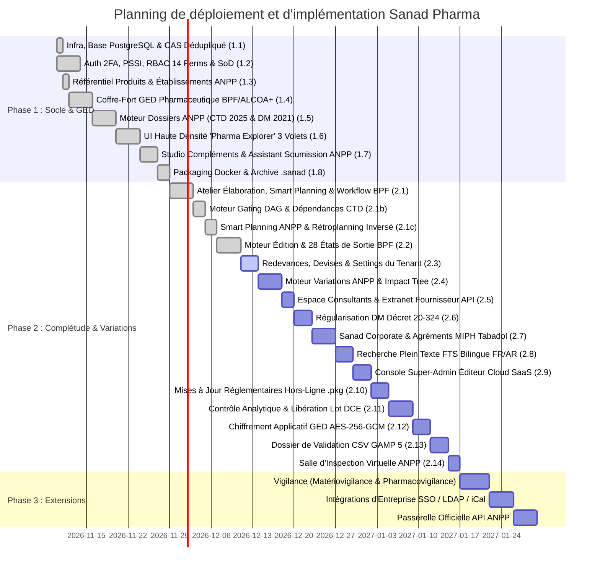

# Feuille de route du projet (Roadmap)
## Plateforme SANAD PHARMA — Gestion de l'Enregistrement des Médicaments, de l'Homologation des DM et GED Pharmaceutique en Algérie

**Dernière mise à jour :** 18 novembre 2026  
**Document de référence :** [`docs/cahier_des_charges.md`](file:///c:/dev/homolog/docs/cahier_des_charges.md) (v1.0 - Harmonisation Réglementaire ANPP/MIPH, Chapitre 10 - Sanad Corporate & Chapitre 11 - Spécifications Exhaustives des États de Sortie)  
**Textes réglementaires officiels algériens intégrés :**
- **Décret exécutif n° 21-82 du 23 février 2021** relatif aux établissements pharmaceutiques et aux conditions de leur agrément.
- **Arrêté du 22 septembre 2025** (Établissements de fabrication, éléments du dossier, traitement et liste des modifications substantielles).
- **Arrêté du 30 septembre 2025** (Établissements de distribution en gros) & **Arrêtés du 1er octobre 2025** (Exploitation & Importation).
- **Ligne directrice MIPH (Février 2026)** relative au dépôt et au traitement des modifications liées aux établissements de fabrication.
- **Guide pour la soumission du Dossier Technique Commun (CTD)** destiné à l'enregistrement des produits pharmaceutiques à usage humain (DEPP/ANPP, Version 01, Date d'effet : 31/07/2025).
- **Ligne directrice relative aux modifications des décisions d’enregistrement** des produits pharmaceutiques à usage de la médecine humaine (Code : `LD-DEPP07/V01`, Version 01, Date : 22/04/2026).
- **Décret exécutif n° 20-325** du 22 novembre 2020 (Modalités d'enregistrement des médicaments).
- **Arrêté du 3 octobre 2021** (Modalités de modification de la DE) & **Arrêté du 7 novembre 2021** (Article 09 : Regroupement de modifications / *Grouping*).
- **Décret exécutif n° 20-324** et **Arrêté du 10 mai 2021** (Modalités d'homologation des dispositifs médicaux).  
- **Arrêté BPF 2024 / ICH Q10 / 21 CFR Part 11** (Intégrité des données ALCOA+, Piste d'audit immuable et Signature électronique légale).
**Architecture cible :** Go 1.26+ | PostgreSQL 16+ (`pgx/v5`) | Frontend embarqué TypeScript/Tailwind (RTL FR/AR) | Mode Hybride (On-Premise & SaaS)

---

## Vue d'ensemble des jalons

---

## Phase 1 : Socle Fondateur, GED Pharmaceutique & Parcours 360° (Priorité M)
> **Objectif stratégique :** Disposer d'une plateforme opérationnelle de bout en bout permettant de créer un produit (Princeps, Générique importé, Générique fabriqué localement), monter un dossier d'enregistrement CTD conforme au guide ANPP 2025 (procédures NI, RI, MI, NF, RF, MF) ou d'homologation DM, déposer et signer électroniquement des pièces en GED, et exporter l'archive de réversibilité.

### Jalon 1.1 : Infrastructure, Base de données & Configuration Hybride
- [x] Initialiser l'arborescence Go (`cmd/server`, `internal/{api,domain,ged,regulatory,storage,database,audit}`)
- [x] Configurer la connexion PostgreSQL via `jackc/pgx/v5` avec pool de connexions asynchrone
- [x] Écrire les migrations initiales SQL (Schémas, tables de base, contraintes d'intégrité)
- [x] Gérer la configuration hybride par variables d'environnement (`DEPLOYMENT_MODE=on-premise` ou `saas`)
- [x] Mettre en place le `StorageProvider` (Driver CAS local sur disque chiffré avec hachage SHA-256 et déduplication physique)
- [x] Valider la suite de tests unitaires du stockage CAS (`storage_test.go`)

### Jalon 1.2 : Authentification Forte, 2FA Hors-Ligne, Rôles & Audit Trail (21 CFR Part 11) — *[Terminé : RBAC 14 Perms, SoD & Console Admin]*
- [x] **Socle d'authentification et gestion des sessions BPF :**
  - [x] Implémenter le hachage sécurisé des mots de passe avec **Argon2id** (mémoire 64 Mo, 3 itérations) et politique de complexité (min. 12 car., minuscules, majuscules, chiffres, caractères spéciaux).
  - [x] Développer la gestion des sessions par **Cookies HttpOnly sécurisés** (SameSite=Strict, HTTPS) avec table de sessions PostgreSQL pour révocation instantanée.
  - [x] Développer le second facteur **TOTP (RFC 6238)** 100% hors-ligne (QR code local, Google/Microsoft Authenticator, 10 codes de secours chiffrés).
  - [x] Mettre en place le verrouillage automatique de session sur inactivité (**Idle timeout 15 min BPF**) et protection anti-brute force (5 essais = 15 min de blocage).
  - [x] Valider les suites de tests unitaires d'authentification (`password_test.go`, `totp_test.go`, `auth_handler_test.go`).
- [x] **Intégrité ALCOA+, Piste d'audit & Signature légale PDT :**
  - [x] Créer la table `audit_logs` strictement *append-only* (triggers SQL PostgreSQL interdisant `UPDATE` et `DELETE`).
  - [x] Logger automatiquement toutes les actions sensibles (connexion, consultation, téléchargement, approbation, signature, modification de rôle).
  - [x] Créer le flux de **re-authentification pour signature électronique légale du PDT** :
    - Re-saisie du mot de passe ou validation TOTP avec la déclaration solennelle obligatoire :  
      *« En qualité de Pharmacien Directeur Technique, j'atteste sur l'honneur l'exactitude, la véracité et la complétude des données du présent dossier soumis à l'ANPP conformément aux lois et réglementations en vigueur. »*
    - Scellement cryptographique par empreinte SHA-256 liant le binaire du document, l'identité du signataire, son rôle officiel, l'horodatage UTC et l'adresse IP.
- [x] **Mise en conformité PSSI, RBAC Dynamique & Console Dédiée (Sections 6.3, 7.1 & 7.2 du CDC) :**
  - [x] Définir les 10 profils utilisateurs stricts dans le domaine métier (`internal/domain/rbac.go`), incluant le profil partenaire fournisseur API pour le dépôt ASMF chiffré.
  - [x] **Modèle de Données PostgreSQL Dynamique (Migration `005_rbac_and_dynamic_permissions.sql`) :**
    - Tables `roles`, `permissions`, `role_permissions`, `user_permissions`.
    - Pré-remplissage des 14 permissions unitaires et de la matrice par défaut des 10 rôles sans perturber les données existantes.
  - [x] **Moteur RBAC Backend Go & Garde-fous BPF Inviolables :**
    - Service `RBACService` et middleware `RequirePermission(perm)` / `RequireAnyPermission(perms...)`.
    - Garde-fous réglementaires inviolables en code Go : exercice du visa PDT réservé exclusivement au DT titulaire de la décision ministérielle (1.A.7), filtre Zero-Trust bloquant le téléchargement de documents pour les admins techniques (`admin_systeme_local`, `super_admin_editeur`), et non-auto-approbation SoD par pièce (*Maker* ≠ *Checker* ≠ *Approver*).
    - Système d'invalidation instantanée par versioning de permissions (`permissions_version`) pour répercussion immédiate sur sessions actives.
    - Interception stricte de chaque endpoint API (`HTTP 403 Forbidden`) avec journalisation d'alerte automatique dans `audit_logs` (`AUDIT_SECURITY_403_BLOCKED`).
  - [x] **Console Dédiée d'Administration du Laboratoire (Section 6.3 CDC) :**
    - Interface autonome dédiée pour l'Administrateur de Laboratoire (`web/js/admin.js`, gestion collaborateurs, modification interactive de rôle, matrice dynamique des 14 permissions unitaires, 4 politiques visuelles de garde-fous BPF/PSSI, export CSV certifié).
    - Commutateur de test instantané **Dev Role Switcher** dans la barre supérieure (`POST /api/v1/auth/dev-switch`, verrouillé strictement et désactivé en production `APP_ENV=production`, cookies avec attribut `Secure` dynamique TLS/proxy).
  - [x] **Gardes de Navigation Frontend & Masquage Dynamique de l'UI (Pharma Explorer) :**
    - Route Guards frontend interceptant les accès directs non autorisés par domaine avec popups sécurisées d'interdiction.
    - Moteur de rendu conditionnel masquant les composants non autorisés (`data-perm`, `data-perm-any`, bouton signature PDT, console admin, boutons téléchargement Zero-Trust).
    - Provisionnement de 10 collaborateurs réalistes (avec profil Partenaire Fournisseur API) avec mot de passe universel `Homolog2026!Dev` pour les tests complets.
  - [x] Développer et valider la suite de tests unitaires RBAC / Zero-Trust / Session (`internal/api/rbac_test.go`).

### Jalon 1.3 : Référentiel Établissements & Produits (Conforme Guide ANPP 2025)
- [x] **Modèle et tables PostgreSQL pour les Établissements :**
  - Table `establishments` : Raison sociale, statut juridique, agrément ministériel MIPH (numéro, date d'octroi, échéance), coordonnées du Pharmacien Directeur Technique (PDT - 1.A.7) avec décision ministérielle nominative.
  - Table `manufacturing_sites` (1.H.8) : Liste exhaustive des sites intervenants, rôle (Synthèse SA, Intermédiaire, Formulateur PF, Conditionneur primaire, Conditionneur secondaire, Laboratoire de contrôle analytique), licences de fabrication (ML 1.M.S.1, 1.M.P.1) et certificats BPF/GMP (1.M.S.2, 1.M.P.2) avec dates d'échéance.
- [x] **Modèle et tables pour les Médicaments (Typologie ANPP Juillet 2025) :**
  - Table `medicines` : Dénomination commerciale, DCI, forme galénique, dosage, voie d'administration, classe pharmacothérapeutique ATC (Code OMS).
  - Classification d'origine : `princeps` (innovateur), `generique_importe`, `generique_local`.
  - Données SA / API : Présence de monographie pharmacopée (Ph. Eur.), détention d'un CEP EDQM (1.M.S.3 / 3.2.S.3) avec lettre d'accès nominative, numéro APIMF/DMF (DPSA), forme polymorphique et criticité granulométrique (1.P.4 / 3.2.S.1.3 / 3.2.S.4).
  - Données Produit Fini : Conditions de stockage (°C, humidité), durée de conservation initiale et après reconstitution/ouverture. Dossiers de lots de validation industrielle (3.2.P.3.5 / 1.P.8) pour la fabrication locale.
  - Données économiques réglementaires : Structure de prix PCSU pour fabrication locale (1.H.4) ou Attestation prix FOB visée Chambre de Commerce et dossier de Benchmark international pour l'importation (1.H.4 / 1.H.5).
  - Références administratives : N° de Décision d'Enregistrement (DE), date d'enregistrement initial, date d'échéance quinquennale.
- [x] **Modèle et tables pour les Dispositifs Médicaux :**
  - Table `medical_devices` : Dénomination, référence fabricant, classe (I, IIa, IIb, III, DMDIV), stérilité, usage unique, décision d'homologation selon le décret exécutif n° 20-324 et l'arrêté du 10 mai 2021.
- [x] Support complet des champs bilingues FR/AR (`name_fr`, `name_ar`, `inn_fr`, `inn_ar`, `presentation_fr`, `presentation_ar`).
- [x] API RESTful : CRUD établissements, sites, médicaments et DM avec filtrage et pagination.

### Jalon 1.4 : Coffre-Fort GED Pharmaceutique (Standard BPF / ALCOA+)
- [x] **Arborescence standardisée préconfigurée en 5 branches maîtresses normalisées (Section 8 du CDC) :**
  - `01_Affaires_Reglementaires` :
    - `01_01_Agrements_Etablissement` (Agréments MIPH demandeur, façonniers et sous-traitants)
    - `01_02_Decisions_Enregistrement` (DE initiales, renouvellements et avenants ministériels)
    - `01_03_Decisions_Homologation` (Décisions d'homologation DM/DMDIV)
    - `01_04_Dossiers_CTD_Reference` (Dossiers maîtres archivés et dossiers de variations)
    - `01_05_Notices_Articles_Conditionnement` (Notices bilingues FR/AR, étiquettes, maquettes à l'échelle)
    - `01_06_Correspondances_ANPP` (Courriers de compléments, notifications, accusés de réception)
  - `02_Assurance_Qualite_BPF` :
    - `02_01_Manuel_Qualite_Procedures` (Manuel qualité, procédures opératoires normalisées - POS / SOP)
    - `02_02_Certificats_BPF_ISO` (Certificats GMP fabricants SA et PF, certificats ISO 13485)
    - `02_03_Rapports_Audit_Inspections` (Rapports d'inspection ANPP, audits fournisseurs)
    - `02_04_CAPA_Deviations` (Déviations qualité et actions correctives/préventives CAPA)
  - `03_Developpement_Production` :
    - `03_01_Formules_Fabrication_DMF` (Dossiers de lot maîtres, Drug Master Files / DPSA)
    - `03_02_Methodes_Controle_Validation` (Méthodes d'analyse, transferts et validations analytiques)
    - `03_03_Etudes_Stabilite` (Protocoles et rapports de stabilité Zone IVa/IVb, temps réel et accéléré)
    - `03_04_Specifications_Matieres_PF` (Spécifications SA, excipients, articles de conditionnement, PF)
    - `03_05_Dossiers_Techniques_DM` (Fichiers techniques DM selon l'arrêté du 10 mai 2021)
  - `04_Vigilance_Post_Market` :
    - `04_01_Pharmacovigilance` (Rapports périodiques de sécurité - PSUR, fiches de notification d'effets indésirables)
    - `04_02_Materiovigilance` (Signalements d'incidents DM, fiches d'alerte)
    - `04_03_Rappels_Lots` (Procédures de retrait et dossiers d'investigation de lot)
  - `05_Contrats_Tiers` :
    - `05_01_Accords_Qualite_QTA` (Quality Technical Agreements avec façonniers et fournisseurs)
    - `05_02_Contrats_Faconnage_SousTraitance` (Contrats de fabrication, conditionnement, analyse)
    - `05_03_Certificats_Fournisseurs_APIs` (CEP EDQM, lettres d'accès APIMF, déclarations EST/OGM)
- [x] Gestion du cycle de vie documentaire (*Brouillon* → *En revue* → *En approbation* → *En vigueur* → *Obsolète*).
- [x] Gestion des versions mineures/majeures (`v0.1`, `v1.0`, `v2.0`) avec saisie obligatoire du motif de révision et traçabilité.
- [x] Mécanisme de verrouillage de document (Check-out / Check-in) pour prévenir les éditions concurrentes.
- [x] Circuit d'approbation et **Signature électronique légale du Directeur Technique** (avec re-authentification 2FA, horodatage UTC et scellement SHA-256).
- [x] Téléversement résilient par morceaux (Chunked Upload 5 Mo) et déduplication physique par hash SHA-256 via le driver CAS.
- [x] Interface utilisateur Haute Densité 'Pharma Explorer' connectée en temps réel aux APIs GED du backend.

### Jalon 1.5 : Moteur de Dossiers ANPP & Checklists Dynamiques (Guide CTD Juillet 2025)
- [x] **Générateur dynamique de dossier CTD selon les 6 procédures officielles :**
  - **`NI`** : Enregistrement Initial d’un produit Importé.
  - **`RI`** : Renouvellement de la DE d'un produit Importé.
  - **`MI`** : Modification relative à un produit Importé.
  - **`NF`** : Enregistrement Initial d’un produit Fabriqué localement.
  - **`RF`** : Renouvellement de la DE d'un produit Fabriqué localement.
  - **`MF`** : Modification relative à un produit Fabriqué localement.
- [x] **Implémentation intégrale de la nomenclature officielle du Module 1 Algérie :**
  - **Sous-module 1.A (Applicant) :** Récépissé de dépôt (1.A.1), Courrier de demande (1.A.2), Formulaire officiel paraphé/signé/cacheté PDT (1.A.3), Bordereau de versement + document bancaire / quittance + attestation de change Banque d'Algérie (1.A.4), Réponse pré-soumission + BV (1.A.5), Agrément MIPH (1.A.6), Décision d'exercice du PDT (1.A.7), Contrats exploitation/façonnage (1.A.8), Historique DE et anciens dépôts (1.A.9).
  - **Sous-module 1.H (Holder) :** Courrier (1.H.1), AMM pays d'origine (1.H.2), Certificat CPP modèle OMS (1.H.3), Structure PCSU ou attestation FOB visée Chambre de Commerce (1.H.4), Benchmark prix international (1.H.5 - obligatoire import NI/RI/MI), Approbation pays d'origine (1.H.6), Descriptif mise à jour (1.H.7), Liste des sites intervenants visée (1.H.8), Déclaration de similarité (1.H.9), Déclaration de non-modification (1.H.10 - renouvellements RI/RF), Accord transfert DE (1.H.11), Date d'implémentation pays d'origine (1.H.12).
  - **Sous-module 1.M (Manufacturers) :** Agréments et BPF API (1.M.S.1/2), Lettre d'accès / CEP API (1.M.S.3), Agrément et BPF Produit Fini (1.M.P.1/2), Étude de bioéquivalence ou justification d'exonération Biowaiver (1.M.P.3).
  - **Sous-module 1.P (Product Information) :** Textes pays d'origine RCP/Notice/Étiquette (1.P.1.1 à 1.P.1.3), Modèle Algérie visé PDT avec notice bilingue FR/AR et maquettes couleurs échelle 100% (1.P.2.1 à 1.P.2.4), Échantillons (1.P.3), Bulletins SA avec granulométrie/polymorphisme et recontrôle (1.P.4), Bulletins PF et prémix (1.P.5), Attestation correspondance lots (1.P.6), Certificat libération lot (1.P.7), **Lettre d'engagement de non-commercialisation des lots de validation** (1.P.8 - obligatoire fabrication locale NF/MF), **Lettre d'engagement suivi stabilité PF en temps réel Zone IVa/IVb** (1.P.9 - obligatoire fabrication locale NF/MF).
- [x] **Règles de complétude et Spécificités Régionales des Modules 2 à 5 :**
  - Contrôle strict de présence des Modules 2 à 5 pour les Princeps (`E` sur l'ensemble des modules).
  - Dérogation automatisée pour les Génériques : Module 1 exigé (`E`), Module 2 incorporé, Module 3 exigé (`E`), Module 4 facultatif (`F`), Module 5 centré sur la Bioéquivalence (`P`).
  - **Exigences Module 3.2.S (Substance Active) :** Intégration du CEP EDQM avec lettre d'accès nominative, contrôle obligatoire du polymorphisme cristallin (3.2.S.1.3) et de la granulométrie (3.2.S.4).
  - **Exigences Module 3.2.P (Produit Fini) :** Dépôt obligatoire des dossiers de lots industriels de validation en 3.2.P.3.5 pour la fabrication locale (NF/MF), spécifications à libération et à péremption (3.2.P.5.1).
  - **Exigences Module 3.2.R (Documentation Régionale Algérienne) :**
    - `3.2.R.1.1` : Exécution des documents de production (Master Batch Records exécutés).
    - `3.2.R.1.2` : Documents de production principaux (Formules cadres de fabrication et conditionnement).
    - `3.2.R.2` : Procédures analytiques et informations de validation sur site.
  - **Exigences Module 5 (Données Cliniques et Bioéquivalence Génériques) :**
    - Étude comparative de Biodisponibilité (BA) et Bioéquivalence (BE) in vivo en 5.3.1.2 (intervalle de confiance 90 % compris entre 80,00 % et 125,00 % sur Cmax et AUC).
    - Validation complète des méthodes bioanalytiques humaines en 5.3.1.4 (BPL/GCP).
    - Rattachement obligatoire du dossier de justification d'exonération *Biowaiver* en cas d'absence d'étude in vivo (profils de dissolution comparatifs multipoints à pH 1.2, 4.5, 6.8 et classification biopharmaceutique BCS classe I/III en 1.M.P.3 et 5.3.1.2).
- [x] Questionnaire de qualification dynamique **Dispositifs Médicaux** (génération automatique de checklist selon le décret exécutif n° 20-324 et l'arrêté du 10 mai 2021).
- [x] Liaison dynamique GED ↔ Checklist CTD/DM avec calcul du pourcentage de complétude en temps réel.
- [x] **Verrouillage légal strict :** Interdiction de passage au statut *« Validé interne / Prêt pour dépôt ANPP »* si complétude < 100% ou absence de signature électronique légale du Pharmacien Directeur Technique.

### Jalon 1.6 : Interface Web Haute Densité 'Pharma Explorer' (3 Volets, Responsive & Thème Clair)
- [x] Architecture frontend embarquée via `//go:embed` (zéro serveur Node.js ni CDN externe en production).
- [x] Layout 'Pharma Explorer' à 3 volets façon Windows Explorer Pro avec splitters redimensionnables à la souris et mémorisation :
  - **Volet gauche (Tree Explorer) :** Navigation hiérarchique dépliable (les 5 modules CTD, rubriques 1.A/1.H/1.M/1.P, chapitres DM ou branches GED) avec chevrons `▶ / ▼`, badges de procédure et compteurs de complétude dynamiques (ex: `(9/9)`, `(0/28)`).
  - **Zone centrale (Vue détaillée haute densité) :** Tableau compact (lignes de 32px), groupement par sous-module sous forme d'accordéons pliables/dépliables avec ratios de complétude, champ de recherche instantanée en temps réel et barre de pills de filtrage rapide (`Tous`, `🔴 Manquants`, `🟢 Rattachés`, `⚠️ Obligatoires [E]`).
  - **Volet droit (Volet d'aperçu contextuel - Alt+P) à double onglet intelligent :**
    - Onglet `📄 Aperçu Pièce GED` : cartouche cryptographique d'intégrité CAS SHA-256, statut de validation, horodatage UTC, métadonnées BPF et bouton de téléchargement du fichier original.
    - Onglet `📋 Fiche ANPP` : fiche légale officielle issue du Guide CTD ANPP Juillet 2025, texte bilingue, niveau d'exigence (`[E]`, `[F]`, `[P]`) et traçabilité 21 CFR Part 11.
- [x] Mode Plein Écran « 🎯 Focus » permettant d'escamoter instantanément les volets latéraux pour maximiser l'espace du tableau de checklist.
- [x] Thème Clair Pharmaceutique activé par défaut (fond blanc pur/gris perle, bleu marine réglementaire) avec bascule instantanée Mode Sombre.
- [x] Architecture Responsive à 3 paliers opérationnelle :
  - Desktop (≥ 1200px) : 3 volets avec splitters ajustables.
  - Laptop / Tablette (768px - 1199px) : 2 volets fixes et volet droit d'aperçu en tiroir latéral coulissant (*slide-over* avec backdrop).
  - Mobile (< 768px) : Menu hamburger ☰, volet gauche en *drawer* coulissant, tableau adapté et volet d'aperçu escamotable.
- [x] Interface 100% en Français institutionnel avec préservation des textes juridiques bilingues FR/AR dans les fiches réglementaires ANPP.
- [x] Barre d'adresse fil d'Ariane navigable (`📁 DOSSIERS_ANPP > NI > DOS-2026-AMOX-NI > Amoxicilline 500mg`).
- [x] Barre d'état inférieure et indicateurs KPI de complétude avec jauges colorimétriques ALCOA+.

### Jalon 1.7 : Studio de Compléments ANPP, Assistant de Soumission E-Services & Veille RDV
- [x] **Gestion des Compléments et Notifications ANPP (Migration `010_anpp_deficiency_letters_and_tracking.sql`) :**
  - [x] Enregistrement des courriers officiels ANPP (date émission, date réception décharge bureau d'ordre, analyse du délai de latence postale, numéro de référence officiel, motif).
  - [x] Découpage des questions du courrier en sous-tâches unitaires par module CTD (Module 1, 2, 3, 4, 5, DM) avec assignation et priorité.
  - [x] Moteur de compte à rebours légal multi-niveaux (Décret exécutif 20-325, 90j par défaut, 60j ou date butoir personnalisée) :
    - [x] Bandeau d'urgence visuel et badges dynamiques dans l'application (J ≤ 15 Critique, J ≤ 30 Urgent, J ≤ 60 Alerte, Dans les délais).
    - [x] Modale de supervision des échéances critiques accessible depuis le bandeau supérieur de l'application.
    - [x] Visa légal régalien du Pharmacien Directeur Technique (1.A.7 / 21 CFR Part 11) avec scellement de chaque réponse dans l'audit trail BPF.
  - [x] **Numérisation, Versement & Visualisation In-App des Scans Officiels (GED ALCOA+) :**
    - [x] Archivage cryptographique au coffre-fort numérique GED (CAS SHA-256) sous l'arborescence `01_Affaires_Reglementaires/01_06_Correspondances_ANPP`.
    - [x] Colonne dédiée « Pièce Officielle GED » dans la table des compléments avec boutons d'accès rapide `👁️ Aperçu Scan ANPP` et `📎 Joindre Scan`.
    - [x] Visualiseur universel de documents in-app (`#modal-doc-preview`) avec affichage PDF intégré, bascule plein écran `⛶ Agrandir` et téléchargement `📥`.
    - [x] Habilitations RBAC étendues garantissant le téléversement et le remplacement sans friction des pièces officielles par le Pharmacien DT.
- [x] **Assistant de Soumission E-Services ANPP (E-TASJIL & RDV PP/DM) :**
  - [x] **Calculateur des redevances & Bordereaux officiels BV1 / BV2 (Migration `011_anpp_fee_schedules_and_payment_slips.sql`) :**
    - [x] Barèmes légaux configurables selon les procédures officielles ANPP (NI, RI, MI, NF, RF, MF, DM).
    - [x] Production automatique des bordereaux de versement **BV1** (Enregistrement initial / Homologation) et **BV2** (Modifications / Renouvellements) au format HTML imprimable conforme avec calcul automatique des montants en DZD et devises étrangères.
  - [x] **Veille calendaire et Assistant Prise de Rendez-vous (Migration `012_anpp_appointments_and_regulatory_watch.sql`) :**
    - [x] Alertes proactives avant ouverture des guichets : mardi à 09h50 pour les DM (`rdvdm.anpp.dz`), mercredi à 09h50 pour les Produits Pharmaceutiques (`rdvpp.anpp.dz`).
    - [x] Fast-Fill sécurisé préparant les données du dossier (raison sociale, agrément MIPH, PDT, produit, annexe Alger/Oran/Constantine) pour réservation immédiate du créneau.
    - [x] Corpus juridique et registre de veille réglementaire avec analyse d'impact et plan de mise en conformité par le Pharmacien DT.
  - [x] **Submission Package pour E-TASJIL (`etasjil.anpp.dz`) :**
    - [x] Audit de conformité pré-dépôt bloquant : interdiction de verrouillage si pièces obligatoires manquantes, certificats expirés ou absence de signature électronique du PDT (21 CFR Part 11).
    - [x] Génération des manifestes d'intégrité SHA-256 (JSON et XML) et scellement formel du dossier de soumission.
    - [x] Fiche récapitulative de télé-saisie E-TASJIL pour saisie rapide alignée champ par champ avec les masques du portail officiel.

### Jalon 1.8 : Packaging, Déploiement & Réversibilité (Socle Phase 1 100% Validé)
- [x] **Environnement Docker & Docker-Compose de Production :**
  - [x] `Dockerfile` multi-stage durci avec binaire statique Go CGO_ENABLED=0 (`v0.8.0`), image Alpine minimale, utilisateur non-root `homolog:homolog`, santé `/health`.
  - [x] `docker-compose.yml` orchestrant l'application et la base PostgreSQL 16 Alpine avec healthcheck `pg_isready` et volumes persistants.
  - [x] Fichier `.env.production` avec durcissement PSSI (désactivation stricte du commutateur dev et du support commercial Pitch Deck `/presentation`, Cookie Secure forcé, clé JWT 64+ car., timeout 15 min BPF).
- [x] **Assistant de Premier Démarrage (Setup Wizard BPF 1.A.7) :**
  - [x] Détection automatique du statut vierge de l'instance (`GET /api/v1/setup/status`).
  - [x] Provisionnement initial de l'établissement MIPH et du compte Pharmacien DT titulaire (`POST /api/v1/setup/initialize`).
  - [x] Écran guidé d'initialisation in-app (`#screen-setup`) avec hachage Argon2id et journalisation dans la piste d'audit immuable.
  - [x] Garde-fou strict interdisant toute réinitialisation sur une instance déjà active (HTTP 409 Conflict).
- [x] **Archive Universelle Portative .sanad (Sanad Pharma) & Réversibilité ALCOA+ :**
  - [x] Spécification du conteneur d'archive universelle `SANAD_PORTABLE_ARCHIVE_V1` (flux tar.gz autonome sans vendor lock-in).
  - [x] Moteur d'export (`GET /api/v1/system/backup/export`) : sérialisation JSON des 17 tables métier (`database/`), collecte des pièces GED physiques dédupliquées (`blobs/<sha256>`), manifeste signé (`manifest.json`) et sceau d'archive global SHA-256 (`X-Sanad-Seal`).
  - [x] Moteur de restauration certifié (`POST /api/v1/system/backup/restore`) : validation d'intégrité du manifeste, contrôle systématique du hash SHA-256 de chaque document CAS avec rejet immédiat en cas d'altération (HTTP 422), réinjection transactionnelle des 17 tables et scellement dans l'audit log.
  - [x] Interface cockpit IT (`web/js/system_admin.js`) : section « Souveraineté & Réversibilité », téléchargement direct et modale de restauration (`#modal-restore-sanad`) avec barre de progression.
- [x] **Validation de la réversibilité complète :**
  - [x] Suite de tests unitaires et d'intégration validée à 100% (`backup_archive_test.go` : 5 tests réussis).
  - [x] Phase 1 du socle fondateur achevée à 100% (8/8 jalons complétés).

---

## Phase 2 : Complétude, Moteur de Variations ANPP & Efficacité (Priorité S)
> **Objectif stratégique :** Intégrer l'atelier d'élaboration documentaire collaborative BPF (Maker-Checker-Approver), les modèles maîtres ANPP/ICH, le moteur expert de modifications post-enregistrement selon la ligne directrice ANPP LD-DEPP07/V01 (Avril 2026), la gestion des redevances, la régularisation des DM, le module Sanad Corporate de gestion des agréments d'établissements MIPH (Fabrication, Importation, Distribution, Exploitation) avec passerelle Tabadol, la recherche plein texte et le multi-tenant SaaS.

### Jalon 2.1 : Atelier d'Élaboration Documentaire, Templates Maîtres & Workflow Multi-Rôles BPF (Maker-Checker-Approver) — *[Terminé : Workflow Maker-Checker, Baux ALCOA+, Signature PDT 2FA & Moteur Gating DAG 5 Phases]*
- [x] **Cartographie & Attribution Décentralisée des Responsabilités Rédactionnelles :**
  - Matrice d'affectation métier selon l'expertise (Section 7.4 du Cahier des Charges) :
    - *Affaires Réglementaires (RA)* : Module 1 complet, notices patient bilingues FR/AR (1.P.2), résumés des caractéristiques (RCP 1.P.1), maquettes, bordereaux BV1/BV2, lettres d'engagements (1.P.8, 1.P.9, 1.H.10) et dossiers de variations (LD-DEPP07/V01).
    - *Contrôle Qualité (CQ) & Stabilités* : Spécifications analytiques SA/PF (3.2.S.4, 3.2.P.5.1), protocoles et rapports de validation des méthodes d'analyse selon ICH Q2(R1) (3.2.P.5.3), bulletins d'analyse libératoires CoA (1.P.4, 1.P.5), et protocoles/rapports d'études de stabilité sous conditions climatiques Zone IVb (3.2.P.8).
    - *Recherche & Développement (R&D) / Galénique* : Justification de la formulation et développement pharmaceutique (3.2.P.2), profils de dissolution comparatifs (*f*1, *f*2) pour *Biowaiver* (1.M.P.3), et Résumé Global de la Qualité (QOS Module 2.3).
    - *Production Industrielle & Ingénierie* : Formules de fabrication unitaire et par lot (3.2.P.3.2), procédés et contrôles en cours IPC (3.2.P.3.3), protocoles et rapports de validation de procédé sur 3 lots industriels (3.2.P.3.5 / 1.P.8).
    - *Assurance Qualité (AQ)* : Rôle de relecture indépendante (*Checker*), procédures opératoires (SOP/POS), revue annuelle de la qualité (PQR), audits BPF et gestion des CAPA.
    - *Partenaires Externes (Tiers)* : Dépôt sécurisé des ASMF/DMF Substance Active (3.2.S) par les fabricants d'API et rapports d'essais cliniques/bioéquivalence (Module 5) par les CROs.
  - Assignation des sections CTD/DM à des contributeurs désignés avec dates butoirs et notifications automatiques de suivi.
- [x] **Moteur de Workflow Rédactionnel à 5 États (Maker-Checker-Approver BPF) :**
  - Cycle de vie : `À Rédiger` ➔ `En Cours` ➔ `En Revue Qualité/Checker` ➔ `Prêt pour Visa DT` ➔ `Approuvé & Scellé`.
  - Mécanisme de verrouillage collaboratif (**Check-out / Check-in**) avec bail d'expiration automatique (*TTL Lease Lock* 30 min) et verrouillage transactionnel pessimiste PostgreSQL (`SELECT ... FOR UPDATE`), interdisant l'écrasement concurrent entre Maker et Checker avec bandeau d'avertissement en lecture seule.
  - Gestion granulaire du versionnage : révisions de travail mineures incrémentales (`v0.1`, `v0.2`, `v0.3`...) jusqu'à la révision majeure officielle scellée (`v1.0`) par le PDT.
  - Circuit de revue par les pairs / AQ (*Checker*) avec annotations, demandes d'ajustements motivées et journal d'audit complet.
- [x] **Moteur de Dépendances Chronologiques, Chemin Critique & Déverrouillage Conditionnel (*Gating*) — [Jalon 2.1b Validé] :**
  - Modélisation du graphe orienté acyclique (DAG) des dépendances techniques et réglementaires CTD/DM en 5 phases successives (Matières & Méthodes ➔ Lots pilotes & CoA ➔ Stabilités Zone IVb & Bioéquivalence ➔ QOS & Notice/RCP ➔ Engagements & Visa PDT).
  - Système de verrous bloquants prévenant les erreurs de rédaction prématurée (verrouillage de la notice 1.P.2 et du RCP 1.P.1 tant que les stabilités 3.2.P.8 ne sont pas conclues ; verrouillage du QOS 2.3 tant que le Module 3 n'est pas validé) avec interception HTTP 422 `GATING_BLOCKED`.
  - **Verrou de parité linguistique synchrone FR ↔ AR (Règle bloquante GxP) :** Mécanisme de blocage technique interdisant formellement le passage du dossier au statut *« Prêt pour Visa DT »* si la notice patient en langue arabe (1.P.2.2) n'est pas au même indice de révision validé manuellement que la notice française (1.P.2.1), garantissant la stricte symétrie médico-légale exigée par l'ANPP avant toute soumission. *(Décret exécutif n° 20-324 / 20-325 Art. 12)*.
  - Horloge de suivi des épreuves temporelles incompressibles : suivi des jalons de stabilité Zone IVb (M0, M3, M6, M9, M12, M24) et alerte automatique à l'atteinte du seuil minimal légal de soumission (M6).
  - Mécanisme de propagation descendante des métadonnées critiques : injection automatique de la formule validée, de la durée de conservation et des conditions de stockage dans les modèles maîtres de Notice bilingue, RCP, étuis et formulaire 1.A.3.
  - Interface utilisateur intégrée : bandeau de progression DAG 5 phases, badges dynamiques `🔒 Verrou GxP` dans la table de checklist, cartouche d'alerte dans l'Atelier BPF et modale explicative complète avec références juridiques ANPP.
  - Qualification complète : 100% de tests unitaires et d'intégration validés (`gating_test.go`, `workflow_gating_test.go`) et validation visuelle par robot navigateur (`docs/recette_gating_jalon_2_1b.md`).
- [x] **Moteur de Rétroplanning Dynamique Inversé (*Smart Planning* ANPP) — [Jalon 2.1c Validé] :**
  - **Chemin critique inversé à 6 jalons incompressibles :** Calcul dynamique à rebours depuis la date butoir de dépôt ou l'échéance légale de renouvellement quinquennal à **J-180** (Décret exécutif 20-325 Art. 12) : Stabilités M6 Zone IVb (J-240), Revue Checker AQ & QOS 2.3 (J-150), Réservation créneau RDV E-TASJIL (J-60), Notice bilingue FR/AR & bordereaux BV1/BV2 (J-30), Visa légal 2FA du Pharmacien DT & scellement E-TASJIL (J-15), Dépôt légal officiel ANPP (J-0).
  - **Calcul fin en Jours Ouvrables Réels (Semaine Administrative et Industrielle Algérienne) :**
    - Moteur algorithmique `AddWorkingDays` adapté au droit du travail et aux spécificités administratives algériennes (Décret exécutif n° 09-244).
    - Base hebdomadaire configurable par dossier : **5 jours ouvrables par semaine** (Dimanche à Jeudi, exclusion du week-end Vendredi-Samedi conforme à l'administration ANPP/MIPH) ou **6 jours ouvrables par semaine** (Samedi à Jeudi avec astreinte qualité).
    - **Héritage automatique au niveau Établissement :** Paramètre par défaut défini au niveau de l'organisation (`organizations.working_days_per_week`, migration SQL `016`), hérité automatiquement par tout nouveau dossier avec console de mise à jour dédiée (`/api/v1/admin/organization/settings`).
  - **Intégration du Calendrier Officiel des Jours Fériés Algériens (Loi n° 63-278 modifiée) :**
    - Table et index dédiés `algerian_holidays` (migration SQL `017`) recensant les fêtes nationales fixes (*1er Janvier, Yennayer 12 Janvier, 1er Mai, 5 Juillet fête de l'Indépendance, 1er Novembre fête de la Révolution*) et les fêtes religieuses chômées payées (*Aïd El-Fitr, Aïd El-Adha, 1er Moharram, Achoura, El Mawlid Ennabawi*).
    - Déduction automatique des jours fériés dans l'estimation des délais incompressibles avec transparence du nombre de jours exclus.
  - **Recommandation Réglementaire Prescriptive & Alignement en 1 Clic :**
    - Formulation contextualisée de la recommandation officielle indiquant en clair la **date butoir minimale recommandée**, le volume de jours ouvrés requis (ex: 172 jours ouvrés pour stabilités Zone IVb) et les jours fériés déduits.
    - Bouton d'action directe **`🎯 Aligner sur la Date Recommandée (JJ/MM/AAAA)`** dans le ruban de synthèse et dans le chronogramme pour recaler instantanément le calendrier critique.
  - **Intégration dans l'Assistant de Pré-Dépôt et le Reporting Officiel (Audit-Ready) :**
    - Contrôle normatif `PLAN_CRITICAL_PATH` (catégorie `CHEMIN_CRITIQUE`) dans l'Assistant de Validation Pré-Dépôt (`PreSubmissionValidationReport` / `submissions.js`).
    - Insertion du bloc de suivi du chemin critique et de la base ouvrable dans la Fiche Navette Hebdomadaire BPF (`EI-AVT-01`).
  - **Qualification & Recette Complète :** 100% de tests unitaires réussis (`smart_planning_test.go` incluant le test `TestAddWorkingDays_AlgerianHolidays`), tests d'intégration API (`smart_planning_api_test.go`), tests reporting (`templates_ei_test.go`) et recette navigateur robotisée documentée (`docs/recette_smart_planning_jalon_2_1c.md`).
- [x] **Bibliothèque de Modèles Maîtres (*Master Templates*) conformes ANPP & ICH :**
  - Bibliothèque native de canevas paramétrables : Notice patient bilingue FR/AR (1.P.2), RCP (1.P.1), Spécifications et méthodes de contrôle produit fini (ICH Q6A / 3.2.P.5), Protocoles et rapports de stabilité Zone IVb (ICH Q1A(R2) / 3.2.P.8), Résumé global de la qualité (QOS Module 2.3), Rapport de validation de procédé (3.2.P.3.5), Dossier technique DM (Arrêté du 10 mai 2021).
  - Pré-remplissage dynamique des variables documentaires depuis la base de données (nom commercial, DCI, forme galénique, dosage, titulaire, fabricant, etc.).
- [x] **Générateur Automatisé de Formulaires & Lettres d'Engagement en 1 Clic :**
  - Moteur de génération automatique instantanée de documents officiels au format PDF/A prêt pour visa PDT :
    - Lettre d'engagement de validation sur 3 premiers lots industriels de fabrication locale (1.P.8).
    - Lettre d'engagement de suivi de stabilité continue post-commercialisation en Zone IVb (1.P.9).
    - Attestation d'évaluation et de conformité par le Pharmacien Directeur Technique (1.H.10).
    - Attestation de non-modification des autres sections pour dossiers de variations (LD-DEPP07/V01).
- [x] **Cockpit de Supervision & Parapheur Électronique pour le Pharmacien Directeur Technique :**
  - Tableau de bord de pilotage temps réel : vue matricielle d'avancement par module CTD et par département rédacteur, alertes sur retards et goulots d'étranglement.
  - Parapheur électronique consolidé pour les pièces au statut *Prêt pour Visa DT*, avec comparaison visuelle des versions (*diff*) et rapport du *Checker*.
  - Signature électronique par lot (*Batch Signing*) avec validation TOTP unique, audit trail individuel 21 CFR Part 11 et scellement cryptographique SHA-256.

### Jalon 2.2 : Moteur Universel d'Édition Haute Fidélité & Référentiel des 28 États Documentaires BPF (Chapitre 11 du CDC) — *[Terminé : Référentiel 28 États (20 ES + 8 EI), Moteur Vectoriel 300 DPI & Scellement 2FA]*
- [x] **Architecture du Moteur d'Édition Backend Go & Formats Opposables :**
  - Architecture du moteur backend Go (`ReportingService` dans `internal/reporting`) et génération haute fidélité au format **PDF/A-1b et PDF/A-2b** (ISO 19005).
  - Système de **Filigranes Dynamiques BPF** selon l'état de cycle de vie : `BROUILLON (DRAFT)` ou `DOCUMENT DE TRAVAIL / EN COURS` (translucide), `OFFICIEL / APPROUVÉ` (vert BPF avec visa PDT), `ARCHIVÉ / PÉRIMÉ` (rouge).
  - Dispositif anti-falsification par **QR-Code cryptographique** en pied de page renvoyant vers l'URL de vérification instantanée (`https://sanad.labo.dz/verify/{sha256}`) pour contrôle mobile immédiat par l'ANPP ou auditeurs.
  - Paginage légal indélébile **`Page X sur Y`** et cartouche d'identification normalisé (raison sociale, agrément MIPH, DCI, version, horodatage UTC+1 certifié).
- [x] **Volet A : Les 20 États Réglementaires & Finaux Opposables (ES) :**
  - *Famille 1 (Dépôt & Procédures CTD / DM) :* ES-REG-01 (Bordereau de transmission 5 modules), ES-REG-02 (Formulaire 1.A.3 Médicament & Formulaire d'Homologation DM en 6 sections Décret 20-324), ES-REG-03 (Index et table des matières CTD avec SHA-256), ES-REG-03-DM (Récépissé de dépôt DM en 13 points), ES-REG-04 (Fiche de variation LD-DEPP07/V01), ES-REG-05 (Bordereau d'envoi échantillons LNCPP/ANPP calculé selon la table Fr-DCE02-F/V01).
  - *Famille 2 (Redevances & Financier Décret 21-82 & Ordonnance 21-07) :* ES-FIN-01 (Bordereau BV1 initial Médicament Trésor Public CAS 302.145 ou BV DM BNA Chéraga RIB `00100622030000064395` - 300 000 DA), ES-FIN-02 (Bordereau BV2 variations/renouvellements avec décompte Grouping PP et BV DM BNA Modification 150k DA / Renouvellement 300k DA / Transfert 100k DA), ES-FIN-03 (Fiche d'imputation et rapprochement quittance bancaire).
  - *Famille 3 (Vigilance & Compléments) :* ES-VIG-01 (Bordereau de réponse aux compléments avec compte à rebours 60j/90j), ES-VIG-02 (Fiche de préparation RDV ANPP PP/DM), ES-VIG-03 (Rapport périodique de veille et échéancier AMM J-180/90/30).
  - *Famille 4 (Qualité & Audit Trail BPF) :* ES-QUA-01 (Registre d'Audit Trail scellé ALCOA+), ES-QUA-02 (Manifeste de signature électronique Maker-Checker), ES-QUA-03 (Fiche de contrôle documentaire pré-dépôt).
  - *Famille 5 (Pilotage & Réversibilité) :* ES-DIR-01 (Dashboard exécutif du portefeuille AMM/DM), ES-EXP-01 (Procès-verbal de réversibilité archive universelle `.sanad`).
  - *Famille 6 (Contrôle de Conformité, Métrologie & Libération DCE) :* ES-DCE-01 (Certificat Officiel de Libération de Lot du Pharmacien DT avec traçabilité PF/SA/Semi-fini et validation LCQ), ES-DCE-02 (Formulaires de réception à l'importation PP Arrêté 14/02/2021 et DM Arrêté 20/02/2025), ES-DCE-03 (Exportateur automatisé des canevas journaliers Excel ANPP unifiés), ES-DCE-04 (Bordereau de composition du dossier de libération en 8 pièces PDF), MT-LCQ-01 (Template Maître Standard de Référence Secondaire ISO 17034).
- [x] **Volet B : Les 8 États Intermédiaires de Suivi d'Avancement & Pilotage Opérationnel (EI) :**
  - *Suivi de montage CTD & Gating :* EI-AVT-01 (Fiche Navette d'avancement 360° et verrous bloquants), EI-AVT-02 (Relevé des écarts et pièces manquantes Gap Analysis par département), EI-AVT-03 (Fiche d'annotation et d'arbitrage Checker / AQ lors d'un rejet).
  - *Épreuves temporelles incompressibles :* EI-CHR-01 (Fiche de suivi des stabilités Zone IVb M0 à M24 avec alerte seuil légal M6), EI-CHR-02 (Rapport d'étape bioéquivalence CRO avec suivi IC 90%).
  - *Compléments, Changes & Pipeline :* EI-VIG-01 (Fiche d'instruction des compléments et plan d'action avec jalons internes J-15/J-5), EI-CHG-01 (Fiche d'évaluation d'impact réglementaire Change Control 1-34), EI-PIP-01 (Point hebdomadaire du pipeline de soumissions pour CoDir).
- [x] **Exports Tabulaires & API Sécurisée :**
  - Exports tabulaires certifiés **Excel (XLSX) et CSV UTF-8** avec métadonnées d'audit trail (pour comptabilité, finance et analyses de portefeuille).
  - Routes REST API sécurisées (`GET /api/v1/dossiers/{id}/reports/{code}`, `POST .../seal`, `GET /api/v1/public/verify/{sha256}`).

### Jalon 2.3 : Suivi des Redevances Réglementaires, Devises & Settings Réglementaires du Tenant
- [ ] **Settings Réglementaires & Institutionnels Découplés par Tenant (`organization_id`) :**
  - Interface dédiée au sein de la Console d'Administration (*Sanad Admin Console*) permettant la mise à jour dynamique et sécurisée des paramètres institutionnels par laboratoire, sans aucun codage en dur :
    - *Circuit Médicaments :* Mode de paiement (`FIN_PAYMENT_MODE_MEDICINE`), compte Trésor Public CAS n° 302.145 (`FIN_TREASURY_ACCOUNT_MEDICINE`), ordre des chèques certifiés (`FIN_BENEFICIARY_ORDER_MEDICINE` : *Régisseur des recettes de l'ANPP*).
    - *Circuit Dispositifs Médicaux :* Banque domiciliataire BNA Agence Al Qods Chéraga (`FIN_BANK_NAME_DM`), RIB officiel ANPP `00100622030000064395` (`FIN_BANK_RIB_DM`).
    - *Délais légaux de carence ANPP :* Délai standard 90 jours avec compte à rebours J-90 / J-60 / J-30 (`REG_DEFICIENCY_DEADLINE_STANDARD_DAYS`) et délai urgent sur mise en demeure 45 jours (`REG_DEFICIENCY_DEADLINE_URGENT_DAYS`).
  - Gestion des barèmes tarifaires configurables avec versioning temporel (`valid_from` / `valid_to`) pour garantir la reproductibilité et l'immuabilité ALCOA+ des états de sortie historiques (ES-FIN-01, ES-FIN-02) :
    - *Barèmes Médicaments Décret 21-82 :* `FEE_MEDICINE_NI_DZD` (355 000 DA), `FEE_MEDICINE_RI_DZD` (205 000 DA), `FEE_MEDICINE_MI_DZD` (115 000 DA - Mmaj).
    - *Barèmes Dispositifs Médicaux Ordonnance 21-07 Art. 31 :* `FEE_DM_HOMOLOGATION_DZD` (300 000 DA), `FEE_DM_RENEWAL_DZD` (300 000 DA), `FEE_DM_MODIFICATION_DZD` (150 000 DA), `FEE_DM_TRANSFER_DZD` (100 000 DA).
  - Paramétrage des guichets, adresses des directions spécialisées de l'ANPP (DEPP, DDM, DCE/LNCPP, DAF).
  - Workflow de validation des modifications critiques (proposition Maker par l'Admin Labo / Dir. Fin., approbation obligatoire par le Pharmacien DT avec signature électronique 2FA 21 CFR Part 11 et audit trail scellé).
- [ ] Enregistrement et contrôle des bordereaux de versement (1.A.4), quittances bancaires et attestations de taux de change Banque d'Algérie.
- [ ] Suivi des frais de pré-soumission (1.A.5) et tableau de bord consolidé des coûts d'enregistrement par produit et par an.

### Jalon 2.4 : Moteur de Variations ANPP & Reclassement Automatique (Ligne Directrice LD-DEPP07/V01)
- [ ] **Modélisation Préalable de l'Arbre de Décision (Conditions C1..Cn & Justificatifs J1..Jn) :**
  - Spécification exhaustive par rubrique de l'ensemble des conditions préalables et des justificatifs opposables avant implémentation du code.
  - Vérification contradictoire des sous-cas et de l'ordonnancement officiel de la nomenclature ANPP (ex: 7.c, 12.a-f).
- [ ] **Implémentation du référentiel officiel algérien des variations :**
  - **Mmin (Modification Mineure) :** Impact minime ou nul.
  - **Mmod (Modification Modérée) :** Impact potentiel sur qualité, sécurité, efficacité.
  - **Mmaj (Modification Majeure) :** Répercussions significatives.
  *(Remplacement définitif de la nomenclature européenne Type IA/IB/II).*
- [ ] **Catalogue interactif des 34 rubriques officielles de modifications :**
  - **Rubriques administratives (1 à 5) :** Dénomination commerciale PF (1), Dénomination SA/excipient/conditionnement (2), Code ATC OMS (3), Nom/adresse titulaire AMM/DPSA/fabricant/conditionneur/contrôleur (4), Suppression de sites (5).
  - **Rubriques CEP et préqualification API (6.a et 6.b) :** Fabricant approuvé ou nouveau fabricant (Mmin ou Mmod).
  - **Rubriques qualitatives Substance Active 3.2.S (7 à 16) :** Nouveau site/fabricant API (7 - Mmin/Mmod/Mmaj), Nouveau bloc/unité (8.a - Mmin), Procédé API (9 - mineur Mmod, important Mmaj), Taille de lot API (10 - Mmin/Mmod), Contrôles en cours API (11), Spécifications API (12.a-f), Procédures d'essai API (13.a-e), Conditionnement primaire SA (14), Durée de vie/recontrôle API (15), Conditions de stockage API (16).
  - **Rubriques qualitatives Produit Fini 3.2.P (17 à 34) :** Système d'aromatisation/coloration (17), Masse enrobage/capsules (18.a), Composition formes solides (19 - Mmod/Mmaj), Site de fabrication PF (20.a conditionnement secondaire Mmin, 20.b conditionnement primaire Mmin, 20.c fabrication conventionnelle Mmod), Site de contrôle PF (21.a - Mmin), Taille de lot PF (22 - x10 Mmin, >x10 Mmod), Procédé de fabrication PF (23 - Mmod), Contrôles en cours PF (24), Remplacement excipient risque EST par végétal/synthétique (25 - Mmin), Spécifications/méthodes excipient (26), Monographie pharmacopée PF (27 - Mmin), Spécifications PF (28), Procédures analytiques PF (29), Type de contenant primaire (30 - non stérile Mmod, stérile Mmaj), Composition emballage primaire (31), Durée de conservation PF (32 - Mmod), Durée après première ouverture/reconstitution (33 - Mmod), Conditions de stockage PF (34 - Mmod).
- [ ] **Moteur d'évaluation des "Conditions à remplir" et Reclassement Automatique (Escalade) :**
  - Questionnaire guidé pour chaque modification sélectionnée vérifiant les critères techniques.
  - **Algorithme d'escalade :** Dès qu'une condition n'est pas satisfaite, le système reclasse immédiatement la modification (Mmin → Mmod ou Mmaj, et Mmod → Mmaj) et recalcule dynamiquement la liste des pièces justificatives obligatoires.
- [ ] **Générateur du Dossier de Modification ANPP (Section 5.3 LD-DEPP07/V01) :**
  - Production automatique du **Tableau comparatif standardisé** (*État actuel approuvé vs Situation proposée*).
  - Production automatique du modèle officiel d'**Attestation formelle de non-modification des autres sections**.
  - Contrôle et agrégation des **12 pièces obligatoires exigées pour toute variation (Section 5.3 du CDC)** :
    1. Lettre de demande officielle visée par le PDT.
    2. Tableau comparatif standardisé approuvé vs proposé.
    3. Justificatif technico-réglementaire motivant le changement.
    4. Bordereau de versement de la redevance ANPP (+ quittance bancaire).
    5. Sections modifiées du dossier CTD (remplacement page à page).
    6. Liste actualisée et visée de tous les intervenants (SA, PF, conditionnement, contrôle).
    7. Attestation formelle de non-modification des autres sections.
    8. Copie de la décision d’enregistrement (DE) en vigueur.
    9. Accusés de dépôt des modifications et renouvellements en cours d'instruction.
    10. Approbation de la modification dans le pays d'origine (produits importés).
    11. Autorisations des sites et certificats BPF/BPL en vigueur.
    12. Informations "produit" révisées (RCP, notice bilingue FR/AR, étiquetage et maquettes couleurs visées PDT).
- [ ] **Module de Regroupement de Modifications (*Grouping* - Article 09 de l'arrêté du 07/11/2021) :**
  - Création d'une soumission groupée pour un même produit combinant plusieurs modifications interdépendantes.
  - Calcul du niveau de criticité global du groupe (alignement sur la modification la plus sévère du groupe).
- [ ] **Assistant Visuel d'Arborescence d'Impact Réglementaire (Change Impact Tree) :**
  - Graphe interactif projetant instantanément toutes les sections CTD corollaires impactées par le choix d'une des 34 rubriques (ex. changement de site API → 3.2.S, 3.2.P, 1.H.8, RCP/notice).
  - Code visuel tri-couleur : Rouge (Impact direct), Orange (Impact indirect *ripple effect*), Vert (Sections préservées candidates à l'attestation de non-modification).
  - Alimentation automatique de la fiche d'impact technique et financier pour le Comité de Contrôle des Changements (EI-CHG-01).

### Jalon 2.5 : Espace Sécurisé pour Consultants Externes & Extranet Fournisseur API (Partie Fermée ASMF)
- [ ] **Cloisonnement Étanche des Consultants Externes :**
  - Accès restreint exclusivement aux seuls dossiers CTD/DM explicitement assignés par le Responsable Réglementaire.
  - Zéro accès à la GED transverse, aux formules confidentielles ou aux autres produits du portefeuille.
  - Date d'expiration de contrat automatique révoquant les accès à l'échéance et marquage d'audit renforcé.
- [ ] **Portail Extranet Fournisseur de Substance Active (Dépôt Sécurisé ASMF / DMF) :**
  - Profil tiers `partenaire_fournisseur_api` permettant au fabricant d'API de téléverser directement la partie fermée (*Restricted Part*) du Module 3.2.S.
  - Chiffrement étanche : le contenu reste confidentiel vis-à-vis des collaborateurs du laboratoire tout en étant certifié complet et scellé par empreinte SHA-256 pour les évaluateurs de l'ANPP.
  - Tableau de bord de suivi des Accords Techniques Qualité (*Quality Technical Agreements - QTA*) avec alertes d'échéance à J-90.

### Jalon 2.6 : Procédure de Régularisation & Homologation Complète des Dispositifs Médicaux (DDM)
- [ ] **Formulaire Officiel de Demande d'Homologation DM (Décret exécutif 20-324 & Arrêté du 10 mai 2021) :**
  - Intégration des 6 sections normées : Renseignements administratifs, certifications/engagements PDT, nature de la demande (Fabrication locale vs Importation avec CLV/CPP/CE/ISO 13485), caractéristiques et stérilisation, cartographie complète des fabricants/sous-traitants, partie technique et sécurité (composition %, dépistage latex/phtalates/CMR/médicament/biologique, stabilité T0-T36, gestion des risques **ISO 14971**, évaluation biologique **ISO 10993** et clinique **ISO 14155**).
- [ ] **Récépissé Officiel de Dépôt des Dossiers soumis à Homologation :**
  - Grille d'évaluation de la recevabilité administrative et technique en **13 points de contrôle**, attestant du dépôt physique auprès de la Direction DM de l'ANPP (gestion des 04 exemplaires électroniques obligatoires).
- [ ] **Module de Régularisation des DM sans Homologation :**
  - Inventaire des DM déjà commercialisés sous mesures transitoires, suivi des accusés de réception de dépôt et formalisation des déclarations quotidiennes dérogatoires (`CANEVAS-DECLARATION-DM-NON-HOMOLOGUES.xlsx`).
- [ ] Tableau de suivi des mesures transitoires et des échéances de dépôt de régularisation.

### Jalon 2.7 : Module Sanad Corporate — Agréments des Établissements Pharmaceutiques (MIPH & Passerelle Tabadol)
- [ ] **Espaces Dédiés & Checklists pour les 4 Catégories d'Établissements (Décret exécutif 21-82) :**
  - **Établissements de Fabrication (Arrêté du 22/09/2025) :**
    - Demande d'agrément préalable de réalisation : formulaire `eForm-MIPH-FAB-PREALABLE`, descriptif technique (plans de masse/flux, zonage ISO 5 à 8), notice d'impact environnemental, calendrier prévisionnel d'investissement.
    - Demande d'agrément d'ouverture : formulaire `eForm-MIPH-FAB-OUVERTURE`, conformité des locaux CVC/HVAC, qualification des boucles d'eau purifiée et PPI, rapports de qualification QI/QO des équipements, organigramme et SOP BPF.
    - Demande d'agrément d'ouverture en sous-traitance : formulaire `eForm-MIPH-FAB-SOUS-TRAITANCE`, contrat de façon BPF opposable, partage des responsabilités de contrôle et libération, audit qualité du façonnier.
    - Demande de décision d'exercice du Pharmacien Directeur Technique (PDT) : formulaire `eForm-MIPH-PDT`, diplôme d'État, inscription Ordre Section B < 3 mois, attestations d'expérience 3 ou 5 ans (Décret 21-82), contrat de travail CDI exclusif temps plein, casier judiciaire, engagement déontologique.
    - Demande de décision d'exercice du Pharmacien Assistant : formulaire `eForm-MIPH-ASSISTANT`, diplôme, inscription Ordre, contrat de travail sous l'autorité du PDT.
    - Moteur de qualification des modifications : *Modifications substantielles* (liste limitative légale : nouvelles formes, nouvelles lignes, réaménagement HVAC/eau PPI, transfert de site → arrêté modificatif ministériel après visite d'inspection) vs *Modifications non substantielles* (déclarations annuelles d'information).
  - **Établissements d'Importation (Arrêté du 01/10/2025) :**
    - Première demande, renouvellement quinquennal, modification du dossier.
    - Intégration du Cahier des conditions techniques à l'importation : locaux sécurisés, séparation stricte quarantaine/rejet sous clé, chambres froides (+2°C/+8°C) et zones climatisées (+15°C/+25°C) thermo-surveillées 24/7 avec alarmes et secours, procédure de libération par le PDT.
  - **Établissements de Distribution en Gros (Arrêté du 30/09/2025) :**
    - Première demande, renouvellement, modification du dossier.
    - Intégration du Cahier des charges relatif à la distribution en gros (BPDG) : aires étanches de réception/expédition, flotte de véhicules isothermes/frigorifiques équipés d'enregistreurs de température étalonnés, système informatique de traçabilité des lots et plan de rappel d'urgence.
  - **Établissements d'Exploitation (Arrêté du 01/10/2025) :**
    - Première demande, renouvellement, modification du dossier.
    - Intégration du Cahier des conditions techniques à l'exploitation : désignation du responsable de pharmacovigilance (QPPV) et système de recueil des effets indésirables, traçabilité des lots sur le marché national, contrôle préalable de la publicité et de l'information médicale par le PDT.
- [ ] **Numérisation Intégrale des Formulaires Officiels en « Smart e-Forms » :**
  - Masques de saisie réactifs avec validation en temps réel des champs réglementaires (NIF, NIS, numéros d'agrément, matricules ordinaux, coordonnées GPS des sites).
  - Génération automatique en 1 clic des formulaires PDF officiels dûment renseignés conformes à la charte graphique du MIPH avec cartouches et signatures.
- [ ] **Moteur de Checklists Dynamiques à 4 Niveaux d'Exigibilité :**
  - Qualification stricte des pièces justificatives : Obligatoires `[E]` (bloquantes), Conditionnelles `[C]` (activées par arbre de décision selon situation juridique ou technique), Facultatives `[F]`, Spécifiques `[S]`.
  - Tableau de bord temps réel de Gap Analysis Établissement (% de complétude globale, pièces manquantes et pièces expirées).
- [ ] **Suivi des Validités Réglementaires & Rétroplanning des Échéances Corporate :**
  - Registre centralisé des arrêtés d'agrément et décisions d'exercice des pharmaciens.
  - Compte à rebours juridique automatique avec alertes proactives à J-180 (lancement renouvellement), J-90 (audit des pièces) et J-30 (seuil critique) avant péremption de l'agrément quinquennal.
- [ ] **Assistant de Télé-Procédure pour la Plateforme Tabadol (`gate.miph.gov.dz`) :**
  - Audit de pré-soumission bloquant (vérification des quotas de fichiers, formats PDF/A 300 DPI, nomenclature de nommage ministérielle).
  - Export du **Submission Package Tabadol** (archive structurée .zip avec manifeste d'intégrité SHA-256).
  - Production du bordereau récapitulatif officiel d'accompagnement pour émargement avec décharge au bureau d'ordre central du MIPH.

### Jalon 2.8 : Moteur de Recherche Plein Texte Bilingue (PostgreSQL FTS)
- [ ] Indexation textuelle automatique des documents PDF, Word (.docx) et Excel (.xlsx) déposés en GED.
- [ ] Moteur de recherche plein texte PostgreSQL (`tsvector`/`tsquery`) supportant les requêtes en français et en arabe.
- [ ] Surlignage dynamique des termes trouvés directement dans la vue tableau et le volet de prévisualisation.

### Jalon 2.9 : Console Super-Admin Éditeur (Mode Cloud SaaS)
- [ ] Interface d'administration multi-laboratoires et suivi du parc d'instances.
- [ ] Provisioning d'un laboratoire en un clic avec schéma PostgreSQL dédié et sous-domaine isolé (`<labo>.sanad.dz`).
- [ ] Gestion des quotas de stockage par laboratoire et suivi de consommation.

### Jalon 2.10 : Mises à Jour Réglementaires Hors-Ligne (.pkg Signés)
- [ ] Format de paquets de mise à jour réglementaire signés cryptographiquement (`.pkg`).
- [ ] Déploiement sans redémarrage des nouveaux modèles de checklists CTD ou fiches de variations émises par l'ANPP.
- [ ] Vue comparative (Diff) entre le modèle de dossier actuel et le nouveau modèle avant application validée par l'administrateur.

### Jalon 2.11 : Module de Contrôle Analytique & Libération de Lot DCE (Direction du Contrôle et de l'Expertise)
- [ ] **Calculateur d'Échantillonnage Statistique Homologué (Norme Fr-DCE02-F/V01) :**
  - Moteur de calcul automatisé des quantités de prélèvements requises selon l'édition officielle du 01/06/2025 (10 pages) pour les 8 voies galéniques : Ophtalmique, Locale, Rectale, Nasale, Parentérale & Irrigation, Orale liquide, Orale solide (dissolution Ph. Eur. 2.9.3, désagrégation, dureté, friabilité), et Inhalation.
- [ ] **Traçabilité Logistique & Chaîne du Froid des Échantillons LNCPP (Bordereau ES-REG-05) :**
  - Gestion et scellement des numéros uniques de scellés inviolables apposés sur chaque colis d'échantillons.
  - Intégration et scellement des relevés de température issus des dataloggers de transport pour produits thermosensibles (+2°C à +8°C et température dirigée +15°C à +25°C).
  - Enregistrement et rapprochement de l'émargement physique du bureau d'ordre du Laboratoire National de Contrôle (LNCPP / DCE).
- [ ] **Générateur du Certificat Officiel de Libération de Lot du Pharmacien Directeur Technique :**
  - Attestation légale conforme BPF et à l'Arrêté du 10 mai 2021 avec traçabilité et filiation stricte : **N° lot Produit Fini (PF) ↔ N° lot Substance Active (SA) ↔ N° lot Semi-fini**.
  - Intégration obligatoire du N° d'agrément d'ouverture MIPH et de la **Décision de validation du Laboratoire de Contrôle Qualité (LCQ) octroyée par l'ANPP**.
- [ ] **Dossier Électronique de Libération de Lot (Contrôle des 8 pièces PDF) :**
  - Contrôle d'exhaustivité et agrégation : Certificat de libération, bulletin PF, bulletins SA fabricant + recontrôle, bulletin semi-fini, tableau de correspondance des lots, copie DE/DH, agrément MIPH, validation LCQ ANPP et déclaration formelle du premier lot commercialisé.
- [ ] **Module de Réception des Produits Importés sous Contrôle Libératoire :**
  - Fiches d'importation conformes aux arrêtés du 14/02/2021 (PP) et 20/02/2025 (DM), contrôle des déclarations douanières, factures, bulletins d'analyse et programmes d'importation.
- [ ] **Générateur Natif des Canevas Officiels de Déclaration Journalière (.xlsx) :**
  - Production en un clic des classeurs Excel institutionnels de l'ANPP :
    - `CANEVAS-Declaration-journaliere-PP-DM-Revision.xlsx` (Double onglet PP et DM, ventilation Hôpital / Officine).
    - `CANEVAS-Declaration-journaliere-PP.xlsx` (Traçabilité SA et routine PP).
    - `CANEVAS-DECLARATION-DM-NON-HOMOLOGUES.xlsx` (Régularisation DM).
- [ ] **Template Maître BPF pour Standard de Référence Secondaire (MT-LCQ-01) :**
  - Trame normalisée pour les LCQ conforme à `TEMPLATE-CA-SR-secondaire.docx` (Traçabilité ISO 17034 / pharmacopée primaire, confirmation FTIR, 3 essais comparatifs HPLC/UV avec incertitudes ± U, teneur en eau).
  - Suivi automatisé du cycle de vie des étalons secondaires : alerte BPF automatisée de péremption et de re-test analytique à 12 mois (J-60 / J-30) contre l'étalon primaire officiel.

### Jalon 2.12 : Chiffrement Applicatif AES-256-GCM du Coffre-Fort GED au Repos (Modes Cloud & On-Premise)
- [ ] **Moteur de Chiffrement Symétrique AES-256-GCM dans le Pilote CAS (`internal/storage/`) :**
  - Chiffrement symétrique à la volée des flux entrants (`Save`) avec vecteur d'initialisation aléatoire (IV 96 bits) et tag d'authentification GCM (128 bits).
  - Déchiffrement à la volée des flux sortants (`Open`) réservé exclusivement aux requêtes dûment habilitées par le moteur RBAC.
  - Préservation du scellement d'intégrité ALCOA+ et de la déduplication CAS strictement partitionnée par tenant (`tenant_id`) en mode SaaS, interdisant toute fuite par confirmation d'existence de hash inter-laboratoires.
  - Opacité binaire absolue sur le disque physique (`data/storage/`) en cas de vol de support, snapshot de VM ou accès non autorisé à la machine hôte.
- [ ] **Gestion des Clés en Mode Cloud SaaS Souverain (Multi-Tenant Enveloppé) :**
  - Hiérarchie d'enveloppe cryptographique : Master Key d'infrastructure chiffrant les clés de données spécifiques à chaque laboratoire (`tenant_id`).
  - Étanchement mathématique complet entre laboratoires concurrents sur la même instance mutualisée.
- [ ] **Gestion des Clés en Mode On-Premise (Zero-Trust Local) :**
  - Génération de la clé maîtresse lors du premier déploiement (*Setup Wizard 1.A.7*), consignée exclusivement au Pharmacien Directeur Technique et au RSSI du laboratoire.
  - Cloisonnement hermétique empêchant toute lecture par les administrateurs système IT internes ou par l'éditeur en télémaintenance.
  - Procédure de rotation de clé (*Key Rotation*), séquestre à double contrôle (*Four-Eyes Principle* : Split-Key Shamir 2 sur 3 entre PDT, DG et tiers de confiance / séquestre physique) pour parer au risque d'indisponibilité du DT (anti *Bus Factor*), et mécanisme d'export sécurisé pour le Plan de Reprise d'Activité (PRA).

### Jalon 2.13 : Pack de Qualification Logicielle & Dossier de Validation CSV (GAMP 5 / 21 CFR Part 11)
- [ ] **Dossier Documentaire Opposable de Qualification pour Audits et Inspections ANPP/MIPH :**
  - Rédaction des Spécifications des Besoins Utilisateur (*User Requirements Specifications - URS*) pour la GED BPF et le CTD.
  - Spécifications Fonctionnelles (*FS*) et Spécifications de Conception (*Design Specifications - DS*).
  - Protocoles et rapports de Qualification d'Installation (*IQ*), Qualification Opérationnelle (*OQ*) et Qualification de Performance (*PQ*).
  - Matrice de Traçabilité des Exigences Réglementaires (*Requirements Traceability Matrix - RTM*) reliant chaque article réglementaire ANPP à son test automatisé.
  - Analyse des risques système selon la méthodologie GAMP 5 (FMEA) et politique formelle de gestion des changements (*Change Control*).

### Jalon 2.14 : Salle d'Inspection Virtuelle & Mode "Inspection ANPP" (Inspection Readiness)
- [ ] **Environnement d'Inspection Cloisonné pour Inspecteurs ANPP / Auditeurs BPF :**
  - Activation par le Pharmacien DT d'une session d'inspection temporaire (48h) avec sélection stricte des produits et lots audités.
  - Vue inspecteur épurée en lecture seule : accès direct aux pièces CTD scellées, formules de fabrication, contrôles LCQ et audit trail circonscrit.
  - Masquage étanche de tous les autres dossiers, coûts de revient/prix (PCSU, FOB) et données transverses.
  - Générateur du Pack d'Inspection en 1 Clic : export instantané d'une archive officielle chiffrée scellée SHA-256 (agréments MIPH, décisions DE/DH, SOP et certificats de libération).

---

## Phase 3 : Intelligence Artificielle Réglementaire, Extensions & Écosystème (Priorité C / Fin de Développement)
> **Objectif :** Déployer le copilote d'intelligence artificielle pharmaceutique (rédaction assistée, génération de SOP et audit de cohérence), la surveillance post-marché, les interconnexions d'entreprise et l'interopérabilité directe avec l'ANPP.

### Jalon 3.1 : Copilote IA Réglementaire & Assistant Pharmaceutique Intégré
- [ ] **Infrastructure Vectorielle & Connecteur LLM Modulaire (AI-Ready Core) :**
  - Activation de l'extension `pgvector` dans PostgreSQL pour la recherche sémantique documentaire.
  - Abstraction Go `LLMProvider` supportant l'alternance transparente entre :
    - Mode Cloud Haute Performance (Gemini Pro / Claude Enterprise chiffré, sans rétention de données).
    - Mode Souverain 100% On-Premise (Ollama / vLLM local sur CPU/GPU standard de laboratoire sans fuite de données).
  - Indexation vectorielle du corpus réglementaire actualisé : Guide CTD ANPP 2025, Décrets 20-324 / 20-325, Ligne Directrice Variations LD-DEPP07/V01, Pharmacopée Européenne, BPF algériennes, Directives ICH Q1 à Q14.
- [ ] **Assistant Intelligent de Rédaction Scientifique & Réglementaire par Rubrique :**
  - Actions contextuelles intégrées à chaque rubrique CTD et fiche technique DM :
    - *Générer un premier projet (Draft v0.1)* à partir des données structurées du produit (DCI, formule, dosage, stabilité, spécifications, sites).
    - *Rédiger les sections critiques* : introductions, présentations produits, justifications scientifiques et galéniques (3.2.P.2), procédés de fabrication et contrôles en cours (3.2.P.3), protocoles et méthodes analytiques (3.2.P.5), revues de stabilités et synthèses globales QOS (Module 2.3).
    - *Reformuler et améliorer* : harmonisation en style réglementaire institutionnel ANPP.
    - *Développer une argumentation scientifique* : réponse argumentée face aux exigences techniques.
- [ ] **Générateur Automatique de Procédures Opératoires Normalisées (SOP BPF) :**
  - Canevas normé qualité BPF / GAMP 5 comprenant 7 sections maîtresses : *Objet, Domaine d'application, Définitions, Responsabilités (Ségrégation des tâches), Description détaillée du mode opératoire pas-à-pas, Documents associés et Enregistrements / Traçabilité ALCOA+*.
  - Bibliothèque de modèles pour les procédures courantes : libération de lots, gestion des déviations et CAPA, revue de stabilités, maintenance/qualification d'équipements, contrôle analytique.
- [ ] **Assistant de Vérification Réglementaire & Détection Précoce des Incohérences :**
  - Analyse croisée multi-rubriques : identification des contradictions entre la formule déclarée, les certificats d'analyse (CoA), les tailles de lot industrielles et les maquettes de notices.
  - Détection préventive des pièces obligatoires manquantes ou expirées avant soumission.
  - Proposition de corrections et suggestions d'enrichissement motivées.
- [ ] **Assistant de Traduction Médicale & Glossaire Terminologique Bilingue (FR/AR/EN) :**
  - Moteur d'aide à la traduction pharmaceutique et d'alignement terminologique alimentant et facilitant le *Verrou de parité linguistique synchrone FR ↔ AR* (règle bloquante GxP introduite en Jalon 2.1).
  - Référentiel unifié des termes pharmaceutiques en langue arabe institutionnelle (formes galéniques, voies d'administration, contre-indications, effets indésirables) conforme aux normes ANPP et aux Pharmacopées de référence.
  - Contrôle et audit de conformité sémantique synchrone entre le texte français et le volet arabe de la Notice patient (1.P.2) et du RCP (1.P.1).
- [ ] **Garde-fous ALCOA+, Souveraineté & Gouvernance « Human-in-the-Loop » :**
  - **Souveraineté & Secret Industriel (Loi 18-07) :** Module IA désactivé par défaut à l'installation. Mode Local Souverain (Ollama) prioritaire pour toute donnée propriétaire (formules galéniques, procédés de synthèse, brevets). Le mode Cloud est strictement conditionné à l'accord formel du laboratoire et cantonné aux corpus publics (Guide CTD, Pharmacopée, décrets).
  - Marqueur d'origine obligatoire sur tout texte généré (`Draft v0.1 - Suggestion IA`).
  - Interdiction absolue d'auto-approbation : le pharmacien modifie, retouche et valide obligatoirement chaque texte.
  - Traçabilité complète dans l'Audit Trail BPF (`audit_logs`) : modèle utilisé, prompt hash, utilisateur ayant déclenché et modifications apportées avant visa légal du Pharmacien Directeur Technique.

### Jalon 3.2 : Registre de Vigilance & Bilan de Sécurité pour Renouvellement Quinquennal (PSUR)
- [ ] Recueil et qualification des notifications d'effets indésirables et incidents de matériovigilance DM.
- [ ] Compilation automatique des données de sécurité et génération du rapport périodique de sécurité (PSUR / Module 1.H) pour les dossiers de renouvellement quinquennal ANPP.
- [ ] Suivi des enquêtes de lot et gestion des rappels/retraits ordonnés par l'ANPP ou initiés par le laboratoire.

### Jalon 3.3 : Intégrations d'Entreprise
- [ ] Authentification unique SSO d'entreprise (SAML 2.0 / OpenID Connect) et synchronisation d'annuaire LDAP / Active Directory.
- [ ] Flux de calendrier réglementaire iCal (synchronisation Outlook/Google Calendar des dates d'échéance ANPP et des renouvellements).

### Jalon 3.4 : Passerelle Officielle API ANPP (Télétransmission Directe M2M)
- [ ] Connecteur d'interopérabilité API (`internal/anpp`) dès publication des spécifications techniques de télé-procédure ou webhook par l'ANPP.
- [ ] Télétransmission automatisée sécurisée des paquets de soumission CTD scellés (Submission Packages) avec accusé de réception cryptographique.
- [ ] Synchronisation bidirectionnelle du statut d'instruction en temps réel entre E-TASJIL et Sanad Pharma.

### Jalon 3.5 : Packaging Déploiement On-Premise « Clé en Main » (Installeur Windows Server / Setup .exe Style Office)
- [ ] **Installeur Graphique Monolithique Autonome (`Setup_SanadPharma_Server.exe`) :**
  - Package tout-en-un (Inno Setup / NSIS) compressant le binaire Go, l'interface Web statique, les polices arabes/françaises et les scripts d'amorçage.
  - Assistant d'installation graphique pas-à-pas (Wizard) ergonomique inspiré de la suite Microsoft Office (acceptation des licences GAMP 5 / BPF, choix du répertoire cible `C:\Program Files\Sanad Pharma`).
- [ ] **Déploiement Automatisé en tant que Service Windows (24h/24, 7j/7) :**
  - Enregistrement automatique comme Service Windows natif d'arrière-plan (`sc.exe` / API SCM) avec redémarrage automatique en cas de panne ou de reboot du serveur hôte.
  - Exécution permanente en arrière-plan sans session utilisateur ouverte requise (sous compte de service dédié ou `NT AUTHORITY\SYSTEM`).
- [ ] **Configuration Réseau, Pare-feu & Certificats SSL Locaux :**
  - Déclaration automatique des règles de flux dans le Pare-feu Windows Server (`netsh advfirewall` / PowerShell) pour ouvrir les ports 8090 / 443 sur le réseau local d'entreprise.
  - Assistant de génération ou d'importation de certificats TLS d'entreprise pour accès HTTPS sécurisé sur le réseau local / VPN du laboratoire (`https://sanad.monlabo.dz`).
- [ ] **Raccordement Base de Données & Mode Déploiement Silencieux DSI :**
  - Assistant de raccordement guidé à l'instance PostgreSQL d'entreprise (ou initialisation locale automatisée).
  - Support des paramètres d'installation silencieuse sans interface (`/SILENT`, `/VERYSILENT`) pour télédistribution par la DSI (GPO / SCCM / Intune).

---

## Guide d'avancement et métriques de suivi

| Indicateur clé | Objectif Phase 1 | État actuel | Conformité réglementaire |
|---|---|---|---|
| **Spécifications fonctionnelles validées** | 100 % | 100 % ([`cahier_des_charges.md`](file:///c:/dev/homolog/docs/cahier_des_charges.md) v1.0 - 13 Domaines) | Aligné Guide CTD ANPP 2025, LD Modifications 2026, Agréments MIPH 2025, États de Sortie & Copilote IA ✅ |
| **Jalons Phase 1 complétés** | 8 / 8 jalons | 8 / 8 jalons complétés (100 %) (Jalons 1.1, 1.2, 1.3, 1.4, 1.5, 1.6, 1.7 & 1.8 ✅) | Phase 1 validée à 100% : socle souverain, GED BPF, compléments ANPP, BV1/BV2 et réversibilité .sanad ✅ |
| **Couverture des tests automatisés** | > 80 % sur le domaine métier & audit | Tests unitaires stockage CAS, Auth, Produits & Réversibilité validés (100%) | Argon2id, TOTP, Sessions, CAS, RBAC & Backup conformes BPF ✅ |
| **Conformité BPF / ALCOA+** | Validée sur audit trail, GED et signatures | Implémentée (Triggers immuabilité + CAS SHA-256 + Sceau d'archive) | Scellement cryptographique et rôles validés ✅ |
| **Agréments Établissements MIPH** | Conforme Décret 21-82 & Arrêtés sept/oct 2025 | Spécifié (Chapitre 10 CDC & Jalon 2.7 Roadmap : 4 catégories, Smart e-Forms, Checklists [E]/[C]/[F]/[S] & Passerelle Tabadol) | Prêt pour implémentation Phase 2 ⏳ |
| **Nomenclature des Variations** | Conforme LD-DEPP07/V01 | Modélisée (34 rubriques Mmin/Mmod/Mmaj) | Reclassement dynamique & Grouping intégrés ✅ |
| **États de Sortie & Reporting BPF** | Conforme Chapitre 11 CDC, Décret 21-82 & Ordonnance 21-07 | 28 états spécifiés (20 états réglementaires finaux couvrant CTD DEPP, Dispositifs Médicaux DDM et Contrôle Libératoire DCE + 8 états intermédiaires) | QR-code d'intégrité, PDF/A, XLSX/CSV, filigranes dynamiques & ALCOA+ ✅ |
| **Qualification & Validation CSV** | Conforme GAMP 5 & 21 CFR Part 11 | Intégré à la roadmap (Jalon 2.13 - Pack URS, FS, IQ/OQ/PQ, RTM) | Livrable opposable pour inspections ANPP / BPF ⏳ |
| **Copilote IA Réglementaire (Phase 3)** | Spécifié (RAG pgvector, SOP, Rédaction & Audit) | Consigné au CDC (Chapitre 12) & Architecture AI-Ready | 100% Souverain / Cloud sécurisé, Human-in-the-Loop & Traçabilité ALCOA+ ⏳ |
