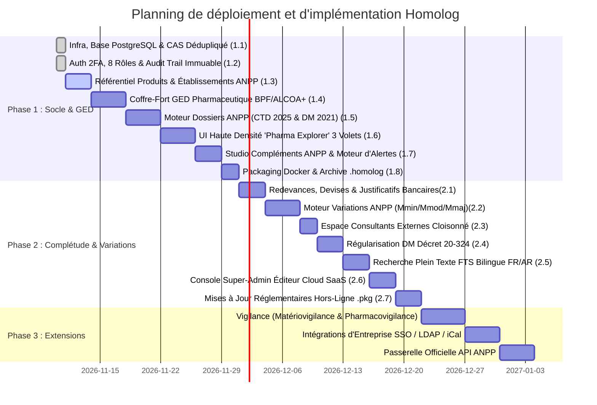

# Feuille de route du projet (Roadmap)
## Plateforme collaborative de gestion de l'enregistrement des médicaments, de l'homologation des DM et GED pharmaceutique en Algérie

**Dernière mise à jour :** 10 novembre 2026  
**Document de référence :** [`docs/cahier_des_charges.md`](file:///c:/dev/homolog/docs/cahier_des_charges.md) (v1.0 - Harmonisation Réglementaire ANPP)  
**Textes réglementaires officiels algériens intégrés :**
- **Guide pour la soumission du Dossier Technique Commun (CTD)** destiné à l'enregistrement des produits pharmaceutiques à usage humain (DEPP/ANPP, Version 01, Date d'effet : 31/07/2025).
- **Ligne directrice relative aux modifications des décisions d’enregistrement** des produits pharmaceutiques à usage de la médecine humaine (Code : `LD-DEPP07/V01`, Version 01, Date : 22/04/2026).
- **Décret exécutif n° 20-325** du 22 novembre 2020 (Modalités d'enregistrement des médicaments).
- **Arrêté du 3 octobre 2021** (Modalités de modification de la DE) & **Arrêté du 7 novembre 2021** (Article 09 : Regroupement de modifications / *Grouping*).
- **Décret exécutif n° 20-324** et **Arrêté du 10 mai 2021** (Modalités d'homologation des dispositifs médicaux).  
**Architecture cible :** Go 1.26+ | PostgreSQL 16+ (`pgx/v5`) | Frontend embarqué TypeScript/Tailwind (RTL FR/AR) | Mode Hybride (On-Premise & SaaS)

---

## Vue d'ensemble des jalons

---

## Phase 1 : Socle Fondateur, GED Pharmaceutique & Parcours 360° (Priorité M)
> **Objectif stratégique :** Disposer d'une plateforme opérationnelle de bout en bout permettant de créer un produit (Princeps, Générique importé, Générique fabriqué localement), monter un dossier d'enregistrement CTD conforme au guide ANPP 2025 (procédures NI, RI, MI, NF, RF, MF) ou d'homologation DM, déposer et signer électroniquement des pièces en GED, et exporter l'archive de réversibilité.

### Jalon 1.1 : Infrastructure, Base de données & Configuration Hybride
- [x] Initialiser l'arborescence Go (`cmd/server`, `internal/{api,domain,ged,regulatory,storage,database,audit}`)
- [x] Configurer la connexion PostgreSQL via `jackc/pgx/v5` avec pool de connexions asynchrone
- [x] Écrire les migrations initiales SQL (Schémas, tables de base, contraintes d'intégrité)
- [x] Gérer la configuration hybride par variables d'environnement (`DEPLOYMENT_MODE=on-premise` ou `saas`)
- [x] Mettre en place le `StorageProvider` (Driver CAS local sur disque chiffré avec hachage SHA-256 et déduplication physique)
- [x] Valider la suite de tests unitaires du stockage CAS (`storage_test.go`)

### Jalon 1.2 : Authentification Forte, 2FA Hors-Ligne, Rôles & Audit Trail (21 CFR Part 11)
- [x] Implémenter le hachage sécurisé des mots de passe avec **Argon2id** et politique de complexité (min. 12 car., minuscules, majuscules, chiffres, caractères spéciaux)
- [x] Développer la gestion des sessions par **Cookies HttpOnly sécurisés** avec table de sessions PostgreSQL pour révocation instantanée
- [x] Développer le second facteur **TOTP (RFC 6238)** 100% hors-ligne (QR code local, Google/Microsoft Authenticator, 10 codes de secours chiffrés)
- [x] Mettre en place le verrouillage automatique de session sur inactivité (Idle timeout 15 min BPF) et protection anti-brute force (5 essais = 15 min de blocage)
- [x] Implémenter la matrice des 8 rôles stricts (Admin Sys, Admin Labo, Affaires Réglementaires, DT, Qualité/Prod, Consultant, Lecteur, Auditeur)
- [x] Créer le flux de **re-authentification pour signature électronique légale** (mot de passe/2FA + déclaration solennelle de rôle BPF/ANPP)
- [x] Créer la table `audit_logs` strictement *append-only* (triggers SQL PostgreSQL interdisant `UPDATE` et `DELETE`)
- [x] Logger automatiquement toutes les actions sensibles (connexion, consultation, téléchargement, approbation, signature, modification de rôle)
- [x] Valider les suites de tests unitaires d'authentification (`password_test.go`, `totp_test.go`, `auth_handler_test.go`)

### Jalon 1.3 : Référentiel Établissements & Produits (Conforme Guide ANPP 2025)
- [ ] **Modèle et tables PostgreSQL pour les Établissements :**
  - Table `establishments` : Raison sociale, statut juridique, agrément ministériel MIPH (numéro, date d'octroi, échéance), coordonnées du Pharmacien Directeur Technique (PDT - 1.A.7).
  - Table `manufacturing_sites` (1.H.8) : Liste exhaustive des sites intervenants, rôle (Synthèse SA, Intermédiaire, Formulateur PF, Conditionneur primaire, Conditionneur secondaire, Laboratoire de contrôle), licences de fabrication (ML 1.M.S.1, 1.M.P.1) et certificats BPF (1.M.S.2, 1.M.P.2) avec dates d'échéance.
- [ ] **Modèle et tables pour les Médicaments (Typologie ANPP Juillet 2025) :**
  - Table `medicines` : Dénomination commerciale, DCI, forme galénique, dosage, voie d'administration, classe pharmacothérapeutique ATC (Code OMS).
  - Classification d'origine : `princeps` (innovateur), `generique_importe`, `generique_local`.
  - Données SA / API : Présence de monographie pharmacopée (Ph. Eur.), détention d'un CEP EDQM (1.M.S.3 / 3.2.S.3), numéro APIMF/DMF, forme polymorphique et criticité granulométrique.
  - Données Produit Fini : Conditions de stockage (°C, humidité), durée de conservation initiale et après reconstitution/ouverture.
  - Références administratives : N° de Décision d'Enregistrement (DE), date d'enregistrement initial, date d'échéance quinquennale.
- [ ] **Modèle et tables pour les Dispositifs Médicaux :**
  - Table `medical_devices` : Dénomination, référence fabricant, classe (I, IIa, IIb, III, DMDIV), stérilité, usage unique, décision d'homologation.
- [ ] Support complet des champs bilingues FR/AR (`name_fr`, `name_ar`, `inn_fr`, `inn_ar`, `presentation_fr`, `presentation_ar`).
- [ ] API RESTful : CRUD établissements, sites, médicaments et DM avec filtrage et pagination.

### Jalon 1.4 : Coffre-Fort GED Pharmaceutique (Standard BPF / ALCOA+)
- [ ] Arborescence standardisée préconfigurée en 5 branches maîtresses :
  - `01_Affaires_Reglementaires` (Agréments MIPH, Décisions DE/Homologation, dossiers CTD maîtres, notices bilingues, courriers ANPP)
  - `02_Assurance_Qualite_BPF` (Manuel qualité, SOP en vigueur, certificats BPF/GMP, rapports d'inspection ANPP, CAPA)
  - `03_Developpement_Production` (Formules cadres, dossiers de lots de validation 3.2.P.3.5, méthodes d'analyse, stabilités Zone IVa/IVb, spécifications)
  - `04_Vigilance_Post_Market` (PSUR pharmacovigilance, matériovigilance DM, retraits de lots)
  - `05_Contrats_Tiers` (Accords qualité QTA, contrats de façonnage/sous-traitance, CEP et déclarations fournisseurs d'API)
- [ ] Gestion du cycle de vie documentaire (*Brouillon* $\to$ *En revue* $\to$ *En approbation* $\to$ *En vigueur* $\to$ *Obsolète*).
- [ ] Gestion des versions mineures/majeures (`v0.1`, `v1.0`, `v2.0`) avec saisie obligatoire du motif de révision et traçabilité.
- [ ] Circuit d'approbation et **Signature électronique légale du Directeur Technique** (avec re-authentification 2FA, horodatage UTC et scellement SHA-256).
- [ ] Téléversement résilient par morceaux (Chunked Upload 5 Mo) et déduplication physique par hash SHA-256 via le driver CAS.

### Jalon 1.5 : Moteur de Dossiers ANPP & Checklists Dynamiques (Guide CTD Juillet 2025)
- [ ] **Générateur dynamique de dossier CTD selon les 6 procédures officielles :**
  - **`NI`** : Enregistrement Initial d’un produit Importé.
  - **`RI`** : Renouvellement de la DE d'un produit Importé.
  - **`MI`** : Modification relative à un produit Importé.
  - **`NF`** : Enregistrement Initial d’un produit Fabriqué localement.
  - **`RF`** : Renouvellement de la DE d'un produit Fabriqué localement.
  - **`MF`** : Modification relative à un produit Fabriqué localement.
- [ ] **Implémentation intégrale de la nomenclature officielle du Module 1 Algérie :**
  - **Sous-module 1.A (Applicant) :** Récépissé de dépôt (1.A.1), Courrier de demande (1.A.2), Formulaire officiel paraphé/signé/cacheté PDT (1.A.3), Bordereau de versement + document bancaire / quittance + attestation de change Banque d'Algérie (1.A.4), Réponse pré-soumission + BV (1.A.5), Agrément MIPH (1.A.6), Décision d'exercice du PDT (1.A.7), Contrats exploitation/façonnage (1.A.8), Historique DE et anciens dépôts (1.A.9).
  - **Sous-module 1.H (Holder) :** Courrier (1.H.1), AMM pays d'origine (1.H.2), Certificat CPP modèle OMS (1.H.3), Structure PCSU ou attestation FOB visée Chambre de Commerce (1.H.4), Benchmark prix (1.H.5 - obligatoire import NI/RI/MI), Approbation pays d'origine (1.H.6), Descriptif mise à jour (1.H.7), Liste des sites intervenants visée (1.H.8), Déclaration de similarité (1.H.9), Déclaration de non-modification (1.H.10 - renouvellements RI/RF), Accord transfert DE (1.H.11), Date d'implémentation pays d'origine (1.H.12).
  - **Sous-module 1.M (Manufacturers) :** Agréments et BPF API (1.M.S.1/2), Lettre d'accès / CEP API (1.M.S.3), Agrément et BPF Produit Fini (1.M.P.1/2), Étude de bioéquivalence ou justification d'exonération Biowaiver (1.M.P.3).
  - **Sous-module 1.P (Product Information) :** Textes pays d'origine RCP/Notice/Étiquette (1.P.1), Modèle Algérie visé PDT avec notice bilingue FR/AR (1.P.2), Échantillons (1.P.3), Bulletins SA avec granulométrie/polymorphisme et recontrôle (1.P.4), Bulletins PF et prémix (1.P.5), Attestation correspondance lots (1.P.6), Certificat libération lot (1.P.7), **Lettre d'engagement de non-commercialisation des lots de validation** (1.P.8 - obligatoire fabrication locale NF/MF), **Lettre d'engagement suivi stabilité PF** (1.P.9 - obligatoire fabrication locale NF/MF).
- [ ] **Règles de complétude Modules 2 à 5 :**
  - Contrôle strict de présence des Modules 2 à 5 pour les Princeps.
  - Dérogation automatisée pour les Génériques : Module 2 incorporé, Module 4 facultatif (`F`), Module 5 centré sur la Bioéquivalence 5.3.1.2 et validation bioanalytique 5.3.1.4.
  - Exigence des dossiers de lots industriels de validation en 3.2.P.3.5 pour la fabrication locale.
  - Support du CEP EDQM avec lettre d'accès en 3.2.S.3.
- [ ] Questionnaire de qualification dynamique **Dispositifs Médicaux** (génération automatique de checklist selon l'arrêté du 10 mai 2021).
- [ ] Liaison dynamique GED $\leftrightarrow$ Checklist CTD/DM avec calcul du pourcentage de complétude en temps réel.
- [ ] **Verrouillage légal strict :** Interdiction de passage au statut *« Validé interne / Prêt pour dépôt ANPP »* si complétude $< 100\,\%$ ou absence de signature électronique du DT.

### Jalon 1.6 : Interface Web Haute Densité 'Pharma Explorer' (3 Volets & RTL FR/AR)
- [ ] Architecture frontend TypeScript / Tailwind CSS / Lucide Icons embarquée via `//go:embed` (zéro serveur Node.js en production).
- [ ] Layout 'Pharma Explorer' à 3 volets façon Windows Explorer Pro :
  - **Volet gauche (Arbre de navigation) :** Navigation hiérarchique dépliable (les 5 modules CTD, rubriques 1.A/1.H/1.M/1.P, chapitres DM ou branches GED) avec badges compacts de complétude (ex: `(4/4)` en vert, `(2/5)` en rouge).
  - **Zone centrale (Vue détaillée) :** Tableau haute densité (lignes compactes de 32px, 25-30 documents visibles sans scroll), colonnes triables, filtrage instantané.
  - **Volet droit (Volet de prévisualisation - Alt+P) :** Prévisualisation PDF.js instantanée avec métadonnées d'intégrité SHA-256 et bouton d'action de signature électronique légale DT.
- [ ] Barre d'adresse fil d'Ariane navigable (`📁 Dossiers > ENR-2026-0042 > Module 1 > 1.P`).
- [ ] Intégration des polices locales `Cairo` (Arabe) et `Inter` (Français) sans aucun appel CDN externe.
- [ ] Bascule bilingue dynamique LTR $\leftrightarrow$ RTL (`dir="rtl"`) avec inversion symétrique des 3 volets.

### Jalon 1.7 : Studio de Compléments ANPP & Moteur d'Alertes
- [ ] Enregistrement des courriers officiels ANPP (date de réception, numéro de référence, motif).
- [ ] Découpage des questions du courrier en sous-tâches unitaires avec assignation à un responsable (Qualité, R&D, Réglementaire).
- [ ] Moteur de compte à rebours légal multi-niveaux :
  - Bandeau d'urgence visuel dans l'application ($J < 30$ jours).
  - Notifications e-mails programmées (J-180, J-90, J-30, J-7).
  - Escalade automatique vers le Pharmacien Directeur Technique si une échéance critique est non traitée à J-30.

### Jalon 1.8 : Packaging, Déploiement & Réversibilité
- [ ] Fichier `docker-compose.yml` de production (PostgreSQL 16 + conteneur binaire Go Homolog).
- [ ] Script d'assistant de premier démarrage (Setup Wizard pour configuration du labo et du premier compte DT).
- [ ] Module d'export / import de l'archive universelle chiffrée `.homolog` (dump base + blobs GED dédupliqués + contrôle SHA-256).
- [ ] Validation de la réversibilité complète (sauvegarde SaaS $\to$ restauration On-Premise 100% fonctionnelle).

---

## Phase 2 : Complétude, Moteur de Variations ANPP & Efficacité (Priorité S)
> **Objectif stratégique :** Intégrer le moteur expert de modifications post-enregistrement selon la ligne directrice ANPP LD-DEPP07/V01 (Avril 2026), la gestion des redevances, la régularisation des DM, la recherche plein texte et le multi-tenant SaaS.

### Jalon 2.1 : Suivi des Redevances Réglementaires & Devises
- [ ] Barèmes configurables des redevances ANPP selon la procédure (**NI, RI, MI, NF, RF, MF**) et la classe de produit.
- [ ] Enregistrement et contrôle des bordereaux de versement (1.A.4), quittances bancaires et attestations de taux de change Banque d'Algérie.
- [ ] Suivi des frais de pré-soumission (1.A.5) et tableau de bord consolidé des coûts d'enregistrement par produit et par an.

### Jalon 2.2 : Moteur de Variations ANPP & Reclassement Automatique (Ligne Directrice LD-DEPP07/V01)
- [ ] **Implémentation du référentiel officiel algérien des variations :**
  - **Mmin (Modification Mineure) :** Impact minime ou nul.
  - **Mmod (Modification Modérée) :** Impact potentiel sur qualité, sécurité, efficacité.
  - **Mmaj (Modification Majeure) :** Répercussions significatives.
  *(Remplacement définitif de la nomenclature européenne Type IA/IB/II).*
- [ ] **Catalogue interactif des 34 rubriques officielles de modifications :**
  - **Rubriques administratives (1 à 5) :** Dénomination commerciale PF (1), Dénomination SA/excipient/conditionnement (2), Code ATC OMS (3), Nom/adresse titulaire AMM/DPSA/fabricant/conditionneur/contrôleur (4), Suppression de sites (5).
  - **Rubriques CEP et préqualification API (6.a et 6.b) :** Fabricant approuvé ou nouveau fabricant (Mmin ou Mmod).
  - **Rubriques qualitatives Substance Active 3.2.S (7 à 16) :** Nouveau site/fabricant API (7 - Mmin/Mmod/Mmaj), Nouveau bloc/unité (8.a - Mmin), Procédé API (9 - mineur Mmod, important Mmaj), Taille de lot API (10 - Mmin/Mmod), Contrôles en cours API (11), Spécifications API (12.a-f), Procédures d'essai API (13.a-e), Conditionnement primaire SA (14), Durée de vie/recontrôle API (15), Conditions de stockage API (16).
  - **Rubriques qualitatives Produit Fini 3.2.P (17 à 34) :** Système d'aromatisation/coloration (17), Masse enrobage/capsules (18.a), Composition formes solides (19 - Mmod/Mmaj), Site de fabrication PF (20.a conditionnement secondaire Mmin, 20.b conditionnement primaire Mmin, 20.c fabrication conventionnelle Mmod), Site de contrôle PF (21.a - Mmin), Taille de lot PF (22 - x10 Mmin, >x10 Mmod), Procédé de fabrication PF (23 - Mmod), Contrôles en cours PF (24), Remplacement excipient risque EST par végétal/synthétique (25 - Mmin), Spécifications/méthodes excipient (26), Monographie pharmacopée PF (27 - Mmin), Spécifications PF (28), Procédures analytiques PF (29), Type de contenant primaire (30 - non stérile Mmod, stérile Mmaj), Composition emballage primaire (31), Durée de conservation PF (32 - Mmod), Durée après première ouverture/reconstitution (33 - Mmod), Conditions de stockage PF (34 - Mmod).
- [ ] **Moteur d'évaluation des "Conditions à remplir" et Reclassement Automatique (Escalade) :**
  - Questionnaire guidé pour chaque modification sélectionnée vérifiant les critères techniques.
  - **Algorithme d'escalade :** Dès qu'une condition n'est pas satisfaite, le système reclasse immédiatement la modification (Mmin $\to$ Mmod ou Mmaj, et Mmod $\to$ Mmaj) et recalcule dynamiquement la liste des pièces justificatives obligatoires.
- [ ] **Générateur du Dossier de Modification ANPP (Section 5.3 LD-DEPP07/V01) :**
  - Production du **Tableau comparatif standardisé** (*État actuel approuvé vs Situation proposée*).
  - Production du modèle officiel d'**Attestation formelle de non-modification des autres sections**.
  - Intégration des pièces requises : lettre officielle signée PDT, justificatif technique, bordereau de paiement, copie de la DE en vigueur, accusés de dépôts en cours, approbation du pays d'origine (si importé), autorisations des sites et certificats BPF/BPL.
- [ ] **Module de Regroupement de Modifications (*Grouping* - Article 09 de l'arrêté du 07/11/2021) :**
  - Création d'une soumission groupée pour un même produit combinant plusieurs modifications interdépendantes.
  - Calcul du niveau de criticité global du groupe (alignement sur la modification la plus sévère du groupe).

### Jalon 2.3 : Espace Sécurisé pour Consultants Externes
- [ ] Cloisonnement étanche : accès restreint exclusivement aux seuls dossiers CTD/DM explicitement assignés.
- [ ] Zéro accès à la GED transverse ou aux autres produits du laboratoire.
- [ ] Date d'expiration de contrat automatique révoquant les accès à l'échéance.
- [ ] Journalisation et marquage d'audit renforcé sur chaque action de consultation ou dépôt par un consultant.

### Jalon 2.4 : Procédure de Régularisation des Dispositifs Médicaux (Décret 20-324)
- [ ] Inventaire des DM déjà mis sur le marché sans décision d'homologation.
- [ ] Checklist spécifique de régularisation selon l'arrêté du 10 mai 2021.
- [ ] Tableau de suivi des mesures transitoires et des échéances de dépôt de régularisation.

### Jalon 2.5 : Moteur de Recherche Plein Texte Bilingue (PostgreSQL FTS)
- [ ] Indexation textuelle automatique des documents PDF, Word (.docx) et Excel (.xlsx) déposés en GED.
- [ ] Moteur de recherche plein texte PostgreSQL (`tsvector`/`tsquery`) supportant les requêtes en français et en arabe.
- [ ] Surlignage dynamique des termes trouvés directement dans la vue tableau et le volet de prévisualisation.

### Jalon 2.6 : Console Super-Admin Éditeur (Mode Cloud SaaS)
- [ ] Interface d'administration multi-laboratoires et suivi du parc d'instances.
- [ ] Provisioning d'un laboratoire en un clic avec schéma PostgreSQL dédié et sous-domaine isolé (`<labo>.homolog.dz`).
- [ ] Gestion des quotas de stockage par laboratoire et suivi de consommation.

### Jalon 2.7 : Mises à Jour Réglementaires Hors-Ligne (.pkg Signés)
- [ ] Format de paquets de mise à jour réglementaire signés cryptographiquement (`.pkg`).
- [ ] Déploiement sans redémarrage des nouveaux modèles de checklists CTD ou fiches de variations émises par l'ANPP.
- [ ] Vue comparative (Diff) entre le modèle de dossier actuel et le nouveau modèle avant application validée par l'administrateur.

---

## Phase 3 : Extensions & Écosystème (Priorité C)
> **Objectif :** Étendre la plateforme à la surveillance post-marché, aux interconnexions d'entreprise et à l'interopérabilité directe avec l'ANPP.

### Jalon 3.1 : Registre de Vigilance Post-Marché
- [ ] Module de Pharmacovigilance (suivi des PSUR, déclarations d'effets indésirables, fiches de notification officielles).
- [ ] Module de Matériovigilance des DM (déclaration d'incidents, signalements de défaillances de dispositifs).
- [ ] Suivi des enquêtes de lot et gestion des rappels/retraits ordonnés par l'ANPP ou initiés par le laboratoire.

### Jalon 3.2 : Intégrations d'Entreprise
- [ ] Authentification unique SSO d'entreprise (SAML 2.0 / OpenID Connect) et synchronisation d'annuaire LDAP / Active Directory.
- [ ] Flux de calendrier réglementaire iCal (synchronisation Outlook/Google Calendar des dates d'échéance ANPP et des renouvellements).

### Jalon 3.3 : Passerelle Officielle ANPP
- [ ] Connecteur d'interopérabilité API dès publication des spécifications techniques de télé-procédure par l'ANPP.
- [ ] Télétransmission automatisée des paquets de soumission CTD scellés.

---

## Guide d'avancement et métriques de suivi

| Indicateur clé | Objectif Phase 1 | État actuel | Conformité réglementaire |
|---|---|---|---|
| **Spécifications fonctionnelles validées** | 100 % | 100 % ([`cahier_des_charges.md`](file:///c:/dev/homolog/docs/cahier_des_charges.md) v1.0) | Aligné Guide CTD ANPP 2025 & LD Modifications 2026 ✅ |
| **Jalons Phase 1 complétés** | 8 / 8 jalons | 2 / 8 jalons complétés (Jalons 1.1 & 1.2 ✅) | Jalon 1.3 en cours d'implémentation |
| **Couverture des tests automatisés** | > 80 % sur le domaine métier & audit | Tests unitaires stockage CAS & Auth validés (100%) | Argon2id, TOTP, Sessions et CAS conformes BPF ✅ |
| **Conformité BPF / ALCOA+** | Validée sur audit trail, GED et signatures | Implémentée (Triggers immuabilité + CAS SHA-256) | Scellement cryptographique et rôles validés ✅ |
| **Nomenclature des Variations** | Conforme LD-DEPP07/V01 | Modélisée (34 rubriques Mmin/Mmod/Mmaj) | Reclassement dynamique & Grouping intégrés ✅ |
